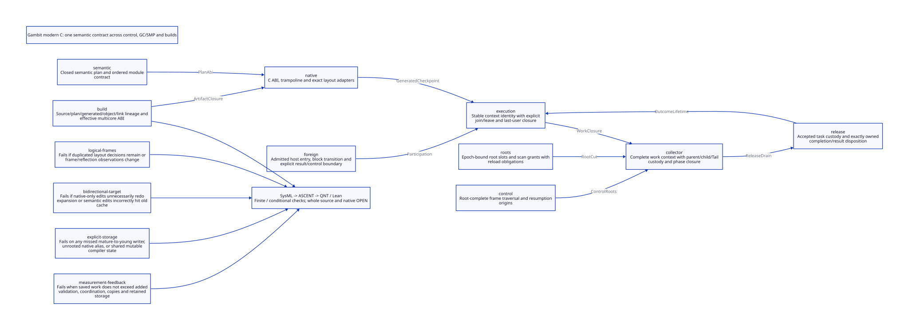

#+TITLE: Amplifying Gambit PVM Advantages Across the Modern C Architecture
#+SETUPFILE: ../../modeling/org/setup.org
#+LANGUAGE: en
#+OPTIONS: toc:3 num:nil
#+PROPERTY: header-args :eval never
#+TODO: RESEARCH DECIDED | ADOPTED RETIRED

* DECIDED Scope: one Gambit architecture, not a marker extension
:PROPERTIES:
:CUSTOM_ID: advantage-architecture
:AUTHORITY: GambitAdvantageArchitecture; GambitModernizationTarget; GambitRuntimeComposition
:STATUS: whole-architecture-design; finite-protocol-checked; source-simulation-open
:MAINLINE: Scheme semantic ownership and modern generated C
:END:

This study extends the [[file:modernization-target.org][six governing replacements]] and [[file:map-multishot-composition.org][joint map/multi-shot witness]].
It references all nine canonical module owners and nine interfaces from
[[file:../../architecture/runtime/models/sysml/composition.sysml][runtime composition]], rather than creating another component inventory.
The [[file:models/sysml/advantage-architecture.sysml][SysML source]] owns four advantage records, six decision references,
twelve cross-module contracts, twenty-three advantage/contract uses, six benefit
rows and seven open scopes. [[file:advantage-architecture-matrix.org][Org matrix]] and  are native projections.
The [[file:../../modeling/ascent/advantage-architecture.rules.scm][actual ASCENT DSL]] joins source witnesses, component endpoints,
interface, action, guard, theorem, paper and obligation identity. It cannot turn
those joins into semantic proofs. Check receipts (local locator: =../../../.cache/research/legacy-evidence/evidence/research/advantage-architecture/checks.json=; unavailable in a clean checkout) distinguish finite protocols,
conditional Lean laws, source refinement, platform qualification and performance.

Modernization means replacing implicit semantic/layout/ownership authorities with
explicit shared contracts, and retiring their old responsibilities. It is not a
new flag profile, additional gate records or a second runtime language. The marker
[[file:../../architecture/toolchain/marker-alias-revocation-design.org][alias/revocation slice]] supplies a subordinate FFI constraint; its local passes
cannot qualify whole GC/SMP, continuation semantics or the compiler service.

* RESEARCH Paper basis and the four amplification decisions
:PROPERTIES:
:CUSTOM_ID: advantage-paper-basis
:PAPER: Feeley-Miller-LFP90
:END:

[[https://www.iro.umontreal.ca/~feeley/papers/FeeleyMillerLFP90.pdf][Feeley and Miller, A Parallel Virtual Machine for Efficient Scheme Compilation]]
§2 describes logical implementation objects and bidirectional target information;
§2.1 separates operand storage classes while retaining a heap-memory alias
exception. The abstract proposes VM measurements to inform representation and
optimization choices. We select these four ideas as architectural advantages.
Our new ownership, GC and build mechanisms below are proposals, not statements
that the paper already defines them. Historical speed comparisons do not quantify
this redesign. PVM futures are not evidence today's SMP or incremental compiler
is already correct or that one continuation may be invoked concurrently.

| Advantage | Required architectural amplification | Failure criterion |
|---+---+---|
| Logical frames | One Scheme-owned FrameSpec/PointId interpreted by every native/root/control consumer | Independent semantic layouts remain or reflective aliases change |
| Bidirectional target knowledge | SemanticProfile before completion; LayoutAbi and ToolRecipe as narrower downstream inputs | A semantic change is reused or an unrelated tool edit forces expansion |
| Explicit storage and alias boundaries | Root domains, remembered writes, context ownership and explicit FFI escape classes | An unclassified writer or raw pointer bypasses required custody/barrier |
| Measurement feedback | Work/span/bytes/space ledgers tagged with exact plan/ABI/dependency cohort | Added barriers, copies, validation or retained storage erase saved work |

The native matrix contains the complete four-by-four mapping to FrameSpec,
continuation, GC/SMP and incremental compilation. The mappings are not independent
projects: their shared contracts must compose before any old authority retires.

* DESIGN Scheme contract compiler and FrameSpec consumers
:PROPERTIES:
:CUSTOM_ID: advantage-frame-contract
:END:

Scheme completes the GVM semantic graph before mechanical C emission. The result
carries FrameSpec, PointId, ModuleSpec, EffectSpec and AllocationSpec in one sealed
cohort. FrameSpec specifies slot identity, pointer kind/liveness per successor,
return/link home, normal/internal-return saved registers, denv origin, exposed
mutation policy and source origin. PointId is semantic occurrence/role/outcome,
not a regenerated C label ordinal. ModuleSpec binds entries, globals, descriptors
and dependencies to the same frame/runtime ABI.

The source seam is real: gsc/_front.scm:331-347 begins/ends environment, parse,
virtual and target state; 397-411 constructs module procedures/descriptors;
435-449 hands them to target.dump and C-interface output. _back.scm:197-238 has
explicit target semantics options, registers, primitive info and frame constraints;
388-419 selects a target and installs process-global callbacks. Current APIs are
not independent compile sessions merely because this seam exists.

_t-c-2.scm:targ-gen-label-return* derives size, variable homes, return link and root
map; _t-c-3.scm emits physical descriptor information. The actual one-list map in
lib/gambit/list/list.scm:850-925 calls the higher-order proc, recurses, then builds
pairs. Stored _std.c return descriptors distinguish callback and recursive-return
live maps. Their common frame size does not justify a single union root mask.
Stored C is source evidence, not newly generated or matched installed code.

| Consumer | Shared FrameSpec use | What remains specific |
|---+---+---|
| Native entry/return | PointId, slot homes, module/frame ABI and tail successors | Target trampoline, register moves, C ABI and portable primitives |
| Collector/root registry | Live pointer slots and current/saved/native root origins | Epoch grants, moving updates and independent scanned storage |
| Capture | Logical live frame closure and denv identity | Stack-backed or heap-backed representation and capture timing |
| Restore/scheduler | Same captured identity, per-shot execution image, reload obligations | Target materialization, exclusive run grant and wind transitions |
| Reflection/serialization | Stable logical coordinates and declared mutable/exposed status | Observation-preserving setters and authority-aware reconstruction |
| Compiler/build/LLVM service | Cohort/schema identity and full semantic effects | Query keys, target legality, dialect lowering and tool invalidation |

This is a target of one semantic authority serving six consumer classes, not a
claim that five measured duplicate implementations or their costs have already
been removed. Existing C portability primitives remain where real target variation
requires them. Semantic inference hidden in macros is the retirement target;
merely translating those macros or adding a schema alongside them does not count.

* DESIGN Repeatable continuation and native effects
:PROPERTIES:
:CUSTOM_ID: advantage-continuation
:END:

Use the existing map witness: an initial traversal captures in its second callback;
two later invocations supply new second values and rerun the suffix. Selected
source expectations remain (10 2 30), (10 20 30), (10 200 30), five callback calls,
three successful suffix native calls and three before/after wind pairs. These are
source-derived expected observations, not executions this turn. General Scheme
map does not impose this evaluation order; the selected Gambit path matters.

Captured logical computation remains repeatable. Each shot obtains a private
execution materialization and fresh native invocation; reachable Scheme objects,
mutable lexical cells and denv identities remain shared. Do not memoize an
effectful suffix, replay a completed native release or restore an expired C catcher.
Continuation reuse is not heap rollback and does not by itself permit simultaneous
cross-processor invocation.

_kernel.scm continuation/frame readers and setters, _io.scm explode/implode-frame,
_thread.scm continuation capture/graft/wind routines and header capture/restore
macros are real consumers. Shared persistent captured storage is eligible only
where observable identity and mutation semantics permit it. Exposed mutable frames
keep a canonical representation and observation-preserving restore until alias
simulation closes. Copy-on-write is a candidate with a proof obligation, not an
assumed universal optimization. Root registration precedes marker allocation and
all other potentially collecting conversions. Current c_intf.c retains the
proc_or_false rooting TODO; raw scheme-object conversion supplies no automatic
borrow lease. Those paths cannot be declared solved by a shared descriptor.

* DESIGN Generational GC and genuine SMP as one ownership architecture
:PROPERTIES:
:CUSTOM_ID: advantage-gc-smp
:END:

Current mem.c contains copying, still allocation, parallel scan queues, barriers
and PSTATE-bound scan/allocation fields. At garbage_collect_mark phase, RC root
scanning is selected in processor-zero branch. This source does not establish a
modern generational collector or complete VM-wide nonzero-processor root coverage.
Neither copying nor multiple collector processors alone implies generational GC.

The target separates ExecutionContext, GCParticipant, CollectorWorkContext and OS
carrier. VM owns membership, heap epochs, root domains and retained native outcomes.
A participant publishes complete updateable root slots after surrendering derived
pointers/borrows. Independent workers own queued/private copy/scan responsibility.
A migrating or exiting worker cannot erase its private cursor, Tail or child work.
The current end_heap_chunk, local/global scanning and idle detection are migration
anchors, not evidence those responsibilities are already carrier-independent.

Select context-local nursery regions and a parallel stopped-mutator minor cut;
retain a separate major-policy interface. All root producers join the closed cut,
including parked native calls through a proven frozen-root adapter. Frame, denv,
pair/vector/global, reconstruction and FFI mature-to-young stores use one barrier
contract: reserve capacity before store or use a preallocated conservative dirty
fallback. Barrier code must not implicitly collect while the value is unprotected.
Overflow becomes a later checkpoint request. Promotion failure retains source
roots/reservations; forwarding visibility does not imply complete initialization.

A mature captured graph can avoid whole-graph traversal on repeated minor rounds
only if ALL incoming roots and mature-to-young writes remain covered. Its root
handle is still visited/updated, remembered regions are still scanned, and major
collection still traces mature liveness. This is a conditional work reduction,
not permission to omit mature roots. Any unmediated FFI/reflection writer uses a
sound conservative mode or blocks that optimization; supported Scheme semantics
must not be silently restricted.

Closure is membership + roots + queued/private/in-flight/derived work, not an
empty queue or idle count alone. Weak processing and foreign cleanup may produce
new work and need their own phase/producer closure. Foreign release leaves the
moving collector critical phase only after rooted custody is accepted by the
release service; callbacks, affinity, descendants and unknown users can prevent
shutdown. Never wait under a root lock for GC or for an owner callback that needs
the same phase to finish. C11 slot publication, release/acquire acknowledgements,
last-use placement and generation wrap must be refined for every actual writer.
The QNT SC abstraction is not that weak-memory proof.

* DESIGN Gambit stages and Gerbil incremental compilation service
:PROPERTIES:
:CUSTOM_ID: advantage-incremental
:END:

Gambit owns semantic correctness, target negotiation, normalized/GVM products and
mechanical native lowering. Gerbil owns dependency queries, phase readiness,
independent compilation sessions, bounded scheduling, cache validation and atomic
multi-output publication. C/native tools are downstream service inputs. This is
primarily gxi/gxc Scheme-module modernization, not Gambit Make/bootstrap tuning.

The real iter chain imports interface/list-builder/iterators into begin-syntax
macros, reexports through iter/api and std/iter, and serves string/misc plus sync/wg.
Their interface names alone do not close executable macro support. Current Gerbil
driver.ss uses with-driver-mutex for import-module and optimize!, writes Scheme
files then queues GSC jobs; std/make.ss already has bounded workers and completion
coordination. Whole-module completion and shared frontend state, rather than a
lack of worker threads alone, constrain useful parallelism.

| Input projection | Semantic plan | C/layout | Native object/link |
|---+---+---+---|
| Source/macro execution support or semantic target option | Revalidate/recompute affected semantic dependency closure | Invalidate descendants unless consumed projection is unchanged | Invalidate affected descendants |
| Physical layout/frame/runtime ABI | Reuse only if no semantic feedback crosses this cut | Recompute affected layout consumers; same cohort across module/GC/restore | Recompile/relink exact ABI consumers |
| Native compiler/tool recipe only | Reuse admitted semantic result | Reuse only with complete emitted-code input identity | Recompute affected compile/link products |
| No relevant change | Validate complete trace then reuse | Validate manifests then reuse | Validate manifests then reuse |

Keys are projected dependency records, not just a monolithic version string:
SemanticKey includes source/read/macro/eval/capability traces, declarations, lexical
identity, source origin and SemanticProfile. LayoutKey adds FrameSpec schema and
physical ABI; NativeKey adds compiler/linker/SDK/ordered argv/env/cwd and dependencies.
An observed dependency change whose consumed semantic projection is equal may cut
propagation only after output encoding and consumer safety reflection are proven.
An unknown native read, mutable alias or unstable snapshot refuses reuse.

AOT can cache interface-construction programs and frozen immutable support.
Stateful module instances, binding identities, owner-thread reader/FFI state and
mutable compiler workspaces still instantiate per admitted session. The two iter
consumers can overlap after complete transformer/support readiness and private
writer closure, without waiting for irrelevant native/runtime artifacts. Process
isolation is an available mechanism; same-VM parallel compilation additionally
requires the Gambit GC/SMP and shared-state contracts above. Neither yields a
promise that twelve cores can be saturated for every dependency graph.

On Darwin the structural aim is less repeated expansion, C generation and parser
input, with stable helper units compiled once per matching cohort and smaller
changed generated units. Modern C alone does not remove SDK/header parsing or
GCC macro cost. Helpers and descriptor data must replace actual generated macro
bodies, with source-level semantic equivalence and artifact keys. Changing Make,
compiler command or core count is insufficient. No Darwin/Linux multiplier or
five-second improvement is inferred without matched future measurements.

* DESIGN LLVM/MLIR remains a decoupled consumer
:PROPERTIES:
:CUSTOM_ID: advantage-llvm
:END:

Export high-level effects, higher-order calls and continuation obligations before
lowering destroys them. A proposed Scheme-aware MLIR dialect can consume the
sealed semantic graph, perform only transformations proven against these effects,
and lower through the same root/frame/module ABI. Arbitrary LLVM optimization
does not know Gambit's GC, multi-shot control or FFI semantics automatically.
Moving GC requires explicit statepoint/root strategy and runtime cooperation;
continuations require legal dispatcher/trampoline or equivalent control lowering.

LLVM service upgrades invalidate transformed products and all relevant derived
ABI/code consumers; pure tool changes need not invalidate a stable semantic plan.
Changed optimization semantics or target information may cross that boundary.
Modern C remains the required portable realization and comparison path. Zig is an
optional mechanical/service implementation only after additional net benefit is
established; it provides no missing collector or Scheme semantics.

* PROOF What the new composition actually establishes
:PROPERTIES:
:CUSTOM_ID: advantage-proof-boundary
:END:

[[file:models/quint/advantage_architecture.qnt][QNT]] couples two participants, two private consumers, repeatable captured
identity, module ABI, remembered mutation, root epochs, copy responsibility,
unknown native outcomes and layered cache invalidation. One cross-domain history
builds/seals, captures, stores a young edge, parks native execution, collects,
reloads/delivers, resumes and reuses the plan after a backend-tool edit while two
consumers are active. These are abstract events with predicate receipts as premises.
The model does not execute map or compute its result lists. Installed old code
cohort is independently pinned; editing a candidate build does not overwrite it.
bindModule requires absence of old runtime roots and debt in this finite slice.
A full concurrent module replacement protocol remains open. Here unknown native
outcome means the status of an already admitted root-safe activation; it never
asserts that an arbitrary raw C writer has stopped. Native borrow surrender and
frozen roots are assumed by the abstract freeze events, not derived by this model.

[[file:models/lean/AdvantageArchitecture.lean][Lean]] proves typed product step/history preservation for resume, remembered
store, guarded start and unknown native reply; separate laws cover module cohort,
cache projection, cut completeness, copy publication and symbolic cost bounds.
Captured identity preservation is by induction over arbitrarily many sequential
shots in that small immutable abstraction. It is not an unbounded proof of Gambit
continuation behavior. The Lean product omits many QNT transitions (notably actual
GC relocation and compiler publication); the full QNT-to-Lean simulation is OPEN.

ASCENT sourcewitness only establishes the exact source hash contains a named
anchor. contractok additionally requires canonical interface endpoints, owners,
action/guard/theorem alignment; useok requires the correct paper and AA-S mapping.
The current study supplies only AA-H/I receipts. Twelve whole-composition scopes
from the six governing decisions remain separate required exact path/hash/scope
receipts, plus IS-S and MAR-S. Even synthetic full AA-H/I/S/E receipts cannot
substitute local fragment scopes for them. Missing owner, wrong guard/source,
missing advantage use, missing whole scope and scope widening controls must block.

| Evidence layer | Current meaning | Still missing |
|---+---+---|
| Native SysML | Canonical references, attributes and cross-contract routing validate | Behavioral or semantic satisfaction is not implied |
| QNT | Finite histories, faulty controls and sampled invariant checks | Exhaustive arbitrary-population proof, fairness and source simulation |
| Lean | Kernel-checked conditional abstract laws and limited product induction | Full QNT transition simulation, frame/root semantic encoding and C11 refinement |
| ASCENT | Exact binding, digest/scope discipline and refusal controls | Truth of source/native receipts is not inferred from filenames or joins |
| Runtime/performance | None run or admitted by this study | Existing full native acceptance and matched consumer campaigns |

* PLAN Joint migration and real retirement
:PROPERTIES:
:CUSTOM_ID: advantage-retirement
:END:

| Gate | Joint producer/consumer migration | Retirement only after |
|---+---+---|
| Semantic contract | Scheme completion + FrameSpec/PointId/ModuleSpec + native emitter/decoder | Every collecting, tail, normal/internal return and module consumer agrees; retire old semantic inference per closed group |
| Root and context | ExecutionContext + RootRegistry + participants + native entry | Nonzero processor scan, allocation-before-root hazards and last-use closure; remove PSTATE as sole retained-storage owner |
| Control and heap | Capture/restore/setter/serializer + barrier + generational minor | Alias/identity/wind observations and every write/promotion path close; retire full mature minor traversal only in eligible profiles |
| Collector work | Queue/private copy/Tail/child accounting + phase finish + resize/exit | Complete producer closure and failure custody; old worker/carrier ownership disappears |
| Native effects | Outcome/ReleaseDrain + actual FFI/device/Tcl callers + scheduler | Nested callbacks, unknown outcomes and descendants settle; retire duplicate inline ownership/cleanup only per migrated caller group |
| Compiler service | Gambit phase API + Gerbil private sessions + query DAG and manifests | Clean/incremental consumer equivalence; retire global writer authority, whole-module-only readiness and authoritative file roundtrips |

Build is a cross-cutting migration lane: contract/schema changes invalidate exactly
its consumers at each gate. Old ABI adapters may temporarily preserve unmigrated
profiles, but must not become a permanent second semantic authority. This research
retires no runtime path by declaration. Failure to identify an actual removed
responsibility falsifies the modernization benefit, even if all local models pass.

* RESEARCH Benefit ledger without invented timings
:PROPERTIES:
:CUSTOM_ID: advantage-net-benefit
:END:

Use disjoint saved-work buckets: semantic/layout support, mature scan, eligible
captured representation, compile/expansion and nonsemantic readiness waits. Charge
shared schema/root/artifact machinery once at its true scope; do not count a helper
removal both as frame savings and build savings. Add per-store barriers, per-minor
roots/remembered/promotion/coordination, per-shot restore/wind/native effects,
per-query validation/instantiation, retained space and integration overhead.

For m minor rounds and clean mature graph size M, avoidable mature-visit work is
at most m*M relative to a baseline that really traverses that graph each round.
If the baseline avoids some visits, subtract them first. Positive return requires
those avoided visits to exceed added barrier, remembered, promotion and coordination
work; peak copy/promotion reserves and unknown native retention are separate space
constraints. No full pause-time upper bound follows from a work inequality.

For k valid backend variants sharing a semantic result with cost F, avoided repeated
frontend work is at most (k-1)*F. It yields positive return only if larger than sealing +
validation + additional instance work. Real semantic changes invalidate reuse.
For unrelated native phase U and independent consumer span B, removing an unjustified
serial gate changes U+B to max(U,B), saving min(U,B) before added coordination.
Graph dependencies and budgets still bound realized parallelism: idealized time is
at least max(W/P, criticalPath), not W/12 for every twelve-core host.

The six native benefit rows include counterconditions and evidence scope. The
scientific result now is a coherent, falsifiable modern-C target with conditional
work bounds and explicit open proofs. No observed speedup, invented person-days,
universal lock-freedom or Zig-specific incremental advantage is reported.

* DESIGN Implementation handoff for the Modern C SMP line
:PROPERTIES:
:CUSTOM_ID: advantage-smp-handoff
:AUTHORITY: GambitAdvantageArchitecture; GambitSharedHeapSmp
:STATUS: design-only; historical-causality-open
:END:

The implementation checkout owns runtime changes and exact-REV acceptance.
This handoff uses the existing [[file:advantage-architecture-matrix.org][advantage matrix]] and
[[file:minor-gc-admission.org][shared-heap admission evidence]].
Darwin build latency has a separate toolchain acceptance path.

** DECIDED Research and implementation ownership
:PROPERTIES:
:CUSTOM_ID: advantage-smp-research-ownership
:STATUS: design-only; no-runtime-authority
:END:

This research work owns DEV architecture, paper-to-source arguments and the
implementation handoff. The concurrent Modern C work owns runtime edits,
build-product mutation and exact-REV acceptance. A new runtime revision requires
source-refinement review before earlier observations qualify that revision.
Shared source visibility does not transfer file or build-directory ownership.

Prioritize amplification of Gambit's precise safepoints, portable logical frames,
shared Scheme objects and multi-shot continuations. Evaluate each proposed
replacement by work eliminated, work added, retained-space bounds and the
conditions needed for correctness. Keep architectural predictions, DEV overlay
observations and production acceptance distinct. Historical wake timing remains
supporting evidence with unresolved causal attribution; it does not determine
the architecture or block preparation of the complete implementation contract.

The next research delivery is the joined safepoint/root/task/phase-close
contract below. It must identify the old authority to retire, every affected
consumer, failure custody and whole-path acceptance. Reuse the existing SysML
obligations and their ASCENT routing. QNT owns concurrent histories; Lean owns
the distinct representation and accounting arguments. Source anchors alone
do not discharge either implementation refinement or native acceptance.

| Order | Gambit capability to amplify | Responsibility to replace | Evidence required before retiring the old path |
|---+---+---+---|
| 1 | Low-overhead polls and precise return frames | Bind each admitted poll to its complete root view and logical resume point. Freeze updates before handing the view to the collector. | Verify the actual generated poll and frame map, including allocation and FFI slow paths. Report poll frequency and request-to-last-park separately from collector and resume time. |
| 2 | Multi-shot continuation with shared Scheme objects | Separate the captured logical frame from per-shot execution storage. Scan and repair canonical root slots by epoch, and reload repaired slots before reentry. | Run map capture and two restores across full GC. Verify dynamic-wind, reflective alias semantics and rooted native effects. Record bytes materialized per shot and reject a missing-slot trace even when another root keeps the object alive. |
| 3 | Parallel collection over precise roots | Dispatch frozen root tasks independently of the carrier. Keep private scan, published children and retirement in one ownership protocol. | Run R=3, W=2 with delayed publication and carrier exit. Require completed scan or retained custody for every root source before resume. Compare scan work, critical-path wait and peak retained space. |
| 4 | Repeated restores without repeatedly walking mature storage | Admit a generational minor only once generated stores, denv and native writers close remembered coverage. Retain full GC fallback and census for the first candidate. | Force overflow and a residual edge with no new write. Require an independent slot oracle and full-GC control. Measure avoided mature slots against barriers, promotion and peak memory. |

Feeley's [[https://doi.org/10.1145/165180.165205][balanced polling]] supplies the low-cost placement idea.
Modern C can amplify that idea by attaching a precise, independently scannable
root contract to the same poll. Native blocking and unadmitted foreign execution
require their own latency accounting. Feeley and Miller's
[[https://doi.org/10.1145/91556.91606][PVM paper]] supplies the logical-frame and target-information boundary.
Current source anchors include =targ-gen-label-return*= in
[[file:../../../vendor/gambit/gsc/_t-c-2.scm::825][_t-c-2.scm]],
worker selection in [[file:../../../vendor/gambit/lib/_mem/root-tasks.inc::639][root-tasks.inc]],
and the strong/weak scan dispatch and retirement in
[[file:../../../vendor/gambit/lib/_mem/collection-round.inc::345][collection-round.inc]].
These anchors define what the implementation must trace at its own REV.

Historical wake experiments are useful discriminators for step 3. The W=2
timing and probe images were linked against historical roles. Their performance
results do not qualify a current PR head. The historical +2.93% causal identity
remains open. The historical gcbench attempt has zero admitted runs. The binding-activation
link retained both tfib inputs despite the new output name. Its successful runs
executed tfib. The sfun-entry executable contains a gcbench descriptor whose
GSTATE and VMSTATE sizes disagree with the compiled setup guard. Status 71
collapses internal setup failures in =lib/main.c= and does not expose the exact
dynamic branch. Future native evidence must bind workload source and generated
objects, compare the linked module tuple to the runtime guard before execution,
and retain the benchmark-specific completion marker. Capture the internal setup
result in a separate diagnostic image if admission still fails.

** RESEARCH Historical outcome accounting and identification boundary
:PROPERTIES:
:CUSTOM_ID: historical-tfib-window-accounting
:AUTHORITY: GambitSharedHeapSmpExecutionControlSources::tfibHistoricalCampaignSensitivity
:STATUS: RETAINED-ROW-RECOMPUTATION; HISTORICAL-COMMON-CAUSE-OPEN
:END:

The existing [[file:../../../evidence/research/retained/modern-c/shared-heap-smp-design/gcc-worker-park-crossover.json][GCC worker crossover receipt]] retains the eighteen no-probe TFIB pairs behind
+2.930296% body time. The following is additive accounting in log space,
not three independent percentage speedups and not a causal mediation result.

| Term | Mean log contribution | Share of observed log contrast |
|---+---+---|
| Collection-count contribution | 0.0087992428992 | 30.4664% |
| Reported per-collection duration contribution | 0.0094853847785 | 32.8420% |
| Outside reported-GC window contribution | 0.0105972084979 | 36.6916% |
| Total | 0.0288818361756 | 100% |

For each paired run, N is collection count, u=G/N is reported mean GC time,
and T is benchmark body time. The exact identity is
Delta T = Delta N * mean(u) + mean(N) * Delta u + Delta(T-G).
Scale each term by log(T_B/T_A)/Delta T and average the eighteen pairs.
The exponential of their sum minus one gives the retained +2.930296%.

Current =garbage_collect= records GC time before =prepare_mem_pstate=,
=reopen_rc_roots=, =root_round_end= and the final member barriers. Therefore
changing only final wake, with earlier work held fixed, cannot directly explain
the two in-window terms. This does not exclude an indirect wake effect on
next-round requests, combined contributors, available headroom or collection
count. A report residual is not exclusively OS wake or mutator CPU.

The historical argv requests p3 without an admitted W=2 marker. Keep that
contrast separate from explicit R=3/W=2 overlay runs and their map/PBT controls.
Likewise, source bytes retained in Git do not recover the original executable
pair or prove its build cohort. The source-bound implementation handoff may
advance while this historical causal question remains open; it neither earns
historical speedup credit nor blocks the five current delivery gates.

#+NAME: historical-tfib-window-accounting-replay
#+BEGIN_SRC python :dir ../../.. :python .venv/bin/python :eval never :results output
from pathlib import Path
import json, math
receipt = json.loads(Path("evidence/research/retained/modern-c/shared-heap-smp-design/gcc-worker-park-crossover.json").read_text())
historical = receipt["historicalExactBodyReplayAdmission"]
rows = historical["logCostAccounting"]["rows"]
keys = ("countLogContribution", "meanDurationLogContribution",
        "outsideReportedGcLogContribution")
assert len(rows) == 18
for row in rows:
    assert math.isclose(sum(row[k] for k in keys), row["bodyLogRatio"],
                        rel_tol=1e-10, abs_tol=1e-12)
means = {k: sum(row[k] for row in rows) / len(rows) for k in keys}
body = sum(means.values())
assert math.isclose(math.expm1(body)*100,
                    historical["allPairs"]["geometricPct"], rel_tol=1e-12)
print(json.dumps({"bodyChangePct": math.expm1(body)*100,
                  "logContributionSharesPct": {k: v/body*100 for k, v in means.items()},
                  "causalAttribution": "OPEN", "newNativeExecution": False}))
#+END_SRC

** DESIGN Separate phase arrival from release and resumption
:PROPERTIES:
:CUSTOM_ID: advantage-smp-critical-path
:STATUS: source-anchored-observation-contract
:END:

Use the frozen membership to identify R and the published collector assignment
to identify W. Key each observation by VM lifetime identity, frozen epoch, phase,
and participant or worker identity as appropriate. The R participants give the
barrier roster. Only the W collector workers contribute scan and queue events.
A single carrier may supply both roles. Treat missing roster members, reused
identities and unmatched epochs as incomplete observations.

| Source cut | Required observation | Failure it distinguishes |
|---+---+---|
| =end_heap_chunk= and =take_heap_chunk= in [[file:../../../vendor/gambit/lib/_mem/heap-sections.inc::267][heap-sections.inc]] | Publish, claim and transferred chunk identity, or explicitly record busy versus observed-empty | Work may exist while an idle candidate cannot observe it |
| =scan_complete_heap_chunk= and local frontier in [[file:../../../vendor/gambit/lib/_mem/object-scanning.inc::282][object-scanning.inc]] | Scan completion and any still-owned frontier or child responsibility | An early arrival can wait on actual scan work or on undisclosed custody |
| =mark_reachable_from_marked= in [[file:../../../vendor/gambit/lib/_mem/collection-round.inc::23][collection-round.inc]] | Final local scan, final remote observation, idle decrement and zero-worker decision for each strong or weak phase | Worker park, stealing overhead and phase termination have distinct causes |
| The final barrier after =root_round_end= in [[file:../../../vendor/gambit/lib/_mem/collection-round.inc::461][collection-round.inc]] | Per-participant arrival and exit, release bracket and acquire, followed by first admitted Scheme instruction | Collector completion, delivery, reacquisition and actual Scheme resumption differ |

For one fully observed phase let A be first barrier arrival, L last barrier
arrival, X last barrier exit, and S the latest first-Scheme resumption among the
same participants. When these cuts are ordered, report A→L, L→X and X→S
as disjoint intervals. If a participant resumes Scheme before X, X→S is only
the global tail after the last exit. Also report each participant's own
exit→first-Scheme interval to show overlap. Never sum inclusive carrier wait
or per-worker queue spans into this wall-clock partition. A receiver's release
bracket to acquire interval can include lock reacquisition and scheduler
delay. It needs an independent scheduler observation for an OS-only claim.

Causal acceptance needs a single source-level treatment, the same source cut
in both historical roles, and independent no-probe runs with validated workload
and layout identity. If the changed release action is observed after L, its direct same-round
effect starts in L→X or later. It cannot directly charge time to an earlier
completed GC reporting interval in that round. A cross-round explanation must
show the predicted response on a verified successor epoch and survive both
execution orders. Preserve actual scan/claim and root-custody coverage in
map/PBT before inferring a scheduling improvement. The existing QNT protocol
owns work custody and termination interleavings. The existing Lean obligations
own frame/root representation and coverage. Timing and source-to-event
correspondence belong to native evidence.

** DESIGN Account for collection frequency before selecting a worker policy
:PROPERTIES:
:CUSTOM_ID: advantage-smp-collection-frequency
:STATUS: source-anchored; trigger-attribution-open
:END:

The prespin ablation reports the same total gcbench allocation in both arms,
but collection counts rise from 37 to 58 in AB and from 49 to 58 in BA.
Total allocation does not identify when a local limit fails or how requests
are combined. The finalizer of the previous round also establishes capacity
for the next allocation interval.

| Cut | Required evidence |
|---+---|
| [[file:../../../vendor/gambit/lib/_mem/allocation-limits.inc::341][Heap and stack section limits]] | At a GC-causing miss, record the context, local cursor and limit, reusable section availability, and the shared estimate read under the allocation lock. Separate successful refill and refused refill. |
| [[file:../../../vendor/gambit/lib/_mem/object-allocation.inc::136][Still allocation]] and [[file:../../../vendor/gambit/lib/setup.c::1346][GC request construction]] | Preserve the origin and requested still words. A zero-word request is insufficient to identify a heap-limit trigger because stack and explicit paths can also request zero. |
| [[file:../../../vendor/gambit/lib/setup.c::1159][Collective operation dispatch]] | Join contributing requests to the admitted VM round. Count unique dispatched rounds separately from requests and rejected or superseded attempts. |
| [[file:../../../vendor/gambit/lib/_mem/capacity-resize.inc::79][Heap resize]] and [[file:../../../vendor/gambit/lib/_mem/memory-lifecycle.inc::74][context limit preparation]] | Record live movable and still occupancy, section/restore reservations, overflow reserve, resize outcome and post-resume headroom. Join that state to the next allocation miss on the same VM. |

The approximate free-space expression subtracts assigned section capacity,
occupied still words and overflow reserve from heap size. It does not use the
benchmark-wide allocation total. A different grant layout or live-set history
can therefore change trigger frequency under equal reported bytes. Competing
requests can also change the ratio of requests to rounds. These are source-based
possibilities. The existing timing images do not identify which occurred.

For acceptance, compare trigger mix, bytes between admitted rounds, post-resume
headroom and scan work per round under the same budget and collector. Preserve
separate no-probe throughput runs. This extends the existing native observation
contract; the QNT and Lean obligations remain the existing ones.

*** DESIGN Join request provenance through the actual combining cut

The [[file:../../../vendor/gambit/lib/setup.c::551][synchronization tree]]
adds =arg[0]= for equal =OP_GARBAGE_COLLECT= operations and selects the
higher-priority operation when they differ. The sum represents still words,
so two zero-word contributors look exactly like one zero-word contributor.
The surviving =sid= also loses the other identities. The lifecycle request
counter in =on_all_processors= is a lifetime guard for the service loop and
does not count GC contributors.

In [[file:../../../vendor/gambit/lib/setup.c::1196][execute_sync_op_loop]],
a requester retires its local operation when the selected operation matches
and the requester either won or the operation is combinable. A losing GC
request remains pending through a higher-priority operation. Capture the
offer and selected operation before =execute_sync_op= mutates =arg[0]= into
the result, and retain the per-requester match decision. An observer can
reconstruct the exact contributors from these participant events without
adding a new field to =___sync_op_struct=. Scope the receipt to VM lifetime,
service exchange, iteration and requester identity. Missing participants or
a changed roster without a closed handoff make contributor attribution
unknown.

Join the selected dispatch to its actual GC invocation. The resize capacity
branch calls =___garbage_collect_pstate= directly inside the resize operation,
so a completed GC may have no top-level =OP_GARBAGE_COLLECT= contributors.
Also keep a selected dispatch, frozen GC epoch, planning acceptance and
reported completion distinct. The lifecycle rejection and pre-copy refusal
paths return before the coordinator increments =nb_gcs=. Count only the
coordinator's reported completions when reconciling benchmark output.

The decisive comparison keeps allocation trigger origin, contributing
requests, selected operations and completed rounds as separate counts. This
distinguishes more allocation misses, less combining, internal resize GC,
and early refusal. It also avoids treating faster service-loop resumption
as a measured change in collecting work.

*** DESIGN Keep binding authority separate from final notification

The historical =a9b896c4= implementation closes the binding view in
=root_round_freeze= under each member's RC lock. This is R owner operations
within the reported GC interval. The immediate work is a view clear, but
the cost that can affect elapsed time includes the lock-held interval and
the last member's arrival at the freeze barrier. Measure both. Do not add
the R overlapping owner intervals to estimate a wall-time contribution.

The successful end path is asymmetric. Processor zero validates all restored
members, then detaches each RC domain and calls =___binding_context_admit=
for its owner in sequence. Admission checks VM phase, lifecycle entries,
RC owner and phase, and detached-round state. The historical caller ignores
the return, so a measurement must distinguish a refreshed view from a
rejected one. This R-member serial path starts after the GC statistics cut
and before the final synchronization release. A fast exit with a rejected
refresh is not a successful performance sample.

| Observation | Distinguishing prediction |
|---+---|
| Freeze lock acquisition, view clear, unlock, and last arrival | A freeze-path increase belongs to pre-report GC and may grow with member contention. |
| Coordinator root-round-end entry and exit, with per-member admission outcome | Increased coordinator work before final release can delay the peers' exit without slowing notification transport. |
| Actual final release bracket, receiver acquire, and first Scheme reentry | A direct notification effect occurs after the corresponding release cut and must be separated from the coordinator prefix. |

Pair within a revision before comparing the role-level gaps. Use the same
boundary probes for both roles, even where a role has no binding view.
A timing-only overlay must preserve all original close and admit decisions.
The =map= restore and native-root PBT controls must pass with no stale view
after successful GC, no forwarding or copy publication on refusal and no root loss at owner
exit. In a pre-copy refusal, an eligible owner may be readmitted after the
round is detached. Record that disposition separately from successful GC.

*** DESIGN Replay retained native observations

From the SMP repository root, the existing reader verifies archive and trace
hashes and applies required wait-exposure parsing.

#+begin_src sh
.venv/bin/python dev/refactoring/modern-c/tests/read-gc-pause.py   --replay-final-archives   evidence/research/retained/modern-c/shared-heap-smp-design/gcc-worker-park-crossover.json
#+end_src

All 56 archived traces replay. Forty have a separately declared accepted epoch
count checked against the reader. Sixteen declare a successor-pair or complete
slot count instead, so replay reports their epoch count with
=epochCountDeclared=false=. Their raw hashes, identity and exclusions remain
checked. Mutation controls remove a wait-return event, set probe overflow or
misalign a receiver epoch; each prevents the affected observation from qualifying.
Replay validates observation integrity and preserves the historical-source
acceptance boundary.

*** DESIGN Gate holders and termination coverage

All source-level chunk gate acquisitions in the inspected collector occur
in =take_heap_chunk= or =end_heap_chunk=. A thief holds the victim gate only
through its head update and chunk-claim transition, then unlocks before
calling =scan_complete_heap_chunk=. A publisher holds its own gate through
payload/link publication and tail update, then unlocks before signaling.
Neither gate-held region directly reaches the idle decrement or condition
wait. Publication can also occur while the root source or weak-will phase
runs before the local scanning loop; both phase counters are initialized to
the chosen W before these paths.

Under the additional premise that a gate holder stays counted through that
region, failed own-gate CAS implies another counted worker at that instant.
The failed CAS alone therefore does not establish that this idle decrement
can reach zero. This observation is compatible with the native busy-before-idle
counts and with the existing QNT counterexample's deliberately omitted
localDrained guard.

A complete termination argument still needs continuity after unlock. The
last gate holder may transfer one chunk to private scanning while more
queued chunks remain. Each remaining item must retain counted custody until
the last idle decision or an authoritative drain. An empty observation can
be invalidated by publication. Track queued responsibility after unlock,
rather than extending gate ownership over unrelated scanning. Exceptions,
unknown worker exit and phase transitions require the existing last-user
and work-closure obligations. This is a conditional source argument; the
native counter observations do not establish it.

*** DESIGN One phase-close responsibility for the runtime implementation

Use the existing =mark_reachable_from_marked=, =take_heap_chunk= and
=end_heap_chunk= entrypoints as the implementation boundary. The replacement
must preserve the following joined conditions.

| Boundary | Required authority | Concrete consumer and acceptance |
|---+---+---|
| Before a chunk becomes visible | A live counted producer owns its queued descendants until transfer | The publication gate orders payload and links before availability. Delayed notification cannot erase that producer responsibility. |
| A take returns | Acquired work has exactly one claimant; confirmed empty has a valid observation; busy retains earlier custody | Own drain must distinguish busy from empty. A thief may skip a busy victim while retaining its own active status. Lost-return query is keyed to the exact VM, phase and claim. |
| Worker decrements idle count | Its private frontier, still chain, active chunk and Tail are drained, and every other live item has a counted custodian | The DEV field counters are observations of this cut. The implementation must establish the same predicate with synchronization and source coverage. |
| Count reaches zero | Every private, queued, claimed and pending child obligation is closed | The count is a projection of counted producers. It is not an independent substitute for custody. Keep the existing work-closure QNT and conditional Lean algebra as the proof owners. |
| Strong phase advances | The strong epoch is closed and old publication/claim authority has ended | =root_round_finish_scan= follows the strong-scan member barrier. Weak wills can produce new work under the weak phase, so zero strong count cannot authorize final collection retirement. |
| Weak phase closes and roots resume | Weak work and pending slot repairs are complete; R member roots remain retained through restoration | Preserve the repaired-slot test cut before continuation restoration and still reclamation. W scans R sources; the roster cannot be inferred from worker count. |
| A worker exits or its result is unknown | Root tasks, private frontier, claims and notification resources retain an identified custodian | A physical carrier exit or join status cannot synthesize work completion. Use existing lifecycle retention and source last-user obligations before releasing storage. |

These conditions should be accepted together with the current full collector,
map two-resume control and native PBT histories. A fault campaign must combine
busy own drain, a delayed publication, lost committed claim result and a
phase transition without erasing responsibility. The existing separate tests
supply starting witnesses; they do not establish this joint C refinement.

The existing baseline fixed steal loop remains a performance reference. Any
replacement needs independent no-probe tfib and gcbench comparisons, per-round
trigger/capacity attribution and retained peak-space accounting. A scan wait
reduction or a notification microsecond improvement alone cannot qualify the
whole replacement. The present evidence supports investigating this joined
boundary while historical +2.93 percent causal identity remains open.
