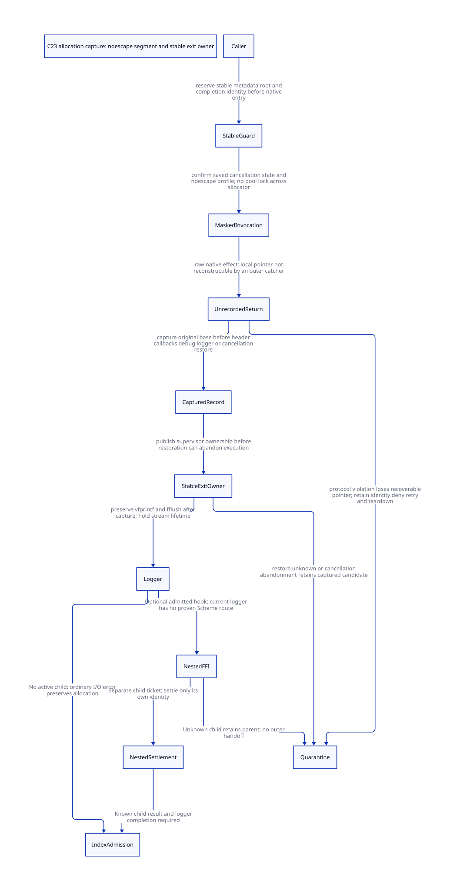

#+TITLE: Native allocation capture, nonescaping windows and stable completion guards
#+SETUPFILE: ../../modeling/org/setup.org
#+LANGUAGE: en
#+PROPERTY: header-args :eval never
#+STARTUP: overview

* RESEARCH Architectural decision
:PROPERTIES:
:CUSTOM_ID: allocation-capture-guard
:BASELINE: C23
:AUTHORITY: GambitAllocationCaptureGuard
:STATUS: source-grounded conditional design; native admission denied
:END:

A guard outside =alloc_rc= cannot close the debug-logging window inside
=alloc_mem=. The managed allocator successor must receive a previously issued
stable ticket and capture the raw allocation base before diagnostic I/O, header
initializers that may call out, or restoration of cancellation. Publish a stable
completion owner before any operation that may abandon the current activation.

This is a boundary refactor, not a debug flag recommendation. Plain and debug
profiles need the same ownership contract. Moving two explicit stdio operations
after capture removes them from the unrecorded-pointer segment; it does not
remove their total work or prove the allocator internals are nonescaping.

There is no current qualified issuer for this guard. Existing SFUN markers,
catchers and resize cancellation masks serve different purposes. The design
must reject unmediated allocator hooks, nonlocal jumps or thread cancellation
that can abandon an unrecorded result. Quarantine prevents unsafe retry; it
cannot reconstruct a lost pointer or guarantee eventual VM shutdown.

The parent [[file:allocation-ticket-handoff-design.org][ticket study]] and its
historical evidence remain unchanged. This work changes models and research
only; no runtime implementation, generated native program, preprocessing,
native test or performance measurement is performed.

* RESEARCH Actual paths and reachability limits
:PROPERTIES:
:CUSTOM_ID: capture-real-paths
:END:

** Native allocator and logger

[[file:../../../vendor/gambit/lib/_mem/rc-allocation.inc][The RC wrapper]] calls
=alloc_rc_no_register=, which calls =ALLOC_MEM= and initializes refcount/data
before returning. It then conditionally registers the block. The current private
header contains no stable attempt identity and its list links are uninitialized.

[[file:../../../vendor/gambit/lib/os_base.c][The native allocator]] calls malloc
in its default branch. Under both allocation-debug and log-debug conditionals,
it updates the allocation counter and calls =___printf= before returning.
The logger chooses =___base_mod.debug= or stderr, calls =vfprintf=, then
=___fflush=; that wrapper calls native =fflush=. The flush return is ignored;
the allocation caller also ignores the logger return. Ordinary stdio failure
therefore does not change a successful pointer into NULL or call Scheme error
propagation in these bodies. The non-Win32 allocation-debug counter uses a plain
increment. A future concurrently admitted debug profile must also qualify shared
counter updates and census reads; adding a capture guard does not make those
operations C23 race-free. No concurrent native execution of this branch is claimed.

The stream's actual producer is base-module setup: =fopen("gambit.log","w")=
with stderr fallback. Base cleanup closes the non-stderr stream. The inspected
[[file:../../../vendor/gambit/lib/os_base.h][FILE typedef and stdio adapters]]
do not dispatch through a Gambit Scheme output port. No direct logger-to-Scheme
callback is established. A custom FILE, symbol interposition, libc hook or
external signal handler needs separate evidence and explicit admission.

[[file:../../../vendor/gambit/lib/os.h][os.h]] spells =___DEBUG_LOG_not=; this
is not a definition of =___DEBUG_LOG=. Its spelling also cannot rule out a
command-line definition. The generated header's C++ cleanup branch is guarded
by =__cplusplus=; the C branch selects setjmp. Textually finding both definitions
in a generated header does not prove both effective. This study does not issue
an effective Darwin/compiler/loaded-libc profile receipt.

The public Apple [[https://raw.githubusercontent.com/apple-oss-distributions/Libc/main/stdio/FreeBSD/vfprintf.c][vfprintf source]]
has a stream lock and internal hooks. Its [[https://raw.githubusercontent.com/apple-oss-distributions/Libc/main/stdio/FreeBSD/makebuf.c][buffer setup]]
can allocate; the inspected fixed logger format does not itself establish
reachability of every generic formatter allocation branch. [[https://raw.githubusercontent.com/apple-oss-distributions/Libc/main/stdio/FreeBSD/fflush.c][fflush]]
uses the stream machinery; [[https://raw.githubusercontent.com/apple-oss-distributions/Libc/main/stdio/FreeBSD/stdio.c][stdio.c]]
ultimately dispatches via a FILE writer. [[https://raw.githubusercontent.com/apple-oss-distributions/Libc/main/stdio/FreeBSD/fopen.c][fopen]]
installs native writer functions. These moving public sources explain why stdio
is not automatically a leaf operation. They are not a version match to the
local dyld cache, nor evidence of an actual Scheme logger callback.

** Real nested FFI and nonlocal transfer

The [[file:../../../vendor/gambit/examples/tcltk/tcltk.scm][Tcl adapter]] contains
a real source-composable chain:

#+begin_example
Tcl_Eval -> registered scheme_call_cmd -> generated tcltk_call
 -> ##tcltk-call -> ##apply proc args
 -> an exported proc invoking ##tcltk-export-procedure
 -> ##tcltk-define-procedure -> alloc_rc(0)
#+end_example

An exported procedure can also invoke Tcl evaluation again. This is a legal
source-level nesting witness using the public example's procedures, not a
claim that a matched generated object was executed. The header still exists
when native payload length is zero.

[[file:../../../vendor/gambit/gsc/_ptree2.scm][c-function and conversion generation]]
emits BEGIN_SFUN, SFUN_CALL and error-conversion paths. The
[[file:../../../vendor/gambit/include/_gambit/foreign_conversion.h.in][SFUN macros]]
create a marker, call =___call=, can call the Scheme conversion-error handler,
invalidate the marker and propagate a nonzero error. In the C setjmp profile,
THROW transfers to the current catcher. The ordinary C BEGIN/END_CLEANUP body
is sequential cleanup text, not automatic cleanup on every raw longjmp.

[[file:../../../vendor/gambit/lib/setup.c][call]] creates the return-to-C frame,
restores through its catcher and may throw again. =run= has a surrounding
catcher and invalidates its marker after the protected call. These are real
control-transfer endpoints; they do not settle native allocation tickets.
[[file:../../../vendor/gambit/lib/c_intf.c][Marker creation]] allocates a Scheme
vector and then reloads the procedure from a supplied slot. The raw legacy
wrapper's local slot is not thereby registered as a GC root. Marker invalidation
protects a C return extent; it is not an allocation completion receipt.

The nested Tcl chain does not establish that nested Scheme execution occurs
between malloc and return in the current plain allocator. Likewise the existence
of THROW does not establish a direct logger-to-THROW edge. Those compositions
remain unqualified rather than being reported as current native bugs.

** Existing cancellation callers

The resize coordinator and resize-root request in setup.c call
=pthread_setcancelstate(PTHREAD_CANCEL_DISABLE,...)= and check its result before
their protected work. The latter preserves the saved state for restoration.
No analogous call appears in the inspected RC allocation/alloc_mem path.

The public Apple [[https://raw.githubusercontent.com/apple-oss-distributions/libpthread/main/src/pthread_cancelable.c][cancellation source]]
updates thread state and calls an internal cancellation entry when enabling or
disabling. Qualification must include that entry and the actual binary. This
study does not infer that restoration always returns, or that disabling
cancellation also blocks signals, Scheme exceptions, raw longjmp or thread exit.

* RESEARCH Stable guard issuer and admission contract
:PROPERTIES:
:CUSTOM_ID: capture-issuer
:END:

** Issuance and bootstrap

The proposed issuer is a VM stable AttemptRegistry, bound to an admitted native
thread/session and independent of Scheme continuation frames. It reserves a
nonallocating guard record, result capacity and registered source-root carrier
from the previous study's resource bundle. The issuer records the semantic
operation, allocator profile, source/root owner, VM/module incarnation, original
cancellation state and the designated stable completion owner. It issues no
receipt on the basis of an address-only lookup.

Before invocation, the request must already have registered Scheme input roots,
VM/module lifetime authority and a nonallocating root/guard capacity reservation.
Entering from a raw SFUN does not satisfy this condition. The bootstrap segment
must itself have a qualified nonescaping entry profile. Arbitrary asynchronous
cancellation during registry mutation cannot be repaired by a guard that is not
yet registered. Existing managed session discipline or a separately qualified
thread-admission adapter is required; unsupported entrants are refused.

The finite model's =issue= and =cancelBeforeMask= assume atomic registration and
supervisor-managed metadata cleanup respectively. They are not a proof that a
POSIX cancellation handler or C longjmp automatically performs that cleanup.
The real issuer, every-GC carrier adapter and bootstrap failure cleanup are
native gaps.

** Critical segment and publication

1. Reserve and publish the stable attempt and source-root binding. Complete any
   metadata allocation outside the segment; hold no pool/index lock across malloc.
2. Confirm cancellation suppression under the effective thread profile. Failure
   must occur before invoking the allocator. Save the exact previous state.
3. Invoke the qualified raw allocator. A synchronous NULL is a known result.
4. For success, copy the original allocator base, checked extent and allocator
   provenance into the stable record, then release-publish CAPTURED. No logger,
   Scheme allocation, FFI callback, cancellation restoration or nonlocal jump
   is admitted between the native return and that publication.
5. Publish responsibility in a stable completion owner that can survive thread
   exit and catcher transfer. A reader needs acquire plus a live record pin;
   a release/acquire edge alone does not keep the backing or descriptor alive.
6. Restore saved cancellation only after that owner is visible. Restoration may
   fail or never return. In both cases the completion owner already owns the
   captured candidate and source-root debt; no post-restore statement is needed
   to reconstruct custody.
7. Perform the existing synchronous logger under a process-base stream lease.
   Its ordinary negative return leaves allocation semantics unchanged. Then
   request index admission using the same stable operation identity.

The required insertion point is inside a successor to the native allocator
adapter, immediately after its raw allocator returns and before debug logging.
Calling the current alloc_mem unchanged and capturing in its caller is too late.
This also requires the managed RC constructor to accept the ticket and distinguish
private header initialization from list publication. The generic raw allocation
API may remain explicitly unmanaged; it cannot silently receive managed status.

C23 checked arithmetic must establish header-plus-payload extent before step 3.
C23 5.1.2.4 and 7.17 describe publication mechanisms, not an atomic transaction
with malloc. Longjmp rules in 7.13 also mean that changing a nonvolatile automatic
local around setjmp is not a stable recovery scheme. No volatile qualifier can
recreate a pointer that was never recorded. See the public
[[https://www.open-std.org/jtc1/sc22/wg14/www/docs/n3096.pdf][C23 working draft]].

** Nested activation, continuation and exit responsibility

A callback admitted after capture obtains its own operation and guard; it pins
the parent's record without overwriting it. Returning or throwing from the child
settles only the child's identity. An unknown child result prevents outer handoff
and retirement. The parent completion owner retains both the parent dependency
and unresolved child authority.

Real continuation execution is different from redelivery of an old response.
A fresh execution needs a fresh guard outside restored frames. Retried delivery
queries the original operation. The SFUN marker cannot provide this distinction.
The guard stack must restore each level's saved cancellation state, including
already-disabled entrants; restoring ENABLE unconditionally is incorrect.

The current finite model starts with cancellation enabled and represents one
nested activation as an abstract outstanding/settled/unknown capability. It does
not model that child's allocator, cancellation-state stack, arbitrary nesting,
fresh execution identities or multi-shot continuation in full. Those are named
refinement obligations, not completed native guarantees.

The process-base logger stream has a lifetime separate from VM/root custody.
Base cleanup must close admission and wait for active stream leases; holding a
VM ticket alone does not protect FILE from fclose. No pool lock may be retained
while waiting for stdio, a callback, GC or the child's completion.

* RESEARCH Unknown results and counterexamples
:PROPERTIES:
:CUSTOM_ID: capture-unknown
:END:

| Window | Defensible owner/result | Forbidden inference |
|--------+-------------------------+---------------------|
| Before native invocation | Stable metadata owner; no native allocation effect | Raw cancellation automatically cleans registered metadata |
| Native invocation abandoned | Quarantine owns uncertain operation and root debt | Unknown is NULL; replay allocator |
| Pointer local, not published | Same quarantine; pointer recovery is not established | Outer catcher can reconstruct raw base |
| Captured, restoration abandoned | Stable completion owner retains known candidate | Restore must return before custody exists |
| Logger returns an I/O error | Candidate still allocated; preserve ordinary result behavior | Logging error implies allocation failure |
| Nested callback outcome unknown | Parent owner plus unresolved child dependency | Parent may commit/retire as though child returned |
| Index response lost | Query original operation; retain backing and source root | Private free while publication may have committed |

Concrete protocol counterexamples retained by the formal controls:

- Dropping the guard on an unrecorded escape loses responsibility even though
  the allocator effect may exist.
- Starting logger state with CAPTURED false violates the required cut.
- Reusing the parent's guard slot for a nested activation loses parent custody.

These are altered model updates, not witnessed bugs in an executed Darwin binary.
A raw escape edge exists in the main model precisely to expose the difference
between retained uncertainty and impossibility of abandonment. =NormalStep=
excludes the two raw escape edges as an admission premise. Its theorem shows
no new lost-pointer state under that restricted relation; it does not prove
that Gambit's current allocator or all foreign callers implement the restriction.

* RESEARCH Source to formal refinement and closure
:PROPERTIES:
:CUSTOM_ID: capture-model-chain
:END:

[[file:models/sysml/allocation-capture-guard.sysml][Native SysML authority]] defines
capture, logger and FFI responsibilities, path classifications, sources, actual
and proposed issuers, QNT actions, Lean obligations and gain rows.
[[file:../../modeling/ascent/allocation-capture-guard.rules.scm][Actual ASCENT DSL]]
joins exact source hashes/needles, component ownership, action/lemma routes,
issuer observations and reachability classifications. A negative control changes
the logger classification to an invented proven Scheme callback and must fail.
Synthetic complete receipts are explicitly not current native evidence.

[[file:models/quint/allocation_capture_guard.qnt][Quint]] includes separate guard
registration, mask confirmation, invocation, local return, capture, stable exit
owner, restoration, logger, nested activation and index handoff transitions.
Known NULL restoration has its own outcome; it is not allocator uncertainty.
The [[file:../../modeling/tools/allocation-capture-guard-projection.py][restricted typed-IR projector]]
produces [[file:models/lean/AllocationCaptureAst.lean][Lean AST]].
[[file:models/lean/AllocationCapture.lean][Lean]] proves finite state preservation,
reachable safety, parent retention, logger-after-capture, known handoff and the
conditional NormalStep property. Source, JSON/parser and projector remain trusted.

| Refinement obligation | Concrete cut | Current closure |
|-----------------------+--------------+-----------------|
| Registration | Stable owner publication before native call | Abstract issuance only; native signer absent |
| Capture | Raw malloc return to CAPTURED release publication | Explicit model interval; actual nonescaping profile open |
| Restore | Exit owner committed before enabling cancellation | Finite protocol preserved; actual thread/internal API open |
| Logger | vfprintf/fflush after CAPTURED | Required refactor; no runtime change |
| Nested entry | Distinct child guard before arbitrary Scheme call | One abstract activation; full allocator/continuation product open |
| Root transfer | Existing source coverage to index root acknowledgment | Source path identified; GC model product open |
| Parent composition | Ticket study phase 14 local -> phase 3 private -> known index acknowledgment | Mapping obligations only; no composed simulation proof |
| C23 instructions | Lock/atomic word, generation, backing lifetime, exception profile | Native refinement unproved |
| Retirement | Root scan, child, result and stream grace before cleanup | No shutdown liveness or unknown-pointer recovery proof |

The parent ticket phase-5 detached request corresponds only to known index/root
acknowledgment, not merely to CAPTURED or restored cancellation in this model.
Neither model may release the other's input roots based on phase names alone.
Source/root/product closure must be proved before retirement is admitted.

#+begin_src python :eval never
# Research tools only; no runtime program is compiled or executed.
# .venv/bin/python dev/modeling/tools/allocation-capture-guard-study.py
#+end_src

Evidence: [[file:../../../evidence/research/allocation-capture-guard/checks.json][scoped checks]],
[[file:../../../evidence/research/allocation-capture-guard/source-witnesses.json][source anchors]],
[[file:../../../evidence/research/allocation-capture-guard/ascent-results.json][ASCENT controls]],
[[file:../../../evidence/research/allocation-capture-guard/external-evidence.json][platform source scope]],
[[file:../../../evidence/research/allocation-capture-guard/input.json][input hashes]],
and [[file:../../../evidence/research/allocation-capture-guard/artifacts.json][artifact hashes]].
Only scoped packages/models are checked; no whole-DEV or native qualification.

* RESEARCH Net return and retirement
:PROPERTIES:
:CUSTOM_ID: capture-benefit
:END:

See the [[file:allocation-capture-guard-matrix.org][SysML-derived net-return and closure matrix]]
and . The debug branch
can move exactly its two explicit stdio operations out of the critical segment,
while retaining both in the total operation. The default nonlogging branch has
zero such stdio work to remove. No 2-to-0 count is a CPU speedup claim or a count
of opaque allocator/libc calls. No present source witness establishes repeated
allocation frequency, native leak frequency, or macOS end-to-end improvement.

Added work includes guard reservation, source-root lifetime, mask/restore,
CAPTURED publication, stable exit-owner handoff, result queries and logger leases.
Unknown outcomes consume capacity and can prevent VM teardown. CPU net return
requires avoided repeated or unsafe coordination to exceed those additions;
reserved bytes and blocked time must be evaluated separately. The strongest
established value here is an explicit ownership/qualification boundary.

Modern C can express these contracts. Zig still needs the same stable identity,
FFI/root discipline, cancellation adapter, logger lifetime and unknown-result
policy. No incremental Zig advantage or concrete native speedup is established.

Retirement order is guard/root bootstrap, raw allocator profile, pre-log capture,
stable completion handoff, generated FFI migration, logger lifetime, then complete
caller/ABI and unknown-outcome drain. Only then may the managed use of the old
untracked allocation/register sequence retire. The underlying raw allocator and
ordinary debug facilities remain services. Current native paths retired: zero.
