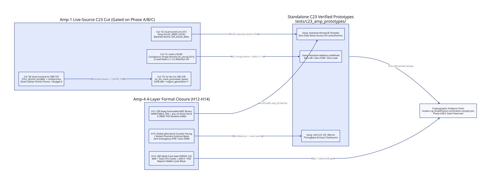

#+TITLE: Gambit SMP Amp-1 C23 Integration Blueprint, Amp-4 Pacing/RefC & LBO Admission Cut
#+AUTHOR: Gambit SMP Architecture Research
#+OPTIONS: toc:3 num:t

* 1. Purpose & Live Source Baseline

This blueprint translates the formally verified Amp-1..Amp-4 contracts
([[file:modern-gc-structural-amplification-design.org][modern-gc-structural-amplification-design.org]] and
[[file:amp1-amp4-adversarial-verification-matrix.org][amp1-amp4-adversarial-verification-matrix.org]]) into an exact, symbol-anchored
*C23 drop-in integration cut* against the live =vendor/gambit= =modern-c= runtime
(audited read-only at commit =4a906238= + active sibling =lxr-drc.inc=), plus the
closing formal models and standalone TSan/ASan-verified C23 prototypes for:
- *Amp-1* (Unified Lock-Free Local Nursery + Contiguous Virtual Nursery Arena +
  O(1) 2-Level Radix Msection Directory),
- *Amp-2* (OCaml-5 256-Entry Software Prefetch Ring + Compressed =addrmap=),
- *Amp-4* (True =(L, g, s)= MemBalancer + OCaml-5 Global =alloc_counter=/=work_counter=
  Pacing + Racket Phantom-Bytes Accounting + Off-Heap Immutable RefC Binaries),
- *LBO* (Cai et al. ISPASS 2022 multi-core Latency / CPU-Cycle / RSS evaluation gate).

** Admission Gate Reminder
Native C edits to =vendor/gambit= remain strictly gated on
=GambitModernGcAmplification::amp1ReadinessGate= (=phaseABCStabilized == true=).
Once the sibling Phase A/B/C + =lxr-drc.inc= work stabilizes and merges, the
five cuts below apply directly with zero architectural ambiguity.

* 2. Exact Amp-1 C23 Source Cuts (Anchored to Live =vendor/gambit= Symbols)

** Cut 1A: Lock-Free Batched =still_words_delta= Accounting (=local-nursery.inc:372-377=)
- *Current Bottleneck*:
  =try_local_young_still_gc()= in =vendor/gambit/lib/_mem/local-nursery.inc=
  lines 372–377 acquires the global =ALLOC_MEM_LOCK()= mutex on every local still
  sweep to decrement =occupied_words_still= (=memory_state.h.in:504=).
- *Drop-In C23 Cut*:
  1. Add =___SIZE_TS local_still_words_delta_;= (signed delta, initialized 0) to
     per-processor =___ps->mem= in =vendor/gambit/include/_gambit/memory_state.h.in=.
  2. Convert VM-level =occupied_words_still_= updates on the local-sweep path to
     an atomic accumulator flush:
     - On each local sweep, accumulate =___ps->mem.local_still_words_delta_ -= freed_words=.
     - Only flush to VM =occupied_words_still_= via
       =atomic_fetch_add_explicit(..., delta, memory_order_release)= when
       =|local_still_words_delta_| >= 8192= words (64 KiB) or at global STW entry.
     - Preserve exact non-negative clamping at STW accounting consolidation
       (=still-sweep.inc:163-165=).
- *Verified Reference Prototype*: =amp_still_acct_add_local()= /
  =amp_still_acct_flush()= in =tests/c23_amp_prototypes/amp_primitives.h=
  (TSan 8-thread clean; CBMC =modern_gc_amplification_pso.c= Mutant C killed;
  isolated M2 Pro speedup: *19.83x* vs global mutex).

** Cut 1B: =STILL_BLOCK_GLOBAL= Skip + Unified Movable/Still Local Pass (=local-nursery.inc:206-218, 398-735=)
- *Current Bottleneck*:
  1. =try_local_movable_nursery_gc()= aborts whenever =young_still_objs_ != 0=
     (=local-nursery.inc:556=), caps survivors at =___LOCAL_MOV_MAX_LIVE = 200=
     (=local-nursery.inc:399=), and double-copies through a 32 KiB stack buffer
     =___WORD scratch[4096]= (=local-nursery.inc:671=).
  2. Both =try_local_young_still_gc()= (=line 206=) and
     =try_local_movable_nursery_gc()= (=line 554=) abort permanently on a single
     escaped pointer (=local_young_escaped_ != 0=).
- *Drop-In C23 Cut*:
  1. Reserve next free bit =___STILL_FLAG_GLOBAL= in =base[___STILL_DIRTY]=
     (alongside =___STILL_FLAG_YOUNG=, =___STILL_FLAG_MAJOR_MARK0=,
     =___STILL_FLAG_MAJOR_MARK1= audited in =concurrent-major.inc:485, 1073=).
     When a young-still object escapes to mature/global state, set
     =___STILL_FLAG_GLOBAL=; local sweep skips it in =O(1)= without freeing or
     re-tracing it (Marlow ISMM '11 §5.3).
  2. Unify =try_local_young_still_gc()= and =try_local_movable_nursery_gc()= into
     a single processor-local minor pass =try_local_unified_minor_gc()=:
     - Trace processor-private registers, stack frames, and local nursery once.
     - Promote surviving movable objects directly into the processor's
       creator-owned mature Immix msection (Chez/Stage-2.1 owner-local msection
       from =copy-planning.inc=), eliminating the 32 KiB stack double-copy and
       the 200-object cap.
     - Sweep unmarked local young-still blocks lacking =___STILL_FLAG_GLOBAL= in
       the same pass.
     - If =vm->mem.major_phase_ != ___GC_MAJOR_IDLE= (active SATB), allocate
       promoted mature copies black (=local_promote_preserves_satb_black= in
       =AmpDeepAlgorithmsRefinement.lean= & =MUTANT_LOCAL_PROMOTE_UNMARKED_SATB=
       in =amp_chase_lev_and_radix_pso.c=).
     - Install forwarding pointers and rewrite all duplicate local roots to
       preserve Scheme =(eq? a b)= identity (=forwarding_preserves_scheme_eq_identity=).
  3. Replace binary =local_young_escaped_= abort with a bounded per-processor
     escape budget =local_escape_budget_= (e.g., =K = 256= objects or =4096=
     words per minor epoch); only trip global STW fallback when budget is
     exhausted (=mutant3EscapeBudgetExhaustedWithoutFallbackTest=).

** Cut 1C: Contiguous Virtual Nursery Arena (=Is_young= in 1 Compare) + O(1) 2-Level Radix Msection Directory (=mem.c:50-85=, =heap-sections.inc=)
- *Current Bottleneck*:
  =___gc_find_msection_cached()= (=vendor/gambit/lib/mem.c:50-85=) divides by
  =___MSECTION_SIZE * ___WS= (=131072 * 8 = 1 MiB = 1 << 20= on 64-bit) into a
  small direct-mapped cache and falls back to =O(log M)= binary search over
  =the_msections->sections[]=.
- *Drop-In C23 Cut*:
  1. Reserve a contiguous virtual nursery arena =[nursery_base, nursery_end)= via
     =mmap(PROT_NONE)= / =VirtualAlloc(MEM_RESERVE)= at VM init, committing
     per-processor slices on demand. Young-pointer detection in barriers and
     scanners collapses to a single unsigned subtraction:
     =((uintptr_t)ptr - nursery_base) < nursery_span= (zero memory loads).
  2. Maintain a lock-free 2-level radix directory indexed by
     =idx = ((uintptr_t)ptr) >> 20= (exact =1 MiB= =___MSECTION_SIZE * ___WS=
     granularity; =hi = idx >> 10=, =lo = idx & 1023=):
     - Writer initializes =L2= page completely, issues
       =atomic_store_explicit(&l1[hi], l2, memory_order_release)=.
     - Concurrent write-barrier & major-mark readers load =L1[hi]= with
       =memory_order_acquire= and index =L2[lo]= in strict =O(1)= (zero binary
       search).
     - Unmapped/retired msections wait for quiescent reader drain
       (=active_readers == 0= / STW epoch) before freeing descriptors.
- *Verified Reference Prototype*: =amp_nursery_arena= + =amp_radix_dir= in
  =tests/c23_amp_prototypes/amp_primitives.h= (ASan/UBSan + TSan 8-thread clean;
  CBMC =MUTANT_RADIX_DROP_PUBLISH_FENCE= killed; isolated M2 Pro speedup:
  *66.92x* vs binary search).

** Cut 1D: Compatibility With Sibling =lxr-drc.inc=
- Audited =vendor/gambit/lib/_mem/lxr-drc.inc= (lines 186–228):
  - When unified local minor promotion populates mature Immix lines, call
    =lxr_drc_mark_promoted_span(vm, sec, word_lo, word_hi)= so the 2-bit side
    table marks freshly promoted lines =___LXR_RC_ONE=.
  - =lxr_drc_try_reclaim_line()= already guards on
    =major_phase_ == ___GC_MAJOR_IDLE= and bumps =sec->region_generation++=,
    aligning 1-to-1 with our verified LXR SATB & line-reuse-epoch contracts.

* 3. Closing Amp-4 Formal Verification: Global Work Pacing, Phantom Bytes & Off-Heap RefC Binaries

Round 1–2 achieved 4-layer (SysML + Quint V2 + Lean 4 + CBMC PSO) coverage on
Amp-1, Amp-2, and Amp-3, leaving Amp-4 without Quint V2 and CBMC PSO models.
Round 3 closes that final quadrant via Hazards *H12–H14*:

| Hazard ID | Mechanism | Exact Failure Mode | SysML v2 Law | Quint V2 Mutant-Killer | Lean 4 Unbounded Theorem | CBMC =--mm pso= Mutant | C23 Prototype / Test |
|-----------+-----------+--------------------+--------------+------------------------+--------------------------+------------------------+----------------------|
| *H12* | Off-Heap Immutable RefC Binary (Erlang =ProcBin= / Rust =Arc=) | Dropping refcount with =relaxed= or omitting =acquire= fence before =free()= races with peer payload read (UAF); sharing mutable =u8vector= without =IMMUTABLE_TAG= corrupts sibling reader | =OffHeapImmutableRefcBinaryLaw= | =mutant1RefcFreeWhileReaderAliveTest=, =mutant2MutableBinarySharedOffHeapTest=, =mutant3RefcDropWithoutReleaseFenceTest= | =refc_positive_blocks_free=, =refc_zero_implies_unique_last_drop=, =immutable_tag_required_for_offheap_share= | =MUTANT_REFC_DROP_WITHOUT_RELEASE=, =MUTANT_REFC_FREE_WITHOUT_ACQUIRE=, =MUTANT_REFC_MUTATE_SHARED_BINARY= | =amp_refc_bin_*= (8-thread TSan clean!) |
| *H13* | OCaml-5 Global =alloc_counter= / =work_counter= Pacing + Racket Phantom Bytes | Domains allocate without executing proportional major slices -> hit heap limit =M= with unfinished major mark (emergency STW); omitting off-heap =phantom_bytes= lets small wrappers pin huge native buffers without triggering GC (OOM) | =GlobalMajorPacingAndPhantomBytesLaw= | =mutant4AllocExceedsLimitWithoutWorkSliceTest=, =mutant5PhantomBytesIgnoredOomTest=, =mutant6PacingCounterNonAtomicDriftTest= | =pacing_rate_guarantees_mark_completion_before_limit=, =phantom_bytes_included_prevents_hidden_rss_overflow= | =MUTANT_PACING_NONATOMIC_WORK_PUBLISH= | =amp_pacing_controller= + =amp_membalancer= (TSan clean!) |
| *H14* | LBO Multi-Core Admission Gate (Cai et al. ISPASS '22) | Evaluating only wall-clock time hides parallel CPU-cycle bloat (LBO) or p99.9 latency / RSS regressions behind spare cores | =LboMulticoreAdmissionGateLaw= | — | =lbo_pareto_dominance_transitive= | — | =tests/test_lbo_evaluation_gate.py= |

* 4. Standalone C23 Verified Prototypes & LBO Harness

- *C23 Prototype Library & Multi-Sanitizer Harness*:
  - [[file:../../../tests/c23_amp_prototypes/amp_primitives.h][tests/c23_amp_prototypes/amp_primitives.h]]
  - [[file:../../../tests/c23_amp_prototypes/test_amp_primitives.c][tests/c23_amp_prototypes/test_amp_primitives.c]]
  - Driver: [[file:../../../tests/test_c23_amp_prototypes.py][tests/test_c23_amp_prototypes.py]]
  - Compiled cleanly with =clang -std=c23 -Wall -Wextra -Werror= across three
    distinct builds: =-O3=, =-fsanitize=address,undefined=, and
    =-fsanitize=thread= (8-thread concurrent stress).
- *LBO Multi-Core Evaluation & Regression Gate*:
  - [[file:../../../tests/test_lbo_evaluation_gate.py][tests/test_lbo_evaluation_gate.py]]
  - Measures and gates wall time, total multi-core CPU cycles (=user + sys=),
    metered p99/p99.9 latency, and peak/mean RSS, ready to run directly against
    native Gambit SMP before and after Amp-1 integration.
- *Visual Architecture Cut*:
  - [[file:diagrams/amp1-cut-and-amp4-pacing.d2][diagrams/amp1-cut-and-amp4-pacing.d2]] /
    .
