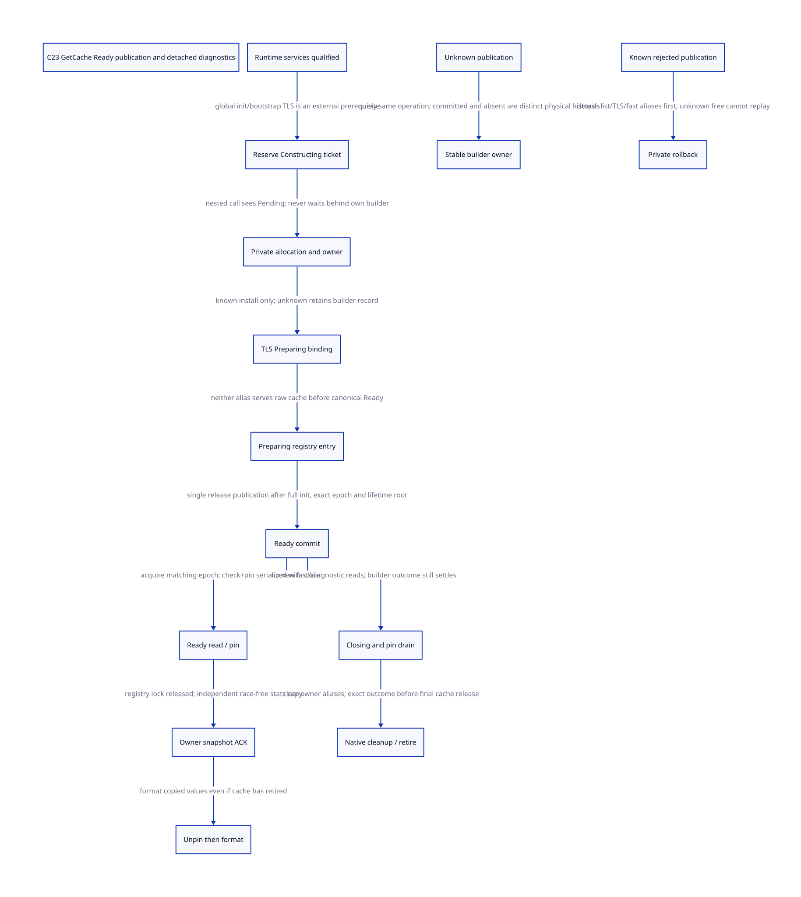

#+TITLE: C23 GetCache private construction, Ready publication and diagnostic snapshots
#+SETUPFILE: ../../modeling/org/setup.org
#+LANGUAGE: en
#+PROPERTY: header-args :eval never
#+STARTUP: overview

* RESEARCH Architecture and evidence boundary
:PROPERTIES:
:AUTHORITY: GambitCacheReadyPublication
:STATUS: conditional service/model proof; native construction/TLS/diagnostic qualification open
:CUSTOM_ID: cache-ready-publication
:END:

Refine [[file:node-storage-authority-design.org][native storage authority]] with explicit components: RuntimeServices,
NativeThreadDomain, CacheBuilder, ReadyRegistry, DiagnosticSnapshotService and
CleanupSettlement. A linked raw Cache is not automatically Ready; a Ready cache
is not automatically a race-free snapshot of its mutable bucket statistics.
This is a C23 native-service redesign, not a configuration selection or runtime
implementation. No native compiler/preprocessor, native test or timing is run.

[[file:models/sysml/cache-ready-publication.sysml][SysML]] owns sources, writer/consumer/issuer contracts, action/lemma and
refinement routes, blockers, benefits and graph edges. [[file:cache-ready-publication-matrix.org][Matrix]] and  are native
SysML projections. [[file:models/quint/cache_ready_publication.qnt][QNT]] models the proposed atomic service steps and lifecycle;
its typed IR produces [[file:models/lean/CacheReadyPublicationAst.lean][Lean AST]], with [[file:models/lean/CacheReadyPublication.lean][induction/contract proofs]] importing
construction, reader, snapshot, shutdown and rollback modules. [[file:../../modeling/ascent/cache-ready-publication.rules.scm][ASCENT DSL]] checks
actual action/lemma, writer and refinement rows. [[file:../../../evidence/research/future-frame-commit/cache-ready-publication/][Evidence]] retains source-order
witnesses, negative controls and failed checks without widening60-second or default
heartbeat limits. Formal module boundaries are split by responsibility when needed.

* What the fixed local code does
The pinned Tcl commit remains cbf86d62348d6b052e1961b4df995960fb21545f. Source
order is checked by exact operations in the captured GetCache body:

1. If listLockPtr is NULL, acquire the allocator init mutex and initialize list,
   object and bucket locks/tables. listLockPtr is assigned before objLockPtr and
   the full bucket table. The first plain pointer test is not itself proof all
   runtime services are Ready under C23; external startup/provider closure matters.
2. Read TclpGetAllocCache. If absent, TclpSysAlloc(sizeof(Cache),0), panic on NULL,
   and zero the Cache.
3. Under listLockPtr, link nextPtr and firstCachePtr; unlock the list lock.
4. Initialize owner through Tcl_GetCurrentThread, install TclpSetAllocCache, return.
5. HAVE_FAST_TSD's GETCACHE stores tcachePtr=GetCache() only after that return.
   Without fast TSD the macro first reads platform TLS, then calls GetCache if NULL.

The local header declares TclpSetAllocCache as void. No native integer error code,
transaction receipt or rollback query follows from this declaration. Platform TLS
implementations and their exceptional/nonreturning behavior are not captured here.
Thread finalization delegates TclpFreeAllocCache; the captured body has no explicit
fast tcachePtr reset. Actual legal thread reuse, TLS destruction and fast-slot
invalidation must be traced before declaring a native stale-pointer bug or safety.

Tcl_GetMemoryInfo locks the list, walks caches, prints owner and reads bucket fields,
then calls DString start/append/end before unlocking. Direct code shows no object
old-tail dereference; formatting/provider effects are not globally closed. The list
lock protects topology, not automatically every owner-written bucket statistic.

* Component contracts and private construction
** RuntimeServices and thread-domain prerequisites
RuntimeServiceReady covers all shared allocator locks/tables, initialization
synchronization and bootstrap TLS/provider availability. Per-cache Ready must not
reuse listLockPtr!=NULL as that certificate. A generic once primitive would also
need a nonrecursive initialization body and failure/unwind policy; naming such a
primitive does not prove those conditions.

A NativeThreadDomain supplies a stable pre-reserved construction guard before
allocation, owner lookup, logging, provider or TLS callouts. Its bootstrap cannot
require the same cache being constructed. The finite model assumes these two
prerequisites; it does not implement their registration or global initialization.

** Proposed descriptor and one builder
Use an owner-local descriptor with Empty, Constructing(ticket), Ready(handle) and
Closing states. The stable ticket binds thread/domain identity, cache StorageKey,
constructor epoch, operation IDs, initialized components and outstanding alias or
cleanup duties. Only its builder authority may allocate the candidate. The model
counts at most one successful candidate allocation per epoch.

Reserve Constructing before entering any callout-capable prefix. Nested calls see
Constructing and an existing ticket, not an uninitialized Cache pointer or a fresh
constructor. They must not wait behind their own builder. A typed service may
return Pending/Refused, or use an independently qualified bootstrap allocation
path. Existing mandatory allocator APIs cannot silently return Pending or NULL
where their callers assume a valid cache. That adapter/caller migration remains
an admission blocker, not an implemented compatibility guarantee.

Initialize private storage, owner and storage binding before a candidate can serve
readers. Stage a Preparing platform binding and registry entry; these aliases must
point through the managed descriptor and cannot expose a raw cache to old readers.
The current raw-pointer getter cannot be changed to return a descriptor while its
callers still cast it as Cache/AllocCache. All such callers must migrate together.

* Ready commit, outcome loss and rollback
The list, platform TLS and fast TLS are different locations. Do not claim one
ordinary store atomically publishes all three. After known component installation,
a canonical Ready control word commits the exact epoch; all managed consumers
validate that word and lifetime authority. The proposed C23 mapping uses release
publication after initialization and matching acquire observation of that same
epoch. Actual reads-from, source CFG and provider synchronization are not proved.

| Outcome | Native/service authority | Permitted next step |
|---------+--------------------------+---------------------|
| known Ready commit | ready entry and stable owner root | serve validated readers; settle builder result |
| commit happened, ACK lost | ready entry plus retained builder record | readers may be safe; reconcile same operation before refund |
| no commit, result unknown | private/Preparing aliases plus retained builder | no rollback/retry based on assumed absence |
| known rejected publication | stable private owner; no Ready reader | unlink/clear aliases, then exact private release |
| TLS installation unknown | original constructor/domain record | do not publish Ready, reallocate or overwrite a potentially installed slot |
| free/rollback outcome unknown | stable operation metadata | do not dereference or free again to learn the outcome |

Unknown is caller knowledge, not necessarily no physical effect. C23 CAS expected
updates/spurious failure and loss of the surrounding result must not be conflated.
If the implementation uses CAS, exact-operation identity and the observed control
word determine admissible retry/reconciliation. No backend reconciliation API is
assumed to exist today.

Private rollback requires known not published, list entry removed, platform and
fast aliases known detached, and no native reader/copy in flight. Allocation failure
has no cache storage to free but still owns its reservation until known settlement.
After an unknown free, the record retains a duty, not proof native storage remains
alive. The model uses owned for responsibility and grants no dereference in that
state. Stable metadata cannot restore an abandoned C stack or unlock another
thread's mutex; native return-domain/catcher/cancel cleanup remains separate.

* Fast path, close and cross-thread lifetime
A nonnull fast pointer alone must not bypass Closing. A Ready handle can be held
under its owner NativeThreadDomain, allowing a scope lease rather than a new global
atomic pin for every object allocation. Its owner/epoch must remain live and all
fast readers must honor scope revocation. This is an architecture option, not a
measured zero-overhead result.

For external readers and diagnostics, validating Ready then incrementing a pin in
an unrelated operation has a reclamation gap. Check-and-pin and close must share
one serialization/ledger domain (for example the same registry lock or combined
control-word protocol). The QNT actions are atomic at that service boundary; a
native two-instruction implementation needs an explicit refinement proof.

Close may precede delivery of a known publication ACK. It prevents new readers but
retains the builder's unresolved result. Drain existing native reader/copy pins,
resolve builder duties, clear fast/platform TLS on the authorized native owner,
unlink the registry entry and qualify native cleanup before retirement. A worker
cannot clear another OS thread's thread-local state by writing its own TLS slot.
Actual thread-exit evidence may substitute only under a qualified provider contract.

Shared allocator lock/provider retirement is independent of one cache retiring.
A record or pointer that survives C-stack abandonment is not a live native return
domain. The [[file:../../../evidence/research/source-references/feeley-sfp/8bb2fae8ae4b54d3a86206596f90e9cf73da39846af0f39244a476074cf81ed4.txt][Feeley interoperability paper]] grounds that distinction, not this new
Ready service or its exact-operation receipts.

* Diagnostic snapshot protocol
** Pin, copy, detach, format
1. Capture/pin Ready handles under registry admission, retaining list order and
   exact cache epoch; then release the global registry lock.
2. Obtain a race-free snapshot source for each cache. The primary design uses an
   owner-authorized copy at a valid owner checkpoint into preowned storage. A
   same-owner request must copy directly when authorized or defer; do not wait
   for an action that only the blocked current callback can execute.
3. Owner ACK covers copied fields and the owner label, with no more source writes
   into that snapshot. Pending/unknown copy retains its cache pin. Cancellation
   needs a separate no-more-writes ACK, not a timeout-based refund.
4. Release the native cache pin only after copy completion. The independent
   snapshot/diagnostic operation now owns the data through formatting failures.
5. Format and append the copy outside the registry lock. The native cache may
   retire before formatting; no late Cache, node or TLS access is allowed.

Snapshot allocation itself must not be hidden under the registry lock. Reserve
buffers outside the critical section, use a prequalified bounded pool or perform
a capacity/retry protocol while preserving pins. Pool exhaustion/unknown task
handoff retains responsibility; it is not permission to wait on own held resources.
The QNT model assumes a preowned independent buffer and one diagnostic operation.
Its pending copy intentionally has no unsafe timeout/cancel-release transition.

The static sharedCache sentinel is a separate RuntimeServices entry, not a thread
cache with an invented owner/TLS binding. The finite Ready model covers one
thread cache; the existing diagnostic also visits sharedCache. Its statistics need
a separately qualified shared-lock/atomic snapshot source and lock-order proof.
The old whole diagnostic cannot retire before that shared-entry case is admitted.

** Statistics are a separate consistency contract
Ready makes initialized immutable metadata visible; it does not serialize mutable
bucket counters. Owner-copy mode defines a per-cache coherent cut. An alternative
all-atomic counter mode may provide individually sampled values, with a different
consistency contract. Merely adding a sequence number around concurrent ordinary
reads/writes is insufficient to establish C23 race freedom; payload access itself
needs valid synchronization/atomicity. Neither mechanism is implemented here.

Preserve field order and encoding: per bucket, blockSize plus numFree, numRemoves,
numInserts, totalAssigned, numLocks and numWaits:7 scalar values. Capture the existing
thread-label representation while its native identity is valid, or use a qualified
stable encoding preserving the API. Do not copy a raw thread-id pointer then
assume evaluating/formatting it after lifetime end is safe. Formatting the resulting
owned label bytes later does not need that native identity's lifetime.

The API must state whether cache-list membership is one registry cut, each cache
has its own owner cut, or a stronger global snapshot is promised. This design
selects a registry handle cut and per-cache owner snapshots, not a global atomic
allocator census. Preparing entries are not shown as zero-owner Ready caches;
this is an explicit publication semantic repair, not byte-for-byte equivalence
for every observation of partial legacy initialization.

* Conditional model and precise obligations
QNT owner/TLS fields are protocol tags, not numeric native thread IDs or pointer
values. The model handles one builder/cache epoch and one diagnostic request;
record reuse, arbitrary nested requests and all-cache initialization are not proved.
QNT separates TLS unknown, publication committed/absent with unknown ACK, Ready
readers, pending owner copy, detached formatting, Closing and unknown rollback.
Safe proves Ready entails owner/TLS/list initialization, unknown publication
retains builder custody, no second candidate in one epoch, and retirement has no
builder/reader/copy pin. lateFormatAdmitted proves the copy can be formatted after
modeled retirement. It does not certify actual snapshot bytes or buffer cleanup.

Typed-IR binding/type/roster/expression poison controls, reachable guard negatives
and forged-state rejection controls remain distinct. The actual prior
NodeStorageAuthorityAst.probeCurrentCache Guard/Step is joined under an explicit
metadata mirror containing layout, generation and caller qualification. That mirror
is not manufactured by Ready alone. Full source/native/product refinement remains
open, including all bootstrap, callbacks and raw provider users.

* Old paths and actual retirement conditions
| Old path | Replacement responsibility | Retirement gate |
|----------+----------------------------+-----------------|
| list membership interpreted as complete cache | typed private CacheBuilder and one Ready epoch | owner/storage/TLS publication and every list reader migrated |
| raw TclpGetAllocCache / tcachePtr return | validated Ready handle under owner scope | all macro/interpreter/provider/cleanup users honor Constructing and Closing |
| list lock held during DString/formatting | SnapshotService and independent output buffer | stats race freedom, owner-label encoding and cancellation/exception ownership |
| implicit failure cleanup through C locals | stable builder/operation settlement | exact TLS/list/free outcomes and native landing coverage |
| global-init pointer shortcut | RuntimeServiceReady prerequisite | every shared lock/table/provider fully qualified before use |

Tcl_CreateInterp's allocCache getter, both GETCACHE macro profiles, GetCache itself,
Tcl_GetMemoryInfo, platform TLS destructors and TclFreeAllocCache are migration
participants. Retiring one caller or adding a facade does not retire the old
contract. GetCache is static and GETCACHE expands inside Tcl allocation code.
This cutover requires allocator-internal refactoring or a cooperating qualified
Tcl build; an outer Gambit/FFI wrapper cannot enforce Ready on unmodified internal
raw consumers. Generic calls, custom instrumentation, panic/allocator hooks and native
reentry must be safe or explicitly outside managed admission without silently
changing the raw APIs. No runtime source is changed by this study.

* Benefits and added work
The [[file:cache-ready-publication-matrix.org][SysML-projected matrix]] records conditions and blockers. With C cache entries
and B buckets, current formatting performs B+3 DString helper calls per cache while
holding the list lock. The proposed protocol moves that output work outside the
registry critical section; it adds O(C*B) scalar snapshot content plus owner labels,
handle pins, copy ACK and buffer cleanup. These are source/asymptotic counts, not
machine instructions or measured lock-time/speedup ratios.

One logical Ready publication, exact-operation records and admission/revocation
add work. Owner-held handles can keep per-object allocation off a global pin path
only after native lifetime proof. Unknown TLS/publication/free can retain resources
indefinitely. Current direct object allocation/copy work is not reduced by this
research. C23 modernization gains come from explicit component contracts and fewer
unsafe dependencies; no Zig-specific benefit, percentage or person-day estimate
is inferred. Old paths retired now0; native implementation and performance remain
unqualified.
