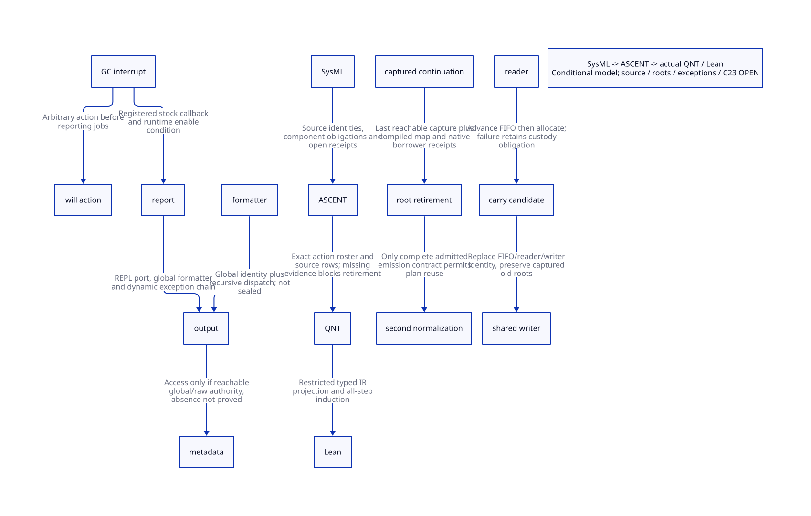

#+TITLE: Compiler Callback Authority and String-pipe Carry Closure
#+SETUPFILE: ../../modeling/org/setup.org
#+LANGUAGE: en
#+PROPERTY: header-args :eval never
#+OPTIONS: toc:3 num:t
#+STARTUP: overview

* Decision and scope
:PROPERTIES:
:CUSTOM_ID: callback-carry-closure
:BASELINE: C23 / ISO IEC 9899:2024
:AUTHORITY: GambitCallbackCarryClosure
:STATUS: source-located; conditional-model; actual-retirement-denied
:END:

This is a modern C compiler-session refactoring study. Zig remains an optional
emitter/runtime implementation language; it cannot discharge effect or root
coverage obligations. The decision concerns replacing mutable target-global
observation with a sealed NativeBindingPlan, rather than selecting a toolchain.
No compiler/runtime changes, native tests, preprocessing or performance tests occur.

[[file:models/sysml/callback-carry-closure.sysml][Native SysML]] owns component ownership, registrations, authority classifications,
reader guards, source anchors, obligations, proof routes and the benefit matrix.
Python queries the native tool and projects [[file:callback-carry-closure-matrix.org][Org tables]] and .
[[file:../../modeling/ascent/callback-carry-closure.rules.scm][Actual ASCENT rules]] join source digests, callback rows and action/theorem bindings;
missing or stale evidence blocks the candidate. [[file:models/quint/callback_carry_closure.qnt][QNT]] is typechecked and its restricted
typed expression graph is projected to [[file:models/lean/CallbackCarryAst.lean][Lean AST]], then checked by [[file:models/lean/CallbackCarry.lean][all-step proofs]].
JSON parsing, the restricted emitter and source extraction are trusted tools,
not verified compiler passes. Full source-to-model simulation remains open.

The [[file:emission-pipe-refinement-design.org][preceding ordinary-emission/no-carry study]] remains authoritative for its narrower
context and receipts. This extension does not rewrite its historical input.
The two contexts remain distinct: ordinary file emission and an explicitly
configured debug string-pipe witness. No authority bridge between them is presumed.

* Registrants, reachable closures and write authority
:PROPERTIES:
:CUSTOM_ID: callback-registrants
:END:

** Formatter identity

_io.scm initializes ##wr to ##default-wr. Its setter writes the global binding.
_gscdebug.scm installs one closure at module initialization, temporarily installs
##default-wr inside the VAR/PTREE branch and restores save-wr on normal return.
igsc.scm explicitly loads that module. These are source facts, not proof that the
current compiled gsc/gxc artifact uses an identical loader and formatter identity.
The selected scalar binding output bypasses the special branch under the already
stated predicate/payload assumptions. It therefore saves zero debug swap writes.

The closure references predicates, conversion routines and global writer dispatch.
The lack of a lexical resource parameter is not a capability restriction: code
can resolve c# globals, retain a resource vector, call a raw setter or escape
through FFI. A complete admitted callback profile must bind transitive callees,
shared mutable data, module identity and the generation of every registration.
Names such as default or stock do not grant an effect-free receipt.

** Port and dynamic exception handlers

Device-port constructors install #f in the per-port handler field. The public
port-io-exception-handler-set! wrapper reaches the internal field writer.
##raise-io-exception chooses a procedure in that field or macro-raise through the
ambient dynamic exception environment. In the inspected gsc and core runtime
source, no application call installing a custom handler on targ-port was found;
this is a bounded negative inventory, not closure over loaded macros, libraries,
FFI, injected port methods or prior application activity.

Both _thread.scm branches implement ##with-exception-handler using dynamic bind.
_repl.scm installs ##repl-exception-handler-hook as the primordial hook. The
module loader's try-open installs a local false-returning handler for that input
operation; this does not establish that the handler surrounds target output.
The compiler-specific _utils.scm with-exception-handling manages a separate
compiler diagnostic escape. It does not seal ambient I/O handlers.
A handler can return, capture, invoke a different formatter, mutate metadata or
fail while reporting an exception; fault-prefix equivalence must be established
for the actual dynamic environment, not inferred from the diagnostic wrapper.

** GC jobs AND executable wills

_nonstd.scm really registers ##display-gc-report through ##add-gc-interrupt-job!.
The report flag starts false, but the action also runs when debug level >=5.
It obtains process statistics and ##repl-output-port, then writes numbers and
strings through the ordinary formatter and I/O chain. Its inspected body has no
direct targ-rsrc-demanders-set! call. Its transitive formatter/port/error effects
are not sealed, and allocation and reporting can expose further runtime work.

_kernel.scm inserts jobs at the FIFO head and ##execute-jobs! traverses a list of
procedures. Clearing the registry is not evidence that an already loaded list,
current procedure or captured activation has retired. More importantly,
##handle-gc-interrupt! invokes ##gc-finalize! BEFORE executing the job list.
Executable will actions are a second producer class. ##will-execute! first loads
testator/action into locals, zaps the fields, then invokes action with interrupts
enabled. Neither field zapping nor clearing jobs revokes lexical/captured roots.
The public make-will API accepts arbitrary action procedures; the GC closure is
therefore not restricted to the one stock reporting job. A session certificate
must enumerate reachable will actions and native finalization callbacks or
reject reuse. No stock metadata-mutating action inside the selected interval has
been proved reachable by this study.

** Required authority boundary

The new design must move metadata behind an owner-controlled plan builder.
Before seal, named writes are admitted by canonical entry identity; raw aliases
must be copied, revoked or refused. After seal, output observes an immutable plan;
callbacks receive explicit output capabilities, not a target-global write token.
Legacy unrestricted sessions keep the second normalization and receive no reuse
receipt. Registration closure alone is insufficient: retained procedures, dynamic
environments, suspended activations and native borrowers must be accounted for.
This boundary is an intended refactoring, not an existing runtime property.

* Carry-over source refinement
:PROPERTIES:
:CUSTOM_ID: carry-over-source-refinement
:END:

** Actual caller boundary

The four direct character fill calls in _io.scm are char-ready?1, peek-char1,
read-char1 and read-substring. The first three call fill in the branch where
rlo<rhi is false. read-substring transfers buffered characters before calling
fill when the buffered count is not positive. With valid locked index bounds
rlo<=rhi, every selected call supplies rlo=rhi. Thus the selected ordinary
character consumer reaches the no-carry case. Native aliases, injected methods,
invalid indices and arbitrary code with access to internal port fields are not
covered. There is no established legal public Scheme witness for carry-over.
Reader/custom-port extensions must be audited before making a global claim.

** Ordered internal branch and counterexample

Let b=wlo, h=whi, r=rlo, t=rhi, c=t-r. In the internal branch r<t and
t=length(old buffer), the source advances the FIFO and sets wlo=b-r BEFORE
allocating append(substring(old,r,t), nextChunk). It then replaces the current
FIFO element and reader buffer. If nextChunk is the current writer buffer,
whi becomes h+c and the writer buffer becomes the new concatenation. Finally
rlo/rhi become zero and the peer writer is signalled; the fill loop re-enters.

For this shared-next case the old pending expression is P=b+h-r. The new one is
P'=(b-r)+(h+c)=P+c. Logical payload concatenation still contains exactly the
unread c-character prefix followed by the writer's h initialized characters.
The conditional example b=32,h=8,r=28,t=32 has physical pending 12 and new
counter expression 16. This is an INTERNAL state counterexample to blindly
extending the previous pending equation, not a demonstrated public Scheme bug.
The model tracks bias=c as a diagnostic ghost; it does not silently fix the
source counter or declare the ghost an existing runtime field.

If nextChunk is not the writer, whi does not change and P'=P; the carried prefix
moves into a different physical chunk. Full FIFO byte-sequence, position/rchars,
capacity and subsequent-drain correspondence remains an explicit obligation.
The QNT operational subset covers no-carry and carry with shared next only.
The nonshared equation is proved separately by Lean sharedCarryDelta /
nonsharedCarryDelta. initializedPayload proves the initialized prefix of an
abstract concatenation; it does not prove the Scheme string primitives faithful.
source execution reachability remains separate from arithmetic.

** Failure and roots

FIFO advance and wlo mutation precede candidate allocation. Treating the whole
branch as one failure-atomic transition hides a real intermediate state.
The model exposes advance, allocation, installation and visibility steps;
allocationFailure retains captured custody and permits no release without an
external retirement receipt. This is a required responsibility, not proof of
existing rollback or allocator-failure semantics. Allocation under a declaration
of disabled interrupts is not a proof that GC cannot occur.

Candidate roots include old vect-rbuf, next-chunk, port and peer, newly allocated
substring/append result, caller input str/end/index and dynamic exception state.
The source lexical binding identifies candidates, not which compiled slots are
live at each safepoint. write-substring re-enters loop i after successful drain
and re-reads the current buffer. Its captured old char-wbuf may nevertheless
remain a GC root depending on the generated frame map; absence of a later read
is not proof that storage can be released.

Captured continuation frames use actual frame descriptor root maps through
memory/continuation-roots.inc and gambit.h. This study pins those consumers but
has no matching per-program-point generated descriptors for the selected action.
A complete receipt must match Scheme generator, emitted program point, saved
registers, frame roots, restored thread/dynamic state and all multi-shot aliases.
A returned activation only reduces active executions; it does not remove the
external continuation reference. The model's roots count therefore survives
repeated resume/return. attestRootRetirement is an external obligation requiring
all captures/native borrowers to retire and a faithful compiled-map receipt;
it is never supplied by a stock return, GC notification or empty registry.

* Proof and migration gates
:PROPERTIES:
:CUSTOM_ID: callback-carry-proof-gates
:END:

QNT histories distinguish ordinary no-carry, an internal carry counterexample,
allocation failure, repeated continuation activation, changed registration,
unknown callbacks and externally attested root retirement. Lean proves every
projected action preserves the model invariant and derives the bias, retained
capture and release preconditions. The proof is about the stated model; source
refinement and fairness/liveness are not implied. Four corrupted typed-IR
controls must be rejected; a weakened release guard must break induction.
ASCENT corruption controls reject stale source, missing action/theorem, changed
callback classification, missing formal receipt and wrong receipt scope.
Only synthetic-all may obtain a candidate. Actual callbacks/carry/roots/faults/
platform/full-emission obligations remain open and are not synthetic receipts.

The second normalization may retire only when all of the following hold:

1. Keep the first demand; it creates or canonicalizes the actual entry.
2. Freeze the full NativeBindingPlan and its alias closure, not only one field.
3. Qualify the real compiled entry, formatter profile and dynamic exception chain.
4. Close registrations by epoch and drain already loaded callbacks, will actions,
   suspended captures and native borrowers without preventing required GC progress.
5. Either exclude carry-over for the admitted route by a source refinement or
   qualify its payload, counters, positions, root maps and partial-failure states.
6. Prove observable bytes, errors, side effects and continuation restorations
   equivalent through the entire interval, not merely the final demand value.
7. Qualify C23 ABI/platform implementation and propagate plan/FrameSpec ABI changes
   into incremental compilation invalidation. No old descriptor retires early.

The migration order is metadata ownership -> frozen plan -> explicit WriterView
and handler/job authority -> root/restore refinement -> end-to-end emission
admission -> remove the second helper for that profile. Existing unrestricted
paths remain until their callers are migrated; no wrapper-only retirement claim.

* Net benefit and evidence
:PROPERTIES:
:CUSTOM_ID: callback-carry-net-benefit
:END:

For N admitted bindings the upper bound is N eliminated helper invocations,
not N eliminated C compilations or macro expansions. With helper costs h_i,
plan construction P, validation V and added root/effect bookkeeping R, theoretical
net work saved is sum(h_i)-P-V-R. It is positive only when this quantity is
positive and all correctness gates hold. No time or speedup is invented.
Current admitted N is zero. The larger architectural benefit is making immutable
phase results safely reusable by independent compilation sessions; that requires
separate identity, dependency-closure and incremental-invalidation proofs.
A global callback lock or per-character epoch scan could erase that benefit and
block GC; neither is accepted as a free implementation detail.

See the native-projected matrix for exact benefit and overhead rows. Modern C
and Zig both require these ownership and semantic contracts; there is no extra
Zig-specific net benefit established here. Existing C portability and Scheme
continuation semantics remain inputs to the refactoring, rather than reasons to
avoid redesigning ownership.

* Reproduce source and formal research
:PROPERTIES:
:CUSTOM_ID: callback-carry-reproduce
:END:

#+begin_src python :eval never
import subprocess
subprocess.run([".venv/bin/python", "dev/modeling/tools/callback-carry-closure-study.py"], check=True)
#+end_src

[[file:../../../evidence/research/callback-carry-closure/checks.json][Checks]] and [[file:../../../evidence/research/callback-carry-closure/input.json][input identities]] record exact source snapshots, native SysML scope,
formal logs and the unchanged parent receipt. Historical failed attempts remain
in their task cache/evidence. No native or performance result is implied.
