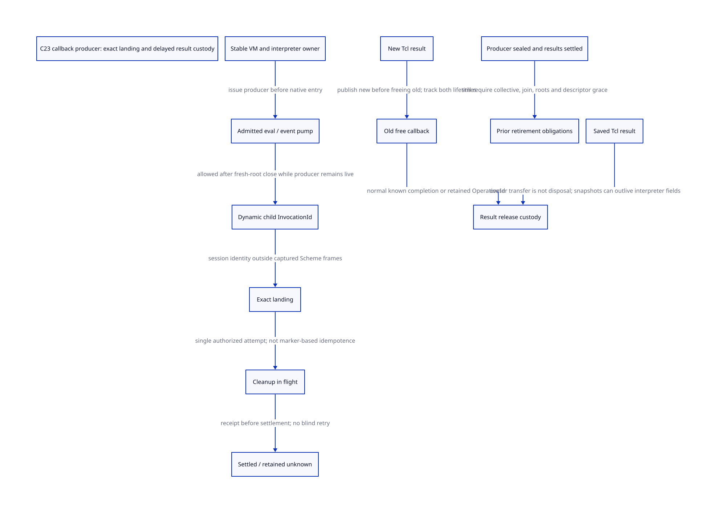

#+TITLE: C23 callback producers — dynamic grants, exact landing and Tcl result custody
#+SETUPFILE: ../../modeling/org/setup.org
#+LANGUAGE: en
#+PROPERTY: header-args :eval never
#+STARTUP: overview

* RESEARCH Refinement of the earlier child policy
:PROPERTIES:
:CUSTOM_ID: callback-producer
:AUTHORITY: GambitCallbackProducer
:STATUS: conditional model; native issuer / landing / result closure unresolved
:END:

The earlier [[file:cleanup-ingress-design.org][cleanup ingress]] model gives a sufficient policy for declared,
bounded child work. Its requirement to reserve every individual child before
root closure is too restrictive as a general Tcl policy. A single already
admitted Tcl_Eval can execute multiple commands; Tcl_DoOneEvent is another real
producer and can dispatch independent/nested events. Pre-enumerating all child
calls of arbitrary scripts is neither available in the adapter nor required for
safe shutdown. A script may also never terminate; finite callback fuel or forced
cancellation changes its semantics and is not silently introduced here.

Close fresh root entry, retain the previously admitted eval/event-pump producer,
and let that producer issue identity-bound child grants while it still owns its
native scope. Seal it only at an authoritative outer return with no active child
or unknown cleanup. This makes the producer a shutdown debt, not an exemption
from accounting. It preserves existing admitted execution conditionally; it does
not accept arbitrary late external callbacks without a matching producer/source.

[[file:models/sysml/callback-producer.sysml][Native SysML]] owns source, issuer, consumer, obligation, route and benefit records.
[[file:callback-producer-matrix.org][Org matrix]] and  are projections. [[file:../../../evidence/research/future-frame-commit/callback-producer/][Evidence]] binds source and
formal inputs. C23 remains the baseline; no runtime implementation or native test.

* Real issuers: what exists and what is proposed
** Before Tcl entry
The adapter tcltk_eval calls Tcl_Eval; its ordinary error path invokes generated
Scheme tcltk_eval_error and loops. This error callback is itself a child entry,
not invisible recovery that can bypass closure. The event-loop thread separately
calls Tcl_DoOneEvent. It does not always run beneath an active tcltk_eval frame.
The Scheme event-handling mutex does not establish an OS-thread-affinity proof
for Tcl, and closure does not make unsupported cross-thread Tcl access legal.

The future joint producer issuer must be the stable embedding owner plus the
owner-affine interpreter generation, before either native API call. A nested
Tcl eval entered from a Scheme callback needs its own child producer recorded
under that callback; an unrelated event-loop activation cannot borrow the eval's
identity. The current plain global tcl_interp and C activation do not implement
this persistent authority.

** At command selection
Tcl_CreateCommand registers scheme_call_cmd, ClientData and scheme_delete_cmd.
Registration supplies command identity and a source owner, not a dynamic right
to enter a VM during shutdown. In pinned TclBasic.c, TclInvokeStringCommand builds
argv, calls cmdPtr->proc(cmdPtr->clientData,...), then frees argv. The adapter
loads data_rc before entering the generated SFUN. Therefore grant issuance must
combine an admitted producer, the exact command/source lifetime and current VM
entry authority before that data_rc snapshot. The existing path returns no such
joint receipt. A Tcl Command hold is not automatically an RC root-slot lease.

** After root closure
A callback from a still-live admitted eval/pump may acquire a fresh InvocationId
under that producer, even though fresh root ingress is closed. The producer
cannot seal between selecting the command and publishing the child responsibility.
Under a single owner-thread scope, that exclusion can be lexical; cross-thread
or asynchronous dispatch requires a separately qualified handoff. All unknown
selection/entry outcomes keep the producer/source hold until resolved.

A callback with no admitted producer, wrong interpreter/command generation or
closed source is refused before Scheme entry. Refusal must not invoke the old
Scheme error translator. The previous [[file:tcl-source-borrow-design.org][Tcl source-borrow study]] explains sticky
native refusal provenance because Tcl catch/reset may turn errors into TCL_OK.
Do not claim a new refusal preserves every historical late-callback behaviour:
unsupported raw/asynchronous ingress is a managed-profile boundary.

* Landing exactly once: real cleanup is not idempotent
The current call_sfun_with_cleanup converts a Gambit throw to a result at the
common SFUN boundary. Generated macros execute end_sfun before propagate_error;
conversion-error recovery is skipped on thrown exits. This is a reusable actual
landing, conditional on the generated module/header ABI and selected build.

end_sfun kills its marker and returns/releases its bank. kill_sfun_stack_marker
writes #f into marker element zero, then decrements still refcount every time.
Neither checks a stable per-invocation settled state. #f prevents return to the
old C activation; it does not prove that root/native release can be executed a
second time. No current arbitrary multi-call idempotence property is asserted.

The proposed stable record must bind InvocationId, native activation/return-domain
identity, marker/bank identities, producer/source generation, result transfer and
cleanup operation identity outside any replayable Scheme continuation frame.
A new native callback under the same Scheme continuation gets a new InvocationId.
An old landing or ACK cannot settle that new invocation.

Use separate transitions: ACTIVE -> LANDING -> CLEANUP_IN_FLIGHT -> SETTLED,
with CLEANUP_UNKNOWN retaining the independent record and its root/native duties.
Only the exact invocation's known cleanup receipt permits settlement. Acquiring
an exclusive cleanup attempt prevents duplicate attempts, but it does not make
refcount decrement plus persistent ACK one atomic transaction. If execution can
be abandoned between them, keep UNKNOWN; do not retry the decrement. Required
non-abandoning release cuts or same-operation reconciliation remain native premises.
An external longjmp bypassing the common landing supplies no completion receipt.

The model separates receiptFirst and receiptSecond, not merely landingFirst and
landingSecond: a stale successful ACK is as dangerous as a stale control return.
Two sequential native invocations are enough to retain this ABA-like counterexample;
they do not prove arbitrary-width/generation behaviour or cap real callbacks at two.

* Tcl result disposal: concrete ordering and limits
All Tcl claims here use existing local captures at commit
cbf86d62348d6b052e1961b4df995960fb21545f, checked against the earlier pinned ledger
with both SHA-256 and original Git blob SHA-1. They do not identify the library
loaded on Darwin. No upstream fetch or native library call was needed.

| Real path | Order in pinned source | Required custody |
|-----------+------------------------+------------------|
| scheme_call_cmd | tcltk_call result -> Tcl_SetResult(result, release_string) | native result storage and release code can outlive callback |
| Tcl_SetResult | save old tuple; install new result/freeProc; invoke old custom hook; reset object result | new result already owned while old disposal is in flight |
| Tcl_FreeResult | invoke current custom freeProc, then clear freeProc and reset object result | escaping hook does not reach the clear |
| Tcl_ResetResult | reset object result; invoke custom hook; then clear freeProc and string fields | return/field state cannot be assumed after escape |
| Tcl_DeleteInterp | mark DELETED, increment compileEpoch, schedule EventuallyFree | request return may precede actual deletion |
| DeleteInterpProc | check active eval invariant; namespace/variable cleanup; Tcl_FreeResult | deletion can create/transfer result duties before final result free |
| selected Gambit hook | release_string -> release_rc | native storage release; no Scheme reentry shown by this hook |

There are additional actual disposal/transfer routes: SetObjResult releases the
old native string; GetObjResult copies a nonempty legacy string into an object
and then calls its free hook. SaveInterpState invokes GetObjResult, so a
seemingly observational state snapshot can trigger that conversion/free.
Legacy SaveResult instead moves result/freeProc into Tcl_SavedResult and clears
the interpreter freeProc. RestoreResult resets the current result then moves the
saved ownership back; DiscardResult calls the saved free hook. Therefore a saved
result outside the interpreter can keep Gambit storage/provider duties alive.
The holder census for these tokens is not closed by finding the transfer functions.

A different extension's old custom hook may call out or escape; this is supported
as an arbitrary application callback boundary, not an observed Scheme reentry
from Gambit's selected hook. The adapter's tcltk_cleanup sets global tcl_interp
NULL after DeleteInterp returns; that pointer value is not a result-release or
all-activation receipt. Tcl's preservation semantics and exact deletion execution
must be qualified; this study reads callers/comments and does not claim an
independent proof of the unseen preservation implementation.

Represent old and new result ownership separately across SetResult. A retained
old disposal must not clear or settle the new result's identity. Clearing the
interpreter freeProc field alone is neither proof of free nor permission to replay
a custom hook. If custom release can abandon, a managed adapter must intercept
that boundary, retain an independent ResultId/OperationId and prevent unsafe
raw replay, or reject reusable retirement for that profile. No such wrapper is
implemented here. Current release_string receives only a pointer; the true
issuer would require an out-of-band storage/origin index, not a fictitious
ResultId argument already present in Tcl's ABI.

Known result completion releases its original allocator/provider hold only after
the disposal call no longer uses those resources. Unknown completion retains
opaque operation/storage identity and provider holds, without rescanning or
freeing possibly dead payloads. An indefinitely retained provider/result record
is an explicit cost, not a bounded recovery guarantee.

* C23 composition and model boundaries
Producer publication and root close need one linearization authority. Child
selection/registration must not have a gap in which both producer and child
counts are zero. Exact completion must publish after last root/bank/descriptor
use, with release/acquire transfer to the retirement owner. Generation reuse,
width bounds and rejected overflow require native policy. Memory ordering does
not repair an unsafe ClientData load or an abandoned decrement.

The previous closed-root model and this producer model have different admission
languages: the old pre-reserved-child rule cannot represent every valid dynamic
Tcl eval. Do not assert step simulation into it while the producer is live.
The integration point is the producer-exit boundary. Once it is sealed and all
result duties known settled, an explicit ExitMirror can discharge the old model's
outer/child/grant/guard/root obligations. Physical collective, join, descriptor,
source-root and allocation-origin obligations remain independent.

[[file:models/quint/callback_producer.qnt][QNT]] contains ten scalar fields and seventeen actions. It models two sequential
child identities under one producer and one result-disposal operation. The first
and second landing and cleanup receipts are distinct. The cleanup phase records
attempted/unknown/done rather than assuming a replay-safe marker. Fresh-root close
does not seal the producer. A sealed producer cannot dispatch again.

Unknown/in-flight result disposal blocks further dispatch and producer seal in
this conservative model. Qualified reentrant free hooks would require a richer
nested release/child model; they are not silently admitted by the ordinary path.

The single result operation is a safety slice: it does not model the complete
two-result SetResult handoff, all Tcl_Save/RestoreInterpState aliases, arbitrary
nested producers, source deletion, collector relocation or every asynchronous
callback. Those require additional product/caller refinements; source ordering
alone is not their formal proof. The model also does not prove progress of a
nonterminating Tcl eval.

[[file:models/lean/CallbackProducerAst.lean][Typed-IR extraction]] binds exact actions to [[file:models/lean/CallbackProducer.lean][Lean]], which proves action preservation,
reachable safety, root-close not implying producer seal, and wrong-ticket
settlement refusal. The guarded join uses the actual CleanupIngressAst retirement
transition only at the explicit exit mirror, with remaining collective/join
premises. It is not a full product simulation.

Six histories include two legitimate callbacks after root close, known/unknown
cleanup and result disposal. Twelve reachable negative controls reject stale first
landing/ACK/settlement during the second invocation, duplicate first settlement,
unknown cleanup/free replay, unknown completion settlement, redispatch/seal under unknown result release, live-producer
retirement and dispatch after producer seal. ASCENT requires exact action/compiled
lemma/source routes, nine consumer classes and five joint issuers. Current
native gaps block admission; synthetic full receipts only test the DSL chain.

* Gains, costs and retirement gates
The architectural gain is avoiding static pre-enumeration of arbitrary callback
chains while preserving responsibility under a live producer. It also separates
control continuation from irreversible cleanup, retaining the native lifetime
that Feeley's [[file:../../../evidence/research/source-references/feeley-sfp/8bb2fae8ae4b54d3a86206596f90e9cf73da39846af0f39244a476074cf81ed4.txt][continuations/C paper]] requires us to reason about. The paper does
not supply these new producer/receipt services or prove the C23 implementation.

For P active native producers, C active child records and R outstanding result
operations, support is O(P+C+R), plus any retained replay-protection records.
Unbounded deduplication history is not free: reclaiming completed TicketIds needs
its own observer/generation retirement proof. Zero accepted stale settlements and
zero blind retries are abstract safety properties, not measured speedup. Native
record bytes, contention and latency remain unmeasured. Existing ordinary SFUN
landing and release_string are reuse candidates; no new universal runtime or
Scheme reentry is needed for the selected ordinary result-free hook.

Retire raw managed callback entry only after joint producer/source/VM issuance
covers eval, error callbacks, event pump and nested events. Retire repeated native
cleanup assumptions only after per-invocation one-attempt/known-result custody is
qualified. Result adapter qualification must include replacement, reset, eventual
deletion and saved-state transfers. No runtime path retires from these checks.
