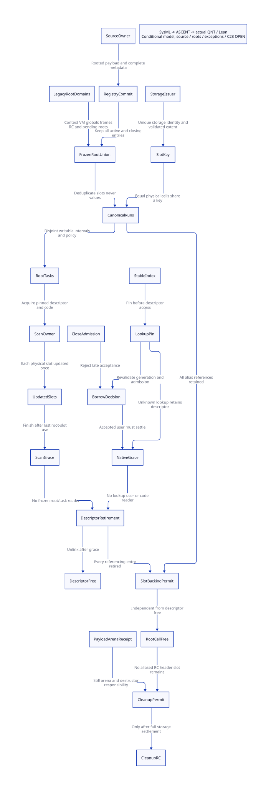

#+TITLE: VM Carrier Registry to Physical Collector Root Slots
#+SETUPFILE: ../../modeling/org/setup.org
#+LANGUAGE: en
#+PROPERTY: header-args :eval never
#+OPTIONS: toc:3

* RESEARCH Decision, authority and scope
:PROPERTIES:
:CUSTOM_ID: carrier-slot-mapping
:BASELINE: C23; mandatory modern C
:AUTHORITY: GambitCarrierSlotMapping
:STATUS: conditional-formal; native-slot-fidelity-open
:END:

A persistent carrier is a logical registration, not necessarily a distinct physical
root cell. Each collector round needs a complete, policy-compatible union of
writable physical cells. Deduplicate aliases of the same cell; never deduplicate
by the Scheme object currently stored there. Descriptor lifetime, root-cell backing,
payload arena lifetime and scan-code/module lifetime are distinct obligations.

[[file:models/sysml/carrier-slot-mapping.sysml][SysML]] owns component obligations, source anchors, signers, contracts, cost rows,
and model/lemma routing. Python invokes native SysML validation and expression
queries, then projects [[file:../../modeling/ascent/carrier-slot-mapping.rules.scm][ASCENT]], [[file:carrier-slot-mapping-matrix.org][Org closure/cost views]] and .
The formal artifacts are [[file:models/quint/carrier_slot_mapping.qnt][QNT]], [[file:models/lean/SlotMapping.lean][transition induction]], [[file:models/lean/SlotCensus.lean][generic slot census]]
and [[file:models/lean/SlotMappingBridge.lean][parent membership bridge]]. This extends the [[file:persistent-carrier-coverage-design.org][persistent coverage study]].
There is no runtime implementation, native GC test, compiler bootstrap or benchmark.

* EVIDENCE Current source and complete mapping obligations
:PROPERTIES:
:EVIDENCE_SCOPE: snapshot source and template bodies; not effective Darwin expansion
:END:

** The actual collector updates cells, not just objects

[[file:../../../vendor/gambit/lib/memory/copy-reservations.inc][mark_array]] reads =obj = *cell=. Its forwarding winner, loser, and
already-forwarded branches all perform ordinary stores through =*cell=.
The object header CAS arbitrates copying the referent. It does not arbitrate
access to the root cell. Equal writes from two workers are still conflicting
ordinary accesses under the C23 data-race rules unless separately ordered.

Consequently two descriptors for the same writable address must share one scan
authority, or use a separately proved serialized protocol. Conversely two different
root cells containing the same movable object each need their own relocation update,
even when the referent is copied once. The study does not establish that current
Gambit already dispatches duplicate root cells concurrently: the alias scenario is
a proposed carrier admission case, not a demonstrated native bug.

** A root union must include legacy domains

| Root domain | Current consumer | Proposed mapping responsibility | Open condition |
|---+---+---+---|
| VM object and resize requests | mark_vm_scmobj; all MAX_PROCESSORS request slots | VM storage identity plus field/word offset | Independent of processor_count; generic carrier list absent |
| Registers, saved, cache, startup, marker | mark_execution_roots | Frozen context identity plus exact array/field extent | No unenumerated saved/native roots |
| Continuations and captured frames | mark_continuation; generated frame descriptors | Existing frame policy and physical root runs | Native frame/continuation composition not proved here |
| Context RC chain | mark_rc updates h->data | Header allocation identity and data-field offset | List stability and all writers/borrowers must be mediated |
| Globals and symbol/keyword tables | mark_global_variables and mark_symkey_tables | Existing VM/domain partition plus canonical cells | Preserve multi-VM and single-VM policy branches |
| New carrier and its embedded Scheme values | No general consumer identified | All slot runs and embedded SCMOBJ fields in registry | Real registration signer and complete ABI still missing |
| Pending lookup/FFI/candidate roots | Existing source roots and future guarded adapters | Registered source root until accepted target coverage | Borrow admission cannot create an unrooted copy |

[[file:../../../vendor/gambit/lib/memory/root-origins.inc][root-origins.inc]] reaches RC through the frozen origin context. It scans
resize-request slots independently of active membership. This is a real precedent
for stable VM roots, not evidence that arbitrary carriers are already enumerated.
=___GC_ROOT_CONTROL= defaults to a no-op in copy-reservations.inc.

The initial architecture may keep legacy scanners as separate domains only when
the domain partition proves their writable cells disjoint from carrier tasks. If
a carrier aliases =&h->data= or a legacy context root, leaving both scanners active
without cross-domain exclusion is not an admitted shortcut. Forwarding does not
repair that omission. Weak-object traversal and newly produced object/chunk work
remain separate producer obligations; root census completion alone is not global
collector termination.

** Real signer bodies are in the header template

The preceding literal inventory used =*.h= and omitted =*.h.in=. This study adds
template files explicitly. This is an inventory-scope correction; it does not alter
historical receipts or make a literal search a semantic caller-closure proof.

| Signer or owner | Exact current source mechanism | What it does not establish |
|---+---+---|
| Context incarnation issuer | setup_pstate checks MAX_FIX then increments gc_origins[i].incarnation | Generic CarrierId or storage identity |
| Round publisher | heap setup checks epoch exhaustion, increments epoch, freezes origins, publishes tasks | Complete arbitrary VM carrier census |
| Origin freeze | gc_origin_freeze CASes running to publishing to frozen | Caller must already stop physical root writers |
| Task publisher | gc_root_task_publish installs origin/incarnation/epoch then CASes ready | Exclusive reuse and prior-reader drain are caller premises |
| Task claimant | gc_root_task_claim checks epoch/incarnation/frozen then CASes owner | It reads origin/descriptor before CAS; cannot pin freed memory |
| Task completer | gc_root_task_finish checks epoch and exact owner | No unrelated FFI/lookup reader drain |
| Round grace | gc_origin_thaw and final collective barrier | No global module-unload or foreign-alias grace |
| RC registrar and cleanup | register_rc modifies context list; cleanup_rc bulk frees headers | No canonical SlotKey issuer or alias-aware reclamation receipt |

The bodies and VM descriptor arrays are in [[file:../../../vendor/gambit/include/gambit.h.in][gambit.h.in]], with actual
calls in [[file:../../../vendor/gambit/lib/setup.c][setup.c]], [[file:../../../vendor/gambit/lib/memory/heap-sections.inc][heap-sections.inc]] and
[[file:../../../vendor/gambit/lib/memory/collection-round.inc][collection-round.inc]]. Header CAS alternatives include GCC sync builtins,
Win32, emulated synchronization and sequential operations. These source alternatives
are not a proof of the selected Darwin configuration, C23 atomic object legality,
or matching generated headers and artifacts.

* DESIGN Canonical physical slot mapping
:PROPERTIES:
:CONTRACT: complete union; canonical identity; disjoint scan authority
:END:

** Descriptor and storage records

#+NAME: carrier-slot-schema
| Record | Required fields | Owner |
|---+---+---|
| CarrierDescriptor | DescriptorId/generation; VM; source/payload generation; SlotRuns; policy; backing/module handles; admission state | VM registry |
| StorageRecord | StorageId/generation; actual allocation; extent; alignment; live status; all aliases | Stable storage issuer |
| SlotKey | VM; StorageId; storage generation; validated word offset | Storage issuer |
| FrozenRootRun | SlotKey interval; scan kind/layout; round; retained descriptor/backing/code references | Collector census owner |
| LookupReservation | Registry incarnation; descriptor generation; unique operation identity; outcome | Stable VM lookup owner |

Storage identity is not a disguised integer address or object value. The issuer
must establish both directions of key/address adequacy over admitted live cells:
same key means the same actual writable cell, and the same actual cell has one
canonical key. Two separately minted storage IDs for overlapping allocations do
not satisfy this condition. Validate allocation ownership, in-bounds word offset,
alignment, extent arithmetic, generation exhaustion and overlap before publishing.
Cross-VM or stale-generation aliases must be refused, not normalized speculatively.

Generic carrier runs in this design admit dedicated native root storage, frozen
context slot arrays and RC-header data cells only. Managed heap or captured-frame
interior pointers are not admitted as generic carrier root cells: movement and
ordinary object-field scanning would introduce another address/ownership domain.
Existing FrameSpec/continuation traversal retains its own protocol. Extending that
classification requires a separate root-versus-object-field scan composition proof.

A descriptor can contain several runs; normalize partially overlapping intervals
within the same storage generation and compatible policy. Two descriptors containing
the same object in different cells remain two roots. Incompatible layout or strong/weak
policies require rejection or a separate semantic join proof. The current model
covers strong roots only and does not prove such a join.

** Per-round construction and handoff

1. Close round mutation admission and stop the actual root writers; snapshot the
   complete admitted registry plus explicitly partitioned legacy root domains.
2. Retain every contributing descriptor, storage record and scan-code module before
   using its runs. A representative SlotKey does not replace these lifetime edges.
3. Validate complete extents and policies. Normalize aliases and overlaps into a
   disjoint physical slot set, then coalesce adjacent compatible cells into runs.
4. Publish immutable run tasks. Workers obtain scan authority for disjoint cells,
   retaining metadata and backing independently of the worker carrier processor.
5. Update each cell with existing mark_array semantics. Finish only after its last
   slot access and task-derived obligations; an unknown result remains owned.
6. Drain frozen views before allowing unlink/reuse. Only a separately completed
   native-reader grace permits descriptor/code reclamation.

Do not install one global CAS per word by default. A canonical run can be one task
when the disjointness, full coverage and end-of-task ownership conditions are proved.
The existing frame cursor explicitly supports nonallocating bulk runs but cannot
outlive its module or cross a safepoint. These restrictions must survive adaptation.
The list-based generic Lean census is an extensional proof witness; its recursive
membership checks are not a production indexing algorithm or a linear-time claim.
A sorted interval representation and a hash index have different cost and worst-case
obligations, neither implemented or performance-qualified here.

* DESIGN Late lookup, revocation and backing lifetime
:PROPERTIES:
:LIFETIME_RULE: close admission before drain; lookup guard before dereference
:END:

** Two admissions, one stable lookup owner

A caller starts with an opaque handle, not an already safe raw descriptor pointer.
The stable VM registry/index must protect lookup and generation validation before
any descriptor dereference. A lookup reservation keeps metadata alive while a second
check decides whether payload borrowing is still admitted. Closing between those
checks denies payload acceptance; the existing lookup reservation must still settle.
A borrow accepted before close retains custody until its exact operation completes.

Late handles after close or retirement are rejected using the stable index/tombstone,
without touching reclaimed descriptor memory. Reusing descriptor storage requires
an independent generation/ABA protocol and drain of stale lookup channels. The QNT
model has no descriptor reuse and only fixed lookup/borrow identities; it does not
prove arbitrary concurrent counts or protect a new borrow from an old release ID.

Unknown lookup/scan outcomes cannot be changed into failure by timeout. Retain the
lookup reservation or owned scan, descriptor, backing and code references until the
same-identity owner supplies a valid result. The resolver actions are trusted
settlement premises. Eventual completion and bounded retention remain unproved.
Current public data_rc/addref_rc and GSTATE-indirect APIs provide no such pre-dereference
registry guard. Their adapters require redesign; the current scan-claim function is
not a substitute.

** Alias retirement differs from copied-root retirement

If carrier B aliases source A's =&h->data=, retiring A's logical descriptor does not
permit freeing h: B still roots through that physical cell. All aliases, including
CLOSING entries, must stop referring to it before root-cell backing can be released.
This is not merely a longer lifetime for B's descriptor.

There is a separate logical-binding restriction. A BoundPayload carrier promises
one semantic payload generation, whereas a LiveLocation view deliberately observes
later semantic source writes. Aliasing an RC data cell cannot implement both policies
at once: a later set_data_rc changes what that physical cell roots. Admit an aliased
BoundPayload only while a source semantic-write lease freezes its binding through
all alias users; collector relocation updates remain allowed. Otherwise allocate and
register an independent copied cell before returning the source pin. This model has
collector-only slot writes and does not simulate semantic setters, so its parent
membership bridge does not prove payload-binding equivalence. That product refinement
remains open. The source write lease and delayed header reclamation are real costs
of aliasing, not automatically an optimization.

A copied-root carrier instead gets a distinct registered target cell. It can permit
source-cell retirement after source pins and source users drain. However copying
the root does not move the old still object out of its original arena, transfer
foreign destructor responsibility, or discharge module/context users. The required
payload arena and foreign-resource receipts remain separate.

[[file:../../../vendor/gambit/lib/memory/memory-lifecycle.inc][cleanup_mem_pstate]] frees still objects before =cleanup_rc=. Existing
[[file:../../../vendor/gambit/lib/memory/capacity-resize.inc][retirement]] refuses nonempty RC without a freeze receipt; current Tcl and
C-closure users demonstrate logical payload installation and native deletion but
supply no generic alias-aware cleanup receipt. Physical slot ownership, payload
storage ownership and descriptor ownership all need independent settlement before
processor or VM teardown.

* DESIGN C23 refinement and counterexamples

C23 publication must make a fully initialized descriptor and its retained owners
visible before readers use them. Ordinary slot loads/stores must be ordered by the
root freeze and disjoint scan protocol; atomic descriptor publication alone cannot
legalize conflicting ordinary writes. Close and lookup pinning must linearize under
one proven exclusion/gate protocol, with acquire observation of all accepted users'
last-use completion before reclamation. Finite counter/generation overflow, abandoned
critical sections and signal-context lock-free requirements remain native obligations.
A lock-based/stopped-world reference protocol is admissible; a lock-free label is
not required for this architectural decoupling.

The [[https://www.open-std.org/jtc1/sc22/wg14/www/docs/n3096.pdf][C23 working draft N3096, section 5.1.2.4]] supplies the synchronization
and conflicting-access baseline; it does not prove a chosen compiler's expansion.
[[https://www.cs.utoronto.ca/~tabrown/debra/fullpaper.pdf][Brown's memory-reclamation study, sections 1–2]] separates retirement from safe
reclamation and discusses retained pointers held by delayed participants. Applying
that distinction to a carrier's metadata and backing is our architecture inference;
we do not transfer the paper's performance or progress results to Gambit.

#+NAME: slot-mapping-counterexamples
| Counterexample | Required prevention | Evidence boundary |
|---+---+---|
| Same h->data claimed by two worker domains | Canonical union or explicit domain serialization | Source has ordinary slot writes; actual duplicate dispatch not demonstrated |
| Equal object values used as dedup key | Canonicalize physical keys; update both distinct slots | QNT equal-values history and negative omitted-slot mutant |
| Retired representative while another alias lives | Hold independent backing and all contributor dependencies | Model alias source-retirement history; native storage receipt open |
| Claim used to pin an already freed origin | Guard lookup before first descriptor access | Header claim reads origin before CAS |
| Close after lookup start, then late payload acceptance | Revalidate admission; drain accepted lookup pin | Model late-lookup history and negative omitted-pin mutant |
| Retire descriptor and also free shared root backing | Separate reclamation permits | Model shared-slot negative mutant |
| Assume task DONE means all FFI readers gone | Separate native grace and module/code holds | Current collective barrier covers its stopped views only |

* PROOF Models, bridge and closure
:PROPERTIES:
:PROOF_SCOPE: conditional fixed-state induction plus arbitrary finite census algebra
:END:

The QNT model has two descriptors, two possible physical cells, alias/copy admission,
fixed lookup/borrow identities, independent descriptor/backing storage, frozen masks,
canonical tasks and retained unknown results. All-phase membership is independent
of processor count. Modeled word updates are abstract relocation observations, not
proof of Gambit's pointer tagging, object-copying implementation or root maps.

Lean proves every action preserves the model invariant and derives reachable safety.
Generic finite-list lemmas prove live-slot completeness, no duplicate canonical keys
and census size bounded by logical entries. Native address/key injectivity remains
an explicit hypothesis. The parent bridge proves the prior per-descriptor membership
obligation from an explicit physical-coverage relation; it is not a full product
simulation of source pinning, private initialization, writer epochs or native GC.

ASCENT checks component ownership, source anchor identity, complete action/lemma
roster, proof scopes, issuer observations and dependency routes. The actual candidate
remains blocked by source registry, native execution/lookup, complete root union,
writer authority, C23/platform and storage obligations. A synthetic all-receipt
scenario checks the gate machinery only.

* ANALYSIS Net benefit and legacy retirement

Let M be logical slot references after run expansion, S distinct physical cells and
K collector rounds. Canonicalization can avoid =K*(M-S)= duplicate slot visits only
against a baseline that actually repeats those visits. Its benefit must exceed
canonicalization, coalescing, task ownership, all contributor pins and grace costs.
This study establishes neither a current duplicate rate nor elapsed-time savings.
When M=S, deduplication saves no slot visits. Keeping duplicate legacy scans alongside
new carrier scans can make the migration slower and unsafe if accesses overlap.

Task count may fall through safe run batching; required physical updates do not.
Alias registration can save a copied slot but retain an entire RC header or source
arena. A copied registered slot can improve source retirement only after independent
payload/module/FFI owners settle. Unknown results may dominate all saved resources.
The [[file:carrier-slot-mapping-matrix.org][SysML-derived cost and closure matrix]] states the conditions explicitly.

Mandatory modern C provides one generated root/layout/lifetime contract usable by
Scheme, collector workers and FFI. No Zig-specific mechanism removes canonical
storage identity, actual moving-slot updates or reclamation obligations. Additional
Zig payoff is still unproved; introducing a second backend must retire concrete
necessary support before its extra maintenance can count as a positive return.

Retirement order: establish canonical storage authority and complete writer/borrower
admission; build a complete frozen legacy/carrier union; prove disjoint task mapping
and native slot updates; establish descriptor/native/code grace; settle root-cell
and still/foreign backing separately; integrate processor/VM cleanup callers; only
then remove old root scans, RC links or public raw-pointer entry paths. No native
path is authorized for retirement by this study.

* EVIDENCE Reproduction

[[file:../../modeling/tools/carrier-slot-mapping-study.py][Python driver]] invokes native SysML for this self-contained package, exact source
snapshots, QNT, Lean, ASCENT, native Org parsing and D2 rendering. It does not parse
SysML in Python or execute Gambit. [[file:../../../evidence/research/carrier-slot-mapping/checks.json][Checks]] and [[file:../../../evidence/research/carrier-slot-mapping/input.json][bound inputs]] distinguish source,
formal and native lanes. Generated header/configuration correspondence, complete
indirect caller closure and arbitrary native root mapping remain unresolved.

** Current scoped closure

| Evidence | Result | Scope limit |
|---+---+---|
| Current source | 12 snapshots, 44 anchors; template-inclusive 515-file literal corpus, 154 hits | Literal sites are not semantic caller closure |
| QNT | 40 actions, 13 histories, 500 samples up to 100 steps, seed argument 431 | Two descriptors/two physical slots; fixed identities; no semantic setters |
| Lean | 63 theorems; action induction, generic finite-key census, conditional parent membership | Native key/address adequacy and full payload/writer/GC product remain open |
| Negative controls | Four typed-IR corruptions and three unsafe mapping/lifetime mutants rejected | Model rejection is not a native test |
| ASCENT | Eleven scenarios; actual candidate blocked; synthetic-all diagnostic only | Six unresolved native source/execution/roots/writers/platform/storage obligations |
| Retirement | Zero native old paths retired | No runtime or performance claim |
