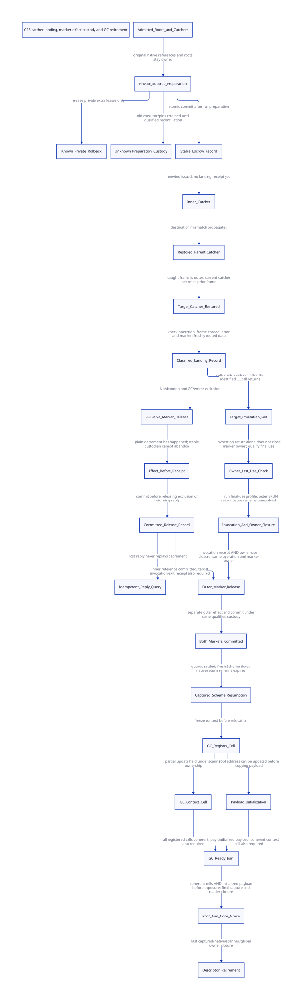

#+TITLE: C23 catcher landing, exact marker settlement and mutable GC slots
#+SETUPFILE: ../../modeling/org/setup.org
#+LANGUAGE: en
#+PROPERTY: header-args :eval never
#+STARTUP: overview

* RESEARCH Decision and evidence boundary
:PROPERTIES:
:CUSTOM_ID: catcher-landing-marker-settlement
:AUTHORITY: GambitCatcherLandingMarkerSettlement
:BASELINE: C23
:EVIDENCE_SCOPE: Local vendor source, bounded protocol and conditional native refinement
:END:

Separate preparation commit, target catcher arrival, target invocation return,
marker reference release, and root/code retirement. They are different facts
with different issuers. A lost reply queries a stable operation record; it never
reissues a longjmp or a native reference decrement.

Implementation evidence comes from the current local vendor/gambit files,
including the modular headers. HEAD alone does not identify the dirty checkout;
source witnesses bind content hashes and anchor lines. The complete runtime
composition is rebound separately. Some runtime files differ from the parent
study snapshot; see the [[file:../../../evidence/research/catcher-landing-marker-settlement/parent-composition-drift.json][exact parent/current drift list]]. The parent input
receipt itself remains immutable, but its native/source conclusions are not
inherited as qualification of the changed runtime. The bounded formal protocol
and current local-source observations have distinct evidence scopes. External literature is
research evidence, not an alternate implementation source. This study changes
models, research tooling and documentation only. No runtime or native test runs.

The [[file:models/sysml/catcher-landing-marker-settlement.sysml][native SysML package]] owns source, issuer, component, leaf qualification,
composition, memory and benefit rows. Python orchestrates the installed evaluator,
ASCENT, QNT and Lean; it does not parse SysML. The [[file:catcher-landing-marker-settlement-matrix.org][matrix]] and [[file:diagrams/catcher-landing-marker-settlement.d2][D2]] /  are
projections. The parent [[file:nested-domain-root-retirement-design.org][joint-root/unwind study]] remains immutable evidence.

* RESEARCH Research grounding
:PROPERTIES:
:CUSTOM_ID: catcher-settlement-basis
:END:

[[https://www.schemeworkshop.org/2000/feeley.ps][Feeley, continuation/C interoperability (2000), sections 1–5]] distinguishes
unlimited Scheme control from dynamic C extent. Lazy native frame removal allows
Scheme restoration after a foreign target expires; actual return to that target
must fail. Its independent-native-stack proposal was not implemented then. We
retain this semantic distinction while replacing implicit lifetime coordination.
The official PostScript and extracted text are locally hash-bound; missing glyphs
preclude reconstructed quotations. Historical timings do not predict this design.

[[https://www.iro.umontreal.ca/~feeley/papers/FeeleyMillerLFP90.pdf][Feeley/Miller PVM (1990), section 2]] motivates bidirectional compiler/backend
contracts. NativeEntrySpec and FrameSpec should specify roots, native return
identity and exit intent rather than relying on macro placement alone.

[[https://anil.recoil.org/papers/2021-pldi-retroeff.pdf][OCaml effect handlers (PLDI 2021), sections 3.2, 5.3 and 7]] discusses resource
cleanup and explicit callback/stack transitions. Its one-shot control does not
cross C frames. We learn explicit effect boundaries; Gambit's multi-shot semantics
are retained, and OCaml's performance numbers are not transferred.

[[https://www.open-std.org/jtc1/sc22/wg14/www/docs/n3096.pdf][C23 working draft N3096, 7.13.2.1]] requires the appropriate thread and live
setjmp invocation. Modified nonvolatile automatic values can be indeterminate
after longjmp. A heap guard does not extend a C invocation's lifetime. Stable
receipts use preissued identities and stable storage; they cannot rely on a
modified local completion flag. Release/acquire publication does not make a plain
count update plus a separate receipt transactional. The public draft is not the
purchased final ISO text.

* RESEARCH Actual source: the two landing cuts
:PROPERTIES:
:CUSTOM_ID: catcher-settlement-source
:END:

| Point | Local source fact | What can be inferred |
|-------+-------------------+----------------------|
| TRY entry | foreign_conversion.h.in creates a local jmp buffer, saves old catcher and installs the new one | Catcher registration identifies one live native invocation |
| Raw catch | BEGIN_TRY reloads longjmp_err after a nonzero setjmp result | Control reached this catcher; error classification is still required |
| END_TRY | Restores ps->catcher to old_catcher | Current catcher now names the previous frame, not the frame just reached |
| ___call destination check | Requires UNWIND_C_STACK and matching marker; mismatch rethrows | Intermediate catches cannot sign accepted target landing |
| Before frame pop | The matching ___call frame is still executing | A target-arrival receipt does not prove this invocation has returned |
| Caller after ___call | ___run receives the result, then performs marker cleanup | A separate invocation-exit adapter can witness target return after classifying this path |
| Generic ___run error catch | Also catches errors outside accepted target-return paths | FailedNativeExit needs its own contract; it is not AcceptedNativeReturn |

The proposed ClassifiedLandingReceipt contains OperationId, native thread
incarnation, ContextId, TargetFrameId/generation, marker identity, subtree identity,
exit kind and descriptor/root bindings. It is signed after target checks and
catcher restoration, before any new callback or interruptible cleanup. Record
the caught frame's stable identity explicitly: comparing current ps->catcher with
the target would be wrong after END_TRY.

** Marker owner lifetime and repeated ___call invocations

The actual SFUN_ERROR_VOID/SCMOBJ/general loops can invoke ___call again using
the same marker after conversion failure. A single invocation exit therefore
does not close a marker-owning SFUN admission. The full architecture requires an
OwnerUseClosureReceipt, tied to MarkerOwnerId and the final permitted use, before
that owner's reference is released or return validity permanently revoked.
Stale receipts must not close a later invocation's still-open use permission.

The bounded model admits the outer ___run single-call/last-use profile only; its
inner marker-owning admission has been abandoned by the outward unwind. It does
not certify an outer SFUN conversion retry loop. For that broader profile,
owner-use closure, conversion/error reentry and validity revocation need extra
states/refinement. This is a semantic coverage gap, not permission to reject
existing conversion behavior silently. The last-use assumption must be checked
at the generated entry adapter, not inferred from a matching marker alone.

NativeInvocationExitReceipt is distinct. Its signer is the qualified caller-side
adapter after the identified ___call has actually returned. The outer marker
reference release requires this receipt and qualified owner-use closure. The target frame and its code lease
remain live between the two cuts. Other native callers/image owners still require
separate leases; this is not global unload authority.

The current source has these control points but no complete stable receipt
issuer. Proper-tail-call, trampoline retry, SFUN conversion errors, conditional
CFUN cleanup catchers and generic exception exits need explicit lowering and
classification. The generated END_SFUN cleanup and ___run cleanup must delegate the same managed
release ticket. An unchanged unconditional legacy kill left beside escrow
settlement would permit a second decrement on ordinary returns; a skipped SFUN
cleanup after outer unwind would instead leak its reference. These sites are
replacement targets, not an additional cleanup layer. Conversion-cleanup CFUN
catchers must forward ownership without signing the final target receipt.

A root-backed marker value must be reloaded after possible GC;
no pointer cached before allocation constitutes an identity receipt.

* RESEARCH Partial preparation and lost replies
:PROPERTIES:
:CUSTOM_ID: catcher-settlement-preparation
:END:

The stable operation exists outside the C frames that may be discarded.
Preparation records each private root/code/marker lease before any subsequent
interruptible work. Two prepared entries stand for a bounded subtree in this
model, not a proof for every dynamic descendant graph.

- Known failure before publication rolls back only private extra leases. Original
  marker native references, source roots and descriptor leases remain owned.
- Unknown preparation retains those original resources and the private progress
  ledger. Reconciliation requires old-executor exclusion and known candidate
  identities; absence of a reply or elapsed time is insufficient. The model does
  not recover an allocation pointer lost before any stable record.
- Full preparation is release-published as the subtree escrow commit. Native
  return claims are then closed. Lost escrow acknowledgement queries the same
  operation; the native transfer is not repeated under a new identity.
- Accepted landing and release commits are recorded before reply delivery.
  Missing replies therefore query existing results. A genuine continuation
  resumption has a new execution ticket and cannot consume the old marker lease.

The QNT escrow action changes ownership and validity in one logical step. It is
not a claim that several C stores or two marker vectors form a hardware atomic
transaction. Native lowering must close competing return admission, retain root
scan participation, and publish one authoritative operation generation under the
same protocol. Staggered vector invalidations must remain hidden from competing
users and GC or be represented by additional owned progress states. This
multi-store refinement, including failure before acknowledgement, remains open;
a release store on the final receipt alone is insufficient.

Marker validity closure must occur after the kernel has accepted the requested
native destination, not before its first-return validity check. The managed
return adapter must coordinate this cut; simply clearing the existing vector
before running the unchanged return handler is not equivalent.

* RESEARCH Exactly once includes the physical decrement window
:PROPERTIES:
:CUSTOM_ID: catcher-settlement-release
:END:

The current kill_sfun_stack_marker first clears vector element zero, then calls
still_obj_refcount_dec. The latter performs an ordinary decrement with no receipt,
locking or idempotence check. The allocator starts the still reference count at
one; still scanning reads that count. Scheme also exposes a refcount writer, and
frame reflection can reveal internal values. Source function purity alone does
not establish exclusive ownership or an effective native leaf ABI.

The model's refI/refO fields count the two owned native reference obligations,
not all references in the physical still-object header. Other admitted owners
require their own accounting. Discharging this native obligation never proves
that the real header is zero or the Scheme object unreachable. Refinement must
show that the physical decrement consumes this live owned reference without
underflow, even when other legitimate references exist.

The retained-marker profile requires a qualified NoAbandon release interval:

1. Validate the marker incarnation and single owned native reference. All competing
   count writers must be closed or mediated, including raw FFI and Scheme aliases.
2. Obtain required metadata and participation permissions before entering the
   leaf. A busy collector/writer gate defers work while stable custody remains;
   do not wait on GC while holding a lease that prevents that GC from finishing.
3. Use the actual mutable root slot, acquire exclusion from collector/count
   readers, and establish acknowledged cancellation/non-local-exit restrictions.
4. Perform the physical count decrement. The model exposes a state in which the
   decrement happened but the release receipt has not committed.
5. Commit the release ticket before dropping exclusion, restoring cancellation or
   delivering a reply. If cancellation restoration does not return, the committed
   ticket and stable owner remain observable.

No allocation, logging, callback, safepoint or abandonment may occur inside this
interval. Compiler prologue/epilogue instrumentation and asynchronous exits must
also qualify. A C23 atomic done flag around a plain decrement is insufficient.
The collector must participate in the same ordering/exclusion carrier; publishing
only the receipt does not synchronize its plain count read.

A qualified collective stop-the-world profile may reuse its existing mutator/
collector exclusion rather than add a per-marker lock. This requires a complete
participant/foreign-thread argument. A concurrent collector requires a different
shared count protocol or retirement of that count dependency. Neither native
qualification is proved here. If the leaf can be abandoned after the effect,
retain custody and refuse retry; exact-once completion cannot be inferred.

* RESEARCH Mutable root cells and partially initialized destinations
:PROPERTIES:
:CUSTOM_ID: catcher-settlement-root-updates
:END:

The real mark_array updates *cell both for a newly forwarded object and when
another worker already forwarded it. In the winner path that root update precedes
payload copying and publish_object_scan. Consequently three facts differ:
canonical forwarding identity, all live root cells updated, and copy initialization
complete. An acquire load of a cached SCMOBJ does not supply these facts.

The relocating cell represents a movable procedure/payload root, not relocation of
the current still-allocated marker itself. The joint model exposes registry-root update, resumed-context-root update and
object-copy completion as separate steps. During a partial update, Scheme/native
borrowers remain parked while the scanner retains roots and descriptors. GC can
update either the registry first and then its context consumer, or finish payload
initialization before the other cell is updated. Completion requires both coherent
cells and initialized payload. A fresh native borrow reloads the registered slot.

On Scheme reentry, the borrowed value is delivered into a registered mutable
context root and the native borrow ends. The whole Scheme execution is not held
under a no-GC borrow: GC can run and rewrite both cells while that context is
parked. This avoids introducing a borrow→GC→borrow cycle. The model has one
relocation and one active scanner; every real alias, safepoint map, object-scan
publication and global collector-termination condition remains an implementation
refinement obligation.

Captured Scheme frames continue to consume frame descriptors after native marker
invalidation and after the native count reaches zero. Root retirement therefore
requires reader/borrow closure; descriptor retirement additionally requires final
capture, native invocation and code-reader closure. Cross-VM and permanent raw
module pointers remain external image-lease obligations.

* RESEARCH C23 alternative: retire the managed marker vector
:PROPERTIES:
:CUSTOM_ID: catcher-settlement-token-alternative
:END:

A stronger architectural candidate places return authority in a generation-bearing
NativeReturnToken inside the already necessary stable native-frame record. Scheme
procedure values live in RootBundle slots. NativeEntrySpec and FrameSpec describe
the return token and its root kinds explicitly. A captured Scheme continuation
retains an expired native token without reviving its return permission.

This could retire the managed path's marker-vector constructor, native still
ownership reference and kill/refcount coupling. It cannot retire generic still
allocation/refcounting used elsewhere. It is not implemented or proved by the
retained-marker model above.

Simply calling Scheme make-vector from C is not a solution: C callback bootstrap
currently needs the marker before Scheme entry, and ___alloc_scmobj chooses still
allocation for a non-null processor. The new native portal must use the stable
return token before any Scheme heap object exists. This requires a real entry/
frame ABI change, not a wrapper around the current C constructor.

A two-word index/generation handle may change FRAME_SPACE(2) to a different typed
frame layout. The actual space delta depends on alignment; it is not assumed to
be exactly one word. Compact handles require explicit generation exhaustion and
ABA rules. Wide boxed handles can reintroduce Scheme allocations.

Frame-ref, frame-set and frame serialization are real consumers. A managed token
needs a defined reflective view, shared identity rules and serialization behavior
for expired/live native targets. Reconstituting an already dead catcher as live
is forbidden. Rejecting or changing a currently supported reflective behavior
cannot be booked as semantic equivalence without a separate decision. ModuleSpec
must invalidate generated callers, descriptors, reflection/serialization plans
and cached artifacts when this FrameSpec fingerprint changes.

Here E counts qualified marker-owning SFUN/___run admissions, not every ___call
invocation, trampoline trip or Scheme resumption. The real SFUN conversion-error
loop can call ___call again with the same marker. MarkerOwnerId and invocation
FrameId must therefore remain distinct; a receipt for one invocation does not
settle a reused owner reference belonging to a later admitted use.

| Count or cost | Current retained-marker path | Token candidate | Boundary |
|---------------+------------------------------+-----------------+----------|
| Logical marker-vector constructions for E admitted entries | E | Eligible to remove E | No claim about number of malloc attempts |
| Native marker-reference drops | E | Eligible to remove E | Generic foreign/still references remain |
| Local marker object footprint | (STILL_BODY+n) words per object | Token/frame/view storage instead | Bound source has STILL_BODY=6; n=2 only in the non-single-threaded branch |
| Conditional old footprint | 8 words for that branch; 64 bytes if words are 64-bit | New byte footprint not established | Excludes allocator alignment/metadata and does not qualify the effective Darwin configuration |
| Reflective/wide-handle Scheme objects | Existing marker objects | R reflective views plus S fallback boxed handles | Scheme-object construction reduction requires R+S<E |
| Additional native-owned token/view reference releases | Existing unrelated owners remain | D new native count releases if the replacement introduces such owners | Net native count-release reduction requires D<E |
| Native support | Existing marker lifetime plus new qualified guard/roots | Token acquisitions, generation checks and retained operation records | Common necessary RootRegistry/guard support must not be counted twice |

The candidate therefore removes E-(R+S) Scheme-object constructions and E-D
native count releases only when the respective replacements and accounting are
qualified. D is not assumed zero: a boxed handle that recreates native still
ownership can reintroduce the very release work being retired.

Object construction counts alone are not a runtime net-benefit proof. Positive
work return requires removed vector/count/census work to exceed token acquisition,
lookup, reflective-view, frame-layout and additional GC/receipt costs. Metadata
may grow, and unknown outcomes can retain it indefinitely. Reuse the necessary
stable frame/guard ledger; a separate token ledger layered on top weakens the case.
No Zig-specific semantic or support-work saving is demonstrated by either C23 path.

* RESEARCH Formal evidence and remaining obligations
:PROPERTIES:
:CUSTOM_ID: catcher-settlement-formal
:END:

[[file:models/quint/catcher_landing_marker_settlement.qnt][QNT]] models two native catchers, two marker native references, partial preparation,
one relocation, separate receipt/effect states and two Scheme resumptions.
Initial RootBundle admission, the outer ___run last-use profile and a qualified
NoAbandon permit are explicit premises. The model cannot turn those premises into a native certificate.
The safety result bounds each physical release to at most one and relates a
committed settlement to that effect. It does not prove scheduler fairness,
eventual reconciliation or completion under indefinitely lost replies. Unknown
outcomes retain custody rather than acquire a timeout-based release permission.

[[file:models/lean/CatcherSettlementAst.lean][The Lean AST]] is extracted from typed QNT IR. Action preservation is organized
into [[file:models/lean/CatcherPreparationSteps.lean][preparation]], [[file:models/lean/CatcherLandingSteps.lean][landing]], [[file:models/lean/CatcherMarkerSteps.lean][marker settlement]] and [[file:models/lean/CatcherGcSteps.lean][GC]] proof modules (with separate execution and retirement scopes); the
[[file:models/lean/CatcherSettlement.lean][composition proof]] joins them and derives reachable-state properties. The
trusted parser/emitter and C23 source refinement remain separate obligations.
The initial landing induction attempt exposed a missing invariant link from
validated target identity to its error class. This was an inductive-strength gap:
the action already checked the class, and no reachable wrong-class landing was
established. The strengthened invariant records that provenance; the failing
proof and source snapshot are retained. Action proofs are split at private preparation/escrow, dispatch/receipt,
inner/outer release and execution/retirement boundaries after module-level
timeouts. Source-bound formal receipts preserve successful scopes for resuming
later controls; each receipt binds its transitive Lean source imports, QNT/
projection inputs, generated AST, compiler and output/log hashes. Reuse never
imports a failed or timeout-only scope. A separate final manifest binds the
complete set of formal sources. Property proofs use direct congruence/arithmetic reasoning over Safe in
landing/lifetime scopes; failed arithmetic and wildcard-destructuring attempts
are retained. Default
heartbeat and wall-clock limits remain unchanged; no property was weakened. retained timeout/diagnostic attempts are
not relabeled as successful qualification.

Countercontrols alter partial rollback, transit-catcher signing, the physical
release gap, reply replay, partially updated context exposure, uninitialized
payload exposure, target-return permission and descriptor lifetime. Four separate
typed-IR corruption controls check extraction rejection.

[[file:../../modeling/ascent/catcher-landing-marker-settlement.rules.scm][Actual ASCENT rules]] join component/source/action/compiled lemma, cross-component
contracts and five explicit leaf/owner qualification conditions. Missing native leaf
qualification, a forged effective leaf boundary or treating an arbitrary SFUN
invocation exit as owner closure blocks candidacy. Synthetic
completeness is a wiring control, not native evidence.

| Obligation | Research/model result | Native gap |
|------------+-----------------------+------------|
| Partial preparation | Original custody survives modeled known/unknown failure | Complete allocation/pin capture and old-executor exclusion |
| Landing | Exact target classification after catcher restoration | Generated frame/thread/context/marker incarnation signer |
| Target return | Distinct from target arrival; bounded outer ___run last-use profile | Caller-side return plus owner-use closure; SFUN retry loop remains outside this model |
| Marker release | Effect/receipt gap and replay are explicit | NoAbandon, all-writer closure and same GC synchronization carrier |
| Mutable roots | Two cells and object initialization have distinct completion cuts | Full real slot map, parked-context and collector-copy/termination refinement |
| Descriptor retirement | Capture/scanner/native leases are distinct from count zero | Global image groups, cross-VM and raw pointer owners |
| Token alternative | Concrete retirement candidates and count thresholds | Entry ABI, reflection/serialization and end-to-end equivalence |

* RESEARCH Receipts and migration order

- [[file:../../../evidence/research/catcher-landing-marker-settlement/checks.json][Scoped result and unresolved native assumptions]]
- [[file:../../../evidence/research/catcher-landing-marker-settlement/source-witnesses.json][Local vendor anchors and hashes]]
- [[file:../../../evidence/research/catcher-landing-marker-settlement/ascent-results.json][ASCENT qualification and countercontrols]]
- [[file:../../../evidence/research/catcher-landing-marker-settlement/input.json][Input, parent and runtime-composition binding]]

First generate explicit native-frame/root identities; then add classified arrival
and invocation-exit adapters; then qualify exclusive marker release or select a
fully specified token replacement; finally join mutable root updates and global
image retirement. Retire old marker construction/cleanup only after every entry,
reflection consumer and descriptor dependency qualifies. Native paths retired in
this study: zero. No runtime implementation or native/performance tests.
