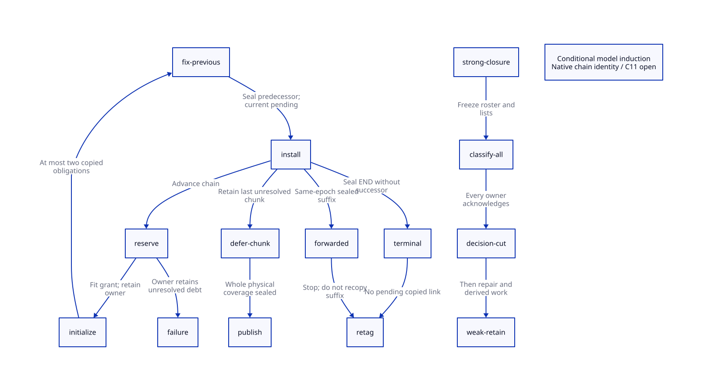

#+TITLE: Complete Captured-Chain Sealing and Global Will Decisions
#+SETUPFILE: ../../modeling/org/setup.org
#+LANGUAGE: en
#+CATEGORY: modern-c
#+PROPERTY: header-args :eval never
#+OPTIONS: toc:3

* RESEARCH Decision and authority
:PROPERTIES:
:CUSTOM_ID: chain-seal-decision
:AUTHORITY: GambitChainSealWillCut
:STATUS: conditional-model-induction; source-and-c11-open
:MAINLINE: modern-generated-c
:END:

Modern C owns this redesign. Scheme retains capture and will semantics;
collector workers own copied storage and scanner admission; control owns the
frozen roster and collective decision cut. No Zig runtime or second backend is
required for these gains. This study changes research artifacts only.

[[file:models/sysml/chain-seal-will-cut.sysml][SysML]] is the authority for module seams, source witnesses, proof routes and
benefit rows. Native SysML queries generate [[file:chain-seal-will-cut-matrix.org][the closure/cost matrix]] and
. The [[file:../../modeling/ascent/chain-seal-will-cut.rules.scm][ASCENT DSL]] joins exact model digest/scope receipts,
module-qualified actions and Lean lemmas. File association alone grants nothing.

** Current-source boundary and predecessor drift

The predecessor's cursor-interval exclusion is historical: current =end_heap_chunk=
compares =alloc_heap_chunk_start != work->local_scan_chunk_= and uses explicit
chunk-state transitions. Do not reuse the old stale-cursor witness unchanged.
Current frame copying still calls =publish_object_scan= before its own copied
link is fixed by a subsequent iteration. A different owned chunk can still reach
the publication branch, but exact local-frontier placement must be requalified.
The old receipt is frozen; =predecessor-source-drift.json= records changed inputs.
No native failure is inferred from a sequential model trace of racing C stores.

* RESEARCH Full-chain ownership protocol
:PROPERTIES:
:CUSTOM_ID: chain-seal-protocol
:OBLIGATION: CS-source
:END:

** Source exits and seal points

| Source case | Required seal operation | Prohibited shortcut |
|---+---+---|
| Initial root already END | No fresh frame; ordinary root consumer handles marker | Allocate a fictional pending frame |
| Fresh nonterminal successor | Initialize successor; repair predecessor; seal predecessor; retain current link | Publish predecessor while later ordinary stores overlap scanner |
| Fresh terminal frame | Resolve END link and seal final frame on loop exit | Wait for a nonexistent successor |
| Next old frame already forwarded | Repair predecessor to existing destination; seal predecessor; stop | Recopy suffix or treat forwarding address alone as readiness |
| Initial root already heap-backed | Existing mark-array path; no new chain transaction | Reuse a stack-copy cursor without root classification |
| Capacity failure before successor | Original owner retains pending link and delayed chunk | Report completion or release old stack |

=END_OF_CONT_MARKER= is =VOID=, not a fixnum. The already-forwarded test reads
=ra2=, whereas terminal continuation selection reads =cf=. They are different
branches. RETI and RETN descriptors must agree with both stack and copied-frame
coordinates. The final =orig_ptr= retag follows complete successor resolution.
A chain with zero new frames is distinct from a chain with one terminal copy.

** Rolling seal rather than whole-chain buffering

At an installation boundary there is at most one copied frame with an unresolved
successor. During initialization of its next fresh frame, there can be two
unsealed copied frames: the preceding frame and the newly initialized one.
After predecessor fixup, its header may become READY and the new frame becomes
the sole pending link. This is the =copied-sealed <= 2= transient invariant and
=copied-sealed <= 1= boundary invariant proved by Lean.

A closed physical chunk containing the pending frame remains private/deferred.
It becomes publishable only when every contained object is initialized, every
contained captured-frame successor is sealed, its terminator is installed, and
no retained scanner/copy operation still modifies that footprint. Object READY
and chunk QUEUED remain separate authorities. A sealed frame in a chunk with an
unsealed neighbour does not authorize enqueueing that chunk.

The candidate drains the preceding deferred chunk before allowing another
chunk-close that would create a second deferred record. For one sequential
copier with a fit-admitted successor this bounds deferred closed chunks by one.
A newly open allocation chunk is additional storage. Recursive/nested capture,
multiple chains and other producers require separate owner records: the bound
is per admitted copier, not per VM. No O(N) chain-buffer claim is assigned to
the existing runtime; rolling staging avoids that cost in the proposed design.

** Same-epoch forwarded suffix receipt
:PROPERTIES:
:RECEIPT: SealedSuffixReceipt
:ISSUER: copy-owner-plus-epoch-storage-authority
:END:

An address in a forwarding word proves identity, not full readiness. A suffix
receipt requires destination identity/epoch, descriptor validity, all suffix
links sealed, surviving storage authority and an acquire observation of its
publication. Existing =MISC_MEM_LOCK= serializes captured-stack copy loops. Under
the new rule, every successful loop exit must seal its suffix before unlock;
then a later lock holder can obtain the receipt from that completed transaction.
Other forwarding producers and epoch changes must be excluded explicitly.

A partially initialized published address or an unknown previous transaction
cannot be certified. Retain custody and reject progress; do not wait while
holding a lock needed by the completion owner. Capacity failure is not rollback
permission: old-stack forwarding stores may already be visible. Recovery needs
an epoch-retained transaction or a collector-wide failed-epoch exit. Neither is
implemented here. Copy handoff completion never means GC scan termination.

* RESEARCH Capacity admission and quantitative limits
:PROPERTIES:
:CUSTOM_ID: chain-seal-capacity
:END:

#+NAME: chain-capacity-equations
#+BEGIN_EXAMPLE
F = fs + FRAME_EXTRA_SLOTS + SUBTYPED_BODY
copy-path compile guards: FRAME_EXTRA_SLOTS = 1, SUBTYPED_BODY = 1
if descriptor fs <= MAX_NB_FRAME_SLOTS: F <= 8194 words
standard unshared half-section = 131072 / 2 = 65536 words
empty-section usable allocation grant = 65536 - 1 first-link - 2 end reservations
regular closed-chunk upper bound <= threshold + max F + terminator
                                   <= 255 + 8194 + 1 = 8450 words
#+END_EXAMPLE

The frame and chunk inequalities are conditional source-design bounds, not
measured allocation peaks. On an admitted 8-byte-word profile they are 65552
and 67600 bytes respectively. The chunk interval excludes its leading link word
and side metadata, which must be accounted separately. =MSECTION_CHUNK= is a threshold, not a hard object
or chunk-size cap. The captured-copy loop tests the published context allocation
pointer while advancing a local =alloc=; therefore regular threshold checking
cannot simply be assumed for that loop. The 8450-word physical chunk bound stays
unqualified until that check and all allocation producers are refined.

The while-loop fit test is against a concrete limit. Its next allocator may
return a standard section, the shared-stack section or a custom allocation.
Shared-stack limits use the remaining stack space and =3*space+FUDGE=; aggregate
free heap bytes do not prove that the next frame fits. Custom allocators need
explicit size/alignment/epoch receipts. Integer/pointer overflow, section-table
capacity and progress of repeated no-fit attempts remain admission obligations.
Do not turn fatal/no-capacity paths into unbounded retries.

The scalar model's =reserve= assumes a successful concrete grant; =capacityFailure=
models a denied grant retaining the old owner. It does not prove allocator
termination or a total O(1)-byte staging bound. =grantIncludesFrame= and
=closedChunkBound= expose their fit/threshold premises rather than hiding them.

* RESEARCH Legal Scheme input families and remaining reachability gap
:PROPERTIES:
:CUSTOM_ID: chain-seal-scheme
:END:

Public =call/cc= delegates to =##continuation-capture= and wraps the captured
continuation in a retained procedure. The C emitter has an explicit
=CONTINUATION_CAPTURE= route. Non-tail recursive calls with values used after
return can supply a chain; two captures sharing live caller frames can supply
an already-forwarded common suffix during later collection. These are legal
input families, not evidence of exact emitted frame counts.

#+NAME: legal-capture-family
#+BEGIN_SRC scheme :eval never
;; Research witness family only: never built or executed by this study.
(define saved #f)
(define (walk n combine)
  (if (= n 0)
      (call/cc (lambda (k) (set! saved k) (collect-now) 0))
      (combine n (walk (- n 1) combine))))
;; collect-now is an externally supplied GC trigger; combine remains unknown.
#+END_SRC

Optimizations, inlining, descriptor sizes, heap pressure, stack section
boundaries, distinct worker assignment and exact triggering of collection must
still be extracted for the effective configuration. No N is claimed to force a
particular rollover. The standard Scheme source family plus a Gambit GC trigger
is not a portable Scheme GC guarantee. Multi-shot restoration must continue to
consume shared, sealed frame identities and valid descriptors; accounting alone
does not establish source-level continuation equivalence.

Public =make-will= checks the action then invokes =##make-will=; MAKEWILL inserts
into the current context's nonexecutable list. Two distinct wills can reference
one heap testator. To witness interference, register them on distinct admitted
execution contexts, retain the wills, drop all strong references to testator,
and ensure neither action captures it. Two Scheme threads alone do not prove
two processor/list owners. Retained local arguments or closure captures may
make testator strongly reachable and invalidate the proposed witness.

* RESEARCH Shared-testator decision cut
:PROPERTIES:
:CUSTOM_ID: chain-seal-will-cut
:OBLIGATION: CS-weakHistory
:END:

=determine_will_executability= reads live =UNMARKED(testator)=. =process_wills=
classifies its own list and immediately repairs/marks testators. With distinct
wills A/B sharing a strongly unreachable T, a source-enabled schedule is:
A classified executable; A's retention marks T; B then observes marked T and
remains nonexecutable. No duplicate will membership is needed. The existing
strong-to-weak barrier precedes both local classifications and does not forbid
that intra-weak interleaving. This is a conditional semantic discrepancy,
not a native reproduction or a guaranteed C11 execution.

The proposed cut freezes the epoch roster, list membership, and strong closure;
every local list is classified; every participant including empty-list owners
acknowledges; only then may any producer introduce weak-retention marks.
Splitting =process_wills= into classify and retain/repair is necessary for the
barrier design. Action execution stays in the later Scheme finalization path.
Weak repair still discharges omitted testator fields without resetting strong
DONE. Classification receipt and scan-DONE receipt have different meanings.

A separate immutable strong-mark snapshot is an alternative to an additional
classification rendezvous. It costs epoch metadata and stable identity, and
all decision readers must use it. Mutable forwarded headers cannot reconstruct
whether marking came from strong tracing or weak retention. No general global
testator-dedup table is necessary: each will can consult the same frozen fact.
Finalization ordering/cycles and callbacks require their own semantic policies.

Boehm's POPL work on finalization and synchronization motivates separating
reachability decisions, object retention and execution/cleanup synchronization.
It supplies no proof of Gambit's will policy or this phase split. Our policy
premise comes from Gambit's own comment: all paths through weak references imply
executability. [[https://www.hboehm.info/gc/finalization.html][The author's finalization notes]] also distinguish prompt explicit
resource release from GC-triggered finalization. No timely cleanup guarantee is
introduced by the decision cut.

* RESEARCH C11 and formal refinement obligations
:PROPERTIES:
:CUSTOM_ID: chain-seal-formal
:END:

| Boundary | Required modern C refinement | Current status |
|---+---+---|
| Initialize to forwarding | Initialized copied fields and retained owner precede address exposure | Open |
| Fixup to READY | All scanner-overlapping ordinary writes before release READY | Open |
| READY to queue | Entire physical chunk seal then release enqueue; acquire claim | Open |
| Existing suffix | Acquire sealed receipt plus epoch/storage pin | Open |
| Termination | Copier and deferred chunks remain active until handoff; scanning descendants drain separately | Open |
| Strong closure | Roots, private work, in-flight copies and publishers all drained | Inherited open premise |
| Classification cut | Frozen roster; all ack stores released and read acquired; no early weak producer | Open |
| Will list updates | Exclusive list owner; stable forwarded identity; no concurrent registration/action execution | Open |
| Reset/retirement | All receipt observers and scanners finished before epoch reuse | Open |

C11 N1570 sections 5.1.2.4 and 7.17 define happens-before and atomic requirements.
Legacy ordinary payload stores that race are undefined behavior: an SC schedule
is a structural warning, not a guaranteed machine outcome. Stronger atomics at
READY cannot publish writes that occur after READY. Effective Darwin macro
selection and actual primitive memory orders are not qualified by these models.

[[file:models/quint/captured_chain_seal.qnt][Chain QNT]] exercises three fresh frames, empty/terminal/forwarded exits,
transient two-frame debt, denied capacity and injected early publication/release.
[[file:models/quint/will_classification_cut.qnt][Will QNT]] exercises both decision orders, strongly reachable/dead shared
objects, the legacy interference history and missing-cut/roster controls.
The [[file:../../modeling/tools/chain-seal-will-cut-projection.py][restricted extractor]] projects actual typed IR guards, updates, initial
states, invariants and exact step rosters. Integer addition/subtraction extends
the preceding scalar grammar. JSON parsing/emission remain trusted; no general
Quint semantics or source-to-model theorem is claimed.

[[file:models/lean/ChainSeal.lean][Chain Lean]] proves all projected actions and arbitrary-length accounting;
[[file:models/lean/WillCut.lean][will Lean]] proves all actions and consistent classified decisions. The chain
model counts a sealed prefix; a native refinement still needs a bijection from
indices to unique copied headers/link slots and a physical-chunk coverage map.
=publishPrefix= represents eligible sealed coverage, not permission to publish a
partly sealed physical chunk. =done= means copy-owner handoff, not scanned GC
closure. =suffixReady= and fit are admission inputs, not proven issuers.

* RESEARCH Retirement, net benefit and next proof cut
:PROPERTIES:
:CUSTOM_ID: chain-seal-net
:END:

1. Introduce copy-transaction seal and pending-link ownership, preserving source root identity.
2. Route terminal/already-forwarded exits through explicit sealing; retain failure custody.
3. Gate object readiness and physical chunk publication using their separate footprints.
4. Split local will classification from weak retention; install collective cut or strong snapshot.
5. Retire immediate captured-frame READY and fused classify-retain entry only after all callers migrate.
6. Refine descriptor/slot identity, chunk coverage, every weak producer and real C11 operations before acceptance.

Preserve global copy locking initially as a semantic ownership boundary in the
model; removing it requires a separate uniqueness/forwarding proof, not a faster
language. Existing suffix reuse and direct weak-field repair are baseline gains
already present in C and receive zero new performance credit. The proposed
modern C architecture enables safe parallel scan overlap rather than locking
all scanners for an entire captured chain. It does not guarantee a speedup.

For P active copy owners, let H be useful scan work overlapped by prefix sealing,
A be added seal/receipt work, and B be classification rendezvous cost. A runtime
net speed benefit needs H > A+B in the actual workload. Retained staging bytes
are bounded by the sum of admitted per-owner chunk grants, not by 1 or 2 machine
words. A whole-chain-serial workload or dominant barrier latency can refute a
performance claim even though the correctness contract remains necessary.

The next proof gap is physical object/slot-to-chunk coverage plus all weak mark
producers, not more synthetic tests of the existing scalar inequalities.

* References and receipts

- [[file:../../../vendor/gambit/lib/mem.c][Current collector]], [[file:../../../vendor/gambit/lib/mem.h][capacity constants]], [[file:../../../vendor/gambit/include/gambit.h.in][object layouts]] and
  Scheme/C generator callers are pinned in the native SysML projection receipts.
- [[https://www.hboehm.info/popl03/web/][Hans-J. Boehm, Destructors, Finalizers, and Synchronization, POPL 2003]]:
  conceptual motivation only; no inference of Gambit-specific correctness.
- [[https://www.open-std.org/jtc1/sc22/wg14/www/docs/n1570.pdf][C11 draft N1570]]: publication and data-race obligations, not platform qualification.
- [[file:../../../evidence/research/chain-seal-will-cut/][Formal checks and input hashes]] and the frozen predecessor
  distinguish actual model receipts from synthetic ASCENT controls and native acceptance.
