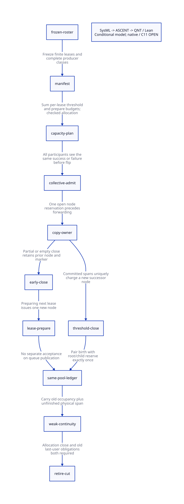

#+TITLE: Chunk Capacity Charges — Source Closure and Collective Admission
#+SETUPFILE: ../../modeling/org/setup.org
#+LANGUAGE: en
#+PROPERTY: header-args :eval never
#+OPTIONS: toc:3

* RESEARCH Decision and evidence boundary
:PROPERTIES:
:CUSTOM_ID: chunk-capacity-charge
:AUTHORITY: GambitChunkCapacityCharge
:STATUS: conditional-formal-design; source-injection-and-C11-open
:END:

Modern C is the required runtime line. This study refines the node pool's demand
contract, not its implementation. [[file:models/sysml/chunk-capacity-charge.sysml][SysML]] owns callers, charges, receipts,
module seams, proof routing and cost rows. Native queries generate [[file:chunk-capacity-charge-matrix.org][the matrix]]
and . [[file:../../modeling/ascent/chunk-capacity-charge.rules.scm][ASCENT]] joins these obligations to checked actions, actual prior
pool steps and hash-bound source/caller observations.

The previous [[file:chunk-node-pool-design.org][pool study]] used the safe but deliberately loose allowance
=floor(A/255)+V+P+D=. Here L means the number of actual heap-section preparation
visits, including all initial P preparations. With one record reserved for each
chunk start, the source topology gives =starts=T+L=. Therefore do not add P again
when using this definition of L. No previous evidence is rewritten.

This is not a claim that the current runtime already has independent queue nodes,
capacity receipts or a working preflight failure branch. The pinned source still
uses the shared terminal/link representation. The study modifies no runtime file,
runs no native program and reports no measured speedup.

* RESEARCH Exact source call and accounting inventory
:PROPERTIES:
:CUSTOM_ID: charge-source
:END:

[[file:../../../evidence/research/chunk-capacity-charge/source-witnesses.json][Source anchors]] and [[file:../../../evidence/research/chunk-capacity-charge/caller-audit.json][caller audit]] bind immutable source snapshots and all literal
=mem.c= call sites for start/end/prepare. Comments and strings are masked without
changing offsets. The inventory is lexical, not a verified C parser, effective
preprocessed call graph or proof that arbitrary callbacks cannot reach the code.
The current source hash and any later drift are retained in the evidence set.

** Exhaustive literal end/start/prepare callers in the selected source

| Callee | Caller | Real effect | Charge |
|--------+--------+-------------+--------|
| end_heap_chunk | mark_array | Committed object span crossed threshold | T += 1 |
| end_heap_chunk | mark_captured_continuation_locked | Committed frame span crossed threshold | T += 1 |
| end_heap_chunk | reserve_copy | Next required contiguous copy does not fit | E += 1, even if span is zero |
| start_heap_chunk | mark_array | Immediately follows threshold close | One new successor node |
| start_heap_chunk | mark_captured_continuation_locked | Immediately follows threshold close | One new successor node |
| start_heap_chunk | prepare_heap_msection | First chunk of a prepared heap lease | One node per visit |
| prepare_heap_msection | setup_stack_heap_vmstate | Initial worker loop | Initial visits already included in L |
| prepare_heap_msection | reserve_copy | New lease after early close | Later visits in L |

For this proposed reservation policy, births count chunk starts rather than
successful enqueues. A locally owned or still empty open chunk retains its record.
A later queue publication moves the same accepted task; it must not allocate or
accept it again. Frame-seal and first-field Tail responsibilities remain separate.
The birth accounting does not make an incompletely initialized payload scannable.

** Threshold charge: committed allocation span, not copied Scheme payload

=start_heap_chunk= sets its limit to =start+___MSECTION_CHUNK=; selected =mem.h=
uses 255. Both threshold callers compare their post-commit =alloc= against this
limit and then end/start the chunk. Thus each threshold-ended chunk can be
charged at least 255 allocation-span words. Overshoot is allowed and is not a
second threshold event. Header words, frame extra slots, leading/trailing alignment
objects and other committed padding count in A. Marker and initial-prefix words
are accounted physically but never reused as copied-body threshold credit.

=reserve_copy= calculates the contiguous interval before forwarding. On a lost
object-forwarding CAS, =cancel_copy= returns the grant's begin, not an earlier
chunk start or previous lease. It does not undo a preceding no-fit close and
prepare. Only the uncommitted interval is refunded. A node per copy attempt would
be the wrong abstraction: retries may be numerous while chunk starts remain fixed.

The weak-end equation =reserved-cancelled=copied+padding= is a diagnostic after
the actual work and only after outstanding grants are gone. It is not an input
from which a preflight coordinator can predict a valid A_max. Nor is
=gc_round.source_words= automatically a tospace bound for frames, extra slots,
padding and hidden producer activity. Use physical admitted intervals instead.

** Early and empty endings

=reserve_copy= is the only literal early-close caller. It writes the cursor back,
closes the chunk, obtains a new msection and prepares it. An early close can have
fewer than 255 committed words. It may also be empty immediately after a prior
threshold start or a previous no-fit rollover. =end_heap_chunk= writes a marker
even for an empty chunk. That marker creates no second independent node. The next
=prepare_heap_msection= creates the next open-chunk record.

The two marker words reserved by =prepare_heap_msection= cover a nonempty terminal
followed by an empty terminal. They are not evidence of two extra starts. An empty
close before a failed/new preparation still retains the old record and physical
marker; it cannot refund them based on zero payload.

** Phase and restoration boundaries

The real =___garbage_collect_pstate= sequence calls strong tracing, crosses a
barrier, then calls weak tracing without rerunning =setup_stack_heap_vmstate=.
Therefore cursor, lease, open-chunk identity, pending scan work and node occupancy
carry across the cut. A 254-word strong prefix followed by one weak word crosses
the 255 threshold. Independently flooring phase totals loses this event.

Current =move_continuation= copies to the stack cursor and does not call any
start/end/prepare function. Post-GC heap-fudge restoration may call
=next_heap_msection=, but does not call =prepare_heap_msection=. These paths remain
future storage users relevant to reclamation, yet they are not additional current
chunk-node births. If a redesigned restore path emits chunks, it adds a new class
and invalidates this receipt until that class is budgeted.

* RESEARCH Tighter finite bound
:PROPERTIES:
:CUSTOM_ID: charge-bound
:END:

** Epoch-wide form

For a selected profile with exactly the above birth paths and one reservation per
start:

#+begin_example
T      = threshold endings across strong and weak
L      = heap lease preparations, including initial workers
A      = all committed span words; each threshold span is charged once
D      = separate dummy queue records
starts = T + L
255*T <= A
B_data <= floor(A_max / 255) + L_max
B_total = B_data + D
#+end_example

There is no extra P in this form: L includes the initial P heap preparations.
A threshold successor is already counted by T; a partial/empty lease successor
by L. A no-fit loop that cannot obtain its next lease has no successful new start,
but its preceding close remains charged. Capacity safety does not turn an exhausted
tospace or fatal allocator path into successful GC progress.

** Per-lease form

All threshold spans stay inside their lease, including phase-spanning chunks.
For a fixed disjoint lease manifest with committed-span ceiling U_i:

#+begin_example
B_data <= sum_i (floor(U_i / 255) + 1)
B_total = sum_i (floor(U_i / 255) + 1) + D
#+end_example

[[file:models/lean/CapacityCharge.lean][Lean]] proves the floor implication and list-sum arithmetic under the stated
per-lease charge relation. It does not derive interval disjointness from raw C
pointers. Prefix/marker/fudge reservations can reduce U_i once their full physical
layout is qualified; the current conservative expression need not subtract them.

** Default finite-list profile and its admission limits

A promising source-derived profile fixes N distinct msections before setup,
excludes =custom_msection_alloc=, freezes resize/extension and prevents stack
reassignment or native reentry throughout strong/weak tracing. Initial setup
assigns P stack and P heap sections. Later heap acquisition visits at most N-2P
fresh sections, followed by at most one shared stack fallback per worker. The
real allocator refuses further exhaustion once stack and heap already share.
Under this profile, L <= P+(N-2P)+P = N.

The caller audit also records that the only literal =next_stack_msection= caller
in this snapshot is processor setup, not a tracing function. This supports the
profile argument but does not establish that concurrent processor setup, external
field writes or hidden callback reentry are impossible. Those are admission facts
that the real coordinator must establish; do not infer them from a null custom
allocator pointer observed without ownership.

With U_i <= H=65536 from the selected source:

#+begin_example
floor(H/255) = 257
B_data <= 258*N
B_total <= 258*N + D
#+end_example

This is a sufficient selected capacity under the qualified profile, not a claim
that each real section produces 258 chunks. Actual effective word size, section
layout and threshold must match the receipt. If the profile cannot certify these
facts, use another proven finite lease plan or refuse the tight receipt.

* RESEARCH Capacity receipt: signers, ordering and collective failure
:PROPERTIES:
:CUSTOM_ID: charge-receipt
:END:

The proposed =CapacityPlanReceipt= contains:

#+begin_src text :eval never
CapacityPlanReceipt {
  epoch, rosterGeneration, effectiveProfileDigest,
  sectionManifestDigest, intervalAndVisitProofDigest,
  birthClassDigest, thresholdK, perLeaseSpanCeilings,
  initialWorkerCount, visitLimit, dummyCount,
  dataRecordLimit, recordStride, checkedNativeBytes,
  allocatedPoolIdentity, collectiveDecisionIdentity
}
#+end_src

** Real candidate insertion point

=___garbage_collect_pstate= freezes roots and crosses a barrier before calling
=garbage_collect_setup_phase=. Setup immediately has side effects: coordinator
flip/setup and other workers' still-object preparation. A successful plan must be
allocated, checked and collectively accepted between that frozen-roster barrier
and the first setup side effect. Merely inserting an allocator into processor 0's
existing setup branch is insufficient.

All participants must observe the same accepted/rejected generation before any
participant proceeds. On OOM or rejected manifest, no participant may independently
return while the others enter the next barrier. The design needs a collective
failure outcome and acknowledgement path preserving the old roots/parity and
retaining ambiguous ownership. That path does not currently exist for this pool.
An unknown coordinator result keeps the cohort and its old resources under
custody; a timeout is not a rejection acknowledgement.

** Required signer evidence

- Storage owner: stable, finite, acyclic section manifest; non-overlapping lease
  bounds; no rewind or hidden extension; supported fallback and custom-hook policy.
- Charge-class owner: complete start/end/prepare emitter inventory, physical span
  mapping, exact profile K, phase continuity, cancellation rules and exception cuts.
- Pool owner: overflow-checked count/stride multiplication, actual allocation and
  initialization, dedicated dummy records, no recursive Scheme GC requirement.
- Collective coordinator: closed roster, shared epoch/decision identity, all
  participants' accept/reject acknowledgements and no premature setup effects.

The null-hook/default allocator checks cannot replace this combined evidence.
No real code currently signs this receipt; the entries identify actual owners and
source insertion points requiring redesign.

** Weak continuity is not a new pool admission

The worker must publish a continuity record containing the same lease/start/end,
open span remainder, issued nodes, unresolved grants/Tail/copy work and observers.
The coordinator verifies identity and completion conditions. It must not reset
=issued=, reclaim strong nodes, re-run pool initialization or sign a new isolated
weak budget. An interrupted or unknown snapshot retains the old responsibility.

* RESEARCH C11 and actual QNT/Lean composition
:PROPERTIES:
:CUSTOM_ID: charge-models
:END:

[[file:models/quint/chunk_capacity_charge.qnt][The executable QNT model]] separates grant reserve, forwarding visibility,
commit and cancellation. It distinguishes threshold close/start from early close
and next-visit preparation, and preserves phase-spanning spans. Allocation classes
1, 254 and 257 exercise boundary/carry/overshoot histories; they do not enumerate
every legal Scheme allocation size. Its no-fit event imports a physical observation,
not an independently proved result of pointer subtraction.

[[file:models/lean/CapacityChargeAst.lean][The AST]] is extracted from actual typed IR. The restricted emitter adds only
literal-coefficient integer multiplication; nonlinear products and unsupported
operators are rejected. Parser/emitter correctness and C machine arithmetic remain
trusted/unproved. [[file:models/lean/CapacityCharge.lean][Induction]] ranges over all states satisfying the invariant,
not only the sample 7-record pool. Literal-grant classes bound this operational
slice; the separate arithmetic/list-sum results are general under their premises.

[[file:models/lean/CapacityChargeComposition.lean][The composition]] imports the exact preceding =NodePoolAst= and =NodePool=
proofs rather than recreating a similar model. =Bound= equates capacity/budget and
issued node count with actual chunk births. Threshold and lease births are paired
with exactly one old =reserve= or =derive= update; the old free-space guard follows
from the charge theorem. Non-birth source steps and non-allocating pool transport
steps interleave without changing that relation. The guarded product has actual
all-step and reachable safety proofs. It also preserves the old-pool relation at
the strong/weak cut. Initial pool storage is an admitted parameterized old state
with one live private node, not the old sample capacity-three initial state.

The product explicitly requires source allocation admission to close before the
pool completes/retires. A counterexample shows individually safe pool counters
and matching birth count are insufficient without this lifetime cut. Strong and
weak source phases are not automatically old pool root-admission phases; when root
admission closes, a new birth requires a still-active parent and =derive= authority.
The real mapping from copy/Tail tasks to that authority remains open.

| C11 boundary | Required relation | Remaining obligation |
|--------------+-------------------+----------------------|
| Owner counters | Commit pointer and charge are owner-private; no new global atomic per word | Stable owner/migration contract |
| Preflight | Initialize plan before release decision; all members acquire matching decision | Effective primitive/storage and collective failure branch |
| Strong/weak cut | Last owner writes before release acknowledgement; next phase after acquire | Carry open span, nodes and unfinished task identity together |
| Birth + old ledger | Child reservation precedes final parent settlement and forwarding exposure | Non-abandonable native segment and failure custody |
| Reclaim | Allocation close plus old last-user closure and generation checks | C11 reads-from and complete callback/observer census |

These are C11 refinement obligations, not a claim that a numerical counter check
or existing full fence establishes them. The abstract product does not model
weak-memory reads-from, effective compiler flags, raw aliases or integer overflow.
All such native/source gates remain unresolved.

* RESEARCH Benefits, costs and retirement
:PROPERTIES:
:CUSTOM_ID: charge-benefit
:END:

At three 8-byte pointer fields, 258 records cost at least 6192 bytes per full
65536-word ceiling: about 1.181% of 524288 tospace bytes. Add D dummy records,
actual stride/padding, pool metadata, pins and retained epochs. This is arithmetic
for the selected capacity plan, not measured residency, live-heap overhead or a
speed claim. A full physical section allocated to stack may be mostly unused by
heap copies, so reserve cost relative to actual live objects can be much larger.

The tighter topology can avoid the dense one-record-per-word ceiling and the
previous duplicate P allowance. It avoids one record per failed copy attempt and
a second pool at the strong/weak cut. These savings are distinct from runtime
speed: record initialization, queue transport, validation, collective failure
coordination and reduced usable heap remain costs. Net gain requires saved
heap-wide atomic/serialization work and useful scan overlap to exceed these costs
plus any extra collection frequency induced by retained pool storage.

Retire the old shared terminal-as-next representation only after all consumers,
local frontier, section transitions, debug helpers, complete failure paths and
last-user reclamation migrate. The source's existing queue gate is not a new
saving. The result does not retire Gambit semantics, frame descriptors, continuation
or C portability; it makes resource and ownership decisions explicit around them.

* RESEARCH Literature and evidence boundaries
:PROPERTIES:
:CUSTOM_ID: charge-literature
:END:

- [[https://www.open-std.org/jtc1/sc22/wg14/www/docs/n1570.pdf][N1570]] 5.1.2.4 and 7.17 define the C11 obligations. The official
  [[https://www.open-std.org/jtc1/sc22/wg14/www/docs/n1479.htm][WG14 memory-model rationale]] explains why data races cannot be repaired by
  informal assumptions about execution order. No C++ runtime direction is proposed.
- [[https://www.cs.toronto.edu/~tabrown/debra/fullpaper.pdf][Brown, Reclaiming Memory for Lock-Free Data Structures]] distinguishes record
  retirement from safe reuse and discusses stalled observers. We retain that
  distinction; its signal scheme and performance figures do not qualify Gambit.

Model checks, source witnesses and native acceptance are separate. Actual ASCENT
admission remains blocked by source and platform obligations. Negative controls
preserve missing/wrong bindings and counterexamples; synthetic complete receipts
only validate the gate itself. The [[file:../../../evidence/research/chunk-capacity-charge/][evidence directory]] retains inputs, raw tool logs,
caller audit, typed projection, controls and final hash audit.
