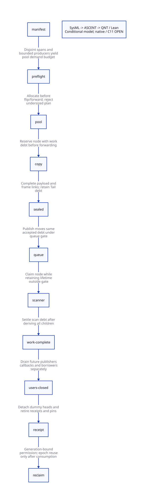

#+TITLE: Independent Chunk Node Pool — Capacity, Progress and Reclamation
#+SETUPFILE: ../../modeling/org/setup.org
#+LANGUAGE: en
#+PROPERTY: header-args :eval never
#+OPTIONS: toc:3

* RESEARCH Decision and scope
:PROPERTIES:
:CUSTOM_ID: chunk-node-pool
:AUTHORITY: GambitChunkNodePool
:STATUS: conditional-formal-design; native-source-and-C11-open
:END:

Modern C remains the required runtime direction. This is a proposed replacement
of the shared terminal/link representation, not a runtime patch or a new build
configuration. Scheme retains language semantics and generated frame contracts.
No Zig dependency is needed for this pool protocol.

The predecessor [[file:chunk-transport-ledger-design.org][transport/ledger design]] separated immutable in-band markers
from mutable queue records. This study supplies the missing capacity admission,
finite-drain argument and reclamation authority. A bounded pool alone does not
provide progress. In particular, helping a scan cannot create a free node when
every issued record is intentionally retained until epoch retirement.

The authoritative rows, ownership seams, proof subjects and costs are in
[[file:models/sysml/chunk-node-pool.sysml][SysML]]. Python queries the native tool and drives ASCENT/QNT/Lean; it does not
parse SysML. [[file:chunk-node-pool-matrix.org][The matrix]] and  are generated from those rows.

* RESEARCH Source identity and actual demand producers
:PROPERTIES:
:CUSTOM_ID: pool-source
:END:

[[file:../../../evidence/research/chunk-node-pool/source-witnesses.json][Source witnesses]] bind exact needles, functions where recorded, line numbers and
immutable source snapshots. Concurrent runtime changes are independent work.
The snapshot is not an effective Darwin preprocessed or linked-product receipt.
The prior proof input remains immutable; [[file:../../../evidence/research/chunk-node-pool/input.json][the new input]] records imported proof hashes.

** Threshold closure is only one producer

=start_heap_chunk= sets its limit to =start + ___MSECTION_CHUNK=. The selected
=mem.h= has threshold 255 words. The ordinary object-copy and captured-frame-copy
branches close a chunk after their committed cursor crosses that limit. An
object can overshoot the trigger. This supports charging such a closure to at
least 255 distinct allocation-span words; it is not an exact chunk size.

=reserve_copy= can close a partial chunk because the next contiguous interval
will not fit. Its loop moves to a new heap msection and prepares it. This path
is independent of the threshold. =end_heap_chunk= also writes a terminal for an
empty chunk, and =prepare_heap_msection= reserves two terminal words plus writes
a first prefix. A payload-only count omits these real operations.

=cancel_copy= rolls back the current private copy grant after losing the
forwarding CAS. It does not grant authority to rewind an already closed chunk.
Node reservation must survive cancellation as the current open chunk's
reservation; failed object copies must not allocate an additional chunk node
unless they genuinely close/start a distinct interval.

** Physical ownership cannot be inferred from section names

=next_msection_without_locking= has an unconstrained custom allocator branch
and a fallback that shares a section with the stack. Counting distinct section
pointers is therefore insufficient. A proposed epoch manifest must identify
non-overlapping heap leases with offsets, bounds and generation. It must prove
monotone committed cursor movement and no second visit to a previously consumed
terminal address. The allocator may split a section into disjoint leases; each
visit is separately counted. Custom allocation without this contract is refused.

** Weak and cleanup consumers remain relevant

=process_wills= can cause additional copying in the weak phase, after the strong
closure. =move_continuation= follows weak draining; cleanup then invokes
=process_gc_hash_tables= and =free_unmarked_still_objs=. The latter calls
=___release_foreign=, whose real =release_fn(ptr)= is unrestricted native code.
Thus strong-phase completion, weak-phase return, an empty FIFO and zero scan
debt are four different observations; none alone certifies pool reclamation.
A whole-epoch plan must cover weak-derived copies and restoration writes.
Cleanup reentry must be prevented, routed into another admitted epoch, or proved
not to touch the retiring pool. A phase label cannot serve as that proof.

* RESEARCH Capacity contract
:PROPERTIES:
:CUSTOM_ID: pool-capacity
:END:

** Conservative physical ceiling

Let =W= be the number of available terminal-word positions across all disjoint
admitted heap leases for this epoch. Let =P= bound simultaneously open chunks,
including any worker continuation that retains one. Let =D= count independent
dummy queue records. Each close writes a distinct terminal and consumes a word.
Assuming the source-to-manifest injective mapping and at most one reserved
record per open chunk:

#+begin_example
closed <= W
issued_data <= closed + P
B_data <= W + P
B_total = B_data + D
#+end_example

=NodePool.coarseCapacity= proves the arithmetic implication. It does not prove
terminal injectivity from C, infer a correct W, or authorize custom allocator
reuse. Empty closures are covered. Multiple retained epochs require the sum of
their admitted capacities; this study admits one non-overlapping pool epoch.

At pointer width 8, the selected =start/terminal/next= fields alone require at
least =24 * B_total= bytes. A dense one-record-per-word fallback costs about three
times tospace bytes before overhead. This finite ceiling is a correctness
reference, not a satisfactory production memory policy.

** Tighter charged ceiling

Let =A= bound all committed chunk allocation spans across the manifest (headers,
padding and copied bodies, not just payload). Let =V= bound section/lease visits
that can end in one partial/no-fit close. Each threshold close has a disjoint
255-word charge; each non-threshold close is assigned to a visit. Then:

#+begin_example
T * 255 <= A
issued_data <= T + V + P
B_data <= floor(A / 255) + V + P
B_total <= floor(A / 255) + V + P + D
#+end_example

=NodePool.chargedCapacity= proves the equivalent scaled inequality. The division
form requires integral nonnegative counts. The source classification of every
close and all phase transitions remains a proof obligation. If another close
class exists, add its bounded charge before issuing a receipt. Neither silently
dropping the class nor counting already charged spans twice is admissible.

Illustrative arithmetic: A=65536 words, V=1, P=1, D=1 gives B_total<=260 and the
three-pointer field lower bound 6240 bytes, about 1.19% of 524288 tospace bytes.
This is a hypothetical certified geometry, not a measured VM, actual node stride
or achieved memory overhead. Alignment, pool metadata, generation and observer
storage add to it. A threshold/profile change invalidates this bound.

** Admission is before irreversibility

The VM epoch coordinator and storage-manifest owner jointly sign a
=PoolPlanReceipt(epoch, profile, manifestDigest, demandClassDigest, P, D,
B_total, stride, poolAllocation)=. All arithmetic is checked before multiplication
or addition in native size types. The native pool is allocated and initialized
before the epoch flips or any winning forwarding pointer is published.
Preflight failure leaves the old runtime state intact and rejects this plan.
This is a proposed insertion point, not a claim the existing setup has it.

A new storage lease, producer class, participant or generation requires a joint
storage-plus-node extension before any newly enabled irreversible operation.
The chosen baseline disallows extension inside an admitted epoch. Capacity is
reserved for the whole strong/weak/restoration lifetime, never just the strong
live census. Worker-private slices can reduce allocation-gate contention, but
slices require redistribution or worst-case per-worker demand bounds; a global
bound does not prevent one local slice exhausting while others are unused.

* RESEARCH Exhaustion, progress and failure custody
:PROPERTIES:
:CUSTOM_ID: pool-progress
:END:

** Space theorem is conditional, not circular

The model permits a new reservation only if =issued < certified budget=.
Admission establishes =budget <= capacity=. Therefore every permitted request
has a free record; the reserve step does not need an additional free-node wait.
=permittedReserveHasSpace= and =permittedChildHasSpace= prove this implication.
The essential outstanding source obligation is that every real node request has
a remaining unique physical charge. The model's guard is not itself that proof.

The pool never reuses a record within the epoch. =finish= reduces work debt but
leaves =issued= unchanged. A completed, full pool with retained heads/receipts
is a legal state. Additional demand at that point violates the capacity receipt;
helping completed scans cannot repair the violation. Waiting for epoch end while
that demand blocks epoch end creates a cycle.

** Allowed responses and rejected shortcuts

- Before admission: reject, choose a larger admitted plan, or select a separately
  qualified local-scanning strategy. No silent mixed transport fallback.
- Before forwarding, with existing parent responsibility: preserve all existing
  custody; an allocation error is not permission to discard the parent. Admission
  failure after an epoch starts requires an explicit recoverable whole-GC protocol.
- After forwarding or publication: retain the node, copy/Tail task and stable
  receipt on failure or unknown outcome. No Scheme exception rollback that leaves
  an observable forwarding pointer with no initializer. No recursive Scheme GC.
- Persistent callback or owner failure: a surviving coordinator may retain the
  epoch indefinitely; safe retention is not eventual reclamation. Helping requires
  a complete resumable task state and independent owner-transfer proof.

The baseline promises no new pool-capacity wait under a valid plan. It does not
promise wait-freedom, lock-freedom or bounded wall time. Existing queue gates,
allocator locks, owner scheduling and foreign callbacks have independent progress
requirements.

** Finite drain

For a fixed accepted set, the modeled pipeline has rank:

#+begin_example
R = 4*private + 3*sealed + 2*queued + owned
#+end_example

Each seal/publish/claim/finish decreases R by one. Positive debt implies at least
one such action is enabled in the model. New child reservations increase rank;
termination additionally needs finite source work, correctly completed frame/Tail
initialization, fair service and terminating scans. A delayed, unsealed frame is
not made ready by an abstract rank argument. These are explicit native gaps.

* RESEARCH Reclamation authority and C11 handoffs
:PROPERTIES:
:CUSTOM_ID: pool-reclamation
:END:

** Four distinct receipts

1. =PoolPlanReceipt=: preflight coordinator plus storage owner; covers capacity,
   physical leases, stage producer classes and stable participant set.
2. =WorkCompleteReceipt=: global work coordinator; root admission closed, every
   accepted/private/queued/owned/copy/Tail child settled, including late children.
3. =FutureUsersClosedReceipt=: admission owner and every possible queue reader,
   publisher, maintenance task and cleanup callback; new borrowing excluded and
   existing borrowers drained. Thread-local queue emptiness is insufficient.
4. =PoolReclaimReceipt=: lifecycle coordinator under closure serialization; both
   previous receipts match epoch/generation, all dummy heads detached, receipt
   observers and borrowers zero. A single-use permit authorizes destruction or
   reset. Multiple/replayed consumers need a separate once-only commit protocol.

The model proves the prerequisites at receipt issuance, not the native identities
of the signers, stale-generation exclusion or single-use machine implementation.
A failed/unknown signature leaves the pool and its custody record alive. No timeout
or guessed quiescence can replace a missing last-user acknowledgement.

** C11 ordering obligations

| Handoff | Required ordering | Native gap |
|---------+-------------------+------------|
| Pool admission | Initialize record storage and checked counts before release publication; consumer acquire | Exact effective storage types/profile |
| Queue publication | Payload and immutable bounds before release unlock; dequeue acquire; all next/head/tail gated | Gate/CAS adapter and payload-ready mapping |
| Scan completion | Derive child responsibility before settling parent; last access before release acknowledgement | Full copy/frame/Tail caller closure |
| Borrow close | Registration and close share one linearization domain; recheck generation before pointer use | Hidden readers and failure continuations |
| Reclaim | Acquire every required last-user release through a specified gate or RMW chain; then detach/free | A relaxed zero is not a drain proof |

A final release decrement must follow its last dereference. A reclaimer's acquire
must actually observe the relevant release(s), not just a numerically equal zero.
The simplified baseline may use a single close/registration gate for these
transitions; it does not assume a weak-memory theorem for a chain of arbitrary
fences. Pool memory must remain live throughout the attempted acquire itself.
Counter overflow and generation wrap are rejection/retention cases. They cannot
be justified by the models' mathematical integers.

* RESEARCH Actual model composition and evidence boundary
:PROPERTIES:
:CUSTOM_ID: pool-proof-chain
:END:

[[file:models/quint/chunk_node_pool.qnt][QNT]] has aggregate private, sealed, queued, owned and retained-done records;
receipts and borrowers are separate from work debt. Root closure blocks new root
work while a live parent can derive a child within the remaining budget. Dummy
records are outside the data-record count and separately included in B_total.
There is no per-object ID, raw pointer, forwarding CAS or machine-memory model.

[[file:models/lean/NodePoolAst.lean][The Lean AST]] is extracted from actual Quint typed JSON with state binding and
exact action roster checks. The parser/emitter are trusted. [[file:models/lean/NodePool.lean][The induction]] proves
all-step/reachable invariants, conditional capacity and finite-drain properties.
The sample initial capacity is three; preservation and arithmetic theorems range
over every state satisfying the invariant, not just this sample capacity.
=weakEntrySafe= additionally admits a weak-cut base with retained strong-phase
records, unresolved receipts and borrowers. =issued= begins at retained count,
not zero. =runsFromSafe= proves preservation from any such qualified base, and
=weakEntryProjectIsWeakCut= maps it to the same old weak-work cut. This does not
identify a native strong-cut issuer or prove all strong records are DONE; those
are prerequisites for importing this base. The QNT retained-strong-entry history
checks that a new weak allocation adds to, rather than overwrites, old occupancy.

[[file:models/lean/NodePoolComposition.lean][Composition]] maps every actual pool action to the preceding actual
=WeakAdmissionAst= step or stutter. Reserve maps to continuationProducer; child
reserve to deriveChild; finish to settleTask; root close and work complete to
corresponding old steps. Admission, transport, pin handling and reclamation stutter
at that abstract work layer. Pool retirement maps to weak-complete, not native
cleanup authorization. Initial projection starts at the already-established weak
cut; the strong-closure proof is imported, not reproduced or inferred from pool
counters. The actual initial projection is proved reachable through the old five-step
strong-cut prefix, and =reachableProjects= transports every pool execution.
=commonWeakLedger= equates the pool and delayed-chunk projections under
their same-phase/debt/kind/root-closure premises. These equalities and steps make
the connection substantive, rather than a file association.

This is an aggregate safety refinement and conditional drain result. It does not
prove arbitrary task identity/retry deduplication, entire C heap refinement,
C11 weak-memory behavior, automatic strong-phase capacity receipt issuance or
end-to-end termination. The earlier marker/transport product is not extended by
claiming two independently safe components are automatically safe together;
capacity admission and actual pool lifetime must also satisfy its publication
and storage guards. That source-level product remains open.

[[file:../../modeling/ascent/chunk-node-pool.rules.scm][ASCENT DSL]] joins exact action names, preserved lemmas, old target steps,
source witnesses and scoped hash receipts. Missing source or platform refinement
keeps actual admission blocked. Synthetic all-evidence controls only test the gate;
they are not native evidence. Negative controls reject wrong hashes/scopes,
missing actions/lemmas/targets and source witnesses.

* RESEARCH Net benefit and retirement
:PROPERTIES:
:CUSTOM_ID: pool-benefit
:END:

The replacement can remove mutable-terminal classification hazards without
converting every heap header load to an atomic operation. It can avoid allocator
failure and free-node waits inside irreversible copy publication only when the
complete preflight contract holds. These are architectural benefits, not measured
speedups. Strong/weak scan overlap is useful only when saved atomic/serialization
work exceeds record initialization, queue transfer, admission and retained-memory
cost. Less usable heap may increase collection frequency; count that loss too.

The loose dense ceiling alone does not establish positive net benefit. The tighter
budget needs a complete source charge proof and an acceptable memory reserve.
Compare against the unified-atomic control at the same correctness requirements.
Existing gate costs are not newly saved by this design.

Retire the old terminal-as-next layout only after emitter/layout consumers, queue
writers/readers, local frontier, section transitions, epoch setup, debug helpers,
cleanup and all failure paths migrate together. Keep immutable marker parsing and
Scheme object/frame semantics. Do not delete the old path merely because this
model passes. Detailed cost and closure rows are in the native SysML matrix.

* RESEARCH Literature and reflection
:PROPERTIES:
:CUSTOM_ID: pool-literature
:END:

- [[https://www.open-std.org/jtc1/sc22/wg14/www/docs/n1570.pdf][C11 draft N1570]], sections 5.1.2.4, 7.17.3 and 7.17.4: synchronization and atomic
  ordering constrain the concrete handoff. Integer atomicity alone is insufficient.
- [[https://www.cs.toronto.edu/~tabrown/debra/fullpaper.pdf][Trevor Brown, Reclaiming Memory for Lock-Free Data Structures]]: stalled readers
  can delay epoch reclamation. We use this as a reason to distinguish safe
  retention from progress; we do not adopt its signals or lock-free claims for
  Gambit's queue gates and foreign callbacks.

The relevant modernization is explicit ownership, bounded admitted resource
requirements, independent execution/scanning roles and verifiable phase authority.
Changing the implementation language does not supply any of those proofs.
