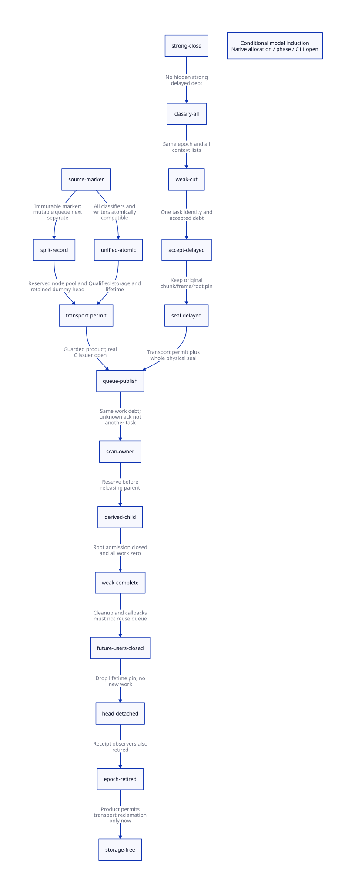

#+TITLE: Chunk Transport and One Weak-Phase Custody Ledger
#+SETUPFILE: ../../modeling/org/setup.org
#+LANGUAGE: en
#+CATEGORY: modern-c
#+PROPERTY: header-args :eval never
#+OPTIONS: toc:3

* RESEARCH Decision and scope
:PROPERTIES:
:CUSTOM_ID: transport-ledger-decision
:AUTHORITY: GambitChunkTransportLedger
:STATUS: CONDITIONAL-MODEL-SIMULATION; GUARDED-PRODUCT; SOURCE-C11-OPEN
:MAINLINE: modern-generated-c
:END:

Use split immutable heap markers and independent queue records as the main
architecture candidate. Keep unified atomic access as a genuine comparison.
This is conditional on bounded node-pool admission, queue-head lifetime and
receipt/cleanup closure. No implementation, native test or speedup is claimed.
Modern C retains Scheme semantics, generated FrameSpec, ordinary object layout,
continuation restoration and the existing portable-runtime boundary.

[[file:models/sysml/chunk-transport-ledger.sysml][SysML]] owns access roles, alternatives, source trace, contracts, costs,
component seams and formal needs. Native queries generate [[file:chunk-transport-ledger-matrix.org][the matrix]] and
. [[file:../../modeling/ascent/chunk-transport-ledger.rules.scm][ASCENT]] checks exact receipts, source access witnesses,
30 action/lemma pairs and 18 old-model action/stutter simulation bindings.
These are semantic research checks, not source/native admission.

Source evidence is bound to archived hashed snapshots. The worktree changed
during research (ordinary-copy reservation/commit and Tail support); these
concurrent changes are not this study's implementation. They do not by name
establish the full phase/custody relation. Any later live drift is recorded
separately and never earns native admission.

The [[file:frame-chunk-weak-producers-design.org][predecessor]] already establishes the conditional mixed-span/link arithmetic
and producer inventory. It remains frozen. Existing FIFO CAS gates, object
DONE deduplication and suffix reuse are baseline work, not new benefits here.

* RESEARCH Actual shared-word readers and writers
:PROPERTIES:
:CUSTOM_ID: transport-source-access
:OBLIGATION: TL-source
:END:

The native SysML access table references exact source anchors rather than
maintaining another pathname registry. The relevant source operations are:

| Source operation | Access | Synchronization/lifetime boundary |
|---+---+---|
| prepare_heap_msection / end_heap_chunk | Plain initialization of NULL_CHUNK_LINK | First section prefix or closing marker |
| end_heap_chunk | Plain store through heap_chunks_to_scan_tail | FIFO gate; may target an older physical terminator |
| take_heap_chunk | Plain load through FIFO head | Successful gate; returned node becomes retained head |
| scan_complete_heap_chunk | Plain load of *ptr before FORW test | Outside FIFO gate; thief may overlap later victim appends |
| scan_movable_objs_to_scan | Same classifier expression | Local ownership; not by itself a cross-thread counterexample |
| setup_stack_heap_vmstate | Reset dummy/head/tail | New GC collective; old observers must already be detached |

There are two source classifier occurrences. The source-context audit also checks each named reader/writer against the
lexical function containing the matching snapshot occurrence, including both
classifier sites. ASCENT rejects a stale context digest. This is not a C parser
or a proof of all macro/debug aliases.

A queue field and the word reached
through that field are different C objects. Protecting head/tail pointer updates
does not automatically protect every scan load of the shared pointed-to word.

** Three-chunk conditional source schedule

Choose C0 after an earlier local-owned chunk, so C0 is nonlocal and enqueued.
Let t0 be its terminal address. C1 starts at t0+1 and its leading queue-link
address is t0. Publishing C1 selects t0 as FIFO tail; a subsequent C2 publication
writes the next node address through that tail. Meanwhile a thief can have
claimed C0 under the victim gate and be scanning toward t0 outside the gate.

#+NAME: source-shared-word-history
#+BEGIN_EXAMPLE
owner: close C0 at t0; start C1=t0+1
owner: publish C1; FIFO tail now points to t0
thief: claim C0 under owner gate; release gate; scan C0
owner: publish C2; *FIFO_tail(t0)=FORW(node(C2))
thief: head=*t0; inspect FORW tag
#+END_EXAMPLE

The distinction between selecting tail and later writing through tail matters:
C1 publication alone is not the later relink at t0. The original terminal and
the new link may both carry FORW, but that does not establish C11 synchronization.
An acquire at C0 claim covers earlier releases; it cannot acquire a future C2
store merely because the latter uses the same queue gate. The complete C11
happens-before graph still needs actual primitive/storage/profile evidence.

This is a source-enabled schedule under nonlocal publication, adjacent-chunk,
thief progress, live storage and configuration premises. It is not a compiled
Scheme witness, observed native race, or guaranteed outcome of undefined C
behavior. A same-carrier local scan alone need not have this concurrency.
Debug reads and alternate generated/header access paths also require admission;
this bounded inventory is not a whole-program alias proof.

* RESEARCH Comparing two modern C transport designs
:PROPERTIES:
:CUSTOM_ID: transport-alternatives
:END:

** Unified atomic access

Retain the shared marker/next-link word. Every conflicting read/write must use
compatible atomic storage/access. A scanner cannot first do a plain load and
then choose an atomic load only after recognizing a marker: recognizing it
already required reading the word. Either all undecided classifier loads become
atomic, or an authenticated out-of-band bound identifies the marker first.
The latter also needs metadata and should not be advertised as free.

Portable C11 atomic storage, alignment, initialization and ABI compatibility
must be specified. A pointer cast is not such a proof. A target-specific GCC
atomic adapter over existing native storage is another profile, with its own
compiler contract; it is not automatically portable C11 qualification. Generated
code, debug paths, initialization and reuse must not retain an unordered
plain/atomic mixture. No mid-epoch switch from an exhausted split pool to the
legacy shared protocol is permitted while readers remain.

Atomicity and publication ordering are separate. A classifier that only uses
the persistent FORW tag might use relaxed loads if compatible atomic storage,
prior initialization and queue-acquire publication are proved. Following queue
links and observing object fields needs the corresponding ordering/lifetime
proof. The abstract access model selects atomic versus plain operations; it
proves no hardware memory-order or compiler-profile theorem.

For K object headers and C terminal observations, the direct classifier design
converts K+C existing loads to atomic loads; it does not add another traversal.
Atomic word size/alignment, lock freedom, code generation and libatomic fallback
remain unqualified. No latency value is assigned to these operations.

** Split immutable marker and independent queue record

Keep the in-band end marker immutable after publication. Put the mutable next
link in a separately owned stable record. The existing queue gate may protect
all next/head/tail accesses, so per-node atomic next is not inherently necessary
if every such access stays inside that gate. The scanner can retain immutable
FORW classification or consume the authenticated sealed endpoint.

#+NAME: split-transport-record
#+BEGIN_EXAMPLE
ChunkExtent: epoch, section identity, start, terminal, physical-seal receipt
ChunkNode: start, terminal, next
QueueEpoch: gate, head, tail, generation, pool reservation, retained observers
#+END_EXAMPLE

These are contract records, not runtime declarations. The selected three-pointer
node carries explicit bounds; a smaller start/next node would need endpoint
proof elsewhere. Keep the existing leading marker/state identity if required by
the scan bitmap, but stop using it as mutable queue linkage. The end-marker word
and its reuse as the next physical prefix count once in heap storage.

A native node pool must be reserved before closing/publishing a chunk. Pool
allocation must not invoke Scheme GC recursively or lose an already forwarded
copy's owner. On exhaustion retain the original transaction and enter the
admitted failure protocol. A bound based only on copiedWords/255 is insufficient:
empty/no-fit section transitions and custom grants need explicit progress bounds.
Node demand must cover initial worker chunks, committed chunk closes, section
transitions, outstanding receipts and queue dummy-head retention.

The pool may be retained for an entire GC epoch, avoiding per-node atomic
refcounts at the price of longer retention. Earlier reuse requires exact detach
proofs and generation/ABA protection. For C selected nodes and pointer size P,
the three pointer fields alone cost at least 3*P*C bytes. At P=8 this lower bound
is 24*C bytes, before alignment, generation, pool slack and pin accounting. It
is neither an observed allocation peak nor the complete record size.

** Conditional choice and retirement

Split storage keeps marker classification out of the mutable FIFO footprint
and preserves ordinary C heap/frame words. That is the architectural reason to
prefer it for further research. Unified atomic access remains competitive if a
profile can qualify the entire access/storage set at lower total cost. Neither
option fixes captured-frame late link writes, will classification or GC roots by
itself. Retire the shared mutable marker role only after all append, take,
scanner, debug, setup and retirement consumers migrate to one chosen protocol.

* RESEARCH One work ledger, separate lifetime pins
:PROPERTIES:
:CUSTOM_ID: delayed-work-ledger
:OBLIGATION: TL-weakInduction
:END:

The delayed chunk is an accepted work item while still private. Sealing it,
linking it into the FIFO and claiming it for scanning transfer that same
responsibility. Queue visibility must not mint a second unit of work.

#+NAME: ledger-balance
#+BEGIN_EXAMPLE
workDebt = accepted - settled
parent outstanding: workDebt = childDebt + 1
parent settled:     workDebt = childDebt
private -> sealed -> queued -> owned: workDebt unchanged
child reservation: accepted++, childDebt++, workDebt++
parent settlement: settled++, workDebt--
#+END_EXAMPLE

The task identity binds GC epoch, phase, original chunk/extent and owner; a frame
fixup keeps its original chunk even after allocation rollover. Strong-phase
delayed/private/Tail work must settle before the global strong closure and will
classification cut. Weak-phase delayed work is admitted only after every frozen
context list is classified. Real multi-context/worker assignment remains an
explicit closure requirement.

Accepted parents can reserve children after top-level admission closes, provided
reservation precedes final parent settlement. Unknown publication acknowledgment
retains the accepted item and its receipt pin. The single-item state machine
prevents republishing that accepted item as a new state transition; it is not a
general distributed task-ID/retry deduplication proof.

FIFO head lifetime is independent. Dequeue makes the consumed node the next
head/dummy; an empty queue can still reference it. Scan DONE or workDebt=0 does
not detach head/tail, observers or delayed receipt readers. Conversely, keeping
a dummy pin must not prevent weak scanning from completing once all work is zero.

| Event | Work accounting | Lifetime accounting |
|---+---+---|
| Accept delayed chunk | One unit accepted | Extent/source/receipt retained |
| Publish or claim | Transfer same unit | Queue and scanner references retained |
| Reserve child | Increment before parent release | Child retains required extent/code/epoch |
| Finish parent/child | Settle exactly its unit | Existing queue/receipt references may remain |
| Finish weak phase | Closed roots and zero represented work | Dummy and receipt pins may remain |
| Close all future queue users | No later producer/callback may use this queue | External cleanup/reentry closure required |
| Detach dummy and receipts | No new work | Release separately retained references |
| Recycle epoch storage | Work zero | No pins, users or unknown observers; generation safe |

=closeFutureUsers= in QNT is an abstract receipt event. Its native issuer must
prove cleanup callbacks, error exits, tracing/debugger users and all later phases
will not touch the old queue. Being at weak phase completion alone is not enough.
Current foreign cleanup can call unrestricted release_fn, so this obligation is
not discharged by collector source or by the model Boolean.

* RESEARCH Actual model refinement and guarded composition
:PROPERTIES:
:CUSTOM_ID: transport-composition
:OBLIGATION: TL-compositionProof
:END:

[[file:models/quint/chunk_marker_transport.qnt][Marker QNT]] retains the legacy overlap and the two managed modes, with
controls for a plain classifier in atomic mode, unqualified atomic storage,
early free and tag corruption. [[file:models/quint/delayed_chunk_ledger.qnt][Ledger QNT]] covers delayed/published/scanned work,
child reservation, lost acknowledgment, retained pins and invalid completion.
The ledger slice represents one delayed chunk and counted child work; it is
not an arbitrary queue-node population abstraction. strongDebt imports the
preceding strong-closure summary; proving that summary matches the native
strong ledger remains open. Both have actual typed IR and [[file:../../modeling/tools/chunk-transport-ledger-projection.py][restricted extraction]] into Lean AST.

[[file:models/lean/TransportComposition.lean][The composition proof]] has two distinct results beyond separate model passes:

1. It projects all 18 ledger actions into the exact preceding
   [[file:models/lean/WeakAdmissionAst.lean][weak-admission AST]], using actual old actions or stutter. active becomes
   workDebt. Sealing, queue publication and receipt observation stutter at that
   abstraction; child reservation and settlement map to its accounting actions.
   Epoch retirement is storage-layer progress mapped to old weak-complete state,
   not an invented execution of the old cleanup action. Initial states, every
   step and reachable safety are proved. The old typed IR is re-extracted and
   compared byte-for-byte to its pinned AST before ASCENT admits target bindings.
2. It defines a guarded interleaving product of marker transport and the ledger.
   New queue publication requires managed transport permission. Transport storage
   may disappear only after the ledger retires the epoch with no pins/work.
   All product steps and product reachability preserve the joint invariant.
   Concrete counterexamples show that dropping either added guard breaks it,
   even though the isolated component models can still be safe.

This is an actual model-to-model step simulation and conditional product theorem,
not a C source composition theorem. The product guards must be implemented by
real issuers; neither an AST link nor a predicate named receipt provides them.
The previous physical SpanTile/FrameSpec seal must also refine ledger sealed:
that native relation, all late writers and the original frame/root pin remain
open. No fairness, lock-free progress or complete heap abstraction is proved.

** C11 refinement obligations

| Boundary | Required source-to-model obligation |
|---+---|
| Shared terminal access | Enumerate actual addresses, every plain/atomic access and all happens-before edges |
| Atomic alternative | Compatible storage, initialization, alignment, all classifiers and reuse; no hidden mixed access |
| Split alternative | Marker immutable after exposure; queue record has a distinct live location; gate covers every queue access |
| Frame seal | Real normalized descriptor/link/span and all overlapping writes completed before publication |
| Queue transfer | Reserve ownership before release publication; acquire claim sees payload and same epoch identity |
| Work conservation | Every private/queued/scanning/Tail/still/child producer maps to accepted minus settled exactly once |
| Strong/weak cut | All strong debt closed; all context lists classified before weak work permission |
| Failure/unknown | No lost owner after forwarding, pool failure or absent acknowledgment; no inferred rollback |
| Retention | Dummy head and receipt pins survive work completion; readers cannot race reset/reuse |
| Final closure | Cleanup/reentry and future users closed before releasing pins and freeing epoch storage |

Atomicity alone is not a publication proof. A volatile qualifier is not a portable
C11 atomic object contract. Existing GCC full-barrier adapters need a concrete
profile mapping; no native preprocessor or compiler test was run. JSON parsing,
restricted emission and general Quint semantics remain explicit trusted
boundaries. The two mathematical models do not supply Darwin ABI qualification.

* RESEARCH Net benefit and falsification
:PROPERTIES:
:CUSTOM_ID: transport-ledger-net
:END:

The redesign removes ambiguous overlap between heap scanning and mutable queue
metadata, and makes private delayed work visible to the same phase termination
law. A second independent publication counter is unnecessary only when the same
accepted work lifetime covers reservation through final settlement. Existing
queue locks, DONE deduplication, weak repair and forwarded suffix reuse receive
no new optimization credit.

| Design | Candidate savings | Necessary added cost | Refutation |
|---+---+---+---|
| Unified atomic | No independent next-link node in best case | K+C classifier loads converted; storage/ABI/profile qualification | Hidden plain access or expensive fallback defeats admission/value |
| Split record | Preserve ordinary payload words; remove shared mutable marker footprint | At least three pointer fields per selected bounded node; pool/pins | Unbounded pool demand, retained nodes or high allocation cost defeats value |
| Unified work ledger | No duplicate debt on publication | Stable task/phase identity and child reservation | Any hidden producer or duplicate acceptance invalidates zero-work conclusion |
| Separate pins | Weak phase may finish despite live dummy/receipt references | Explicit final detach/future-user protocol | Unrestricted cleanup reentry or unknown observer prevents reclamation |

Runtime speed benefit requires useful overlap H to exceed transport overhead A
plus synchronization/custody cost B. Pool memory needs its own capacity budget;
time savings do not prove memory admission. Will classification remains O(W)
with one additional collective cut or a qualified immutable strong snapshot.
Neither alternative claims a measured speed ratio or total modernization proof.

The next source proof should bind actual queue-node/extent lifetime and pool
capacity to these two product guards, including the implicit FIFO dummy head.
It must also construct the real physical-seal-to-ledger relation. More unrelated
scalar histories would not close those source obligations.

* References and receipts

- [[file:../../../vendor/gambit/lib/mem.c][Actual marker/queue/scanner/phase source]] and [[file:../../../vendor/gambit/include/gambit.h.in][native atomic and frame definitions]], pinned by this study.
- [[https://www.open-std.org/jtc1/sc22/wg14/www/docs/n1570.pdf][C11 draft N1570]]: 5.1.2.4, 6.2.4, 6.7.2.4, 7.17; concurrency, lifetime and atomic contracts.
- [[https://gcc.gnu.org/onlinedocs/gcc/_005f_005fatomic-Builtins.html][GCC atomic builtin documentation]]: explicit ordering and target fallback boundaries; not source qualification.
- [[file:../../../evidence/research/chunk-transport-ledger/][Source identities, typed IR, simulation, controls and audit receipts]].
