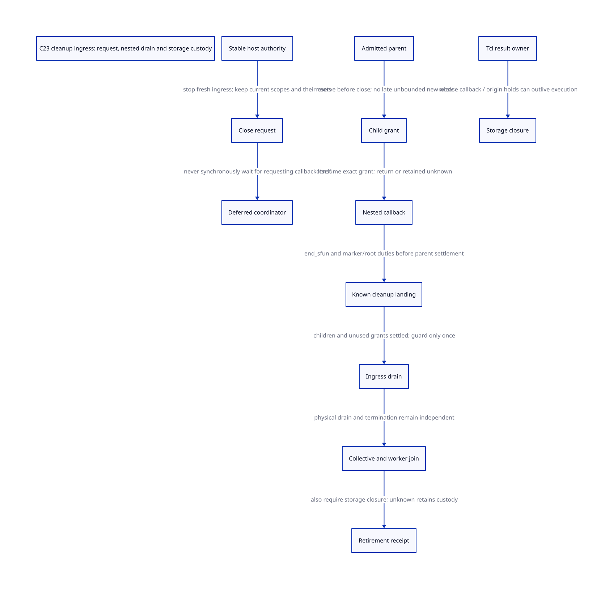

#+TITLE: C23 cleanup ingress — external close, nested completion and retirement composition
#+SETUPFILE: ../../modeling/org/setup.org
#+LANGUAGE: en
#+PROPERTY: header-args :eval never
#+STARTUP: overview

* RESEARCH Decision and source authority
:PROPERTIES:
:AUTHORITY: GambitCleanupIngress
:STATUS: conditional model; native admission unresolved
:CUSTOM_ID: cleanup-ingress
:END:

A public cleanup call cannot mean both request shutdown and synchronously destroy
all resources regardless of where it was invoked. A callback requesting closure
still owns an admitted activation, roots, marker and possibly native result
duties. Separate a nonblocking close request from finalization by an authorized
owner after those duties drain. No callback may wait for its own active scope to
become zero, nor decrement it merely because it requested shutdown.

[[file:models/sysml/cleanup-ingress.sysml][Native SysML]] is the source for exact source witnesses, consumer/issuer records,
action/compiled-lemma routes, unresolved conditions and benefit/diagram edges.
[[file:cleanup-ingress-matrix.org][Org matrix]] and  are projections. [[file:../../../evidence/research/future-frame-commit/cleanup-ingress/][Evidence]] records formal inputs and
checks. This is a C23 architecture study, with no runtime source edit, native
compiler/preprocessor invocation, native execution or performance validation.

* Real public callers and current guards
** Top-level entry
=cleanup= checks =setup_state != 1= and returns in that case. It also rejects a
same-carrier GC participant not in GC_RUNNING, then sets setup_state to 2,
removes interrupt handling and attempts to shrink the primary VM. Retained resize
or pending request roots can leave setup_state 3. The API returns void.

These are useful existing refusal/lifecycle checks. The plain setup_state test
and assignment do not implement atomic close-vs-entry arbitration or a global
active-call census. GC_RUNNING describes a local phase, not caller storage
lifetime or the absence of nested callback frames. The code obtains PSTATE and
reads participant metadata before those tests; a future stable entry authority
must precede these raw loads. It cannot be stored only inside potentially retired
VM memory.

The global function table exports cleanup, cleanup_pstate and cleanup_vmstate.
Direct symbols and table-indirect calls therefore need the same admission
contract. A grep of internal calls cannot prove arbitrary external C callers
respect it. A modern managed profile must mediate those routes or explicitly
reject lifecycle reuse when raw authority has escaped. Retaining an exclusive
legacy embedding lifetime can remain an explicit compatibility policy; it is not
proof of concurrent managed retirement.

** Concrete embedding sequences
- tests/client.c calls generated eval_string, releases each returned string, and
  calls cleanup at the end. This is a sequential embedding discipline.
- examples/pthread/pthread.c serializes Scheme calls under a host mutex and wraps
  them in ON_THROW. It joins its external pthreads, reads/releases the counter,
  then calls cleanup. The example demonstrates caller-owned quiescence. Its
  comment allowing only one Scheme call is example policy, not evidence that
  current SMP is universally single-threaded or a design target to preserve.
- lib/main.c cleans up after successful setup returns. Setup itself invokes
  cleanup on its error return after run has returned.
- cleanup_and_exit_process invokes cleanup and then exit_process regardless of
  reusable-VM retirement success. Process termination is a distinct policy,
  not a successful final retirement receipt.

* Nested execution and exact exception landing
** run and call
=run= checks the participant phase before marker allocation, creates a rooted
stack marker, calls Scheme through call under BEGIN_TRY, then kills the marker
and adjusts startup ownership before returning. =call= creates the return-to-C
frame and trampoline/host activation. If the unwind marker is not its own target,
it throws again before its normal frame-restoration return.

Thus callback C return, Scheme logical return, error-as-result, and continuation
transfer are different completion events. A continuation may revisit Scheme
frames without recreating a dead native activation. An already settled native
scope must not be decremented again or used to settle a later execution.

** Existing SFUN cleanup landing
=call_sfun_with_cleanup= sets unwinding true before BEGIN_TRY, clears it only on a
normal call return, and otherwise returns the thrown result with unwinding true.
The generated SFUN macros skip conversion recovery for throws, run end_sfun,
then propagate_error. end_sfun invalidates the marker and returns/releases its RC
bank. This is a concrete reusable cleanup route, not a new invented exception
handler. The generated module, header ABI and selected configuration must still
match before this route can issue a native receipt.

In the setjmp branch BEGIN_TRY saves the old catcher, installs the local catcher,
and END_TRY restores it. A Gambit throw reaching that catcher executes the common
landing. An arbitrary foreign longjmp, cancellation or hook escape around the
landing can bypass END_TRY and end_sfun. This study does not silently treat such
an escape as balanced. Keep the stable guard, source/root custody and descriptor
holds pending until the exact native landing is proved; otherwise refuse reuse.

** Tcl dispatch and delayed result disposal
The real path is scheme_call_cmd -> data_rc(ClientData) -> generated tcltk_call
-> Scheme apply. Raw data_rc is a snapshot, so command-source lifetime must cover
entry before the root bank can be established; current cleanup checks do not
supply that source permit. Tcl command deletion and nested event dispatch need
source-owner agreement in addition to VM entry permission.

After tcltk_call returns, scheme_call_cmd passes the native string to Tcl_SetResult
with release_string as its free callback. Tcl can call that runtime function later.
The callback's Scheme execution has ended, yet the result allocation, allocator
origin and runtime release code still have duties. A VM implementation could
allow independently escrowed result storage to outlive context retirement if
provider and release semantics were separately proven. The present conservative
contract instead blocks its combined retirement receipt until result debt is
settled. It does not claim that every allocation intrinsically requires a live VM.

* Proposed request / drain / finalization protocol
** Stable authority before entry
A host-owned lifetime authority, surviving VM closure, arbitrates first entry
against close. Its successful acquire publishes a stable activation/guard and
root source before any collecting conversion, TLS-dependent PSTATE use or raw
context load. The previous native-entry/source-pin studies remain prerequisites;
this model starts with one already admitted parent, not an implementation of
allocation-free guard issuance.

Fresh run, generated SFUN, direct call, table-indirect entry and cleanup API access
must all be classified. Internal run -> call delegates existing authority rather
than acquiring a redundant fresh public lease. A raw public call is not thereby
an internal delegate. Maintenance operations such as result disposal retain their
own release authority after ordinary ingress closes.

** Close requested inside a callback
1. Atomically mark the stable authority closed to fresh work and publish RequestId.
2. Return an accepted/deferred result to the requesting callback. It continues to
   own its activation, roots, marker and nested obligations until normal landing.
3. The authorized owner may finalize only after the requesting callback and all
   other covered scopes/children have landed. An await inside that active subtree
   must report deferred/would-wait-for-self, never block on itself.
4. Unknown native completion stays with the stable owner record. A retry observes
   the same RequestId/OperationId rather than issuing a new decrement/free.

No such typed result exists in today's void cleanup API. A possible modern-C
service boundary is request_close(handle) -> accepted/deferred/refused, then
poll_or_await(request) -> pending/retained/retired, with receipt issuer identity.
These are proposed API outcomes, not installed symbols or a promise of equivalent
behaviour for every historical reentrant cleanup invocation.

** Closed ingress and preauthorized nested work
Closure cannot simply reject every callback: already admitted foreign work may
need a callback to finish. It also cannot allow arbitrary reentry through any
parent, or closing never seals the producer set. A parent must reserve a bounded,
identity-bound child grant while admission is open. After close only that existing
grant may activate; no fresh grants are minted. Parent completion requires both
active children and unused grants settled. The current Tcl/SFUN APIs do not yet
supply these grants. Unbounded/opaque foreign dispatch requires a stronger
library-specific completion/disable protocol or refusal; no semantic equivalence
is asserted for arbitrary late native callbacks.

** Composition into final retirement
The final owner combines, without replacing any obligation:

| Component | Issuer | Required evidence |
|-----------+--------+-------------------|
| ingress closure | stable embedding authority | first-entry/close arbitration; no escaped raw admission |
| activation drain | exact native landing owner | parent/child grants settled once; catcher/marker/root cleanup complete |
| GC metadata and source-slot grace | round/domain coordinators | real collective plus no late readers or escaped scanner |
| departing worker termination | join owner | known exact-worker join; current coordinator uses its separate outer authority |
| remaining storage | source/result/origin owners | RC/still handoff, delayed results, descriptors and native free receipts |
| final retirement | lifecycle coordinator | same VM/incarnation/request and no unknown retained debts |

Neither collective nor join alone closes external ingress. The coordinator must
not join itself: worker-join evidence concerns departing workers, while the main
cleanup owner needs a separately closed outer native scope. The model's joined
bit abstracts required departing-worker receipts, not self-join.

* C23 synchronization and unknown custody
The stable gate's close and entry-acquire need one linearization order. Guard and
child-grant publication requires release publication and acquire observation;
failed CAS is not a successful permit. A generation check made after dereferencing
a retired record cannot validate that dereference. Counters and generations need
bounded no-wrap/refusal rules. The QNT bounded slots do not establish native bounds.

A known landing must release roots only after every actual child and resource user
has ended, then publish completion to the finalizer. Interrupt/GC inhibition or a
plain integer count cannot substitute for a source-root lease or catcher lifetime.
Managed waits must keep required old-roster participation until the collective
can complete; this model uses nonblocking request and supplies no new waiting loop.

On unknown callback completion keep the active native scope, roots and guard.
On unknown worker join keep the resize/native ledger and VM identity. On unknown
result disposal/free keep the independent origin/operation record and refuse
final storage closure; never scan or free again through possibly freed payloads.
The record must survive the abandoned C frame. These stable services are design
requirements; current local stack variables do not implement them automatically.

* Actual models and limits
[[file:models/quint/cleanup_ingress.qnt][QNT]] has thirteen scalar fields and fourteen actions for one parent, one bounded
child grant and one delayed-result debt. requestClose preserves the requester,
roots and guard. A preauthorized child can activate after close; no fresh child
reservation can. finishOuter settles exactly once and is disabled by children,
unused grants or unknown landing. collective, join and result disposal remain
independent conditions before retireDomain.

recoverLanding and joinKnown after unknown are authoritative evidence inputs.
They are not optimistic retries. releaseResult means known storage release,
including any required native maintenance calls already drained; it is not
proof of a transactional libc free receipt. Unknown result disposal leaves debt
outstanding. Exact TicketId/RequestId, GC relocation, all callees and C23 machine
steps are refinement premises, not implicit powers of these model actions.

[[file:models/lean/CleanupIngressAst.lean][Typed-IR extraction]] produces the AST used by [[file:models/lean/CleanupIngress.lean][Lean]]. Per-action preservation and
reachable-state induction prove abstract safety. requestPreservesRequester and
joinDoesNotSettleResults expose two key non-implications. The guarded join uses
the actual previous CohortRetirementAst retirement transition under an explicit
CohortMirror, including external-reader and fault correspondence. This is not a
full product simulation or native end-to-end proof.

Six histories cover an inner close request, authorized callback after close,
delayed result disposal, a known unwind landing and unknown join/boundary.
Eight reachable negative controls reject self-finalization, unused grants,
late fresh grants, unknown landing/join, result debt after join, early collective
and duplicate settlement. ASCENT binds actual compiled action/lemma routes,
source hashes, seven real consumer classes and five joint issuers. It rejects
claiming callback return is storage grace. Native unresolved receipts block
admission; synthetic all-receipts success only checks the DSL wiring.

* Paper basis, gains and retirement conditions
Feeley's retained [[file:../../../evidence/research/source-references/feeley-sfp/8bb2fae8ae4b54d3a86206596f90e9cf73da39846af0f39244a476074cf81ed4.txt][continuations/C paper]] grounds the distinction between Scheme
continuation and C activation lifetime. Current run/call, SFUN cleanup and Tcl
result consumers are the concrete evidence here. The proposed admission/grant
service is our conditional architecture, not something the paper already proved.

A nonblocking request adds zero self-drain waits. Delegated run/call can share
one outer authority rather than require duplicate independent fresh gates.
For A admitted scopes, C unused/active child grants and R delayed result owners,
stable support is O(A+C+R), plus retained unknown records. No byte size, native
latency or speedup is inferred. Compared with today's minimal void cleanup,
these contracts add bookkeeping; gains are safe concurrent lifecycle composition
and avoiding unnecessary duplicate admission, conditional on actual mediated use.

Keep existing phase refusals, marker checks and SFUN landing. Retire direct
managed cleanup entry only after typed request/finalization is wired to every
relevant caller and unknown-result path. Retire duplicate admission checks only
when internal delegation is explicit; safety checks are not redundant merely
because there is a parent frame. No old runtime path is retired by this study.

* RESEARCH Dynamic Tcl refinement boundary
[[file:callback-producer-design.org][The callback-producer study]] narrows the pre-close individual child-grant policy
to declared bounded work. Arbitrary admitted Tcl eval/event-pump scopes need a
retained producer that may issue identity-bound children after fresh-root close.
No full step simulation into this earlier child policy is asserted; integration
is at a separately proved producer-exit boundary.
