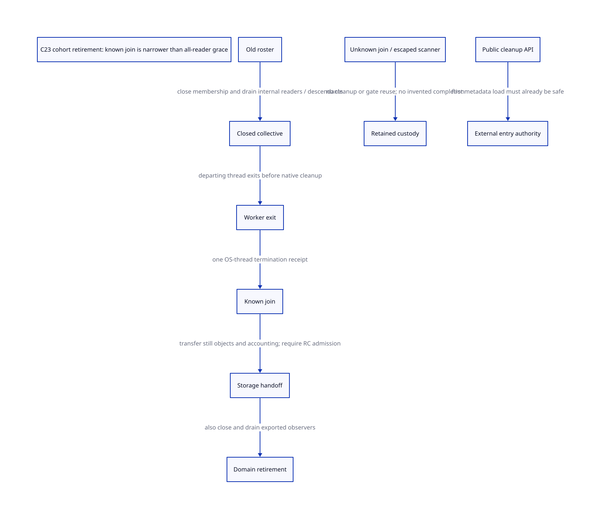

#+TITLE: C23 cohort retirement — closed readers, native join and cleanup authority
#+SETUPFILE: ../../modeling/org/setup.org
#+LANGUAGE: en
#+PROPERTY: header-args :eval never
#+STARTUP: overview

* RESEARCH Decision
:PROPERTIES:
:AUTHORITY: GambitCohortRetirement
:STATUS: source-bound internal path; conditional model; native closure unresolved
:CUSTOM_ID: cohort-retirement
:END:

Refine [[file:rc-reader-grace-design.org][metadata-reader grace]] at an actual lifecycle cut: a processor leaving the
Gambit VM. Reuse the existing old-roster collective and successful native join
for synchronous internal readers. Neither a membership count change nor joining
one OS thread proves that all native aliases and exported readers have drained.
The C23 design needs typed cleanup authority covering those distinct premises.

[[file:models/sysml/cohort-retirement.sysml][Native SysML]] supplies source witnesses, consumer/issuer records, actual model
routes, gaps and gains. [[file:cohort-retirement-matrix.org][Org matrix]] and  are projections;
[[file:../../../evidence/research/future-frame-commit/cohort-retirement/][evidence]] records checks and exact inputs. No runtime source or native test changes.

* Actual lifecycle evidence
** Live shrink: narrow, reusable existing path
=execute_sync_op_loop= serializes selected synchronous operations using the
existing collective. In the resize operation, the old member set commits the
processor count. Departing processors subsequently clear their entry marker and
startup thunk, mark startup stopping and call =thread_exit=. The coordinator joins
them. Only a successful join reaches =transfer_retired_still= followed by
=cleanup_pstate=. Join failure instead marks the slot and resize ledger RETAINED.

This is useful concrete ordering: exclusion from the old collective precedes
thread termination; known termination precedes storage transfer and gate cleanup.
It does not justify cleanup merely because =processor_count= became smaller.
The departing thread can still access context fields after the count commit.
The new-set finish barrier is not a substitute for joining that departing thread.

=can_retire_pstate= currently rejects a nonempty RC chain, pending resize-source
activation, effectful foreign still objects and retained still ownership apart
from the recognized entry marker. Thus the admitted shrink path is intentionally
narrow. It is not a general RC-root handoff path. After successful join,
=transfer_retired_still= preserves still objects reachable by other contexts and
moves capacity/statistical accounting before the source context is cleaned.
Retiring an execution context is not collecting all its objects.

** Private setup and failed growth are different authorities
Failed setup_sync_op_pstate can call cleanup before setup successfully returns.
This uses an unpublished, exclusively initialized lifetime assumption, not a
successful join of a previously running Scheme processor. The callback and
publication closure of that assumption still needs qualification.

On failed growth, created threads receive ABORT entry permission; the coordinator
joins them and cleans initialized slots only if all relevant joins are known.
If joins are not known, the resize path retains resources and may isolate only
strictly empty, unpublished contexts under its separate admission checks. This
is not permission to roll back a published context or erase unknown native state.

** Whole-VM shutdown and public cleanup
Top-level cleanup shrinks to processor 0, rejects retained resize/request state,
then cleans the current PSTATE and VM. The coordinator is executing its own
cleanup; it does not join itself. Its authority must come from a closed top-level
entry/return scope, drained nested callbacks and absence of new admissions.
The departing-worker model here does not model that authority as a fake self-join.

=cleanup_pstate= is also exported in the global function table; the VM cleanup
function is public too. A bounded inventory of calls in setup.c cannot close
arbitrary external C callers. Those APIs currently do not return a composed
reader/scan/native-storage retirement receipt. A future typed interface must
require stable enclosing VM authority before the first metadata load, rather
than trying to validate a permit inside memory that may already be retired.

* Contract and issuer decomposition
| Required evidence | Candidate existing issuer | What it does not establish |
|-------------------+---------------------------+----------------------------|
| closed old roster | sync/resize coordinator | external C observers closed |
| phase-reader drain | existing GC phase collective | unrelated exported observers drained |
| worker terminated | successful thread_join for the exact worker | other threads, callbacks or source owners terminated |
| still storage transferred | transfer_retired_still after join | RC or foreign destructor handoff for rejected domains |
| RC source-slot grace | same-gate normal mark_rc completion and prior release contract | pre-claim metadata reader grace |
| domain cleanup authority | VM owner combining the above | arbitrary public cleanup call is safe |
| failed/unknown result custody | retained resize/VM owner | retry or successful teardown allowed |

The final joint authorization must bind VM identity, context incarnation, roster
and GC epoch, retiring worker identity, scan/metadata grace, any exported-reader
census and remaining root/storage obligations. A successful join is an input to
that contract, not its sole issuer. No new implemented receipt is claimed here.

* C23 handoff and failure custody
- The old-set commit must publish the membership decision before the departing
  worker consumes it. Its subsequent context writes must finish before join
  success is accepted by the coordinator. The effective native thread adapter,
  cancellation landing and synchronization backend remain refinement obligations.
- The VM/admission anchor must remain live while a reader acquires its lookup
  authority. Generation checks cannot repair an unsafe first pointer load.
- Closed collective coverage can avoid additional per-lookup RMW operations for
  synchronous internal users. Any asynchronous observer must be excluded or have
  an independently retired lease; joining one worker does not settle that lease.
- Escaped scanning/fatal callbacks retain their VM, domain/gate and root duties.
  They do not become normal completed readers because a coordinator requested
  shutdown. Unknown join retains native identity and dependent storage.
- Source RC storage and allocation-origin release obligations from the earlier
  study remain independent. This model does not permit scanning freed RC payloads
  or dropping an original allocator/provider hold on unknown free completion.

* Actual formal refinement
[[file:models/quint/cohort_retirement.qnt][QNT]] has ten scalar fields and eleven actions for one departing worker and one
exported reader. =closed= stops new modeled admissions; =drained= is a normal
collective receipt; =worker= remains live until an explicit exit; =joined= requires
that exit; =unknown= blocks retirement. =external= can remain live across both
collective drain and successful worker join. =fault= has no invented recovery.
An escape is modeled before normal drain; an observer outside that cut belongs
to the separate external admission/lease class.

=joinKnown= after =joinUnknown= means an independently authoritative completion
receipt, not blind reuse of the same ambiguous native result. The actual API and
exact-operation identity needed to obtain it are premises. This is safety
reasoning, not a liveness guarantee or a native thread implementation.

[[file:models/lean/CohortRetirementAst.lean][Typed-IR extraction]] binds action semantics to [[file:models/lean/CohortRetirement.lean][Lean]]. Action preservation and induction
prove abstract reachable safety. The actual previous RcReaderGraceAst retirement
guard is joined through =GraceMirror= and remaining root-domain preconditions.
That mirror is explicit and conditional; this is not a full product simulation
or evidence that the current collective implements all modeled guards.

Five histories cover normal closure, an external reader outliving join, unknown
join, fault retention and later authoritative join completion. Six reachable
negative controls reject late lookup, collective drain with an active lookup or
fault, premature join of a live worker, retirement after unknown join, and
retirement while an external observer remains. ASCENT requires source hashes,
compiled action/lemma routes and consumer/issuer correspondence; synthetic
complete receipts only exercise the research wiring.

* Learning and limits
Feeley's retained [[file:../../../evidence/research/source-references/feeley-sfp/8bb2fae8ae4b54d3a86206596f90e9cf73da39846af0f39244a476074cf81ed4.txt][continuations/C paper]] motivates separating C activation lifetime,
Scheme continuation lifetime and native thread ownership. It does not prove
these new C23 retirement contracts. Current vendor shrink/join code supplies
concrete reusable mechanisms; the model supplies conditional safety arguments.
No new claim about current native SMP performance or correctness follows.

* Gain and migration matrix interpretation
For N internal task attempts completely enclosed by the existing collective,
the proposed contract requires zero additional per-attempt reader RMWs. Existing
barriers, task CAS, gate serialization and join remain. For A exported observers,
additional enrollment is O(A), or the profile refuses asynchronous access. For
U unknown joins or escaped scans, retention can be O(U) and unbounded in time.
These are architectural quantities, not measured acceleration or memory-byte
estimates. Relative to today's unchecked public cleanup entry, the stronger
contract can add overhead rather than demonstrate speedup.

Reuse current RC-empty shrink refusal first; do not invent RC migration to claim
closure. A broader future handoff must independently cover roots, still storage,
foreign cleanup and allocator origin. Unify cleanup under typed authority only
after separating live shrink, unpublished setup rollback and current-thread VM
shutdown. Their distinct issuers cannot be collapsed into one Boolean success.
No runtime path retires from these documentary/formal checks alone.
