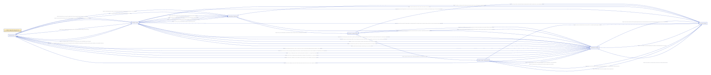

#+TITLE: Static completion resume and structural frame-root contract
#+SETUPFILE: ../../modeling/org/setup.org
#+LANGUAGE: en
#+OPTIONS: toc:3 num:t
#+PROPERTY: header-args :eval never :tangle no
#+TODO: RESEARCH SOURCE_REFINED | DESIGN_DELIVERED

* DESIGN_DELIVERED One complete DEV Goal
:PROPERTIES:
:CUSTOM_ID: completion-frame-goal
:AUTHORITY: GambitSharedHeapSmpCompletionFrames
:SOURCE: models/sysml/shared-heap-smp/source-sites/completion-frame.sysml
:NATIVE_ADMISSION: OPEN
:SCOPE: source refinement, structural-root design and cost/acceptance handoff
:END:

This Goal refines the [[file:sender-completion-design.org::#sender-completion-goal][sender-completion design]] as one whole control/root/exit
delivery. A source location or model pass cannot admit the proposed lowering.
No runtime, build workspace, census, heap, watchdog or QNT/Lean implementation
is changed. The historical PR model-binding rejection is a separate issue.

The [[file:completion-generator-contract.org::#completion-generator-goal][generator refinement]] carries this plan into actual GVM frame/liveness,
check/internal-return production, host/label emission and round publication.
It makes explicit that a nonallocating header prefix does not prove its emitter
prechecks preserve the static corridor or mutable operand read order.

- [X] Establish concrete alias, callable exposure and stack/heap restore facts.
- [X] Specify logical payload, structural roots and static retry corridor together.
- [X] Cover grant, multi-shot, reflection, GC, nested/nonlocal and unknown exits.
- [X] Account for new frames/restores/scans and full-load break-even conditions.
- [X] Synchronize native SDK/ASCENT projections, Org/D2 and retained evidence.

The canonical contract rows live in the existing
[[file:request-service-reconstruction.org::request-service-source-contracts][SysML-derived source table]]. The  remains
the one derived diagram. This modular source package does not add a runtime
namespace, root registry, executor or new proof owner.

* SOURCE_REFINED Source facts that change the proposed representation

| Existing producer/consumer | Exact source implication | Wrong inference to exclude |
|---+---+---|
| Kernel continuation-copy / next! | Copy allocates a wrapper sharing frame/denv; next! advances one wrapper | Two wrapper identities do not imply independent frame cells |
| Kernel continuation-ref/set! | Heap and stack coordinates differ; setter writes the actual selected cell | GC relocation and logical mutation cannot share one revision event |
| Closure creation and CLOSUREREF/SET | Resume captures mutex/owner/self/timeout/wait values in distinct free fields | Caller frame's completion slot is not automatically the original captured mutex cell |
| Kernel break handler | Heap frame payload may be copied to the active stack, structural return patched, break.next advanced | Current active copy, retained heap source and wrapper are not one address/owner |
| THREAD_SAVE / RESTORE | SAVE either saves current frame plus break or reuses break.next when R0=handler_break; RESTORE moves the edge and clears Thread.cont.frame | Thread.cont is not always readable after restore; unconditional re-save after restoring a frame need not have fixed cost |
| ROOT_STACK and captured-frame scanner | Task uses source context, active/break ancestry and dedicated captured-frame handling; forwarding repairs aliases | A tagged stack-frame fixnum in an ordinary bitmap slot is not necessarily traced as a frame |
| Collector frame_gate | Serializes collector frame work | It does not itself admit/freeze mutator or reflective writers |

Counterexample: a copied continuation wrapper shares caller frame B; reflection
changes B.completion from M0 to M1 after resume closure construction. The old
closure still holds its separately captured M0 unless that closure cell is also
changed. A static resume that simply reloads B.completion now waits on M1 and
is not equivalent. Likewise, adding a revision number while copying every alias
into independent immutable payloads changes the original shared-cell semantics.

* RESEARCH Selected binding: a structural private wait frame

The earlier side-binding proposal is not the default root solution. Prefer a
generated private wait frame S with its lexical operand snapshot and structural
caller B. It is ordinary Gambit control representation, placed and described
by Scheme FrameSpec/PointId semantics and emitted by the modern C backend.
Its root binding is the existing structural continuation path, not a guessed
current-Thread lookup or a new table of raw frame addresses.

| Logical field / role | Representation and alias law | Cost / admission |
|---+---+---|
| Captured completion M0 | Named ordinary SCM root slot in S; distinct from B.completion | Preserves the lexical capture, adds a real live frame slot |
| Caller B | FrameSpec structural link/return coordinates, not a second ordinary SCM fixnum slot | Current scanner handles stack and materialized link forms differently |
| Retry and final-return code | Module-owned PointIds/label descriptors | Metadata lifetime must span every captured S, not just its current Thread |
| Anonymous/no-timeout policy | Known internal constants, not per-instance free fields | Only this admitted completion role is specialized |
| Request/result/ordinary caller values | Remain in B under their original logical cells and liveness | Do not snapshot/change user-observable mutable caller values merely for convenience |
| Scheduler/physical registration | Existing actual Thread, BTQ ownership and fixed outcome writers | Not stored as a recyclable raw native pointer inside captured S |
| Current/captured denv | Existing effective Thread state and user continuation graph | Internal parking does not roll back parameter updates or skip dynamic-wind |

This is a schema, not a claimed two-slot emitted frame. Scheme must derive S's
actual fs/link/bitmap, register/result/checkpoint liveness and return labels;
C must reserve FRAME_SPACE(fs_S) before formation. No partially formed S may
become visible or trigger a collecting poll. Known reserve refusal before
publication uses the already-rooted generic path within the original budget;
it does not allocate a partial frame then ask GC to interpret it.

The captured M0 cell preserves its actual sharing. If a supported accessor
exposes and mutates the logical captured environment, aliases of that same cell
must see the mutation. A restored active stack copy follows existing copy/
mutation semantics; it does not rewrite every retained heap template. Neither
a fresh physical incarnation nor an address move creates an independent copy
of all shared Scheme values. Current raw accessors have no such optimized
projection adapter, so this remains an admission premise rather than a pass.

** The static retry corridor avoids a side root and repeated restoration

1. Form complete S with snapshot M0 and caller B. A static registration entry
   receives the actual Thread and explicit M0 through existing SAVE2-style
   argument passing; timeout/no-owner are constants. The first SAVE establishes
   S through Thread.cont.frame and the break chain using the existing layout.
2. Registration uses the existing mutex wait/outcome producers with a permanent
   static retry procedure in place of the heap self-resume closure. Queue
   publication, current-thread withdrawal and wake policy are not redesigned.
3. On service wake, RESTORE puts saved S in break.next. Dispatcher drains request
   nodes under the existing policy; its eventual tail-call to static retry must
   occur with FP=stack_break, R0=handler_break and next descriptor identifying S.
   Validate module/PointId/layout and read M0 without a collecting operation;
   stage it in mapped operands before any later permitted checkpoint.
4. While R0 still denotes handler_break, SAVE's existing fast branch reuses
   break.next=S and does not push a fresh break. Static registration rechecks M
   with the original lock order. Crucially the retry has not returned through
   the break handler and materialized S first. A decode walk of arbitrary
   ancestors or an ambient per-Thread payload is not this corridor.
5. A real mutex grant installs its existing locked-action; abandonment installs
   its existing action/exception disposition. Fixed outcomes do not call static
   retry. Normal final return may restore S through the break handler once,
   then return to B and its result consumer. Count this extra landing/restore.

The next-S invariant must hold for every supported ingress, including a restored
service continuation: dispatcher ancestry retains S, so the same structural
parent is reached after returning through service/dispatcher frames. The static
procedure is not allowed to use whichever unrelated wait happens to belong to
the current Thread. Captured continuations retain logical S/data, not a pointer
to a reusable physical scheduler record.

This is a proposed generator/backend path, not existing emitted C. The current
header primitives provide useful operations, not proof of the combined
corridor. If code first returns through the break handler, S may become an
active copy and break.next advance to B; the precondition has changed. A later
unconditional SAVE can add frames/breaks or save the wrong base. Such a trace
defeats the claimed zero-restore retry path and must be preserved, not hidden by
an extra yield, larger stack or a search for another matching label.

Stack-section overflow/undo, nested winding and native return are not forbidden
inputs. Admission must prove the corridor for every supported such path or
provide a qualified rooted slow/deoptimization landing. That landing needs S's
actual lexical cells, caller/return authority and known physical registration/
grant settlement before it can enter equivalent generic waiting. It must retain
captured S/module aliases, avoid replaying the request and account for any new
capture/closure/restore cost. After unknown partial registration it cannot
start a second wait as fallback. No current helper is asserted to implement
this adapter. Until coverage or a safe landing is supplied, keep the original
generic lowering from the start; a failed runtime predicate is not permission
to reject a legal Scheme control path.

** Root coverage through movement, independent workers and exit

| Cut | Canonical root of S / operand obligation | Implementation requirement |
|---+---+---|
| Formation / pre-save | Complete active frame and mapped M0, caller B rooted | Generator reserve/check placement before any source/queue publication |
| Saved/blocked | Existing Thread.cont.frame and break path | Typed captured-frame interpretation, not an arbitrary integer in an SCM array |
| Service/dispatcher active | Structural next S remains below the active service chain | All service/dispatcher captures and ordinary returns preserve this ancestry |
| Frozen GC source | ROOT_STACK's source context and source-owned thread/captured graph | W<R worker scans the source, not carrier; mutator/semantic writers closed independently of collector frame_gate |
| Stack S becomes heap FRAME | Existing captured-frame forward/link repair, descriptor ordinary slots and parent link | Re-decode canonical current edge after GC; never retain a raw slot/stack address |
| User restores a shot | Existing continuation graph reconstructs its physical frames and effective denv | Preserve shared aliases and ordinary return values; a shot is not permission to replay a request or reuse old BTQ membership |
| Final/abnormal exit | Settled physical wait and actual remaining user/native/source roots | No source cleanup while its root/scan/native users remain; UNKNOWN retains custody |

The design adds no extra captured-frame root kind if every binding is actually
in that structural path. A side cell/reference not in the path is a different
design and needs its own typed scan/census/repair adapter; it cannot inherit
this claim. RootTask completion is neither scheduler grant nor last-user proof.
If a carrier exits, retain the source/context until its qualified root transfer
or last-use closure; Thread.cont clearing, a join result or a zero local count
does not establish that closure.

* RESEARCH Callable exposure and full control semantics

Thread.resume-thunk is stored state, so local non-escape is not established.
Current closure-ref/set!, closure-code/length, raw record access, native closure
conversion and saved dispatcher operands can expose identity or captured values.
There is no current getter hook that magically reifies a compatible closure.
Optimization requires a proven supported use set or fully implemented projection
adapters preserving identity, self-reference, copied-closure sharing, field
mutation and invocation. Otherwise use the generic closure for the affected
cohort, including possible future exposure. Do not reject Scheme inputs or
hide this condition behind an environment flag. Eligibility may be zero in an
unmediated open-world configuration; no deployment-wide saving is promised.

This does not freeze physical frame counts, private numeric offsets or debugger
display formatting forever. Modern FrameSpec may replace those layouts, update
their real consumers and refuse stale native metadata while retaining Scheme
names and declared semantics. What must be preserved is admitted observation,
callable behavior and alias meaning, not every old implementation detail. A new
typed internal exposure contract is another possible migration, but its reader/
serializer/native adapters must actually exist before admission. An unmediated
raw reader does not become safe merely by calling it compatibility.

These are real consumers, not only hypothetical unsafe programs: REPL variable
inspection calls continuation-ref using debug slot descriptors, and its hidden
frame predicate explicitly exposes every frame under show-all. _io.scm's
explode/implode-frame and explode/implode-closure read or rebuild live fields;
sys.scm's serializer follows continuation/structural links and preserves shared
objects. A hidden flag does not close these uses. Qualify logical slot/parent,
callable and serialization projections, including fixups and failures, or keep
their affected cohorts generic. Absence of reflection in the benchmark alone
is not a supported-runtime use-set proof or a test-only optimization allowlist.

Capturing a user continuation inside service retains service, dispatcher and S
ancestry as required. Completing the original service or changing Thread's
resume action cannot delete that captured graph. Two later restores preserve
dynamic-wind before/after ordering and Scheme return values; physical queue
registration is current-incarnation work, not inherited from a saved pointer.
Cross-context restoration keeps existing VM/resource-affinity admission rather
than silently permitting arbitrary native-handle migration.

Native normal grant, service-retry and explicit user continuation return have
different causal sources. An arbitrary R1 value, returned request flag or a
matching code label alone does not prove mutex acquisition or physical stop.
Retain the existing fixed outcome and generic ordinary-control paths; do not
reinterpret every captured S return as a new scheduler retry. Raw/reflective
restoration paths that cannot satisfy the logical projection stay generic.

Graft/return-no-winding replaces the active break edge and denv; the Scheme
unwind/wind layer may allocate, nest, capture, throw or call user before/after
hooks. Structural detachment is not physical cancellation/cleanup. Normal
return, abandonment, nonlocal graft and unknown native escape must each close
or transfer the actual physical wait while retaining captured user roots.
Do not retry hooks as idempotent bookkeeping, run them under M/frame_gate or
claim a stopped raw writer from an unwind alone. Unknown publication/cleanup
queries the same obligation and retains it; no duplicate registration repairs
an unknown old registration.

* RESEARCH When closure and internal capture work can disappear

| Candidate mode | Required before admission | Claimed removal / retained cost |
|---+---+---|
| Generic | Any unsupported exposure, unqualified structural ingress or missing source adapter | Existing closure/capture remain; zero elimination credit |
| Static resume with captured base | Proven callable use set plus a complete, movable canonical base and reload | May remove callable environment; retained capture explicitly remains a cost. This is not the direct-S proof |
| Structural S / direct-frame corridor | Complete reserved S, lexical snapshot alias law, next-S invariant on every supported shot, typed current roots and all exits | Retire ALLOC_CLO5/five stores and the separate internal CAPTURE4 wrapper where qualified; still save control, trace/copy live S and preserve all user call/cc |
| Proposed lazy callable exposure | Would require actual getter/field/native/procedure adapters and identity roots | Not implemented or admitted; cannot count it as allocation-free fallback |

No mode removes user continuation capture semantics. Frame-placed data are real
storage: stack initialization, extra return/checkpoint maps, descriptor access,
physical reserve, final restore, GC scanning/materialization and retained graphs
remain. A static code address does not automatically eliminate JUMPGEN or all
dispatch checks; direct-call savings need actual emitted-code evidence.

* RESEARCH Net benefit over the unchanged original workload

Let E_q be qualified original sender setup episodes (not N requests or repeated
registrations), G observed collections and L_e the qualified S frames whose
storage is actually copied/materialized in epoch e. N=360000000 still requires
complete useful consumption and all original limits/populations. The baseline
closure initializes (7+T)*E_q heap words. A useful allocation ledger is

#+BEGIN_QUOTE
removed closure words = (7+T)*E_q;
new S copied/materialized words = sum_e sum_S_in_L_e(fs_S+2),
plus actual padding, fallback/auxiliary allocation and signed extra ancestry work.
#+END_QUOTE

Heap copies of an already-materialized S are included, not charged as another
logical setup. Aliased forwarding repairs are not another payload copy. Census
stays enabled and separately measured. If S does not survive to a GC it can
avoid a per-episode heap environment while still paying stack/frame work; this
uses Gambit's lazy frame materialization rather than imposing one-shot control.
E_q and L_e are unmeasured; retained user shots can make L_e large. There is no
universal bound from the number of physical workers or a finite register set.

The comparison credits no baseline closure-GC recopy saving until a matched
trace establishes it. Mutator environment initialization, collector destination
initialization and simultaneous retained capacity are separate ledgers; do not
present their sum as one measured allocation or RSS number.

At an explicitly selected T=0/eight-byte-word ABI the removed closure term is
56*E_q bytes, or20.16e9*alpha bytes if E_q=alpha*N. It is not net allocation,
peak or wall-time improvement. S needs FRAME_SPACE(fs_S) stack reserve; old
capture wrapper reserve is round(SUBTYPED_BODY+CONTINUATION_SIZE,FRAME_ALIGN).
At asserted1/2/4 constants that wrapper is4 words. Do not assume S is smaller;
extra live stack, scratch/restoration and root graph retention can increase peak.

Positive exclusive work requires saved closure setup and any actually removed
capture/retry/GC work to exceed added S initialization, decode, scan/copy,
final/user-shot restore, physical reserve and fallback/exposure costs. Compare
the complete original workload, not only unexposed fast episodes. The earlier
fast M-lease fusion remains an independently attributable term; do not count
that saving twice as evidence for this structural-frame change.

The historical illustrative3600-second file budget requires at least100000
useful requests/s before other work. Actual target2/4 lifetime windows, second
original file and harness keep their frozen budgets. Lower exclusive CPU or
closure allocation does not by itself satisfy deadlines or simultaneous peak.
No native net benefit, interval packing saving or speedup is measured here.

* RESEARCH One five-gate implementation and native campaign

| Gate | Required implementation / positive and negative controls | Status |
|---+---+---|
| SH-CUT-S | S FrameSpec reserve/complete formation, SAVE/RESTORE/static corridor, overflow/undo or qualified slow landing, next-S descriptor/module checks and all freeze/reload cuts | Source path refined; lowering/corridor native qualification OPEN |
| SH-ALIAS-S | Caller-slot mutation versus captured M0; copied wrapper shared mutation; restored active copy; callable extraction/set/copy identity; independent live alias while omitting a slot | Adapter/exposure proof and independent oracle OPEN |
| SH-BOUNDARY-S | Grant versus retry/user return, nested/cross-context shot, winding hook failure, detach, unknown publication/exit and last rooted/native reader | No new state/stop authority from labels or GC task DONE; OPEN |
| SH-EXEC-N | Existing R3/W2 map two restores/PBT/full GC plus original interpreted/compiled stress families and real consumers | No runtime/native run in this Goal; OPEN |
| SH-COST-N | E_q, M, unique S copies/scans/census, corridor restores, fallback/exposure, body/CPU/pause/deadlines and simultaneous reserve/peak | Net benefit/capacity UNMEASURED; OPEN |

The replay/shrink campaign must retain: B.completion mutated but old closure
M0 unchanged; two aliases sharing S; two restores yielding distinct active
copies; Thread.cont cleared while break.next owns S; premature break handling
advancing to B; fixed anonymous grant not-owned mistaken for retry; GC moving
S while a stale raw decoder pointer survives; exposed static callable invoked
from another Thread; nonlocal hook exit with captured S retained; and added
frame copying outweighing removed closure allocation. Preserve the causal
identity/cut that makes each counterexample meaningful. Actual legal probes
are bounded/nonallocating; missing cuts or overflow are INCOMPLETE.

Existing QNT owns interleavings, grants and unknown-result/last-user histories;
existing Lean owns shared slots, relocation/representation and physical-interval
laws. This package refines their source premises and native observations,
without another schedule/alias proof or a model-pass-to-runtime promotion.
