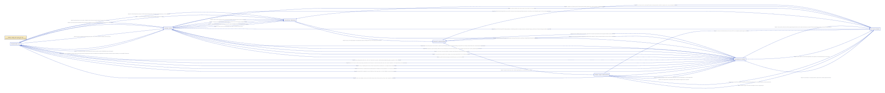

#+TITLE: Completion wait: GVM to FrameSpec, static corridor and GC consumers
#+SETUPFILE: ../../modeling/org/setup.org
#+LANGUAGE: en
#+OPTIONS: toc:3 num:t
#+PROPERTY: header-args :eval never :tangle no
#+TODO: RESEARCH SOURCE_REFINED | DESIGN_DELIVERED

See the joined [[file:completion-retry-handoff.org::#completion-retry-goal][static retry / generic handoff]] for admission, exposure,
partial conversion and qualified-population cost accounting.

* DESIGN_DELIVERED One generator-refinement Goal
:PROPERTIES:
:CUSTOM_ID: completion-generator-goal
:AUTHORITY: GambitSharedHeapSmpCompletionGenerator
:SOURCE: models/sysml/shared-heap-smp/source-sites/completion-generator.sysml
:NATIVE_ADMISSION: OPEN
:SCOPE: DEV design/source refinement; no peer runtime or native execution
:END:

This is one implementation handoff for the [[file:completion-frame-contract.org::#completion-frame-goal][structural wait frame S]], not
another independent optimization. It joins semantic operand/liveness production,
physical emission, real GC publication/repair, exposure and all exits. Existing
source obligations stay with the whole freeze adapter; no new proof owner or
parallel configuration/runner is introduced. The typed source argument is
=completionGeneratorRefinement=, not a mechanized correctness claim.

- [X] Trace GVM state, label/debug generation, FrameSpec and C descriptor output.
- [X] Specify complete S and checkpoint roles, semantic snapshot order and corridor.
- [X] Integrate GC, reflection/serialization, repeated restore and exit adapters.
- [X] State generic/slow admission, actual retirement and signed full-load costs.
- [X] Regenerate SDK/ASCENT/Org/D2, check owner boundaries and retain evidence.

Canonical clauses and source rows are projected in the parent
[[file:request-service-reconstruction.org::request-service-source-contracts][source-contract table]] and . New source-case counts are
not REV or SMP progress. Historical PR model-binding STALE remains independent.

* SOURCE_REFINED Concrete producer-to-consumer chain

| Stage | Actual current producer/consumer | Proposed change / retained responsibility |
|---+---+---|
| Frontend semantic producer | _front.scm gen-call specialization, current-frame/context->frame and gen-return-label adding live result-var | Recognize the admitted internal completion role before frame freezing; preserve argument evaluation, reason, user tail behavior and arbitrary result values |
| Semantic GVM frame | _gvm.scm make-frame(size,slots,regs,closed,live), frame-live?; instructions carry gvm-instr-frame | Create S lexical snapshot and control roles before liveness freezes. Do not delete a C allocation while keeping stale closure-env liveness |
| Target scan | _t-c-2.scm targ-gen-gvm-instr selects attached entry/exit frames; label starts target block frame state | Recognize admitted completion roles and give each edge its actual frame, operand and effect state |
| Return/root/debug production | targ-gen-label-return*: ret-var position, live vars and gcmap; debug-info-add! queues records | Emit S normal return, check RETI and final result maps separately, with coherent debug slot/label order |
| Physical FrameSpec | _t-c-3.scm targ-make-frame-spec and internal size expansion/chunk helpers | Validate one physical contract; size validity is not semantic root coverage |
| Host/label placement | _t-c-1.scm compilation-unit plan then DEF_LBL_RET_AT/OFD output | Preserve logical points and complete edges/effects through host/slot remapping. Current return/CFG planners are constrained prototypes, not automatic corridor support |
| Inline SAVE/check emission | _t-c-2.scm thread-save! inliner calls end-of-block checks, adjusts stack and declares resource effects | A normal static Scheme helper is not proof that FP/R0 stay at the break anchor; new typed corridor support is required |
| Native control/roots | SAVE/RESTORE, kernel break handler, ROOT_STACK/continuation and FRAME scanners | Reuse actual typed structural S ancestry and canonical repair. Never treat an integer stack address as an ordinary SCM root |
| Actual worker publication | collection-round.inc barriers -> roster begin/freeze/publish -> assignment | Generated CHECK/POLL and a label are not release/acquire publication to independent collectors |

There is a separate debug channel. Return emission helpers accept label-descr
but put FrameSpec in their physical label record; debug-info-add! also queues
the description, and targ-scan-procedure later calls debug-info-generate.
Ignoring that parameter is therefore not evidence that debug data disappeared.
Every new first-class S/check/return label must preserve the correspondence
between the debug queue and numbered label records, including accessible-slot
and closure-environment descriptions. Native round-trip remains unqualified.

Current labels are assigned sequentially through cells and then mapped to a
physical host/slot. The design's PointId must be bound to module-artifact,
procedure and logical point/role. It is not a current host slot and no existing
cross-build-stable PointId type is asserted here. Live module/descriptor lifetime
and stale native-metadata rejection must be implemented against that bound
identity; equal numeric label ordinals from two builds are not interchangeable.

Qualification digests belong to source/artifact admission, not the request hot
loop. A future runtime should establish coherent module metadata and lifetime
at setup, then use bounded resident descriptor/role checks at retry. This is
not a proposal to hash files, consult Python evidence or walk a module catalog
per request. Actual module pin/unload correctness remains a source/native gate.

* RESEARCH One semantic S plan, several precise physical points

This table specifies plan inputs, not a new runtime constructor or a second
generator schema. The existing FrameSpec remains the physical layout authority.

| Semantic role | Required producer state | Physical/root meaning |
|---+---+---|
| Caller B | Existing request/result/caller cells and return authority | Preserve their actual sharing and mutability, not a copied private environment |
| S snapshot | Fresh logical completion binding selected from the old mutex-wait operand | Ordinary root distinct from mutable B.completion; admitted mutation/exposure must keep its alias law |
| S parent/return | ret-var and named caller relationship | Structural link, excluded from ordinary-root iteration and interpreted by stack/heap frame consumers |
| Retry entry | Static internal role plus no-timeout/anonymous policy | Code can be permanent while data lives in S; no assumption that generic JUMPGEN disappears |
| Checkpoint temporaries | Every live argument/result/code/canonical frame value before collection | Normal S map is not sufficient for a collecting check extension or pending result |
| Final/user return | Ordinary Scheme result, effective denv and actual current registration disposition | Fixed grant/abandon, scheduler retry and user continuation value are not interchangeable authorities |
| Debug/serialization view | Semantic variable/slot/parent metadata associated with the same logical point | Logical observation/round-trip must agree with new layout; old private numeric offsets need not be preserved |

For normal returns the target derives fs from current FP/reserve, reverses frame
slots, finds ret-var and constructs the liveness bitmap. For internal check
returns it aligns the frame and extends it with saved GVM registers/return
state. All those saved registers are marked live. S therefore needs distinct
normal/check/final-return specifications; guessing a small bitmap cannot remove
register/home/native roots. Closure-env-var also remains live whenever its
closed variables require it; removing that environment requires semantic
rewriting, not replacing ALLOC_CLO with a C goto.

No constant fs_S is admitted. Scheme supplies actual slots/liveness/effects;
the target computes stored/actual fs, link, bitmap and IFD/OFD chunks. C uses
the resulting FRAME_SPACE for physical reserve, scan and restoration. Complete
caller roots and sufficient physical space precede S formation; partial frame
initialization may not trigger collection. Keep the existing census and original
heap/stack budget, including extra S and check/restore capacity.

This begins in the actual frontend producer, not merely make-frame's data
constructor: gen-call selects procedure handling, and gen-return-label builds
the current frame with result-var live. The later static decoder's use of M0
must be represented in semantic operands/effects before these frames are
attached. Otherwise ordinary dead-value reasoning can omit the very snapshot
that runtime decode later reads. A role comment, PointId name or post-hoc C
bitmap patch cannot repair that missing semantic use. Preserve original
evaluation order, arbitrary result values and proper user tail behavior while
introducing and retiring this internal wait frame.

* RESEARCH Snapshot, check and no-GC corridor order

The ordinary SAVE inliner is a dependency, not an implementation of the new
path: it performs targ-end-of-block-checks and targ-adjust-stack before SAVE.
Checks can create RETI return state and enter heap/stack handlers. A new
ordinary Scheme helper may also have a prologue or non-tail call that changes
FP/R0. The generator must establish the following corridor explicitly.

| Point | Required operation and root view | Admission failure |
|---+---+---|
| Form | Reserve and form complete S, rooted M0, caller/return and future check state | No partially published frame or collecting check with missing cells |
| Select/check | Preserve semantic operand evaluation order, using one of the two cases below | No unproved hoisting of a check across a mutable capture read |
| Reload/revalidate | After any permitted check, reload repaired canonical operands and validate actual next S/module/layout, FP anchor and R0 handler role | A prior raw descriptor/slot address or an old code label is not current state |
| Decode/stage | Bounded, noncollecting typed stack-or-heap decode; put required SCM operands in mapped registers/slots | Generic frame-ref on the wrong representation or opaque side effects are not a typed adapter |
| Save/register | No new check, allocation, host transition, stack adjustment or hidden call invalidates the state before the existing SAVE fast prefix | Cannot silently set poll? false; current inliner may be used only if its check/adjust is proved a no-op at this point |
| Outcome/return | Existing producers decide physical grant, abandonment or service retry; final landing preserves ordinary caller values | Never replay request execution or infer grant from a label/returned flag |

There are two distinct operand cases:

1. If the selected snapshot cell is proved immutable throughout this internal
   retry scope (apart from relocation), the complete checkpoint can precede
   fresh decode. A later decode still selects the same logical value.
2. If supported reflection can modify it, preserve the original read order:
   select the value into a mapped temporary root before the check; after GC
   reload the relocated *selected value*, not a newly read changed cell. Recheck
   structural/code validity without silently changing the chosen operand.
   That temporary and any saved register extension are real roots and costs.

The current backend has no typed S-decode/corridor operation. A future lowering
needs explicit read/write/control and no-GC effects in the structured emitted
instructions, including all local label/fallthrough edges. Embedded opaque C
does not supply that semantic proof; the current host planner deliberately
rejects such procedure splitting. Keep the corridor in an admitted host region
or provide a verified transfer that preserves its state. This design enables
no experimental layout switch and adds no build profile or environment flag.

* RESEARCH GC publication, movement and exact consumers

Before actual roster freeze, complete S/checkpoint/home values must be visible
under the existing publication protocol. collection-round's barrier sequence
precedes begin/freeze/publish and task assignment. Matching selected C23/GCC
atomic/lock backend evidence and all source participants are required; a
compiler CHECK/POLL or plain FP store does not replace those edges.

The source ROOT_STACK task scans task.origin.source.stack, not the executor's
carrier context. Active and captured frame roots, Thread.cont/break ancestry,
saved registers, caches, RC/still/native users and user aliases remain covered.
Stack S materialization rewrites canonical links through forwarding; heap FRAME
scanning uses the same descriptor's ordinary/structural interpretation. Repair
then resume requires the actual round/restore authorization, not task DONE
alone. Planning refusal/unknown outcomes keep the corresponding rooted source
and partial-work responsibility; they do not permit stale retry or metadata reuse.

Decode no raw frame pointer across collection. After a user shot, GC, overflow
or final break restoration, obtain current coordinates through the admitted
typed structural path. Collector frame_gate alone is not a mutator/reflection
freeze. If the next-S corridor cannot cover a legal path, choose generic lowering
before publication or supply a qualified rooted slow landing; never reject the
Scheme program or search arbitrary ancestors until a label happens to match.

* RESEARCH Reflection, serialization, multi-shot and failure adapters

| Real consumer / control route | Whole adapter required | Safe fallback / retained obligation |
|---+---+---|
| REPL debug slot reads and show-all | Same numbered point/debug-variable mapping; inspect logical S/B cells and parent correctly | Hiding an extra frame is not access coverage; generic where supported exposure is not mapped |
| Closure ref/set, code/length and saved resume value | Captured operand identity, self/alias semantics and invocation remain meaningful, or an explicitly migrated typed private contract updates all real consumers | No current lazy reification hook. Potential future exposure matters; a benchmark that never reflects is not a runtime admission proof |
| Frame/closure explode/implode and sys serializer | One new descriptor/module identity drives live-slot enumeration, structural parent, graph sharing and fixups; validate rebuilt frames/code before use | Stale metadata/partial reconstruction cannot enter S retry; do not preserve old raw offsets by pretending new layouts are identical |
| Two user restores across GC | Existing continuation graph and winding machinery preserve shared cells versus distinct physical stack copies; dispatcher/S association belongs to that shot | No one-shot substitution or ambient Thread lookup; fixed outcomes and ordinary user result keep their own paths |
| Nested hook/exception/native unwind | Match actual generated normal/error return and catcher/graft consumers; close or transfer current physical registration and retain live roots | Hooks may allocate/capture/throw and cannot run under M/frame_gate or be replayed as idempotent cleanup |
| Overflow/undo, known reserve refusal, lost commit/unknown exit | Complete rooted generic/slow handoff and actual last users, preserving original limits | Precommit refusal may stay generic; postcommit unknown retains/query-settles the same obligation, not a second registration |

Physical layout and internal display can be redesigned; this is not a promise
to freeze all implementation details. Namespace/public Scheme/control behavior
and admitted alias/inspection/round-trip meaning are the obligations. Current
source has no completed logical projection, late reification or universal slow
landing. Until each relevant adapter exists, its path remains generic and gets
no closure/capture-elimination credit.

* RESEARCH Concrete implementation boundary and work retirement

The runtime/compiler owner receives one responsibility replacement, covering:

1. Semantic role recognition and S/caller/snapshot/return definitions before
   GVM liveness; supported-use admission and named generic alternatives.
2. Target label/check/debug production and one physical FrameSpec, including
   temporary roots and the selected-value rule above.
3. Typed no-GC decode/save effects, complete host edges and module-bound logical
   point identity; no C-only closure deletion or raw private offset adapter.
4. Current source roster, stack/heap scan/repair, restore and error/slow exit
   consumers; actual refusers retain roots and unknown work remains owned.
5. Debug/serializer/callable projections and a single existing native campaign
   comparing optimized and generic emitted paths on exact source identities.

Only a qualified path may retire ALLOC_CLO5/five free-field stores and a separate
internal CAPTURE4 wrapper. If capture remains, credit only the admitted closure
change. User call/cc, request/completion objects, grant/queue work, original
census and physical capacity checks remain. The generated C must demonstrate
both removal and replacement; absence of a macro name is not a semantic proof.

* RESEARCH Full original-load costs and five joint gates

N=360000000 useful flood requests still requires complete original populations,
including the second file when the frozen family requires it. E_q is the
qualified setup population; M_q is actual retry count, not N. Removed closure
initialization is (7+T)*E_q words; under selected T=0/w=8 this is56*E_q bytes
or20.16e9*alpha when E_q=alpha*N. Alpha is unmeasured and may be zero.

Deduct S stack initialization/reserve, temporary/checkpoint roots, saved-register
scans, descriptor validation, host transfers, final/user restore, materialization
and fallback/exposure/slow-landing costs. Unique GC S payload is accounted by
actual fs_S+2 and actual epochs; alias repairs are not another copy. Do not
double-count snapshot setup and an inclusive GC pause, or infer lower reserved
peak from lower mutator closure allocation. Initial capture is not itself a
deep heap-frame copy, and saved-register maps can retain other environments.

Signed paired savings from setup/retry/exclusive GC (and separately attributable
fast M-lease fusion) must exceed all those added costs. Useful completion C=N,
actual target lifetime windows, wall deadline, CPU/pause and simultaneous peak
are separate requirements. The illustrative historical3600-second file budget
implies at least100000 useful calls/s before other work; it grants no new budget.
No native speedup, capacity or peak saving is measured by this Goal.

| Gate | Joined generator/native evidence and negative control | Status |
|---+---+---|
| SH-CUT-S | S GVM/liveness -> normal/RETI/debug maps -> emitted effects/host -> actual freeze/repair/restore; inject legal check/GC and missing root | OPEN: typed emitter and full source simulation not implemented |
| SH-ALIAS-S | Distinct caller/captured cells, selected value across reflective poll, independent live alias, real debug/serializer/callable round-trip | OPEN: no complete observation/exposure adapter |
| SH-BOUNDARY-S | Grant versus retry/user return, overflow, nested hook/native exception, source exit, unknown publish and last-reader retirement | OPEN: complete qualified slow/error landings absent |
| SH-EXEC-N | Existing R3/W2 map/PBT two restores/full GC plus unchanged interpreted/compiled original stress families and consumers | OPEN: no native execution in DEV Goal |
| SH-COST-N | E_q/M_q and emitted optimized/generic/fallback counts, exclusive body/check/scan/copy/decode/restore cost and simultaneous reserve/peak | UNMEASURED: no net-benefit/capacity credit |

The new typed source case refines the existing freeze adapter's coverage,
exclusion, publication, reentry, failure and validation clauses. Existing QNT
owns scheduling/unknown histories; existing Lean owns slot/alias/representation
and interval laws. Neither is rewritten here. New source clauses and a source
argument are not another temporal/algebra proof, nor evidence that native C
implements their premises. Historical PR STALE remains its own retained status.
