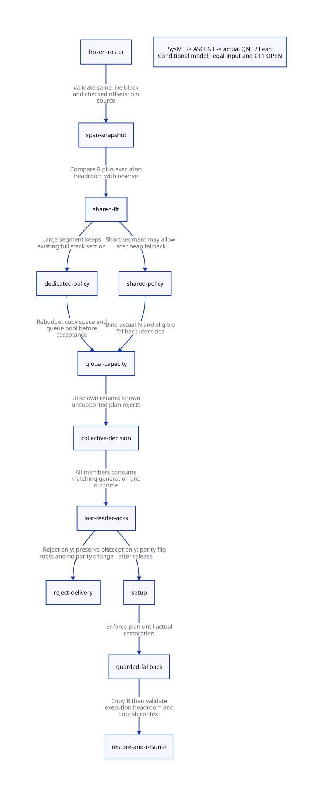

#+TITLE: Continuation Restore Admission — Actual Length, Space Selection and Collective Failure
#+SETUPFILE: ../../modeling/org/setup.org
#+LANGUAGE: en
#+PROPERTY: header-args :eval never
#+STARTUP: overview

* RESEARCH Decision and limits
:PROPERTIES:
:CUSTOM_ID: continuation-restore-decision
:AUTHORITY: GambitContinuationRestoreAdmission
:STATUS: conditional-model-proved; legal-input-and-C11-open
:END:

Modern generated C remains the required architecture. This study extends the
[[file:default-lease-admission-design.org][default lease admission study]] without changing Gambit or executing native tests.
The [[file:models/sysml/continuation-restore-admission.sysml][native SysML package]] owns the source anchors, contracts, model obligations,
proof bindings and benefit rows. Python queries that package using the installed
SysML tool; it does not parse SysML or maintain a second layout registry.

The current evidence does *not* establish that all legal Scheme executions satisfy
the quarter-section restore bound. It also does *not* establish a source-qualified
legal Scheme counterexample or a native corruption. The missing implication is
not filled by a numerical example or by a finite planner model.

The proposed contract avoids depending on that implication: capture the actual
active-segment length under a frozen owner, choose an admissible reserve, protect
it against later heap borrowing, and collectively reject unsupported plans before
any setup effect. A dedicated destination can be the initial stack section already
assigned by setup; it need not be another allocation. This is a runtime allocator
and GC contract refactoring, not a build configuration change.

* RESEARCH Actual source chain and the meaning of R
:PROPERTIES:
:CUSTOM_ID: continuation-restore-source
:END:

Source evidence is retained as immutable snapshots in
[[file:../../../evidence/research/continuation-restore-admission/source-witnesses.json][source witnesses]]. The original paths below remain navigation links; the receipt
binds the analyzed bytes and reports live drift separately.

| Producer or consumer | Actual source | Effect on the bound |
|----------------------+---------------+---------------------|
| Initial context | [[file:../../../vendor/gambit/lib/mem.c::Create "first break frame"][setup_mem_pstate]] | Installs first break below stack_start; its rounded space B is included in R |
| Safepoint materialization | [[file:../../../vendor/gambit/lib/mem.c::stack_left_before_fudge =][prepare_mem_pstate]] | Stores current allocation fp and computes polling limit; does not impose quarter bound |
| Stack pressure | [[file:../../../vendor/gambit/lib/mem.c::occupation of the stack msection would increase][stack_limit]] | May insert break on the low-free-space GC branch; otherwise moves a descriptor-driven prefix |
| Capture, graft and thread save | [[file:../../../vendor/gambit/include/gambit.h.in::#define ___CONTINUATION_CAPTURE][continuation macros]] | Capture/save can create a newer break; graft resets fp to break; these are not mandatory before every GC |
| Returning through break | [[file:../../../vendor/gambit/lib/_kernel.scm::ra1 = ___stack_overflow_undo_if_possible][break handler]] | Copies one frame or calls overflow undo to resume an earlier section |
| Overflow undo | [[file:../../../vendor/gambit/lib/mem.c::stack_msection_resume_using (___ps][stack_overflow_undo_if_possible]] | Restores prior section and saved stack_break; provenance must follow this edge |
| Explicit collection | [[file:../../../vendor/gambit/lib/_kernel.scm::(define-prim (##gc)][gc and gc-without-exceptions]] | Stores RA/register state and calls garbage_collect without universal break normalization |
| Heap pressure | [[file:../../../vendor/gambit/lib/mem.c::___BOOL ___heap_limit][heap_limit]] | Can request collection without executing stack_limit's trimming branch |
| Strong root scan | [[file:../../../vendor/gambit/lib/mem.c::___HIDDEN void mark_continuation][mark_continuation]] | Walks a local fp and updates roots/links; does not shorten context fp to stack_break |
| Actual restore | [[file:../../../vendor/gambit/lib/mem.c::___HIDDEN void move_continuation][move_continuation]] | In weak phase copies the current active segment into reserved destination |

The actual formula is

#+begin_example
start = context->fp
B = FIRST_BREAK_FRAME_SPACE
R = (context->stack_break + B) - start
source interval      [fp, stack_break + B)
destination interval [destination_top - R, destination_top)
#+end_example

R is not the length of every captured frame reachable from a first-class
continuation. Other frames can be linked through break frames or already be heap
objects and are traced through the captured-continuation path. Treating the whole
logical continuation as one required contiguous allocation would unnecessarily
discard Gambit's segmented representation.

Under the checked same-array assumptions

#+begin_example
source_low <= fp <= stack_break
stack_break + B <= source_top
source_top - source_low = H
#+end_example

the symbolic theorem proves =B <= R <= H=. This is the source-span ceiling, not
the smaller sharing ceiling. Proving these assumptions for all generated writes,
all descriptor sizes, overflow undo, FFI and exceptional restoration remains a
source refinement obligation. The default header has FRAME_ALIGN=4 and
FIRST_BREAK_FRAME_SPACE=round(3,4)=4. Effective configuration and machine range
still need explicit qualification; the theorem's integers are not native pointers.

Do not first subtract or order unrelated C pointers to discover whether they
belong to one block. The proposed descriptor carries allocation identity, live
half/parity, validated offsets and extent. Check that br_offset <= extent-B
before forming br+B; check offset differences and PTRDIFF_MAX/SIZE_TS bounds
before native subtraction or conversion. Include initialized contents, code/OFD
liveness and both source and destination pins in the restore obligation.

* RESEARCH Why the current heuristic does not prove shared fit
:PROPERTIES:
:CUSTOM_ID: continuation-restore-quarter
:END:

For a fresh target half-section, the heap-sharing direction computes

#+begin_example
H = 4q + 2F + remainder,  0 <= remainder < 4
K_shared = q + F
E_heap = 3q + F
#+end_example

The two marker words are already charged inside the heap endpoint E_heap. Actual
copy separation requires =R <= K_shared=, plus a valid first-break metadata
footprint. The other sharing direction gives more space to the stack; these two
directions must not be silently treated as the same policy.

The source's =2/3= test is conditional on stack pressure *and* the branch that
decides to collect because approximate free space is low. Its operand is the
current =stack_start-stack_limit=, where stack_limit is a computed polling limit,
not a fixed semantic maximum on all live active segments. It inserts a new break
only on that path. It neither dominates explicit GC nor heap-limit GC.

For the default constants H=65536 and F=8194, q=12287 and K_shared=20481. An
aligned candidate R=24576 exceeds K_shared while its R-B remains below
=2*(H-F)/3=. [[file:models/lean/RestoreAdmissionComposition.lean][thresholdDoesNotImplyQuarter]] checks that arithmetic counterexample.
It refutes the proposed arithmetic implication only. It does not prove that the
computed polling limit equals F, that a concrete generated function reaches this
state, or that its collector actually exhausts fresh heap sections and takes the
sharing fallback in that run.

** OPEN Legal Scheme reachability obligations
:PROPERTIES:
:CUSTOM_ID: continuation-restore-reachability
:END:

| Candidate source history | What source establishes | Additional evidence needed |
|--------------------------+-------------------------+----------------------------|
| Non-tail recursion followed by explicit gc | Language permits non-tail calls and explicit collection; GC entry does not universally shorten the active segment | Exact generated frame sizes, intermediate polls/GCs, optimization and frozen descriptor path |
| Heap allocation at depth | Heap-limit GC can bypass stack-limit trimming | Allocation/free-space trace, current stack limit and active break provenance |
| Captured continuation then repeated resume | Graft, break-copy and undo alter active segment identity | Per-resume descriptor trace and proof that same-array bounds survive every transition |
| Several processors copying live objects | Other workers consume the common fresh frontier | A legal source history reaching fallback while large-R context remains frozen |

The last condition is essential. R>K_shared alone is not an actual overlap if
the heap never borrows that stack section, or its actual endpoint stays lower
than the restore bottom. This study keeps the unconditional legal-input quarter
theorem, the legal counterexample and the effective native path all OPEN.

* RESEARCH RestoreSpan and reserve policy before setup
:PROPERTIES:
:CUSTOM_ID: continuation-restore-plan
:END:

#+name: restore-span-contract
#+begin_example
RestoreSpan = {
  gc_generation, roster_digest, context_identity,
  source_allocation_identity, source_half_identity, source_pin,
  fp_offset, break_offset, first_break_words, actual_restore_words,
  frame_abi_digest, content_stability_scope
}
ReservePolicy = {
  destination_allocation_identity, destination_half_identity, destination_pin,
  destination_top_offset, reserved_stack_words,
  mutator_headroom_words, permitted_heap_endpoint, heap_marker_words,
  allow_heap_fallback, policy_digest
}
#+end_example

These are proposed semantic fields, not implemented C structs or a claim of
native ABI size. Shared fit is checked against actual R and a separately justified
headroom J: =R+J <= K=. Copy-only safety can use =R<=K=, but it must not authorize
mutator resume. Taking J=F is a candidate for the current bounded-write scheme;
complete generated/checkpoint/handler-frame refinement is still required.

| Choice | Preflight condition | Later enforcement | Capacity consequence |
|--------+---------------------+-------------------+----------------------|
| Shared stack/heap section | Valid source span; R+J<=K_shared; full heap-copy plan also feasible | Heap fallback must use the committed endpoint and same generation | Preserves current low-end heap borrowing |
| Dedicated initial stack section | R+J<=H; initial stack section is already exclusively assigned | Remove this stack identity from eligible heap-fallback set | No additional stack section; potentially less usable heap space |
| Different fresh destination | Reserved live block of sufficient extent, disjoint from every other grant; R+J fits | Bind exact interval before setup; enumerate it in GC scanning and capacity census | New actual N, manifest and pool bound must be recomputed |
| Adaptive split | Reserve K>=R+J and heap endpoint<=H-K including markers | Replace fixed-quarter endpoint writer | Not qualified here; copy capacity and allocation granularity require a separate proof |
| Pre-normalize more frames to heap | Root/descriptor-preserving segment conversion before snapshot, followed by a new snapshot | Preserve continuation identity, ordering and failure recovery | Larger redesign; not assumed by planner model |
| Reject unsupported plan | No available qualified choice, OOM, stale identity or unsupported custom allocator | No parity/queue-map/setup writes; deliver collective outcome | Retain old roots; no fabricated successful collection |

Choosing a different destination is not equivalent to calling next_msection
after forwarding has started. Do not resize the old ownership structure or run a
Scheme allocator from preflight merely to obtain descriptor/plan storage. Prefer
preallocated native plan records; a native reserve operation must have explicit
no-GC/no-callback behavior and failure ownership. Partial native reservations
remain owned until all plan readers have retired.

Protecting a dedicated stack lowers the eligible fallback count E<=P. Under the
previous fresh-token assumptions =L=P+fresh+shared<=P+(N-2P)+E<=N=. This does
not create heap-copy space. If many contexts need dedicated stacks, the same
live workload can require more physical memory or be rejected. It is invalid to
reclassify those protected stack sections as available heap capacity because N
still counts them in the pool bound.

* RESEARCH Collective acceptance, failure and C11
:PROPERTIES:
:CUSTOM_ID: continuation-restore-collective
:END:

The real insertion cut is after all old participants acknowledge ROOTS_FROZEN
and before setup_stack_heap_vmstate clears scan maps or changes parity/endpoints.
The current source has no restore-plan signer at that cut.

1. Close membership and every writer of fp, stack_break, section binding and
   destination policy. Publish frozen source spans only after root materialization.
2. Validate source provenance and machine arithmetic; pin source/destination
   blocks and produce per-context sharing policy. Rebudget heap copying and queue
   nodes independently. Unknown results retain the old roster and all owned grants.
3. Publish one immutable plan/generation. Each member verifies its source span,
   policy and common capacity result. Any known rejection prevents setup.
4. Publish one immutable decision. Every old member consumes it and retires its
   last plan read. A coordinator may not return while another member waits at the
   old setup barrier. Release the collective only after matching acknowledgements.
5. Accept: processor 0 performs actual per-context setup writes. The immutable
   policy authorizes every later heap fallback through restore completion. Partial
   setup remains setup-owned; it cannot become an old-parity rejection.
6. Reject: preserve old parity, roots, descriptors and roster. Deliver the same
   failure to every participant before freeing candidate grants. Undo pre-setup
   statistics/debt adjustments exactly once or delay them until acceptance.
7. Return to Scheme only through a qualified completion guard. A preflight failure
   is an internal outcome, not permission to allocate an exception while all
   contexts are frozen or while stack/heap headroom is unknown. Emergency failure
   delivery and retry without livelock remain explicit obligations.

An unsupported plan does not make the Scheme program invalid. Keep
PLAN_UNSUPPORTED, invalid/stale source evidence and genuine OUT_OF_MEMORY as
distinct internal causes. Unsupported sharing must lead to another qualified
collection/reservation/segment strategy, or remain an unresolved service outcome;
it cannot automatically become a user-visible heap-overflow exception when a
semantically valid alternative could execute. The finite QNT outcome=2 deliberately
abstracts these refusal causes and proves setup exclusion, not their external
exception equivalence or fallback progress. That semantic obligation stays OPEN.

| C11 edge | Required happens-before and lifetime | Qualification gap |
|----------+-------------------------------------+-------------------|
| Source span | Last root/pointer write -> release frozen ack -> coordinator acquire -> ordinary reads | All writers, same-array provenance and effective barrier adapter |
| Plan | Initialize immutable payload and pins -> release publication -> generation-matched acquire | Concrete object lifetime, digest binding and no generation ABA |
| Heap fallback | Owning epoch or acquire of matching policy before any endpoint write | Every sharing/rebind/undo/hook path must obey policy |
| Restore | Source stays pinned and length stable; last restore read before releasing this restore pin | GC root updates and callbacks must not mutate control endpoints |
| Decision | Coordinator acquire votes, release decision, members acquire and release last-read ack | Native interruption/exception completion, acknowledgement identity |
| Rejected free | All reader acks and failure deliveries acquired before reclaim | Late observer registration closed; once-only retirement, unknown retention |

The WG14 [[https://www.open-std.org/jtc1/sc22/wg14/www/docs/n1570.pdf][C11 draft]] defines the relevant memory model and same-object pointer
constraints. The sequential planner and Lean offset arithmetic do not prove these
native edges. Releasing a restore pin does not free the old section while other
GC/frame/FFI readers still own it. Existing full-fence macros cannot be credited as a complete lifetime
or publication protocol without effective-profile source refinement.

* RESEARCH Actual QNT, Lean and ASCENT chain
:PROPERTIES:
:CUSTOM_ID: continuation-restore-formal
:END:

The [[file:models/quint/continuation_restore_plan.qnt][actual QNT planner]] models two frozen owners with short, large and oversized
segments; shared/dedicated decisions; allocation failure; denied mutation and
unknown-result retention. Its representative H=64,F=8,reserve=20 values expose
both sides of the choice without pretending to reproduce native machine memory.
The oversized sample is deliberately outside a valid same-block H=64 source
span and represents an invalid/unsupported candidate. It is not a legal Scheme
reachability witness. It requires execution headroom of eight in addition to R. This is a finite policy
slice, not an arbitrary-P allocator or a total-space planner.

The [[file:models/lean/ContinuationRestoreAst.lean][Lean AST]] is extracted from actual typed Quint JSON using a restricted emitter.
[[file:models/lean/ContinuationRestore.lean][Planner induction]] checks every actual action and proves frozen-length and sealed-
outcome stability. The source-span ceiling and interval geometry are separately
symbolic, conditional theorems.

[[file:models/lean/RestoreAdmissionComposition.lean][Composition]] imports the exact preceding CapacityCollective AST/proof. It gates
the original publication event on the sealed plan, proves the guarded product
invariant over all old collective and new planner steps, and derives that setup
requires valid reserve bounds plus all last-reader acknowledgements. Rejected
plans cannot authorize a flip. This is actual model composition, not file linkage.
The previous collective failure-delivery theorem remains bound to its original
source digest. Conditional inequalities do not supply global live-copy capacity.

A pre-setup planner cannot assume the future live-object census is already known.
It needs a conservative, source-qualified copy-space envelope (including
fragmentation, frame/object limits, worker allocation and reserved stack space),
or a separately proved recovery mechanism. The current occupied-word census and
node-count bound alone are not that proof. A dedicated stack plan therefore
remains conditionally accepted by this model; native admission is blocked until
the independent global capacity obligation is discharged.

Negative histories preserve forced sharing for a large R, changing R after seal,
incomplete acceptance and oversize dedicated grants. A widened share guard and a
reversed publication gate must fail Lean verification. Wrong AST binding/type,
missing action and unsupported expression must be rejected by extraction.

The [[file:../../modeling/ascent/continuation-restore-admission.rules.scm][ASCENT DSL]] receives SysML-derived obligations, actual action/lemma names,
snapshot witnesses and exact prior-collective digest. It rejects missing or stale
links. Source/legal-input refinement and native-memory-order obligations have no
qualified receipts: actualCandidate stays false. Synthetic all-receipt input is
only a positive gate-control fixture and is never a native admission result.

* RESEARCH Net benefit, new overhead and retirement
:PROPERTIES:
:CUSTOM_ID: continuation-restore-benefit
:END:

| Mechanism | Potential benefit | Necessary added cost | Positive condition / counterevidence |
|-----------+-------------------+----------------------+-------------------------------------|
| Actual R snapshot | Avoid assuming a whole continuation needs contiguous space | O(P) endpoint/provenance checks and stable descriptors | Reuses existing frozen cut; full source writer closure required |
| Dedicated existing stack | Avoid allocating a new stack solely for restore; avoid unsupported sharing | Up to E_heap of lost borrowing per protected section | For default constants E_heap=45055 words, about 352 KiB at 8-byte words; this is forgone capacity, not allocated overhead |
| Shared short segment | Retain heap borrowing when reserve is demonstrably sufficient | Per-policy validation on fallback | Gain disappears if headroom, pins or global live-copy budget cannot be met |
| Earlier collective refusal | Prevent partially flipped unsupported generation | Collective decision/acks and retained resources on unknown | Internal refusal is not yet a complete Scheme failure/retry path |
| Restricted fallback set | Preserve L<=N with fewer eligible stack tokens | Recompute manifest and usable heap capacity separately | Do not infer space sufficiency from the node-count ceiling |

At the default q,F, one newly protected dedicated stack can forgo 3q+F=45055
words of potential low-end heap borrowing. A shared R=16384 segment fits the
copy-only bound R<=20481, but R+8194 does not fit: this illustrates the extra cost
of demanding immediate bounded mutator headroom. These are static arithmetic
boundaries, not measured workload sizes or speedups. A different J requires its
own generated-code/handler proof, not an arbitrary smaller constant.

Modern C can express the plan, immutable receipts and release/acquire protocol;
introducing Zig is not required for this gain. Existing initial section assignment,
segmented continuations, root scanning and allocation locks are reusable. Retire
implicit quarter-based heap borrowing, unguarded stack rebind during an admitted
epoch and coordinator-only failure returns only after every producer/consumer
and exceptional exit uses the new contract. No source path is retired by this
research change.

The [[file:continuation-restore-admission-matrix.org][SysML-generated matrix]] and  retain proof and cost boundaries.
Reproduction and raw receipts are in [[file:../../../evidence/research/continuation-restore-admission/checks.json][checks]] and [[file:../../../evidence/research/continuation-restore-admission/input.json][input identity]]. Formal checks do not
establish native acceptance, fairness, latency or positive measured net benefit.
