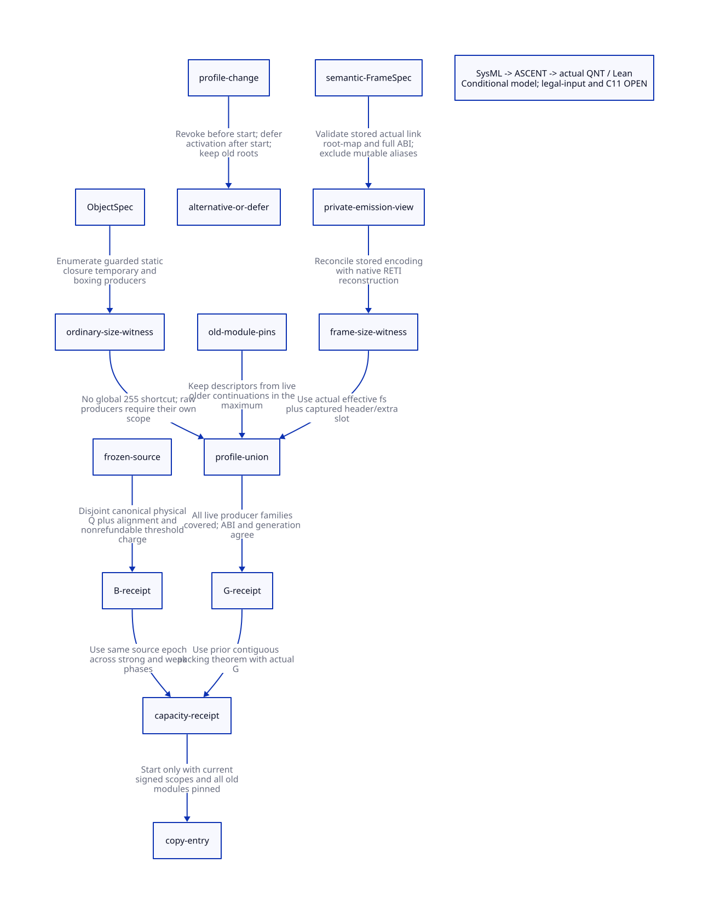

#+TITLE: Copy Producer Envelope — FrameSpec Capacity Receipts and Source Charges
#+SETUPFILE: ../../modeling/org/setup.org
#+LANGUAGE: en
#+PROPERTY: header-args :eval never
#+STARTUP: overview

* RESEARCH Decision and proof boundary
:PROPERTIES:
:CUSTOM_ID: producer-envelope-decision
:AUTHORITY: GambitCopyProducerEnvelope
:STATUS: local-source-arithmetic-and-model-proof; global-native-open
:END:

Modern generated C remains required. This study advances the
[[file:dedicated-copy-capacity-design.org][dedicated-stack global capacity design]] by tracing actual ordinary-object,
captured-frame and RETI producers. It does not implement a backend, runtime,
receipt issuer or native test. The [[file:models/sysml/copy-producer-envelope.sysml][native SysML package]] is the architecture
authority; Python queries it using the installed SysML tool and supplies the
derived evidence to [[file:../../modeling/ascent/copy-producer-envelope.rules.scm][actual ASCENT DSL]].

An active constructor check now supplies a useful local frame bound: unchanged
validated specs have stored_fs<16384. Normal/task captured frames need at most
16385 words; RETI at the default five-register layout needs at most 16395 words;
the supported <=25-register arithmetic envelope gives 16415. These are ceilings
of the accepted specification range, not measured sizes or a proof that a legal
compiled module reaches the ceiling. They do not qualify every native/manual
descriptor or establish a global G for ordinary objects.

FrameSpec may issue a *local size/layout receipt*. It cannot alone issue the VM's
copy budget B. The latter also needs ObjectSpec producer coverage, live old-module
descriptors, canonical disjoint source extents, a frozen source epoch and the
same threshold/forwarding ledger throughout strong and weak tracing.

* RESEARCH Actual producer inventory
:PROPERTIES:
:CUSTOM_ID: producer-envelope-inventory
:END:

[[file:../../../evidence/research/copy-producer-envelope/source-witnesses.json][Source witnesses]] bind nine immutable source snapshots. The
[[file:../../../evidence/research/copy-producer-envelope/producer-inventory.json][inventory check]] evaluates native-SysML patterns on those bytes. Its local
counts are 16 runtime inline-family invocations, two temporary argument vectors,
three native RETI builder blocks, and three typed return-label wrappers. These
counts do not establish an all-FFI or all-generated-code closure.

** OPEN Live source drift and new root domain

During this study, live mem.c and gambit.h.in gained VM-lifetime resize-request
root slots and worker-zero scanning outside active processor membership. The
[[file:../../../evidence/research/copy-producer-envelope/live-source-drift.json][retained drift record]] and patches preserve both identities. The
[[file:../../../evidence/research/copy-producer-envelope/local-source-drift-scope.json][local-slice comparison]] confirms that the analyzed mem.c producer/copy region
and native layout/header region are unchanged; the other seven snapshots also
still match. This check is limited to the recorded byte slices and identities.

The new root domain can retain thunks and their old code even after an origin
leaves the active roster. A source/producer-union witness must include these
retained references, their writers and publication/freeze authority; counting
only P active contexts is insufficient. This is an additional current-source
realization gap for B and old-module retirement, not a new object-size formula
or evidence that the retained snapshot already covers the changed root path.
Global source qualification remains false.

** Ordinary objects: several policies, not one threshold

| Real producer chain | Source result | Capacity interpretation |
|---------------------+---------------+-------------------------|
| [[file:../../../vendor/gambit/lib/_kernel.scm::#define ___ALLOC_SCMOBJ_INLINE][ALLOC_SCMOBJ_INLINE]] -> vector/string/typed vectors/boxvalues/procedure/frame/structure | Computes bytes and words, including a possible constructor alignment reservation; words>255 uses alloc_scmobj/still path | For checked nonnegative sizes and one-word body profile, successful small movable objects have header+body<=255; 32-bit GC alignment can conservatively add one word |
| [[file:../../../vendor/gambit/lib/_num.scm::if (words > ___MSECTION_BIGGEST)][Bignum constructor]] | Own digit-width and alignment arithmetic, followed by small/still split | Needs its own arithmetic witness; cannot inherit all element-type checks from the kernel macro |
| [[file:../../../vendor/gambit/lib/_system.scm::if (words > ___MSECTION_BIGGEST)][GC hash-table constructor]] | Own size formula, overflow checks, root saves and small/still policy | Include weak-object producer and outgoing root coverage; table type alone proves no bound |
| [[file:../../../vendor/gambit/gsc/_t-c-2.scm::(define (targ-apply-vector proc-safe? kind)][Static vector/string/typed-vector/values/structure generator]] | n comes from operand-list length; emits BEGIN/ADD/END allocation macros | Compute each emitted operation's native word footprint; this emitter does not perform a universal 255 split |
| [[file:../../../vendor/gambit/gsc/_t-c-2.scm::(list "ALLOC_CLO" (targ-c-unsigned-long (length opnds)))][Closure generator]] -> [[file:../../../vendor/gambit/include/gambit.h.in::#define ___ALLOC_CLO(n)][ALLOC_CLO]] | Capture count plus CLO_FREEVARS; native layout can include lowlevel trampoline | Bind capture count, header and trampoline size; n+2 is valid only for the matching zero-trampoline/body1 profile |
| [[file:../../../vendor/gambit/lib/_kernel.scm::___BEGIN_ALLOC_VECTOR(np)][Rest and keyword-rest temporary vectors]] | Preserve arguments in a heap vector before collecting; bypass inline-family threshold | np is decoded from 12-bit PRD_NBPARMS and is unchanged before both allocation sites; body1 yields request<=4096, subject to valid procedure metadata |
| [[file:../../../vendor/gambit/gsc/_t-c-2.scm::(define (targ-loc-flo loc val fs)][Floating materialization]] -> [[file:../../../vendor/gambit/include/gambit.h.in::#define ___MEM_ALLOCATED_FLONUM_ALLOC(val)][native boxing]] | May box or remain unboxed/self-tagged/NAN-boxed | Bind actual representation and alignment; account each materialized object, not every floating operation |
| Raw BEGIN_ALLOC/C code/foreign constructor | The macro accepts caller-supplied sizes; polling is separate from subtype/still selection | No narrow capacity receipt until actual writer and size expression are covered |

The kernel inline-family invocation inventory covers VECTOR, STRING, U8/S8,
U16/S16, U32/S32, U64/S64, F32/F64, BOXVALUES, PROCEDURE, FRAME and STRUCTURE.
The macro definition itself is not counted. A negative or overflowing size is
not admitted merely because a branch comparison would be small; caller checks,
machine ranges and complete initialization must be included in its witness.

The [[file:../../../vendor/gambit/gsc/_t-c-2.scm::(define (targ-heap-reserve-and-check][compiler heap-reserve/check path]] accounts for space and chooses a safepoint.
It is not evidence that every emitted object is <=255 or is redirected to still
allocation. Likewise, permanent literal tables are not themselves copied;
runtime allocations emitted by a vector application are a different producer.

The two temporary-vector bounds are local: PRD_NBPARMS decodes np<4096 and the
allocation uses np body words plus the one-word header. This does not prove the
procedure descriptor was valid, every constructor argument was rooted, or all
fudge-area writes before the next GC fit. Those are separate native obligations.

** Captured frames and RETI

The actual chain is:

#+begin_example
targ-gen-label-return*
  -> targ-emit-label-return / return-task / return-internal
  -> targ-make-frame-spec(kind, stored_fs, link, gc_map)
  -> targ-dump-prc (IFD/OFD and GC-map emission)
  -> native label descriptor + internal_return identity
  -> ___decode_frame_descriptor(descr, internal)
  -> mark_captured_continuation_locked
  -> reserve_copy(effective_fs + FRAME_EXTRA_SLOTS, align=0)
#+end_example

The [[file:../../../vendor/gambit/gsc/_t-c-3.scm::(define (targ-make-frame-spec kind fs link gc-map)][active constructor]] checks kind, exact nonnegative stored fs/link below 16384,
link<actual_fs and root-map extent. It returns an ordinary mutable Scheme vector.
The emitter then reads accessors and computes root-map chunks; it does not by
itself prove that no alias has changed the vector after validation. A private
sealed emission view or a complete writer/alias exclusion is required.

For internal returns, [[file:../../../vendor/gambit/gsc/_t-c-2.scm::all saved GVM regs are live][the generator]] extends aligned frame slots with saved GVM
registers, a return-address slot and padding, then computes physical liveness.
The [[file:../../../vendor/gambit/lib/_kernel.scm::setup internal return continuation frame][native builder blocks]] are stack-limit, heap-limit and force handlers.
Each obtains stored CFS, aligns it, pushes native GVM registers and actual_ra,
then adjusts by RETI_RA and identifies the frame with internal_return.

The runtime [[file:../../../vendor/gambit/include/gambit.h.in::#define ___RETI_CFS_TO_FS(fs)][RETI conversion]] is applied once by the decoder. Define
round4(x)=4*floor((x+3)/4), reserve=3 and register count r:

#+begin_example
effective_fs = round4(stored_fs) + round4(r+4) - 3
source physical frame = round4(effective_fs+3)
                      = round4(stored_fs) + round4(r+4)
captured destination  = effective_fs + 2
                      = source physical frame - 1
#+end_example

For normal/task frames, destination=fs+2<round4(fs+3). Thus a canonical captured
frame can be charged to its full rounded source stack interval without an
expansion factor. This is a layout lemma, not yet proof that every recovered
frame interval is correctly identified and disjoint from its neighbors.

| Checked domain | Local request ceiling | Qualification |
|----------------+-----------------------+---------------|
| Normal/task stored fs<16384 | 16385 words | Constructor unchanged through emission; valid native body1 descriptor |
| RETI, native/compiler r=5 | 16395 words | Matched physical layout and saved-root coordinates |
| RETI, matched r<=25 | 16415 words | Exact profile and range qualified; not merely a comment in a header |
| Per-module actual frame maximum | max(effective_fs+2) over live frame specs | Tighter and reusable if the complete manifest is sealed |

The old 4096 target declaration and runtime 8192 fudge-related macro cannot
replace these checks. For example, a constructor input internal stored_fs=8192,
link=0,gc_map=0 meets the checked numeric/link domain and gives destination=8203
at r=5, above 8194. This is an accepted-constructor-domain argument, not evidence
that a legal function currently emits that frame or overruns native memory.

Compiler and runtime defaults both use five registers, but options can differ.
The existing source comment allows compiler registers<=native registers; that
inequality alone does not prove matching physical sizes/root coordinates.
The arithmetic example stored=28 gives effective fs=33 at r=3 and 37 at r=5.
Require explicit layout equivalence or translate/choose another plan; do not
declare all such existing combinations broken based on this example.

The captured-frame path explicitly rejects SUBTYPED_BODY!=1 at compilation.
Handle layouts, raw/manual descriptors, changed alignment/reserve, and modules
without verified source provenance remain outside this tight receipt scope.

* RESEARCH FrameSpec receipt and global envelope issuer
:PROPERTIES:
:CUSTOM_ID: producer-envelope-receipt
:END:

#+name: capacity-witness-fields
#+begin_example
FrameSizeReceipt = {
  generator_identity, module_identity, PointId, kind,
  stored_fs, effective_fs, source_span_formula, captured_request_words,
  root_map_extent, structural_link, IFD_OFD_encoding,
  compiler_register_layout, native_register_layout,
  word_size, body_words, alignment, frame_reserve,
  immutable_view_digest, descriptor_lifetime_lease
}
ObjectSizeReceipt = {
  constructor_identity, operation_identity, module_or_runtime_scope,
  heap_still_permanent_policy, native_size_expression_and_bound,
  header_body_padding_trampoline_profile, initialization_completion_point,
  checked_arithmetic_and_alias_scope
}
CopyEnvelopeReceipt = {
  producer_registry_generation, all_live_module_identities,
  FrameSizeReceipts, ObjectSizeReceipts, G,
  frozen_source_epoch, canonical_source_cover, Q, U_alignment_bound,
  threshold_authority, B, write_authority, custody_owner
}
#+end_example

These are research data contracts, not implemented structs or cryptographic
signatures. Scheme owns semantic liveness, return kind, PointId and constructor
meaning. A generated-C layout projection must mechanically derive matching
descriptor encodings and native size expressions; it must not reinterpret them.
The runtime registry binds actual loaded/relocated descriptors and all live old
code. The GC coordinator combines the producer union with this round's source
and threshold witnesses. Neither a language change nor FrameSpec alone provides
the final authority.

G=max(all qualified ordinary requests, all qualified captured-frame requests).
An ordinary static vector larger than the frame maximum must raise G; it is not
clipped to the frame ceiling. A module's size summary may be reused across GC
rounds, but each source Q must reflect the frozen old allocation epoch.

Loaded old modules whose public entry is closed can still be referenced by
continuations, saved frames, FFI roots or maintenance scans. Keep their maxima
and descriptor leases until actual retirement. A new module/producer activation
before copy revokes the old receipt and replans; after copy begins it must be
deferred or use a separately proved extension protocol. A stale lower maximum
must never remain authoritative merely because its new module is not the current
module being compiled.

* RESEARCH Constructive source budget proof and remaining realization
:PROPERTIES:
:CUSTOM_ID: producer-envelope-source-budget
:END:

The [[file:models/lean/ProducerCapacity.lean][source-cover proof]] represents ordered, nonoverlapping physical source pieces
with destination demand no larger than each piece's length. List induction proves
sum(destination)<=source interval extent. Adding alignment and threshold terms
then proves demand+A+T<=B whenever extent<=Q and Q+A+T<=B. An overlapping list
is retained as a rejected witness. This supplies a concrete missing proof shape
for B, rather than treating a boolean or the factor-two counter as a source union.

| Source kind | Canonical identity and charge | Actual mechanism supporting uniqueness | Still required |
|-------------+-------------------------------+----------------------------------------+----------------|
| Ordinary object | Allocation identity + old half/epoch + physical header offset; charge header/body | Forwarding CAS winner; losers cancel their private grant | Body range, producer completion and no alternative interior-pointer identity |
| Captured stack frame | Allocation identity + old epoch + physical frame interval; charge full FRAME_SPACE | Frame access gate and forwarding link slot | Correct effective descriptor, disjoint frame intervals and all structural writers |
| Existing heap frame | Ordinary object physical identity, not a second stack-frame name | Ordinary header forwarding | Reconcile aliases and representation transitions |
| Current active segment | Dedicated restore destination charged separately | Frozen fp/break and restoration protocol | Do not double-charge source aliases as distinct canonical copies |
| Weak discovery | Same old physical identity and budget | Existing forwarding and shared phase state | No refund/reset or new producer outside old epoch |

The identity must not include a descriptor/type spelling that lets the same bytes
appear twice under different names. All aliases to one frame/object resolve to
one physical charge. Separate blocks have separately validated extents; the full
manifest may sum them only after allocation-identity uniqueness is established.
The native source-header origin check alone does not validate body size or this
partition. Still/permanent roots can discover movable objects but do not create
a second movable-copy charge for themselves.

The remaining realization obligation is to prove that *all* actual ordinary,
captured, restored and foreign-provided references map to this cover and that
no copied demand escapes it. It can be derived from maintained producer/allocator
invariants, or checked by a qualified frozen source walk; the latter adds real
O(allocated source) preflight work. A coarse full-half Q avoids exact liveness,
but still needs representation/provenance invariants. FrameSpec does not remove
this requirement.

For the qualified body1 64-bit profile, ordinary destination equals source and
the frame inequality yields U<=Q. On 32-bit profiles, alignment may add at most
one word per eligible canonical copy, giving U<=Q+A<=2Q under positive source
footprints. Threshold T<=floor(U/255) remains conditional on the previous chunk
charge invariant across both phases. B=U+T then feeds the exact previous
[[file:models/lean/CopyCapacityComposition.lean][contiguous packing theorem]]. The actual producer QNT fields are bound to G/B by
an explicit Lean handoff; native witness construction and C11 realization remain
unproved.

* RESEARCH Admission, alternative plans and C11
:PROPERTIES:
:CUSTOM_ID: producer-envelope-admission
:END:

| Input or event | Required action | Why |
|----------------+-----------------+-----|
| Complete immutable frame/object manifest and source cover | Issue scoped G/B, then perform global capacity admission | Local size bounds become composable only with all scopes covered |
| Known larger static object or RETI request | Raise G and recompute packing/reservation, or select another qualified space/collector plan | Not a language error and not a valid reason to clip the request |
| Uncovered raw C/FFI/native descriptor | Keep old roots; use a qualified wider/alternative plan | Missing proof is not permission to ignore a producer or reject valid Scheme |
| Live old module lacks a summary | Retain its code/descriptors and refuse the narrow receipt | Closing an entry or rebuilding a module does not retire continuations |
| ABI/body/alignment mismatch | Translate under a proved mapping or choose alternative | Unsupported tight contract does not establish existing native failure |
| Source-cover overlap or uncertain initialization | No B receipt; retain custody and investigate/choose another plan | A numeric upper bound cannot repair invalid provenance |
| Module changes before start | Revoke and replan using new producer union | Avoid stale G/B |
| Module activation after start | Defer admission; keep the frozen producer set | Expanding the heap does not repair a violated copy envelope |

Alternative-plan completion and progress for every legal Scheme input remain
OPEN. This study does not add an optimization refusal as a new Scheme exception.

The C11 obligations are immutable-view initialization before release publication,
acquisition of exact module/ABI/generation identity, descriptor/code pins before
root scanning, frozen writer closure before source cover reads, and explicit
retirement of every reader before metadata reclaim. GC relocation updates may
change root values under their authority; this does not authorize changes to
descriptor/control coordinates or source membership. Native flag access and
ordinary raw C aliases still require effective-profile refinement. Sequential
Quint histories do not establish native happens-before relationships.

* RESEARCH Actual formal chain and controls
:PROPERTIES:
:CUSTOM_ID: producer-envelope-formal
:END:

[[file:models/quint/copy_producer_envelope.qnt][The QNT model]] uses a representative static-object maximum 300 and an actual
RETI arithmetic example stored=28,r=5,effective=37. It intentionally catches the
wrong universal 255 policy. The sourceWitness input is an external proof premise;
setting a model flag does not realize a native source cover. Positive scenarios
exercise both word-size envelopes, strong-to-weak budget persistence and deferred
module admission; alternatives cover ABI mismatch, opaque producers, missing old
descriptors and source evidence. These are model histories, not Scheme executions.

[[file:models/lean/ProducerEnvelopeAst.lean][Actual typed-JSON extraction]] feeds [[file:models/lean/ProducerEnvelope.lean][all-action induction]]. An initial induction
failure retained in the evidence showed that Safe needed the pre-start no-spent-
credit condition; otherwise an unreachable pre-freeze state could carry spent
credit larger than a newly selected envelope. The model now states and preserves
that condition. It is a model-strengthening receipt, not a claimed native bug.

[[file:models/lean/ProducerCapacity.lean][Lean arithmetic]] proves exact rounded RETI source size, normal/internal request
ceilings, packed stored-field round-trip and bounded constructor formulas. It
also proves the source-cover induction and imports the exact previous packing
theorem. Extracted G/B, source realization bounds and packing prerequisites are
explicit arguments to the bridge. There is no claim that the missing native
arguments have been constructed.

Negative controls include a 255-only cap despite a larger static constructor,
missing old-module pin, stale generation, weak-phase refund and undersized B.
Widening the actual issue guard must fail Lean preservation; claiming the old
8194 default RETI cap must fail arithmetic verification. Extraction rejects wrong
state identity/type, a missing action and unsupported expressions. ASCENT checks
actual action/theorem names, snapshot hashes, inventory counts and exact prior
input digest, including mismatched/missing inventory controls.

Actual source and platform receipts remain absent: global producer closure,
unchanged FrameSpec/native metadata, canonical source realization, legal Scheme
fallback and C11 publication remain OPEN. Synthetic all-receipt inputs exercise
the gate positively and are never native admission.

* RESEARCH Net benefit and migration matrix
:PROPERTIES:
:CUSTOM_ID: producer-envelope-benefit
:END:

| Change | Concrete benefit | Added cost / risk | Retirement condition |
|--------+------------------+-------------------+----------------------|
| Scheme-owned validated FrameSpec | One semantic layout supplies roots, captured size and RETI reconstruction | Seal mutable aliases; bind effective native ABI | All emitters/consumers use the same contract and native relocation is qualified |
| Per-module ObjectSpec and frame maximum | Reuse finite producer summaries instead of generic half-section G | Inventory static/native constructors and preserve old-module summaries | Every live producer covered, including older code reached by continuations |
| Source-cover witness | Prevent alias double charging and circular source estimates | Producer invariant proof or an additional frozen source walk | All actual references refine to canonical covered physical identities |
| G/B-driven packing | Avoid late unsupported copy grants and quantify reservation headroom | A larger honest G can require more memory than an unproved smaller assumption | Source and platform qualification before any runtime retirement |
| Strong/weak shared credit | Avoid rebuilding/refunding the same source envelope | Stable round identity and ownership across phase transition | Existing forwarding/marker/control paths all consume one ledger |

For H=65536, C=65533, the default checked-range RETI cap 16395 gives d=49139;
the <=25-register cap 16415 gives d=49119. The previous illustrative G=8194 gave
d=57340 but was not a proved universal profile. A valid larger ordinary producer
can reduce d further. Tighter per-module maxima can improve these bounds only
after complete producer coverage; there is no measured memory or speed benefit.

Modern C can carry this architecture. Zig is not required to issue these receipts.
Reusable size summaries require generator/ABI invalidation and old-code retirement;
they do not eliminate each round's frozen source/root obligation. No runtime path
is retired by the research. See [[file:copy-producer-envelope-matrix.org][the native SysML matrix]], ,
[[file:../../../evidence/research/copy-producer-envelope/checks.json][checks]] and [[file:../../../evidence/research/copy-producer-envelope/input.json][input identity]].
