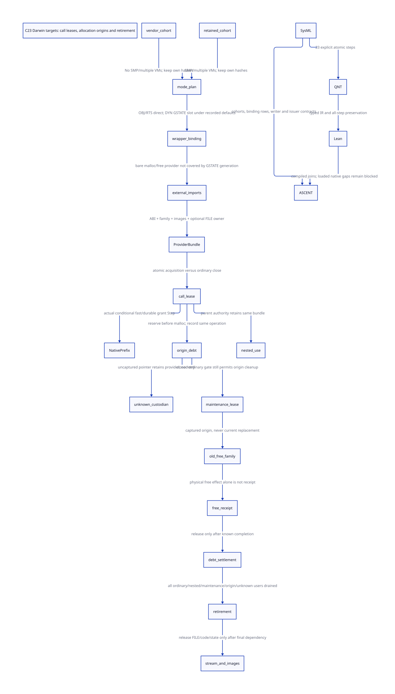

#+TITLE: C23 Darwin target bindings — invocation leases, allocation origins and drain
#+SETUPFILE: ../../modeling/org/setup.org
#+LANGUAGE: en
#+PROPERTY: header-args :eval never
#+STARTUP: overview

* RESEARCH Decision and evidence authority
:PROPERTIES:
:CUSTOM_ID: darwin-target-lease
:AUTHORITY: GambitDarwinTargetLease
:BASELINE: C23
:EVIDENCE_SCOPE: Configured source reductions and conditional lease safety
:END:

This continues [[file:native-prefix-permission-design.org][prefix permission/effect closure]], [[file:native-entry-admission-design.org][joint native entry]] and
[[file:native-return-domains-design.org][native return-domain custody]]. Modern C is mandatory. No runtime source,
configure/preprocessor/compiler, native program/test or benchmark is changed or
run. Configured Darwin inputs are read as inert files; neither config.status nor
the generated shell driver is sourced or evaluated. C23 is the design baseline;
the retained recipes do not attest the final compiler dialect or loaded program.

The [[file:models/sysml/darwin-target-lease.sysml][native SysML package]] owns cohort/binding reductions, writer and issuer
contracts, components, proof routes and costs. The [[file:../../modeling/tools/darwin-target-lease-study.py][Python driver]] invokes
native SysML, actual [[file:../../modeling/ascent/darwin-target-lease.rules.scm][ASCENT]], [[file:models/quint/darwin_target_lease.qnt][QNT]] and [[file:models/lean/TargetLease.lean][Lean]], producing the
[[file:darwin-target-lease-matrix.org][matrix]], [[file:diagrams/darwin-target-lease.d2][D2]] /  and [[file:../../../evidence/research/future-frame-commit/darwin-target/][retained receipts]]. Source facts, proposed
contracts, mathematical preservation and native qualification stay separate.

* RESEARCH Two Darwin cohorts, six bounded default reductions
:PROPERTIES:
:CUSTOM_ID: darwin-target-config-cohorts
:END:

The [[file:../../architecture/toolchain/studies/darwin-configured-input-evidence.org][earlier configured-input ledger]] identifies the retained materialized tree.
Its header, config.status and generated driver still match the recorded digests.
The allocator wrapper os_base.c is byte-identical between that tree and current
vendor. setup.c and configuration products differ. Their identities are not mixed.

| Cohort | Compiler recorded by driver | SMP / multiple VMs | Qualification |
|---+---+---+---|
| Current vendor | GCC 16.2.0 Cellar path with -B/usr/bin/ | Disabled / disabled | Configured source only |
| Retained materialized tree | /opt/homebrew/bin/gcc-16 | Enabled / enabled | Configured source only |

Both config.h snapshots enable dynamic C-library import and leave dynamic Gambit
runtime import undefined. Both leave DEBUG_LOG and DEBUG_ALLOC_MEM undefined.
Their generated DEFS_DYN adds ___DYNAMIC; ordinary object definitions do not.
The runtime makefile adds ___LIBRARY, which is distinct from ___DYNAMIC.

Under those exact defaults, without extra CPP flags or source/include overrides:

| Consumer | Gambit runtime EXT route | C-library relationship |
|---+---+---|
| Ordinary object | Direct runtime symbol through early binding | CLIBEXT stays direct |
| Runtime library object | Direct runtime symbol; LIBRARY alone is not late binding | os_base.c calls bare malloc/free |
| Dynamic module | DYNAMIC forces BIND_LATE; undefined CAN_IMPORT_DYNAMICALLY selects GSTATE field | CLIBEXT stays direct; GSTATE is not a lease on libc |

The driver checks these six rows against literal definitions and the source
conditional rules. This is a bounded default reduction, not a new C preprocessor.
Actual consumer arguments, generated C, macro/include order, linked images and
symbol binding remain required. A request can override these defaults; that
request does not inherit this reduction. Captured gsi/gsi, libgambit.a and
libgambit.dylib candidates are inventoried without execution; no matching loaded
program/provider is qualified here. Do not infer SMP behavior from the sequential
vendor configuration or reuse a retained generated header as the current ABI.

* RESEARCH Real allocator, free and logger closures
:PROPERTIES:
:CUSTOM_ID: darwin-target-real-closure
:END:

** Runtime function-table closure and libc closure are separate

[[file:../../../vendor/gambit/lib/setup.c::= ___alloc_mem;][setup.c]] installs alloc_mem/free_mem in ordinary global-state function fields.
[[file:../../../vendor/gambit/include/_gambit/global_state.h.in][The declarations]] have different signatures depending on DEBUG_ALLOC_MEM:
alloc(size)/free(ptr), or alloc(size,line,file)/free(ptr,line,file). A new binding
must preserve the ABI of all consumers. Function-pointer casts or a generation
change cannot authorize calls across an incompatible signature.

A bounded named-writer scan finds these setup assignments. Native module linkers
also receive the mutable GSTATE pointer. Aliases, bulk state writes and arbitrary
external C are not excluded by a named-assignment scan. The existing EXT fields
are neither an implemented lease registry nor closed atomic storage.

[[file:../../../vendor/gambit/lib/os_base.c::ptr = malloc (bytes);][os_base.c]] calls bare malloc/free. Capturing a GSTATE slot pins at most the
Gambit wrapper unless its external imports and state are also admitted. The
actual Darwin imported provider, allocator family, image lifetime and possible
interposition are not established by source symbol spelling. No claim about a
particular current libSystem/libmalloc image or ASLR address is made.

The target family here is the RC/native alloc_mem/free_mem path. Heap/code
allocators and arbitrary foreign destructors require their own family/closure
qualification; this study does not retire or qualify them wholesale.

** Default-disabled logging contributes no ordinary log calls

Both configured defaults exclude the alloc/free logging branch. Its possible
I/O cost is not charged as an inevitable ordinary malloc cost. A debug override
is a separate profile and may change both ABI and lifecycle requirements.

When enabled, alloc_mem obtains ptr, then logs, then returns it. ___printf
captures base_mod.debug or stderr, calls vfprintf, flushes, and returns. free_mem
logs before native free. setup_base_module obtains gambit.log with fopen and
falls back to stderr; cleanup_base_module closes the owned stream at module
refcount zero. The default wrapper bodies contain no direct Scheme call or
Gambit GC. External allocator and stdio effects still need qualification.

base_mod.refcount is a module-lifecycle counter, not an active-vfprintf counter.
base_mod is externally declared; its aliases and setup/cleanup users require
closure. An owned FILE cannot be closed while a captured stream user or a later
old-origin free still needs its debug logger. stderr is borrowed state, not a
file owned and closable by this service. The selected stream's native I/O/error/
cancellation behavior remains an external leaf; closing a gate does not prove
those calls returned.

* RESEARCH ProviderBundle and two lease lifetimes
:PROPERTIES:
:CUSTOM_ID: darwin-provider-bundle
:END:

The proposed immutable ProviderBundle binds installation identity and generation;
consumer/config/ABI key; typed alloc/free wrappers; external import closure and
allocator family; provider code/image/state holds; selected effect summary; and
optional log-stream ownership/dependency. A function pointer value alone is not
that object. Source identity, Scheme root coverage and native return extent are
separate upstream grants, not facts inferred from this bundle.

A call lease captures that bundle once per NativeScope/native service scope.
All allocator, cleanup and log dependencies in the scope use that captured view,
instead of re-reading mutable GSTATE fields and mixing generations. Enrollment
and ordinary close need one linearizable order. Root/target preparations reserved
before close but not accepted cannot later enter through a stale gate read.
Published immutable data needs the matching acquire observation; full C23
reads-from/storage/linearization refinement remains unresolved.

An allocation-origin hold is different. Reserve it before invoking the allocator;
record its original allocator/free family, ABI/provider handles and OperationId.
A stable known NULL can settle that debt. A successful allocation retains it
after the invoking call lease ends, until its release is known. An unknown
allocation likewise keeps the old provider alive. A new current bundle does not
change that origin's deallocator. Bundle generations are not allocator-family
identities. An explicit family-compatibility and origin-handoff receipt could
permit migration; no such transition is modeled or admitted here. Choosing a
free family from the current bundle number alone is the rejected shortcut.
This is important even when ordinary readers are already zero.

There are two legitimate deployment policies:

- An immutable installation can use a lifetime certificate and shared existing
  shutdown/operation accounting. It need not add an atomic lease increment to
  every EXT read or a new global counter to every Scheme allocation.
- A replaceable managed provider needs tracked invocation and origin holds,
  versioned publication and explicit retirement. The replacement scenario in
  the model stresses this policy; it is not a requirement to add hot swapping.

Both require actual writer/lifetime closure. An immutable source table is not
proved immutable merely because this source census found only initialization.
If legacy callers retain raw slot/stream aliases, either maintain an admitted
immutable-lifetime compatibility domain or refuse live replacement. Migrated
managed callers can use opaque bundle storage. Casting a legacy ordinary field
into an atomic access does not create the missing all-access protocol.

* RESEARCH Revocation, maintenance and final drain
:PROPERTIES:
:CUSTOM_ID: target-close-drain
:END:

Ordinary close stops new caller acquisition. It leaves existing callers,
nested dependencies and origin debts intact. A callback that requests close
cannot synchronously wait for its own still-held lease to disappear. Return a
closing request/receipt and let a lifetime owner drain independently. Publication
locks must not be held across malloc, stdio, free or arbitrary callback execution.

Origin cleanup needs derived maintenance authority after ordinary close. It is
not a new arbitrary call permission: it names the old origin and captured free
family, retains that provider and allows only the corresponding cleanup work.
Disallowing all such work at close would make old-origin debt impossible to drain.
Admitted nested cleanup/log calls retain the same bundle; further allocation
origins need their own prior reservation in the complete implementation.

Final retirement requires ordinary, nested and maintenance invocations gone;
all origins settled; no unknown completion; and the actual module/image, GC and
stream users excluded. A log stream used by old-origin free cannot be closed
before those origins and calls settle. The model tracks one origin and one
nested invocation; unbounded origin/task composition and global image unloading
are not proved by that finite census.

Retiring root storage precedes native free. [[file:../../../vendor/gambit/lib/_mem/rc-allocation.inc::h->next->prev = h->prev;][release_rc_locked]] already unlinks
the RC block under its gate before its caller invokes FREE_MEM. The new registry
needs the corresponding last-use/borrow/scan-grace receipt before beginOriginFree.
The lease model assumes that external reclaim precondition; it does not prove it.
An unknown free record must not leave a possibly freed bank registered for GC
scanning. Retain independent root bundles if Scheme values still need coverage;
retain only opaque operation/storage identities for a possibly freed native block.
Neither a provider pin nor an outstanding origin record keeps that block alive
after native free may have taken effect.

* RESEARCH Return-to-record windows and stronger backend contracts
:PROPERTIES:
:CUSTOM_ID: target-allocation-outcome
:END:

The plain configured allocator branch has no explicit logger between malloc's
return and the wrapper return. With debug logging enabled, the pointer-obtained /
before-caller-recorded window includes external stdio. A caller-side wrapper
cannot record the pointer before an effect that already occurs inside alloc_mem.
Likewise an interposed allocator can have effects inside its own implementation.
Source defaults reduce known call paths; they do not prove no abandonment of the
whole selected call and stable-capture interval.

For a proven synchronous no-abandon profile, return-to-capture can remain a small
qualified native interval. A potentially abandoning backend needs a stronger
cooperative operation/result interface or retains unknown debt. A proposed
allocate request can carry the pre-reserved stable result slot/OperationId;
the qualified provider publishes pointer or NULL before its admitted later
callbacks/logging. If the selected underlying allocator can abandon before that
publication, the interface does not solve the gap. Unknown pointer custody may
retain resources indefinitely; never blindly replay the allocation.

For free, distinguish physical effect, stable backend receipt, debt settlement
and final call release. A C void return is not a durable exactly-once journal.
A cooperative/nonabandoning backend can publish a known result; C23 metadata
atomics alone cannot atomically transact arbitrary external free with its record.
The model's freeApplied field is a ghost, not something a recovery service can
query to justify retry. recordFreeBackend is an admitted receipt-producing cut,
not an implemented feature of libc or the current wrapper. Without that receipt,
unknown free keeps the old origin/provider pinned and cannot be repeated.

A captured result with lost delivery can be reconciled under the same identity.
The stable custodian must outlive the originating PSTATE, native thread and C
frames; it does not authorize returning to a dead C frame. Upstream NativePrefix
root/native-input requirements still apply. A raw argv or other borrowed buffer
cannot be recovered merely by retaining a target code pointer.

* RESEARCH Actual formal joins and unresolved native scope
:PROPERTIES:
:CUSTOM_ID: darwin-target-formal
:END:

QNT has an old bundle, replacement current identity, one ordinary caller, one
nested dependency, maintenance authority, one origin, native effect/capture
states, stable receipts and unknown custody. Publication actions instantiate
previously qualified profile certificates; they do not discover native facts.
The plain profile excludes admitted hooks; the hook profile relies on the
upstream durable source/native lifetime premises.

Lean proves initialization, all 23 transitions and reachable-state induction.
The origin survives call release; closed ordinary ingress does not prevent old
origin cleanup; release of the origin waits for a stable free receipt; retiring
needs every modeled debt zero. The actual NativePrefix fast/durable grant Steps
are constructed at acquisition, preserving closed-ingress behavior. The seed
assumes the other source/ABI/root facts of the upstream profile. This is not an
arbitrary nested-state or native weak-memory product proof.

Eight histories include replacement before old free, nested close, unrecorded
allocation loss, recorded acknowledgment loss, free with/without backend receipt,
known NULL and closure without users. Nine counterexamples first establish
reachable original prefixes, then reject premature acquisition/retirement,
unknown-result recovery, release of unknown maintenance and selection of the
new current family for an old free. Typed-IR binding/type/roster/expression poison
controls must fail. Native SysML drives ASCENT comparison of cohorts, default
binding rows, issuers, writer closure and proof joins. Current native evidence
remains blocked; synthetic-all is a DSL test fixture only.

* RESEARCH Net return, costs and migration
:PROPERTIES:
:CUSTOM_ID: darwin-target-net-return
:END:

The [[file:darwin-target-lease-matrix.org][matrix]] measures work boundaries and added responsibilities. In replaceable
mode a scope needs one enrollment and one settlement, amortized across its
captured targets; these are logical operations, not an asserted hardware-RMW
count. K outstanding non-null or unknown allocations need O(K) origin records.
Reuse the existing stable allocation/cleanup ledger rather than build a second
independent registry. The no-rebind lifetime profile can erase unnecessary
counter traffic only after its stronger installation-lifetime premise is proved.
Default-disabled logging needs no added FILE lease; enabled logging can share
the parent bundle dependency rather than introduce a separate global counter.

These are necessary support savings relative to a fragmented modern-C design,
not measured speedups over today's unsafe/unqualified raw calls. Per-target
locks or a contended global counter on every allocation can erase the intended
multi-core gain. No person-day estimate or native throughput claim is used.

Migration: bind selected configuration/ABI and dependency plans in the Scheme
native manifest; admit immutable installation or explicit replaceable policy;
route managed generated entry through one captured bundle; attach allocation
origins and cleanup authority to the existing stable ledger; qualify root/scan
reclaim and completion capture; only then remove managed-path raw EXT rereads,
ad hoc target checks and incompatible live slot updates. Legacy APIs remain in
a separately admitted compatibility policy. Current native paths retired: zero.
Zig adds no theorem for provider identity, matching free, FILE lifetime or unknown
completion; any incremental language benefit must be demonstrated separately.

The Feeley compiler/runtime and native-extent arguments linked by the preceding
studies motivate preserving Gambit's Scheme control and native portability.
They do not specify this provider-bundle protocol or certify current Darwin
loader state. The new contracts are architectural derivations grounded in the
captured current/retained source, with native obligations left visible.
