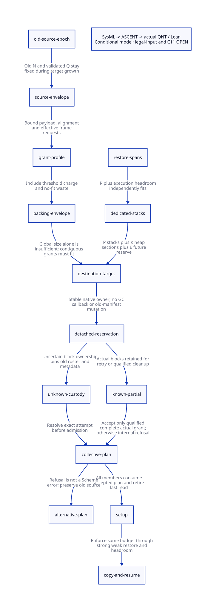

#+TITLE: Dedicated Stack Sections — Global Copy Capacity and Pre-Setup Space Selection
#+SETUPFILE: ../../modeling/org/setup.org
#+LANGUAGE: en
#+PROPERTY: header-args :eval never
#+STARTUP: overview

* RESEARCH Architectural decision
:PROPERTIES:
:CUSTOM_ID: dedicated-copy-decision
:AUTHORITY: GambitDedicatedCopyCapacity
:STATUS: conditional-packing-and-protocol-proof; source-and-native-open
:END:

Modern generated C is the required architecture. This study extends
[[file:continuation-restore-admission-design.org][actual continuation restore admission]] from per-context R to a global copy-space
envelope. There is no runtime implementation, native test or performance run.
[[file:models/sysml/dedicated-copy-capacity.sysml][SysML]] owns the claims, source anchors, contracts, model routes and cost rows;
the native SysML tool supplies the projection consumed by Python and [[file:../../modeling/ascent/dedicated-copy-capacity.rules.scm][ASCENT]].

Three distinct facts must hold before setup: each continuation fits its reserved
stack interval; all heap copies fit a set of exclusive contiguous destination
intervals; and enough post-copy/execution/failure capacity remains. Proving one
does not prove the others. An unsupported sharing plan is not a Scheme error.

The proposed replacement is an old-epoch source envelope plus a detached target
reservation transaction. Only a complete, qualified actual grant can enter the
collective acceptance protocol. Known partial grants can be retained for a new
attempt or released under a closed-reader receipt. Unknown results remain owned
by a stable native completion record and cannot authorize setup, free or an
unfenced duplicate allocation attempt.

* RESEARCH Source findings and non-reusable assumptions
:PROPERTIES:
:CUSTOM_ID: dedicated-copy-source
:END:

The [[file:../../../evidence/research/dedicated-copy-capacity/source-witnesses.json][source witnesses]] bind immutable source snapshots. Original links below are
navigation aids; input receipts bind the exact analyzed bytes.

| Actual source | Finding | Consequence for the new contract |
|---------------+---------+----------------------------------|
| [[file:../../../vendor/gambit/lib/mem.c::#define words_movable_objs(ps)][words_movable_objs]] | Twice previous-section words plus current heap/stack occupancy | Not automatically a union of raw source extents or exact liveness |
| [[file:../../../vendor/gambit/lib/mem.c::participant->phase = ___GC_ROOTS_FROZEN;][GC frozen cut]] | Current fp/hp are restored to allocator pointers before acknowledgement | Reusable place to capture old epoch; complete writer closure still required |
| [[file:../../../vendor/gambit/lib/mem.c::___vms->gc_round.source_sections =][setup source census]] | Source count is currently captured inside setup | Move semantic census before destructive setup; do not include future empty grants |
| [[file:../../../vendor/gambit/lib/mem.c::___HIDDEN ___copy_reservation reserve_copy][reserve_copy]] | Checks one contiguous request and advances on no-fit | Global total bytes alone do not prove placement |
| [[file:../../../vendor/gambit/lib/mem.c::alloc = cancel_copy(work,&grant);][ordinary forwarding loser]] | Rewinds a private grant after another worker wins | Loser does not refund earlier exhausted sections; source charge and reservation custody differ |
| [[file:../../../vendor/gambit/lib/mem.c::words = fs + ___FRAME_EXTRA_SLOTS;][captured frame copy]] | Destination has fs+2 words in the supported body/extra-slot representation | Frame source charge must use effective RETI/RETN descriptors, not one macro ceiling |
| [[file:../../../vendor/gambit/include/gambit.h.in::#define ___RETI_CFS_TO_FS(fs)][RETI size decoding]] | Expands saved-register/internal return layout | Nominal stored frame size is not the entire copied request |
| [[file:../../../vendor/gambit/gsc/_t-c-1.scm::(define targ-max-nb-frame-slots][compiler limit declaration]] | 4096, adjacent to a use-these-constants note; no other reference found in target C files | Declaration is not an enforcement proof for every producer |
| [[file:../../../vendor/gambit/lib/mem.h::#define ___MAX_NB_FRAME_SLOTS][runtime frame/fudge definitions]] | Runtime macro uses 8192 | Do not infer a qualified global G from this different constant |
| [[file:../../../vendor/gambit/lib/mem.c::___HIDDEN ___BOOL resize_heap][resize_heap]] | Live census, growth/contraction and overflow reserve handling run after copying | Cannot prevent a copying overflow that happened before resize |
| [[file:../../../vendor/gambit/lib/mem.c::___HIDDEN void adjust_msections][adjust_msections]] | May replace/free metadata before all requested blocks exist; updates actual count incrementally | Existing growth is not an immutable detached transaction |
| [[file:../../../vendor/gambit/lib/mem.c::No context/member is initialized until the entire grant exists.][reserve_vm_resize]] | Checks actual count, rolls partial reservation back before initialization | Useful ordering precedent; rollback prerequisites cannot be borrowed without ownership proof |

The source has a frozen-fromspace origin check for ordinary copies, CAS forwarding
and serialized frame access. These support an eventual unique-source charge proof.
They do not yet establish body bounds, descriptor lifetime, a disjoint canonical
source partition, or every FFI/root producer. Strong and weak tracing must consume
the same envelope: weak discoveries may reveal more old objects, not a new budget.

* RESEARCH Source envelope and conditional global upper bound
:PROPERTIES:
:CUSTOM_ID: dedicated-copy-envelope
:END:

** Source charges

Let Q be the size in words of a validated union of old-epoch source footprints.
Ordinary movable objects are charged header plus body. Stack frames are charged
their full rounded physical FRAME_SPACE, using effective descriptor coordinates.
Frame identity and heap-object identity must not double-charge overlapping bytes.
Still/permanent objects are traced but are not themselves copied into this pool;
their outgoing edges can discover old movable objects already covered by Q.

For canonical winners, ordinary 64-bit destination size equals its source object
size. A captured frame uses fs+2 destination words, no larger than the supported
rounded source FRAME_SPACE(fs). Thus, under the source partition, descriptor and
unique-forwarding premises, U<=Q on that profile. On 32-bit profiles an aligned
copy may add one word; U<=Q+A, where A counts eligible successful alignment
copies, and A<=Q gives U<=2Q. This is a conditional charge theorem, not a proof
that the existing factor-two counter already provides Q.

A coarse candidate is Q<=N_old*H, where H=MSECTION_SIZE/2, *if* every charged
footprint is contained in a distinct valid old fromspace half and alias/overlap
rules hold. The actual GC source census must exclude detached new target blocks.
Otherwise growing N would grow the alleged source budget again, creating a
circular and potentially non-convergent planner.

Active-segment restoration consumes dedicated stack capacity separately. Source
coverage may conservatively include those bytes in Q as potential captured-frame
sources; this is an upper bound, not a second use of the same destination space.
The per-context proof still requires R+J to fit and pins through restoration.

** Contiguous placement and no-fit loss

For dedicated full-size heap sections define:

#+begin_example
H = tospace half-section words
C = H - 3                    # first link plus two terminal-marker positions
G = largest qualified contiguous grant, including header/alignment; 1 <= G <= C
T = bound on interior threshold-marker consumption
B = U + T                    # old-epoch committed/padding/threshold envelope
d = C - G + 1                # minimum charge on an exhausted no-fit section
P = frozen worker count
K = reserved full heap sections
E = distinct post-copy/fudge/execution/emergency/quarantine reserve
#+end_example

The source advances when remaining usable span is smaller than the request.
For integer words, that implies the abandoned section already consumes at least
d words. To sum this fact, each abandoned section must have a *distinct* charge
to committed payload/padding or interior threshold markers; cancellation cannot
erase those charges. Empty initial/current sections and outstanding private
reservations remain bounded by the P worker frontiers. No migration, rebinding,
custom allocation or reentry may create another uncharged frontier.

If closed*d<=B and B<(K-P+1)*d, the symbolic theorem proves closed+P<=K.
A sufficient candidate is K=P+floor(B/d). The full target must then satisfy
N_target>=P+K+E. The first P is dedicated stack space, not heap copying space.
The P in K accounts for worker-private unfinished last sections, even under
imbalanced scheduling. This is a conservative envelope, not an optimal bin packer.

Threshold closures in the source occur after successful ordinary/frame copies
reach MSECTION_CHUNK. The candidate T<=floor(U/255) requires the previous chunk
charge invariant, persistence across strong/weak phases and no unaccounted early
closures. It is not issued merely by reading the constant 255. Physical empty/
terminal markers are already reserved in C; do not charge them twice as T.
There is no native global packing receipt until this charge injection is refined.

The source permits a generic grant up to H-3. At G=C, d=1: the safe generic bound
degenerates to roughly one section per charged word. This is a concrete reason
to modernize producer/FrameSpec contracts and qualify the actual G envelope;
simply multiplying a byte census cannot produce a useful capacity guarantee.

** Arithmetic boundaries, not benchmark claims

For H=65536, Q=32*H=2097152 and the conditional 64-bit U=Q envelope,
B=U+floor(U/255)=2105376. With P=12:

| Qualified G hypothesis | d | floor(B/d) | Sufficient target excluding E | Meaning |
|------------------------+---+------------+-------------------------------+---------|
| 256 | 65278 | 32 | 56 sections | Small-object-only profile; not the captured-frame workload |
| 8194 | 57340 | 36 | 60 sections | Illustrative qualified grant cap; not a current source-proved maximum |
| 65533 | 1 | 2105376 | 2105400 sections | Generic reserve-copy cap is correct but economically unusable |

These are computed boundaries under declared premises. They are not observed
live fractions or allocation demands. For the middle row, changing to the coarse
32-bit U=2Q envelope gives B=4210752 and floor(B/d)=73, hence 97+E sections.
Actual new allocation is max(0,N_target-N_actual), not the entire N_target.
Native section allocation includes both halves, metadata and scan-map overhead;
H words is not the byte cost of a newly allocated physical section.

E must independently include the actual post-GC heap-fudge next-section demands
(at most P under the existing endpoint argument), global resume reserve and any
isolated/quarantined grants. Requested still allocation is separately budgeted.
Do not spend the same reserve for both normal resume and an exception unless an
exclusive-use proof allows it.
Unknown joins cannot be reduced to a numeric E allowance. Only independently
isolated, inert grants may be excluded from the runnable/source roster and
counted as retained capacity. If an unknown owner may still execute Scheme or
write source roots, the frozen-source premise fails and this collector plan is
not admissible at all.

* RESEARCH Space selection before setup and Scheme semantics
:PROPERTIES:
:CUSTOM_ID: dedicated-copy-selection
:END:

1. Freeze the old roster and all source endpoint/allocator writers. Obtain stable
   RestoreSpan, source extent, descriptor and canonical identity views.
2. Try qualified shared plans. If their R/J or contiguous-copy envelope fails,
   try dedicated initial stack sections. Recompute heap eligibility and target K;
   do not reject the language program because a heuristic plan does not fit.
3. Compare target N with actual qualified destination intervals. Acquire missing
   blocks under a stable detached-reservation attempt; preserve the old source
   bound while growing target capacity. Validate actual count and full identities.
4. If complete, publish one immutable candidate plan covering source epoch,
   restore policy, G/B/K, queue pool, E and all ownership exclusions. Every old
   member verifies matching generation/digest; no setup before collective release.
5. Known partial growth: preserve its exact ownership and select retry, a tighter
   independently justified envelope, another qualified collector/segment plan,
   or a retained unsupported result. Reusing a partial batch requires no new
   reader or competing attempt. Lowering B without new evidence is forbidden.
6. Unknown growth: retain old roots, metadata and every possibly allocated block.
   Stable native owner resolves the exact attempt token before retry or cleanup.
   Known-lower-bound actual count does not enumerate all possibly owned blocks.
7. Only after complete acceptance retire old metadata readers, commit candidate
   metadata/interval ownership and execute the real processor-0 setup loop.
   After any parity/forwarding effect, failure is post-commit custody, never a
   rollback to an unchanged old heap.

Three outcomes are distinct: PLAN_UNSUPPORTED (conservative or unsupported
strategy), RESOURCE_DENIED (policy/native allocation restriction), and a
semantically justified Scheme OOM. A failed attempt or a coarse envelope that is
too large does not prove no valid execution strategy exists. Returning an old
source view and delivering a condition also needs guaranteed stack/heap emergency
headroom, the same sync-op completion result for all members, dynamic-wind/
continuation semantics and a bounded-progress policy. This study does not prove
a total Scheme fallback or turn internal refusal into a user-visible exception.

A future alternative collector or pre-normalization strategy may solve this gap,
but must be modeled explicitly. Silently rerunning the current unsafe sharing
fallback or refusing legal Scheme inputs is not a semantic-preservation argument.

* RESEARCH Reservation ownership and failure delivery
:PROPERTIES:
:CUSTOM_ID: dedicated-copy-custody
:END:

#+name: detached-batch-contract
#+begin_example
CapacityAttempt = {
  stable_owner, attempt_id, gc_generation, old_source_manifest_digest,
  known_actual_destination_ids, uncertain_native_request_ids,
  candidate_metadata_owner, requested_envelope, actual_grant_digest,
  phase, reader_admissions, result_deliveries, completion_guard
}
#+end_example

| Boundary | Responsible owner | Required custody |
|----------+-------------------+------------------|
| Native reserve in flight | Stable native attempt owner | Old roots and candidate records survive Scheme unwinding or processor exit |
| Known partial success | Same attempt owner | Exact blocks remain private; no requested-count credit and no duplicate charge |
| Response lost / unknown | Same owner plus lifecycle coordinator | Possible allocation remains owned; no free/retry based on timeout |
| Known refused plan | Old-roster completion coordinator | Every member consumes same result and retires plan reads |
| Cleanup of detached batch | Reservation owner with no-reader receipt | Free only new batch-private blocks; old source and other resize grants remain |
| Accepted metadata commit | GC/storage coordinator | New graph published once; old metadata retired after readers, old payload still rooted |
| Partial setup | Non-abandonable setup completion owner | Preserve new parity/forwarding and all unfinished obligations |

The current adjust_msections can free its table header before complete expansion.
Calling it under an old table pin is not a detached transaction. A native modern-C
adapter must either drain every table reader under an exclusive mutation epoch,
rebuild immutable views from stable block identities and handle its partial effects,
or allocate a separate candidate table/blocks and publish them at commit. The
detached design is chosen here to make unknown ownership and rollback scope explicit.
It adds real candidate metadata and reclamation support; none currently exists by
virtue of the abstract receipt type. VM-resize rollback is reusable only after its
specific no-published-user/no-unknown-join conditions are established.

* RESEARCH C11 and actual model composition
:PROPERTIES:
:CUSTOM_ID: dedicated-copy-proof
:END:

| C11 edge | Required relationship | Remaining evidence |
|----------+-----------------------+--------------------|
| Frozen source | Last source writer -> release ack -> coordinator acquire | Every FFI/control writer and source-map lifetime |
| Native result | Initialize blocks/identities -> release completion -> owner acquire | Stable guard and interrupted allocator/unknown-result ownership |
| Plan | Initialize envelope and pins -> release publish -> matching-generation acquire | Digest, range/overflow checks and ABA exclusion |
| Metadata | All old table readers retire before replace/free; new readers acquire new graph | No raw aliases into old table; payload pin distinct from table pin |
| Forwarding | Reservation ownership before CAS; winner initialization before READY | All accesses use qualified adapters and old source charge identity |
| Rejected cleanup | All result deliveries plus reader retirement before private batch free | Native last-read completion and no late registrations |
| Resume | Copy/restore completion then headroom and same collective outcome | Native exception/continuation delivery and no unbounded retry loop |

These obligations use the [[https://www.open-std.org/jtc1/sc22/wg14/www/docs/n1570.pdf][C11 memory model]], but are not proved by sequential
interleavings. Abstract integers do not validate size_t, ptrdiff_t, pointer
provenance or effective Darwin atomic adapters.

The [[file:models/quint/dedicated_copy_capacity.qnt][actual QNT ledger]] fixes sourceN=4 while target/actual destination capacity can
grow from four to six. Its representative P=2,C=13,G=5,B=14,E=1 envelope is an
assumed qualified input; it is not computed from four actual source sections.
Both internal refusal and unknown custody are represented. No action raises a
Scheme exception. Five controls retain partial acceptance, unknown acceptance,
source-census feedback, unknown free and duplicate uncharged retirement errors.

[[file:models/lean/DedicatedCopyAst.lean][Typed IR extraction]] feeds [[file:models/lean/DedicatedCopy.lean][all-action induction]]. SourceN immutability,
sealed-plan stability, terminal private cleanup and the representative physical
capacity property are derived from actual transitions. The capacity goal is not
inserted as an invariant premise. The symbolic packing theorem separately names
the charge injection and grant-cap assumptions.

[[file:models/lean/CopyCapacityComposition.lean][Composition]] imports the exact previous restore and collective ASTs/proofs. A
sealed global capacity plan and dedicated RestoreReady witness gate actual
collective publication. Copy work starts only after both setup effects; each
subsequent planner/collective transition preserves the product invariant. A
successful actual-action witness reaches collective setup and copy. This does
not claim source trace extraction, arbitrary P refinement or a total physical
allocator proof. The known-failure cleanup action in the isolated ledger is a
potential lifecycle event; its full native and all-reader guards remain mandatory.

ASCENT checks native-SysML obligations against actual action names, theorem names,
snapshot hashes and exact parent input digest. It must reject missing/stale links.
Source partition, G/T qualification and legal Scheme fallback remain source gaps;
native C11 and allocation completion remain platform gaps. Actual candidate stays
false. Synthetic all-receipt data is a positive gate fixture, never admission.

* RESEARCH Net benefit and retirement matrix
:PROPERTIES:
:CUSTOM_ID: dedicated-copy-benefit
:END:

| Change | Work avoided / capability gained | New cost | Positive condition / counterevidence |
|--------+----------------------------------+----------+-------------------------------------|
| Old source epoch | Avoid circular recalculation on added empty blocks | Immutable extent/identity census and pins | Requires producer and alias coverage |
| Pre-setup envelope | Avoid discovering missing copy space after forwarding | Conservative extra destination storage | Useful G and T bounds; generic d=1 defeats practical benefit |
| Dedicated initial stacks | Preserve large active segments using existing storage | Lower heap borrowing; potentially more sections | Total N/K/E must fit independently of R |
| Detached growth | Known rollback scope and explicit unknown custody | Candidate metadata, stable owner and completion/reclamation records | In-place adjust_msections is not credited as already providing this |
| Partial reuse | Avoid discarding successfully reserved native blocks | Retained memory while retry/decision remains pending | Exact ownership known; no ambiguous previous attempt |
| Explicit fallback | Keep plan failure separate from Scheme semantics | Alternative strategy and no-fail completion service | Total fallback and progress currently OPEN |

Modern C can implement these contracts without adding Zig. Source section layout,
current short allocation lock, descriptor machinery and segmented continuations
remain reusable. Retire late-only capacity admission, implicit borrowing of
protected stacks and unqualified in-place rollback only after all affected paths
use the new producer/consumer contracts. This research retires no runtime path.
There is no measured speedup or established positive workload net benefit.

See the [[file:dedicated-copy-capacity-matrix.org][SysML-generated matrix]], , [[file:../../../evidence/research/dedicated-copy-capacity/checks.json][checks]] and [[file:../../../evidence/research/dedicated-copy-capacity/input.json][input identity]].
