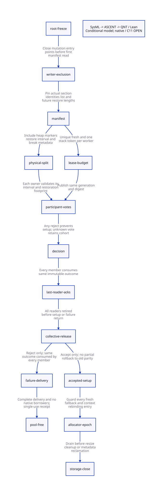

#+TITLE: Default Allocator Leases — Finite Visits, Physical Separation and Collective Admission
#+SETUPFILE: ../../modeling/org/setup.org
#+LANGUAGE: en
#+PROPERTY: header-args :eval never
#+OPTIONS: toc:3

* RESEARCH Architectural decision
:PROPERTIES:
:CUSTOM_ID: default-lease-admission
:AUTHORITY: GambitDefaultLeaseAdmission
:STATUS: conditional-model-proof; native-source-and-C11-open
:END:

Modern C is the required runtime direction. This study turns the previous
[[file:chunk-capacity-charge-design.org][chunk charge argument]] into explicit section ownership and collective admission
contracts. It changes no runtime code and does not run native or performance tests.

#+begin_quote
A finite visit bound and a disjoint physical-write bound are different claims.
L<=N does not authorize sharing, and an individually safe allocator model does
not authorize collection before every participant consumes the same decision.
#+end_quote

[[file:models/sysml/default-lease-admission.sysml][SysML]] owns the source/caller inventory, exclusion policies, proof routes,
module seams and cost rows. Its native queries produce [[file:default-lease-admission-matrix.org][the closure matrix]] and
. [[file:../../modeling/ascent/default-lease-admission.rules.scm][ASCENT DSL]] joins real typed action names, checked lemmas,
prior charge guards and digest-bound source/caller observations. No Python parser
of SysML or duplicate layout file is used.

* RESEARCH Source identity and two ownership structures
:PROPERTIES:
:CUSTOM_ID: default-lease-source
:END:

[[file:../../../evidence/research/default-lease-admission/source-witnesses.json][Source witnesses]] and [[file:../../../evidence/research/default-lease-admission/caller-audit.json][caller audit]] are bound to immutable snapshots. Concurrent
source changes are tracked separately. The audit masks comments and strings and
checks all literal callers of the selected mutators in mem.c/setup.c. It is not
an effective preprocessed C graph, an arbitrary FFI alias proof or native receipt.

** Chronological list versus address-sorted table

=adjust_msections= appends each allocated section at the chronological tail:
=tl->next=s=, =s->prev=tl=, =s->next=0=. It separately inserts the section into the
address-sorted =sections[]= table. The default =next_msection_without_locking=
advances =alloc_msection->next=, not the sorted-table index. A proof must preserve
both structures and distinguish their purposes.

The initial setup assigns distinct adjacent chronological entries to each worker's
stack and heap, then sets =nb_msections_assigned= to =2P=. Later successful fresh
selection advances the shared cursor and assigned count under =ALLOC_MEM_LOCK=.
The lock is supplied by callers; the selector itself explicitly requires it.
Uniqueness follows only if the list is finite, acyclic, stable and its live blocks
remain distinct throughout this cursor traversal.

Expansion can allocate a new msections header and free the old header before all
requested sections have been allocated. Partial failure publishes the actual
=nb_sections=. Contraction unlinks and frees tail blocks. Therefore requested N,
header-pointer identity and actual eligible section count are different inputs.
A raw retained header pointer is unsafe across permitted expansion even if no
existing payload block moves.

** Native block contract

=alloc_mem_aligned_aux= obtains a containing allocation and computes an aligned
interior address. =___alloc_mem_heap= in os_base.c delegates to the code allocator
when =___SUPPORT_LOWLEVEL_EXEC= applies, otherwise to =___alloc_mem= and normally
=malloc=. The latter has the standard live-allocation separation contract;
code-allocation and embedding profiles require their corresponding contract.

Physical separation additionally requires checked size/alignment arithmetic,
that the full msection payload and metadata fit inside the containing allocation,
and no free/reuse while a lease or observer remains live. The current signed
=___SIZE_TS= temporary alias is not justified by a mathematical Int model. These
are source/platform obligations, not consequences of the section count alone.

* RESEARCH Proof of L<=N under the admitted default profile
:PROPERTIES:
:CUSTOM_ID: default-lease-count
:END:

Let N be the actual eligible, fixed section count, P the frozen worker count, F
successful fresh heap acquisitions after initial setup, and S successful fallback
uses of the workers' current stack sections.

#+name: default-visit-count
#+begin_example
Initial setup consumes P stack tokens and P heap tokens.
0 <= F <= N - 2P
0 <= S <= P
L = P + F + S <= N
#+end_example

The heap wrapper passes its own =stack_msection= as fallback. After sharing, that
worker's heap equals its stack. With no stack rebinding, the next exhausted
fallback hits =fatal_heap_overflow= rather than creating a second visit to that
stack section. Initial heap tokens, fresh tokens and each worker's stack token
are disjoint categories. No record is returned to these categories during the
admitted interval.

[[file:models/lean/DefaultLeaseComposition.lean][The symbolic Lean lemma]] proves the general count implication. The separate
[[file:models/quint/default_section_leases.qnt][identity-aware QNT slice]] tracks two workers, two fresh section IDs, permanent
fresh owners and one fallback token per worker. Its invariant does not assume
L<=N as a conjunct; that result is derived from the token counts. A current-heap
inequality alone would miss previously visited but still retained sections, so
the fresh-owner records persist when the worker changes its current heap.

This finite slice is not a proof of source identity injection for arbitrary P.
That requires mapping every actual initial/fresh/fallback grant to a distinct
live manifest token, preserving allocator-lock exclusion and proving that every
writer excluded below is either closed or has an explicit nonconflicting lease.

* RESEARCH Physical interval proof, including future restore
:PROPERTIES:
:CUSTOM_ID: default-lease-geometry
:END:

** Shared section arithmetic

Use offsets in the same qualified half-section, not relational comparisons
between unrelated C pointers. Let H be its size, F the fudge constant, and q/r
satisfy H=4q+2F+r with 0<=r<4. After the real heap-sharing setup:

#+name: shared-intervals
#+begin_example
q = floor((H - 2F) / 4)
heap ordinary limit before two-marker reserve = 3q + F
stack allocation limit                    = H - (q + F)
gap                                        = r
#+end_example

=prepare_heap_msection= subtracts two terminal-marker words from the heap limit.
A final heap write footprint bounded by that adjusted limit plus two remains
below the declared stack limit. The heap and stack intervals are half-open: equal
end/start offsets do not overlap. The proof assumes a stable base/top and proper
bounds for the grant, prefix and terminal writes.

** Why the quarter formula is insufficient

The future =move_continuation= length is computed from the frozen context's old
=fp= and =stack_break=. The function later copies downward from =alloc_stack_ptr=
and does not perform an explicit shared-region fit check at that endpoint.
Its final break-frame metadata write uses =fp[-fpo]=, so the selected negative
field offset writes upward from the restored fp. It is inside the restored
interval when its length is at least three words.

A sufficient complete contract includes:

#+begin_example
R = stack_break + FIRST_BREAK_FRAME_SPACE - frozen_fp
R >= FIRST_BREAK_FRAME_SPACE >= 3
R <= q + F
heapPast <= 3q + F <= H - R
#+end_example

The R bound must cover all preserved contiguous frames and must remain stable
through tracing/restore. The scalar split equation does not supply it. A
numerical counterexample uses H=65536, F=8194, q=12287, R=20482: the declared
split meets exactly at offset 45055, while restore begins at 45054. This is an
arithmetic counterexample to a missing premise. A legal Scheme path reaching
that state, simultaneous heap occupancy there, and an actual native overlap are
all unresolved; no runtime defect or reachable race is asserted.

The modern-C design must either certify the actual R and complete write footprint
before authorizing fallback, reserve a suitable fresh interval, or decline the
plan collectively before irreversible setup. Simply disallowing one fallback
after forwarding has begun is not a complete recoverable GC failure protocol.
Likewise, node capacity safety does not imply that every live object fits in the
remaining copy space. Storage feasibility remains an independent obligation.

* RESEARCH Complete exclusion policy and required refactoring
:PROPERTIES:
:CUSTOM_ID: default-lease-writers
:END:

The native pointer writer boundary must be checked before the first mutation,
not only when entering nested =___garbage_collect_pstate=.

#+name: native-writer-policy
| Entry | Real mutation | Required admitted-epoch policy |
|-------+---------------+--------------------------------|
| ___stack_limit | Reuses free-list section or selects next; resets stack bounds | Mutator execution lease required; defer conflicting entry |
| ___stack_overflow_undo_if_possible | Pushes current section to free list and restores old stack | Same pre-write lease; it bypasses next_stack_msection |
| ___heap_limit | Reuses free-list section or resets heap allocation before GC | Reject/reroute before pointer recovery and list changes |
| ___setup_mem_pstate / ___setup_pstate | Binds new execution slots and stack/heap sections | Serialize after old allocator epoch closes |
| resize_heap | Expands/contracts section list after cleanup | Drain header/block observers before mutation |
| ___reserve_vm_resize | Publishes actual new section/slot grants | New storage generation; no overlap with old admitted traversal |
| ___rollback_vm_resize | Restores cursor/counts and may contract physical storage | Requires native join/borrower closure; unknown outcome retains |
| custom_msection_alloc | Can choose arbitrary or repeated sections | Qualify its finite manifest contract or refuse tight receipt |
| foreign cleanup / adjust_heap_hook | Native callback may reenter runtime | Explicit ingress capability or next epoch; no blanket purity assumption |

The source's real stack-undo path demonstrates why auditing only next-stack calls
was insufficient. Context/PSTATE fields and public native function pointers also
make arbitrary FFI aliases a separate closure obligation.

** Resize sequencing that can be reused

The current grow path in =___vm_resize_pstate= can call GC while resize is
=REQUESTED= and the old roster still owns execution. It crosses a result-consume
barrier before processor 0 calls =___reserve_vm_resize= and initializes new slots.
Thus REQUESTED is not automatically incompatible: a future receipt can bind the
old roster/request generation and retain this sequencing.

The GC guard also admits a RETAINED case with =abort_isolated=. That flag is not
a complete proof that quarantined grants can enter the general free manifest.
Such a profile needs a separate excluded-range/owner proof. Unknown joins must
not release those tokens. A resize request is deferred rather than permanently
disabled; modern-C ownership roles serialize the conflicting stage and make a
new manifest after closure.

** Admission scope is longer than tracing

=process_wills= creates weak work, but actual will action execution is not assumed
inside that classifier. Cleanup can call foreign release functions, and resizing
can call =adjust_heap_hook=. A finite strong/weak visit proof can end before these
calls, while node/header observers may still live. Reclamation therefore needs
separate later closure, not a phase-label shortcut. Immutable manifest copies or
pinned headers must not become dangling when =adjust_msections= replaces a header.

This is substantive modern-C refactoring: explicit allocator-epoch ownership,
per-entry write authorization, immutable metadata publication and stable failure
completion. The supported design must retain SMP and resize through scheduling
and ownership transfer, not treat disabling them as modernization.

* RESEARCH Collective signing and failure delivery
:PROPERTIES:
:CUSTOM_ID: default-lease-collective
:END:

The candidate protocol begins after every old member freezes roots and before
any member enters setup side effects. It adds the following explicit contracts:

1. Close pointer/roster writer admission and pin the actual container/list manifest.
2. Coordinator prepares the native pool, immutable plan and checked geometry.
   Allocation is not permitted to invoke Scheme GC or silently reenter the cohort.
3. Each participant acquires the exact epoch/generation/digest and validates its
   context, restore length, split and ownership. Any known reject yields one
   rejection outcome. An unknown participant cannot be treated as a reject ack.
4. Coordinator consumes all required votes and release-publishes an immutable
   accepted or rejected decision. It cannot change that decision afterward.
5. Every participant acquires the same decision and acknowledges its last read.
   Only the collective release after all acknowledgements permits setup writes
   or the collective failure branch.
6. Reject: all participants consume the same failure while old roots/parity remain
   under custody. Native pool release requires completed delivery and no readers.
   No processor-only return or timeout-forged acknowledgement.
7. Accept: processor 0 performs the actual per-context setup/flip loop, followed
   by the real setup barrier. The model's flip0/flip1 label per-context effects,
   not different processors writing their own parity. A partial accepted setup
   cannot be reclassified as a clean pre-setup rejection; it needs retained
   completion state and a non-abandonable completion guard.

The two-member [[file:models/quint/capacity_collective.qnt][QNT model]] represents known OOM, a member rejecting an allocated
plan, missing acknowledgements, partial failure delivery and partial setup. It
models read retirement and prohibits repeated free. It does not prove native
free completion after an interrupted C call, generation wrap/ABA, arbitrary
participant sets or eventual progress after a participant fails.

The existing grow-result barrier pattern is useful precedent, not an existing
capacity-plan signing implementation. Unknown delivery keeps ownership in the
coordinator's stable record and old member slots. Both acceptance and failure
need a native completion landing pad outside abandoned C stacks.

* RESEARCH C11 and model refinement
:PROPERTIES:
:CUSTOM_ID: default-lease-proof-chain
:END:

- [[file:models/lean/SectionLeases.lean][Lease induction]] is extracted from the actual typed QNT AST and checks all
  actions. Token duplication, repeated fallback and cross-owner rebinding are
  preserved negative histories. Unknown mutation revokes qualification and retains
  the current visits; it does not erase historical ownership.
- [[file:models/lean/CapacityCollective.lean][Collective induction]] proves no accepted setup before all reader acknowledgements,
  no rejected flip and no free while required result delivery is incomplete.
- [[file:models/lean/DefaultLeaseComposition.lean][Composition]] proves the successful collective prefix using actual prior steps,
  a guarded lease/collective product, and an explicit counterexample to composing
  independent safe components without authorization.
- The same file imports the exact preceding =CapacityChargeAst= and proof. A
  newly issued lease token supplies the old =advanceVisit= guard under explicit
  coverage/budget premises. A separate theorem carries its ceiling to N. This
  is a guard/ceiling refinement bridge, not a claimed full global multi-context
  source trace simulation or arbitrary-worker injectivity proof.

The narrow AST emitter preserves bound state identity and exact action rosters;
parser/emitter correctness remains trusted. Abstract integers, finite section IDs
and generation 7 are not native pointers, machine arithmetic or an ABA proof.

#+name: c11-refinement-matrix
| Boundary | Required C11 relationship | Still missing |
|----------+---------------------------+---------------|
| Fresh token | Existing allocation lock covers selection and cursor publication | Effective adapter and all writer closure |
| Manifest read | Freeze/exclude before ordinary reads; retain valid header and blocks | Real epoch lease and alias census |
| Plan/votes | Initialized immutable payload before release; matching-generation acquire | Concrete receipt storage and reads-from |
| Last read | Last dereference before release ack; coordinator acquire all acks | Native interruption and stable completion guard |
| Setup | Accepted collective release before per-context flips | No exception escapes partial setup ownership |
| Reject free | Complete reject delivery and no readers before free | Native once-only reclamation and unknown result handling |

Existing =BARRIER= or full-fence adapters cannot be assumed to satisfy this table
without exact source/configuration refinement. The memory model is not simply a
sequential interleaving; this study has no C11 weak-memory execution proof.
Actual ASCENT admission remains blocked by source and platform obligations.

* RESEARCH Benefits, added cost and retirement
:PROPERTIES:
:CUSTOM_ID: default-lease-benefit
:END:

The candidate 258N+D record capacity remains useful only after both finite visits
and physical write bounds qualify. Three 8-byte pointer fields give a field-space
lower bound 24*(258N+D); actual stride, pins, manifest storage and retained epochs
add to it. There is no measured speed or positive net-benefit result.

Modern C can reuse the short existing fresh-list lock and ordinary object layout.
The design adds O(N+P) manifest/restore qualification, per-member votes and last-read
acks, a stable generation/decision record and pre-write ingress guards. No new
global atomic is required per copied word. Collective latency, reduced useful
heap and callbacks that delay reclamation remain real costs.

Retire implicit same-section sharing, unchecked rebind during a collector epoch,
and coordinator-only failure returns only after all producer/consumer and unwind
paths use the new contracts. Do not retire working source paths merely because
an abstract model passes, and do not credit removal of an already existing lock.
The detailed [[file:default-lease-admission-matrix.org][native SysML matrix]] records conditional gains and unresolved costs.

* RESEARCH Literature and qualification record
:PROPERTIES:
:CUSTOM_ID: default-lease-literature
:END:

[[https://www.open-std.org/jtc1/sc22/wg14/www/docs/n1570.pdf][N1570]], especially 5.1.2.4 and 7.17, constrains ordinary reads, synchronization
and live allocation behavior. The official [[https://www.open-std.org/jtc1/sc22/wg14/www/docs/n1479.htm][WG14 memory-model rationale]] motivates
keeping sequential abstract checks separate from C11 reasoning. No C++ runtime
is proposed.

The [[file:../../../evidence/research/default-lease-admission/][evidence directory]] retains immutable source, native SysML query results,
caller audit, raw QNT/Lean logs, negative controls, ASCENT scenarios and hash-bound
inputs. Any independent concurrently invalid DEV model is reported separately;
scoped validation does not establish whole-DEV validity. No runtime implementation,
preprocessing, native test or performance validation is performed.
