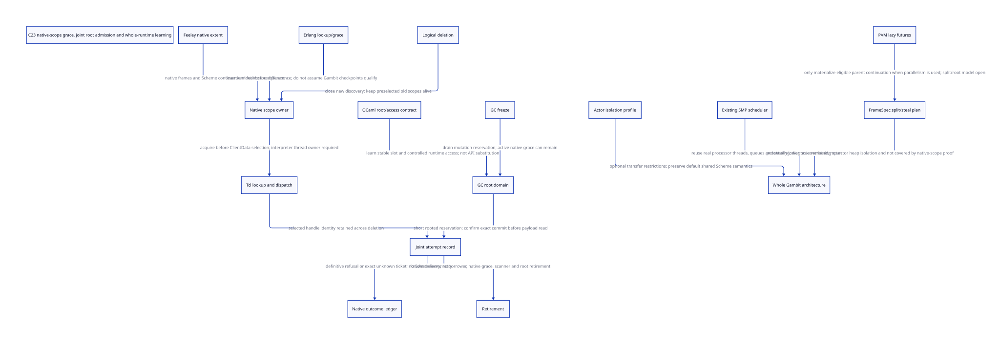

#+TITLE: Native dispatch lifetime, joint root admission and Gambit multicore foundations
#+SETUPFILE: ../../modeling/org/setup.org
#+LANGUAGE: en
#+CATEGORY: modern-c
#+PROPERTY: header-args :eval never :tangle no
#+OPTIONS: toc:3 num:nil

* RESEARCH Decision and epistemic boundary :c23:ffi:smp:
:PROPERTIES:
:CUSTOM_ID: dispatch-joint-admission
:AUTHORITY: GambitDispatchJointAdmission
:STATUS: SOURCE-LEARNING; ABSTRACT-PROTOCOL; NATIVE-REFINEMENT-OPEN
:BASELINE: C23
:END:
Learn concrete mechanisms from Feeley, local OCaml and Erlang/OTP. Do not invent
an upstream API or attribute a new protocol to a paper. In this study
/NativeScope/, /RootReservation/ and /JointReceipt/ are specification vocabulary,
not existing Gambit or Tcl implementation names. Their composition is a proposed
Gambit-specific adaptation with stated admission conditions and counterevidence.

[[file:models/sysml/dispatch-joint-admission.sysml][Native SysML]] owns source, learning, component, action, issuer, ordering,
benefit and gap rows. Python calls the native SysML evaluator, then runs
[[file:../../modeling/ascent/dispatch-joint-admission.rules.scm][actual ASCENT DSL]], [[file:models/quint/dispatch_joint_admission.qnt][QNT]], [[file:models/lean/DispatchJoint.lean][Lean]] and [[file:models/lean/DispatchJointBridge.lean][parent predicate bridges]].
[[file:dispatch-joint-admission-matrix.org][The derived matrix]] and [[file:diagrams/dispatch-joint-admission.d2][D2]] /  retain those distinctions. The
[[file:../../../evidence/research/dispatch-joint-admission/checks.json][qualification receipt]] does not admit native execution. This is not runtime
implementation, native testing, benchmarking or a migration decision for Zig.

* RESEARCH Start with the actual multicore question :architecture:
:PROPERTIES:
:CUSTOM_ID: dispatch-whole-gambit-question
:END:
The claim /Gambit SMP is fake multicore/ is not established. The local source
contains =pthread_create= in [[file:../../../vendor/gambit/lib/os_thread.c::pthread_create (&thread_id,][native thread creation]], invoked by the processor
creation path in [[file:../../../vendor/gambit/lib/setup.c::if ((r->result = ___thread_create (t))][setup]]. [[file:../../../vendor/gambit/lib/_thread.scm::There are no runnable threads locally, so try to steal][The Scheme scheduler]] already has local processor run queues,
processor pinning and stealing. These are source mechanisms. They do not prove
which options built an installed binary, useful simultaneous execution, fairness,
scaling or native correctness. Green threads describe an execution multiplexing
strategy; they do not imply one OS thread.

Current working-tree files include local refactoring changes. File hashes,
[[file:../../../evidence/research/dispatch-joint-admission/reference-revisions.json][submodule revisions]] and native binaries are separate identities. Do not label
all current-source behavior an unmodified upstream release guarantee.

| Question | Current source evidence | What must be established separately |
|----------+-------------------------+------------------------------------|
| Is there an OS-thread mechanism? | Native thread creation and processor activation exist | Effective configuration and loaded binary correspondence |
| Is parallel work scheduling absent? | Per-processor queues and steal loop exist | Work availability, imbalance, critical path and pinning costs |
| Is actor messaging isolated? | Current thread-send links a cons containing the original Scheme object into a mailbox | No implicit payload copy/freeze or per-actor heap ownership follows |
| Does GC coordinate multiple roles? | Context roots and prepare/strong/weak/cleanup phases exist | Complete root writers, closure, termination and native participation |
| Why is the user's workload slow/unstable? | Several relevant paths and unresolved contracts are identifiable | No workload trace or performance qualification was run; a dominant cause is not established |

The structural pressure is separation of responsibilities: an execution context,
its OS carrier, its root owner, a GC participant, collector work and native-stack
lifetime cannot simply be treated as one interchangeable processor identity.
This remains the whole target in [[file:runtime-blueprint.org][the existing runtime blueprint]] and
[[file:modernization-target.org][modernization architecture]]. A Tcl slice must refine that architecture rather
than replace it with a collection of isolated gates.

* RESEARCH Mechanism learning, mismatch and inference :papers:knowledge:
:PROPERTIES:
:CUSTOM_ID: dispatch-reference-learning
:END:
The SysML /learning/ rows are the maintained fact/mismatch/candidate matrix.
The following explains their reasoning; it does not create a second source list.

** RESEARCH What Feeley supplies
The locally retained [[file:../../../evidence/research/sfun-converter-use-closure/primary-paper.json][SFP paper ledger]] and [[file:../../../evidence/research/sfun-converter-use-closure/feeley-sfp-paper.txt][paper text]] distinguish unlimited-extent
Scheme control from dynamic native-stack extent. Section 3 describes historical
lazy native-frame removal; section 4 proposes independent native thread stacks;
section 5 explicitly says that approach had not been implemented there. A Scheme
yield or multi-shot restoration therefore cannot serve as proof that all old
native references were dropped. Nor does the paper implement the joint-admission
protocol proposed here. No native-thread-per-callback policy is selected here.

[[file:advantage-architecture-design.org::#advantage-paper-basis][The PVM learning study]] separately identifies logical frames, bidirectional
target knowledge, explicit storage/alias boundaries and measurement feedback.
Amplification means one Scheme-owned semantic contract can serve GC, continuation,
C emission and ABI-aware incremental compilation. It does not mean replacing
Scheme semantics with Erlang's process semantics or an OCaml one-shot resumption.

** RESEARCH A primary-paper amplification target: lazy futures
:PROPERTIES:
:CUSTOM_ID: dispatch-pvm-lazy-futures
:PAPER: Feeley-Miller-LFP90, section 2.7
:STATUS: PRIMARY-MECHANISM-READ; CURRENT-GVM-REFINEMENT-OPEN
:END:
The author-hosted [[https://www.iro.umontreal.ca/~feeley/papers/FeeleyMillerLFP90.pdf][PVM paper]] was read directly, and its PDF/text retained with hashes
in [[file:../../../evidence/research/dispatch-joint-admission/pvm-paper-source.json][the primary-source receipt]]. Section 2.7 permits lazy future execution:
a processor initially executes the child with call-like behavior; another
processor can materialize the suspended parent at a split marker, creating the
placeholder then. The runtime supplies the actual split mechanism. Task/work/done
and strictness information are compiler/runtime contracts, not an actor API.

This suggests a concrete modernization question: can the existing FrameSpec and
continuation contracts make eligible split points, roots and exclusive parent
reconstruction explicit, so task materialization is paid when parallel work is
actually exposed? This is a Gambit-specific inference. It does not prove the
current GVM has those split points or that arbitrary effectful Scheme code may
be reordered. Start with explicit parallel constructs or independently proved
eligibility; keep general continuation and mutable alias semantics.

For N eligible calls and S actual materializations, the hypothesized comparison
is eager materialization at N calls versus lazy materialization at S splits.
=N-S= is a conditional count of avoided immediate materializations, not CPU time
saved. Charge N marker/strictness checks and S split/restore/GC-root operations.
The existing native-scope model proves none of the split/steal protocol: SysML
keeps =future-split= unresolved for a dedicated composition model. This mechanism
and long-lived ownership-isolated actors address different workloads.

** RESEARCH What OCaml supplies
Local =threads.h= requires foreign-thread registration and acquiring runtime/domain
access before runtime calls or callbacks. Registration alone does not hold that
access. The blocking hooks explicitly release and reacquire the domain lock.

=memory.h= requires a valid value before generational root registration and
controlled writes through the modifying API. =globroots.c= has a root mutex and
marks deletion during iteration for deferred removal. Learn stable slot identity,
controlled root writes and explicit runtime access. Do not claim an arbitrary
concurrent setter is safe, that the root mutex grants domain ownership, or that
registering one root preserves an overwritten old payload. Gambit requires its
own context/root and moving-update refinement.

** RESEARCH What Erlang supplies
The pinned /ThreadProgress/ design's reclamation example first prevents new lookup
of D, then waits until all managed threads reach a known state after dropping
references to D. Unmanaged readers need explicit delay handles; its documentation
warns that frequent shared-counter use can contend. Gambit scheduler checkpoints
are not automatically those known states: a suspended Scheme computation can
still retain live native C frames or foreign aliases.

The pinned GC design ties process-local collection to per-process heap/root
ownership. The current Gambit mailbox path retains the original Scheme payload;
copying it would change mutable aliases and captured closure relationships.
An ownership-isolated actor profile is a separate optional contract, not a silent
rewrite of general Scheme threads. Erlang's NIF documentation also distinguishes
yielding work from dirty scheduling and says dirty execution can still delay
process suspension/GC. A dirty pool does not make arbitrary native cancellation
or cross-thread Tcl calls safe.

* RESEARCH How these mechanisms amplify Gambit :smp:actor:continuation:
:PROPERTIES:
:CUSTOM_ID: dispatch-amplification
:END:
| Gambit asset | Architectural direction | Learning that supports the choice | Semantic restriction / open obligation |
|-------------+-------------------------+-----------------------------------+----------------------------------------|
| Lightweight Scheme execution | Separate migratable execution state from native OS carrier and ownership grants | Erlang scheduler/process separation; OCaml domain/thread access | Native-affine frames/ports cannot migrate by mere queue movement |
| Existing queues and stealing | Preserve scheduling mechanism; redesign readiness, fairness and native-blocking classification around explicit contexts | Erlang yielding/dirty-native treatment | Existing stealing is not the problem's proven bottleneck; no duplicate scheduler is justified yet |
| Shared Scheme objects and actor API | Keep general shared semantics; explore explicit ownership-isolated actors where transfer is proved | Erlang local heap and message ownership | Mutable aliases, procedures, FFI references and continuation transfer need precise rules |
| Multi-shot continuation | One logical frame/root contract; each native invocation has independent live return authority | Feeley native-stack extent; PVM logical frames | A resumed Scheme continuation cannot revive retired C stack storage |
| Precise GC / future generational organization | Context-local allocation with globally sound root/remembered-write participation; collector work separated from native grace | OCaml explicit root updates; Erlang ownership-local GC | Complete writer/root closure and barriers, not copying alone, enable the design |
| Scheme compiler and C portability | Scheme completes semantic specs; C23 realizes layouts and concurrency; phase results feed incremental services | PVM target feedback and existing build redesign | C23 choice alone neither fixes scheduling nor creates incrementality |

These refine existing owners in [[file:runtime-blueprint.org][the blueprint]]. They are research directions,
not six newly implemented subsystems. No concurrency policy from another runtime
is adopted without Gambit's alias, continuation and FFI conditions.

* RESEARCH Joint admission without a fictional omniscient issuer :ffi:gc:
:PROPERTIES:
:CUSTOM_ID: dispatch-joint-issuer
:END:
The real producers are the Tcl constructor, =tcltk_eval= / event entry,
=TclInvokeStringCommand=, =scheme_call_cmd=, =scheme_delete_cmd= and the Gambit
context RC scanner. No current producer issues the complete combined authority.

1. The interpreter's actual native owner establishes a scope *before entering*
   Tcl evaluation/event dispatch. It captures interpreter and registration
   generation, and prevents physical disposal of matching old handles. It must
   prove OS-thread affinity; a Scheme mutex is insufficient evidence.
2. Command lookup can select ClientData while that outer scope already exists.
   The callback authenticates the stable handle before any raw RC/payload load.
   A callback-prologue counter cannot close the prior selection gap by itself.
3. The collector root domain accepts a short reservation for the already rooted
   source slot and the stable attempt record. This is distinct from the outer
   native scope. No allocation, callout, nonlocal exit or wait for GC may abandon
   an outstanding mutation grant.
4. A stable, exact-attempt commit records that both native source authorization
   and root authorization hold. The payload may be read only after confirmation.
   If deletion won before this commit, return a definitive no-commit refusal.
   Once commit is accepted, later logical deletion does not retract its root.
5. A root reservation accepted before GC closes admission may settle before
   freeze. Freeze waits for that short mutation obligation, while longer native
   scopes can remain if every needed value is in the registered frozen census.
   Native grace is not a collector-worker vote.

The sequential contract needs a real C23 synchronization/refinement argument.
It does not require or establish a magical atomic instruction spanning Tcl and
Gambit. Owner-confined Tcl state can avoid shared hot counters only after every
entry's confinement and reentrancy are proven. Otherwise an explicit concurrent
admission/grace mechanism and its costs are necessary.

** RESEARCH Reuse existing authority before adding infrastructure
:PROPERTIES:
:CUSTOM_ID: dispatch-reuse-choice
:END:
First qualify a synchronous owner-confined Tcl profile using existing RC source
slots, existing stable completion/exception support and Tcl interpreter lifetime
APIs. The names in this document denote responsibilities; they do not require
separate services, allocations, queues, a global ticket database or a new epoch
system. An exact attempt may be an identity in an already required stable guard.

The current callback/getter/register calls are direct in-process calls. The source
does not show a message acknowledgement being lost there. /Unknown result/ is an
abstract interruption/deferred-delivery fault case; it must not be presented as
an observed Tcl failure or used to mandate a new distributed protocol. If a
qualified synchronous no-abandon path excludes it, reservation/commit/receipt
can be fused. If a proposed asynchronous or abandonable adapter admits it, that
adapter must provide the corresponding recovery ownership or be rejected.

| Profile | Existing mechanism to qualify | Additional obligation |
|---------+-------------------------------+-----------------------|
| Synchronous interpreter-owner confinement | Tcl native wrapper, preserve/deferred interpreter disposal, RC root slot, stable guard | All entries, reentrancy, root admission and real native last use |
| Cross-thread/deferred requests when genuinely needed | Owner-directed dispatch; existing guard/root support where applicable | Do not call Tcl from a nonowner; define queue ownership, exact settlement and cancellation |
| Raw command-info or retained ClientData bypass | No complete managed source authority established | Mediate explicitly or reject managed admission; no grace guarantee by assumption |

An Erlang-style global progress facility is an alternative only if enough real
components share its managed/unmanaged participation rules to justify it. It is
not selected merely because the reference runtime implements one. Likewise,
OCaml's root mutex and domains are evidence about responsibilities, not a mandate
to install their data structures in Gambit.

** RESEARCH Deletion, late callback and GC closure
| Order | Responsibility | Required outcome |
|-------+----------------+------------------|
| Scope entered, old handle selected, delete closes command, callback starts | Native owner retains old storage; callback rechecks command admission | Refuse before payload read; deliver through native origin ledger |
| Root reservation accepted, delete closes before commit | Root domain retains reservation record; native owner retains matching scope | Authoritative abort/no-commit; release short mutation grant, not a new Scheme error call |
| Joint commit accepted, delete follows, acknowledgement lost | Root domain owns committed source root; native owner retains invocation/control storage | Query exact attempt; do not reissue, roll back or free on missing acknowledgement |
| GC closes after reservation but before commit settlement | Root-domain finisher owns outstanding mutation | Settle accepted reservation before freeze; no wait cycle involving the requester |
| GC already frozen before reserve | Existing root stays scanned; no new payload access authorized | Definitive native rejection; scope may drain without modifying frozen root census |
| All native scopes exit but root/scanner still live | Collector owns remaining root/scan obligations | Root retirement precedes storage free; native grace alone is insufficient |

Tcl's source has an existing preserve/release/eventually-free lifecycle for
interpreter storage. It distinguishes logical deletion from later physical
cleanup. This is a mechanism to reuse after qualifying the exact native API
profile, not proof that preserving an interpreter also preserves each ClientData
or permits use from another thread. It cannot replace command/source scope
accounting. This study does not claim to have verified every implementation
path in Tcl_Preserve itself or the loaded Tcl binary.

* RESEARCH Refusal, unknown results and progress custody :failure:
:PROPERTIES:
:CUSTOM_ID: dispatch-unknown-custody
:END:
| Attempt ledger | Trusted custodian | What caller may do | What is forbidden |
|----------------+-------------------+--------------------+-------------------|
| Native handle not accepted / GC refuses before reservation | Stable outer native invocation owner | Deliver definitive refusal; keep provenance through Tcl result/catch | Read payload or call Scheme error translator |
| Root reservation exists, commit not performed | Root-domain reservation finisher plus native scope owner | Resolve exact record to committed or confirmed aborted; native scope stays alive | Treat timeout as proof of no commit |
| Commit performed, reply missing | Root domain owns root; native owner owns delivery and prelookup grace | Query same attempt, then hand off or complete according to receipt | Retry as a new Scheme invocation or speculative decrement/free |
| Transfer/last-use unknown | Existing source/target owner named in receipt | Retain ownership until exact settlement | Infer completion from native callback count alone |

The abstract model represents reservation abort after an unknown result, and a
committed unknown result later confirmed by exact query. The stable finisher is
an *unimplemented obligation*. If it can be cancelled, lose its root or wait for
a requester that is itself waiting for GC, progress is not established. Safety
can require indefinite retention; bounded recovery is not proved. Source-root
release, Scheme native hold disposition and destination guard completion remain
separate responsibilities from the [[file:tcl-source-borrow-design.org][parent study]].

* RESEARCH Executable protocol and limits :qnt:lean:ascent:
:PROPERTIES:
:CUSTOM_ID: dispatch-formal-scope
:END:
QNT models one fixed-payload registration and distinguished attempt, arbitrary
nonnegative additional native-scope count, reserved versus committed custody,
unknown results and GC freeze. It has 27 actions. It does not model arbitrary
nested native stacks, every public setter, mutable payload-version maps, value
relocation or C23 weak memory. Scope entry/exit, native last use and finisher
availability must be refined from real callers.

The Lean AST is extracted from the real typed QNT IR using the existing restricted
projector. Action preservation plus reachable-state induction prove safety of
that abstraction. Special laws connect active borrow to both backing authorities,
unknown results to retained custody, freeze to writer drain, and refusal to no
payload reads. Imported parent ASTs provide predicate embeddings only, not a
full composition simulation or proof of old native-frame resurrection safety.

The semantic negative controls retain guarded prefixes and deliberate invariant
failures: freeing a preselected source, freezing over an accepted reservation,
reading before unknown commit confirmation, delivering an unsettled attempt,
freeing while another scope remains, and removing a frozen/scanning root.
A close-before-commit history rejects; a commit-before-close history remains
accepted. These are distinct from a single post-state safety predicate.

ASCENT matches exact source, action, compiled lemma, issuer, shared contract and
learning fact/mismatch/inference rows. It rejects changing /thread registered/
to /runtime access held/, /scheduler yield/ to /native quiescence/, /shared mailbox/
to /isolated heap/, or /Feeley proposal/ to /existing C23 service/. Those checks
validate evidence correspondence; prose premises still require human/source
refinement. The current native candidate stays blocked.

* RESEARCH Net return, costs and retirement conditions :benefits:
:PROPERTIES:
:CUSTOM_ID: dispatch-net-return
:END:
| Boundary | Conditional gain | Added cost / falsifier |
|----------+------------------+-----------------------|
| Outer native scope | For M callbacks in E wrapped scopes, E enter/exit pairs instead of M separate outer protections | Per-callback source/root checks remain; when M approximates E there is no amortization |
| GC closure | Registered native-held roots can let GC proceed without waiting for whole callback lifetime | All raw values must be rooted or prohibited; short reservations must have an independent finisher |
| Logical delete | Return without waiting for the currently executing callback itself | D old scopes can retain metadata indefinitely; quiescence is a requirement, not a timer |
| Unknown outcomes | Prevent duplicate invocation and premature free | Q unsettled attempts require O(Q) stable records/roots; no bounded drain claim |
| Managed progress alternative | Potentially share retirement bookkeeping across many objects | Participation, unmanaged delays, cache contention and latency can outweigh savings |
| Actor profile | Local heaps may reduce shared GC/locking for admitted isolated data | Copy/transfer, promotion, binary/off-heap ownership and lost alias freedom must be charged |
| Lazy futures / eligible task splitting | N-S calls may avoid eager parent/placeholder materialization | N marker/check costs, S split/root operations; dedicated split model still open |
| Scheduler modernization | Reuse existing SMP and steal infrastructure while fixing ownership/readiness | No time saving is established by source inspection alone |

The scope-amortization row compares two *correctly protected candidate designs*.
The old raw callback has no qualified outer protection to remove, so E-versus-M
is not an observed reduction from current code. Native admission and grace are
new correctness costs unless an existing guard can satisfy them. Lazy-future
materialization is a separate work-saving hypothesis with a defined eager
baseline; neither comparison establishes a measured net runtime win.

For a ready task graph with useful work W, dependency span L and P available
workers, ideal execution time is bounded below by =max(W/P, L)=. This does not
promise that stealing reaches that bound. GC, native blocking, imbalance,
serialization, queue contention and compiler/session effects must be attributed
separately; increasing P cannot remove L. The user's low utilization and macOS
comparison remain observations to explain, not a number derived from this model.

Net CPU saving requires avoided work/coordination *in the same unit* to exceed
extra root, barrier, admission, transfer and reclamation work. Retained bytes,
latency and fairness need their own ledgers; do not add them into an untyped
benefit number. No person-day or assumed speedup is used.

Retire raw callback payload loading only after joint native/root authority and
moving-root read refinement. Retire immediate delete frees only after lookup,
alias and native last-use closure. Retire unconditional Scheme error translation
only after every eval/event entry has authoritative native provenance. Reuse
existing queues, root walkers and portable C target primitives until an actual
replacement subsumes their obligations. No old runtime path is retired here.

* RESEARCH Closure and next proof obligations :gaps:
:PROPERTIES:
:CUSTOM_ID: dispatch-open
:END:
- [X] Distinguish existing OS threads/queues/stealing from useful multicore acceptance.
- [X] Bind Feeley/OCaml/Erlang learning to explicit mechanisms and mismatches.
- [X] Separate prelookup grace, short root mutation, commit and refusal/unknown custody.
- [X] Connect actual QNT/Lean predicates and ASCENT evidence checks.
- [ ] Native interpreter owner and every eval/event entry qualified.
- [ ] Complete lookup, command-info mutation and external ClientData alias closure.
- [ ] Non-abandonable reservation finisher and real native-frame last-use.
- [ ] Actual per-round root-slot mapping, C23 atomics and reclamation refinement.
- [ ] Optional actor transfer semantics and whole-SMP correctness/benefit closed.
- [ ] PVM-inspired current-GVM split/steal/restore model and eligibility proved.

The detailed statuses are projected from [[file:models/sysml/dispatch-joint-admission.sysml][SysML]] into the
[[file:dispatch-joint-admission-matrix.org][matrix]]. A paper mechanism, an inferred Gambit design, an abstract proof and a
qualified native implementation remain four different claims.
