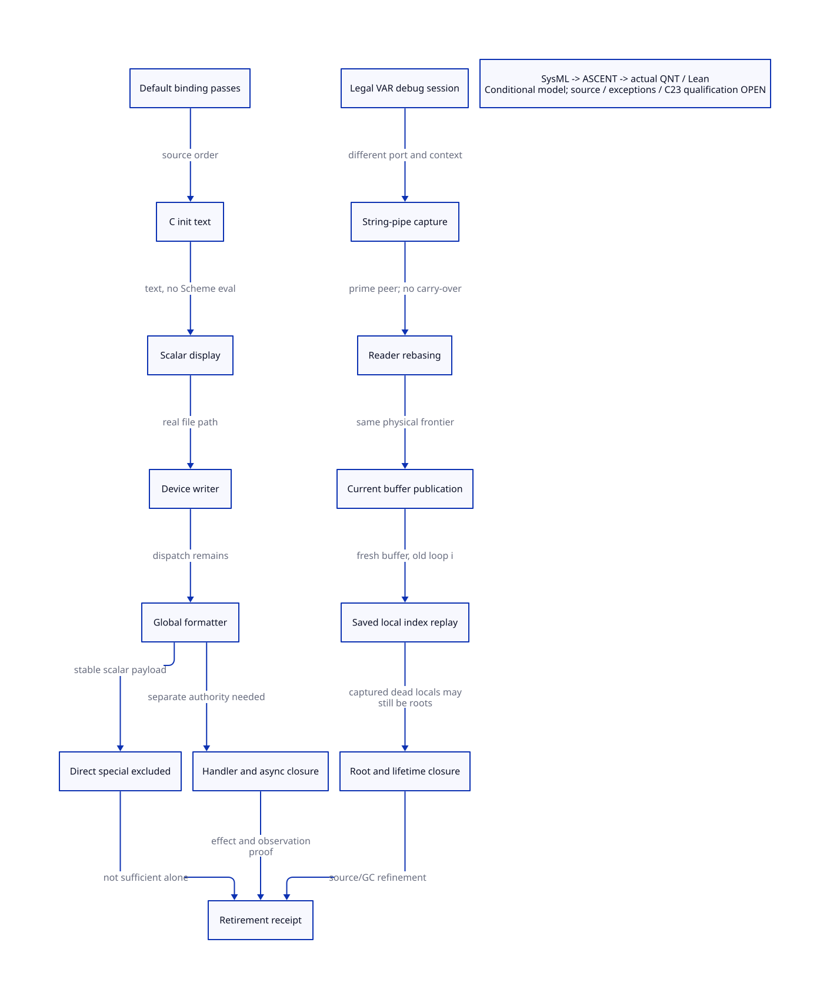

#+TITLE: Default Binding Emission and String-pipe Reentry Refinement
#+SETUPFILE: ../../modeling/org/setup.org
#+LANGUAGE: en
#+PROPERTY: header-args :eval never
#+OPTIONS: toc:3 num:t
#+STARTUP: overview

* Decision and authority
:PROPERTIES:
:CUSTOM_ID: emission-pipe-refinement
:BASELINE: C23 / ISO IEC 9899:2024
:STATUS: conditional source/formal results; native retirement denied
:END:

The actual binding-emission interval contains real output and formatter dispatch.
It does not directly execute C initialization text as Scheme, and the selected
scalar binding payload does not directly enter the debug VAR/PTREE branch.
The legal bounded string-pipe witness remains a distinct application-configured
debug context. Its cursor refinement cannot, without an actual call/authority
bridge, establish interference inside ordinary compiler emission.

Native [[file:models/sysml/emission-pipe-refinement.sysml][SysML]] owns source rows, route classifications, producer/consumer seams,
proof obligations, policy profiles and gains. Python invokes the native parser
and query tool, then runs actual [[file:../../modeling/ascent/emission-pipe-refinement.rules.scm][ASCENT rules]],
[[file:models/quint/emission_pipe_refinement.qnt][QNT actions]] and [[file:models/lean/EmissionPipe.lean][Lean step proofs]].
See the projected [[file:emission-pipe-refinement-matrix.org][matrix]], ,
[[file:models/lean/EmissionPipeAlgebra.lean][algebra]] and [[file:formatter-legal-output-design.org][parent legal-output study]].
No compiler/runtime implementation, native test, preprocessing or benchmark is supplied.

* Exact ordinary source interval
:PROPERTIES:
:CUSTOM_ID: ordinary-emission-interval
:END:

** Producer and order

The real public ##compile-file-to-target entry in _gsclib.scm calls c#cf.
_front.scm wraps cf in its compiler-specific with-exception-handling channel.
This does not install a port timeout thunk or close the ambient dynamic handler.

In _t-c-1.scm, targ-dump extracts c-inits from c-intf before clearing its slots.
It initializes the target heap, scans procedures and calls targ-heap-dump.
That function derives prm-list with targ-extract-primitives, opens the output
through targ-start-dump and eventually calls targ-dump-mod with that list.
The exact interval is:

1. def-mod-prm-glo DEF_MOD_PRM traverses primitive entries. Each entry evaluates
   targ-use-glo, c-id construction and operand extraction before emitting its tuple.
2. Finish that tuple and all remaining first-pass entries; emit END_MOD_PRM and newline.
3. Emit BEGIN_MOD_C_INIT; for each c-inits string, call targ-display and targ-line.
4. Emit END_MOD_C_INIT, newline and BEGIN_MOD_GLO.
5. def-mod-prm-glo DEF_MOD_GLO traverses the same list again, evaluating the second helper.

The two helper calls are separated by whole-list traversal and C initialization
output, not merely adjacent scalar writes. Operand evaluation order within a tuple
is not inferred from indentation; completion of the tuple's operand evaluation
precedes targ-code*. The actual source ordering between the two passes is fixed.

The ordinary parser checks that c-initialize receives a string, calls add-c-init,
and stores that string in c-interface-inits. The emitter displays this text into
the generated C module. It does not eval the text or execute the resulting C
initializer inside the compiler. User macros, FFI or retained mutable aliases can
violate a simple frozen-input assumption; therefore legal producer type checking
alone is not a complete alias/immutability receipt.

** Real output consumers

Writeenv construction also queries ##output-port-width: the concrete device
method can raise through the same I/O handler chain before actual character
output. Remaining first-pass helper calls may allocate and expose GC job
execution; output is not the only possible callback boundary.

The actual path is targ-display-no-line-info -> display -> ##display ->
##write-generic-to-character-port -> device write-datum -> current ##wr.
targ-code also traverses tagged C forms, resolves cells, prints identifiers,
strings and numbers, and may emit line directives. The selected primitive binding
case is a typed scalar C-emission path; this is not a theorem about every possible
object printed elsewhere by the compiler.

The Gambit host opener parameterizes a standard case-preserving readtable around
open-output-file. The generic output-file API creates a file/device path, not the
bounded string-pipe used by the legal debug example. The device constructor has
wtimeout=#t, wtimeout-thunk=#f and io-exception-handler=#f initially. This identifies
its initial state, not a permanent guarantee against later modification.
A matching bootstrap/host artifact and no late field/formatter mutation remain
qualification obligations.

Even an ordinary file port calls the mutable global writer. Installing the stock
igsc debug hook changes this dispatch but does not make a string or integer into
a VAR/PTREE. Under stable payloads and predicates, the hook's scalar arm delegates
to ##default-wr without saving/replacing/restoring the global formatter.

** Callback classes and reachability

| Class | Actual source edge | Authority/availability conclusion |
|-------+--------------------+-----------------------------------|
| Formatter | Device write-datum calls ##wr | Real dispatch; a custom formatter may have effects, but no stock metadata-writing formatter in this interval was established |
| Stock igsc special branch | Vector/tag predicates guard save-wr | Directly excluded for selected scalar payload; igsc is an explicit loader, not every compiler mode |
| Device I/O failure | Character/byte drain -> raise-os-io-exception -> raise-io-exception | Port handler or current dynamic handler may run; metadata/capture authority must be established separately |
| Device timeout | Wait/drain may consult timeout thunk | Default initial infinite timeout and false thunk do not establish an installed callback; no automatic transplant from string-pipe |
| GC/asynchronous jobs | Kernel executes registered GC interrupt jobs | Producer exists; registered closure set, timing, metadata authority and nested printing remain open |
| Compiler diagnostic escape | with-exception-handling stores throw-to-exception-handler | Separate diagnostic continuation; it is not a universal I/O handler or completion guard |
| C initialization | targ-display of validated string | Text output only; no Scheme callback merely because the C text names a function |

A custom dynamic handler could itself print a VAR, install a formatter or start
nested compilation if it owns those capabilities. Direct scalar exclusion does
not exclude such nested activity. No current stock handler/GC job was established
that makes the parent debug witness occur between the selected helper calls.
Absence of a found stock writer is not a complete negative callgraph proof.

* Concrete string-pipe cursor subset
:PROPERTIES:
:CUSTOM_ID: pipe-cursor-refinement
:END:

** State relation to source

The QNT record is a product of two distinct contexts: an ordinary emitter model
and an application-configured legal debug-pipe model. They are not two views of
one admitted physical output port. Cross-context evidence requires an explicit
ASCENT route bridge; running both projections in one history does not create it.

| Model field/action | Source meaning |
|--------------------+----------------|
| wlo / whi | Current writer's character-port base and write-buffer high cursor |
| rlo / rhi | Peer's current character read-buffer cursors |
| shared | Current read buffer is identical to current write buffer |
| rgen / wgen | Logical identity of those Scheme buffers, not reusable raw addresses |
| emitted / delivered | Ghost character counts, not bytes or source runtime statistics |
| savedIndex=58 | Captured substring loop i after an admitted six-character VAR prefix and 58 name characters |
| index | Live execution's substring loop coordinate, restored on continuation reentry |
| advanceReader | Exhausted no-carry FIFO advance: wlo -= rlo, rlo/rhi reset to zero, reader points to writer buffer |
| exposeWriter | Shared buffer reveals current whi by assigning rhi |
| publish | Drain fresh-buffer branch reads current whi, adds it to wlo, sets whi=0 and installs a fresh buffer |
| appendTail | Selected 22 remaining name characters plus closing parenthesis, fitting 23 < 32 |

The selected profile fixes an 80-character ASCII name, default suffix keyword
syntax, no line breaks, write-simple and chunk size 32. If the readtable/prefix
profile cannot establish these coordinates, deny this extraction and use a
parameterized fresh proof; do not silently force i=58 or tail=23.

The physical invariant is:

#+begin_example
emitted - delivered = wlo + whi - rlo >= 0
shared     => wlo=0, rhi<=whi, rgen=wgen
not shared => wlo=rhi, rgen<wgen     [selected exhausted/no-carry subset]
#+end_example

The source supports both no-carry and carry-over concatenation. This model admits
only the former: rlo==rhi before FIFO advance. Carry-over can concatenate buffers
and update peer whi/identity; it is a real path intentionally outside this relation.
There are at most two active unconsumed chunks in the selected schedule. Captured
old locals may still root older consumed buffers; this is not permission to free
them or an upper bound on retained Scheme heap storage.

** Action sequence and multi-shot replay

At the first capture, the untouched peer can still have its original empty read
buffer (rhi=0). After escape, a coordinator peek-char primes that peer: rbuf-fill
advances the empty chunk and exposes the first published 32-character chunk;
peek does not increment rlo or delivered. The modeled pause checkpoint is after
this explicit priming prefix, at (wlo,whi,rlo,rhi)=(32,32,0,32), with 64 characters
emitted. It is not assumed to be the exact pre-priming machine capture state.
Read the first chunk, advance the exhausted reader (rebasing wlo to zero), expose
the current writer buffer and consume it. The drained frontier is (0,32,32,32).
Resume the handler continuation: retain current physical buffer identity, restore
the captured local i, reacquire the mutex and return to drain loop. Publish that
current buffer to obtain (32,0,32,32); append the 23-character tail; finish restores
old save-wr. Read that tail, advance/rebase and consume to obtain (0,23,23,23).
Another resume publishes the current partial buffer, not the original full one,
then replays the same 23-character tail. Each further admitted cycle repeats it.

The source is precise about the important evaluation cut: vect-wbuf and vect-whi
in the allocation/publication branch have not been evaluated when timeout calls
the user thunk. After handler return, the code relocks then invokes loop. In
##write-substring, the full-buffer branch returns from drain and invokes loop i.
It does not copy through the old char-wbuf local after drain returns. The model
therefore restores savedIndex while preserving current wgen. Treating physical
buffer state as part of a deep continuation snapshot is incorrect.

Every modeled action preserves the ghost/physical count equation. This is stronger
than only showing two hand-written endpoint tuples. It is still a conditional
scalar refinement, not a theorem about the implementation's complete Scheme heap,
FIFO identity, compiled root maps, output bytes or every failure interleaving.

** Source refinement and failure obligations

| Obligation | Result now | Remaining boundary |
|------------+------------+--------------------|
| Per-character progress | Read-char increments current rlo; bulk model summarizes non-newline chars | Source lifting from all individual reads/copies to each summary action |
| Reader rebasing | Exhausted branch matches subtraction/reset and logical identity transfer | Carry-over branch excluded; complete heap/FIFO simulation open |
| Publishing current buffer | Fresh branch binds current buffer after loop reentry | Allocation failure, GC movement and publication callback/fault exits open |
| Captured local index | Reentry restores i; next loop reloads current buffer | Actual compiled program points/dead-root maps and complete saved frame closure open |
| Multi-shot counts | Abstract invariant holds through arbitrary modeled cycles | Source fixnum counter representability and a bounded-resume receipt required |
| Mutex | Selected timeout capture is after wait unlock; resume relocks | General reentry, cancellation, partial allocation and unknown completion keep custody |
| Captured buffers | Scheme roots retained; no early free authorized | Root retirement requires separate complete proof, even when old buffer is never read again |

If allocation or output completion is unknown, keep capture/context custody and
invalidate reuse. Do not advance the source completion guard merely because a
QNT transition finished. This study adds no runtime recovery path.

* C23 ownership and second-normalization retirement
:PROPERTIES:
:CUSTOM_ID: interval-retirement
:END:

C23 remains the native publication/lifetime baseline. Initialize and root an
immutable NativeBindingPlan/WriterView before release publication; acquire before
consuming it. Serialize registration and restore with the same generation protocol.
Close admission, drain already-fetched callables, accepted callbacks and captured
root debt, then release old context storage. Object equality alone cannot revive
a stale generation. An atomic C pointer neither protects a movable Scheme value
nor closes its callback authority. Actual target lowering/ABI remains open.

The current path is not changed. First demand remains, and second normalization
can retire only with same entry identity, canonical named-writer closure, immutable
plan inputs, current formatter/effect profile, fault/output equivalence and actual
emission correspondence. No current complete receipt is issued.

The ASCENT DSL has explicit routeClass / routeReady rules:

- default-emitter requires default-interval-qualified; unrelated string-pipe
  cursor proof is not an extra prerequisite for a genuinely closed default route.
- debug-pipe requires cursor-refinement-qualified AND emission-bridge-qualified
  before its facts can support the actual emission interval.
- both require the shared resource, generation, root-drain and observation contracts.

The default and debug routes have separate synthetic positive controls. A legal
pipe witness without an emission bridge remains rejected. This prevents both
false promotion and an unnecessary dependency of default emission on debug I/O.
unknownEffect conservatively drops the correspondence between model demand and
actual resource contents: when unknown=true, demand is last-known only and the
source value is unconstrained. It does not assume an unknown handler leaves
metadata unchanged. Certificate safety requires unknown=false; full source
reflection must carry this conditional relation, not read a last-known field as
current evidence. The arbitrary raw default-callback state is therefore denied,
even though its exact resource payload is not enumerated by this model.

Attest in QNT is an external semantic obligation, not a receipt issued by current
compiler source or by a successful character-count theorem.

* Net benefit and new cost
:PROPERTIES:
:CUSTOM_ID: interval-benefit
:END:

SysML gain rows are authoritative. For N emissions, qualified fraction p, second
normalization cost Cn, qualification cost Cq and W resolver calls of cost Cv,
the runtime subset requires p*N*Cn > Cq+W*Cv. No timing ratio is inferred.

| Change | Avoided work | Retained or added work | Admission now |
|--------+--------------+------------------------+---------------|
| Remove second normalization | At most one helper call per qualified binding emission | First demand, metadata table, observation/alias closure | None |
| Remove temporary writer swap | Two global stores per special debug invocation | Owned recursive resolver and capture roots | Zero such stores eliminated on direct scalar default path |
| Explicit cursor/resume state | Prevent stale-buffer restoration and clarify source lifting | Frontier/identity bookkeeping in model, native lifetime obligations | Conditional no-carry model only |
| Independent compiler contexts | Potential removal of cross-session mutable globals | Frozen plans, writer policies, root/epoch ownership | Larger architecture dependency, not throughput evidence from this study |

No allocation, root, queued character or real output can be removed merely because
it repeats after continuation invocation. Reexecution is a real Scheme effect;
value canonicality does not turn it into an acknowledgment retry.

* Evidence and open closure

[[file:../../../evidence/research/emission-pipe-refinement/checks.json][Checks]], [[file:../../../evidence/research/emission-pipe-refinement/source-witnesses.json][source anchors]],
[[file:../../../evidence/research/emission-pipe-refinement/source-call-slices.json][bounded call slices]], [[file:../../../evidence/research/emission-pipe-refinement/ascent-results.json][ASCENT controls]],
[[file:../../../evidence/research/emission-pipe-refinement/contract-profiles.json][route policies]] and [[file:../../../evidence/research/emission-pipe-refinement/projection-receipt.json][typed-IR projection]] bind this result.
The restricted extractor is trusted and explicitly rejects corrupted bindings,
field kinds, action roster and unsupported expressions. Induction proves only
its exact projected model. Negative issuance mutation is a modular induction
control, not automatic source reachability of a corrupted state.

Current gaps stay separate: source/heap refinement, exception and output prefix
equivalence, C23 platform qualification, and full emitted C/ModuleSpec fidelity.
The source interval and conditional no-carry accounting are established at their
stated levels. Neither closes global callback absence or native correctness.

* Primary semantic reference

[[https://standards.scheme.org/r7rs-html5/index.html][R7RS sections 6.10/6.11]] define multi-shot continuation/dynamic-extent and
exception boundaries. Original Gambit raise/handler return semantics must still
be read from its implementation and manual, not substituted with R7RS wrappers.
See the maintained [[file:language-baseline-design.org][C23 baseline]] for published-standard and target distinctions.

* Retained induction diagnostic

The first induction attempt rejected pause from arbitrary safe-looking setup
states carrying old delivered counters. The corrected invariant requires the
new pipe scope to start with empty cursors, zero ghost counts and initial buffer
identities. This states the source initialization premise rather than weakening
the conservation equation. Original source, typed IR and failure logs are retained.

The next induction attempt also required initial local index=58. The retained
setup-index failure records that obligation; actual extraction must establish
the prefix/readtable coordinate before using this fixed-index model.

* Qualification receipt

Native SysML validated the recorded complete DEV input set without errors; exact
input identities and count are recorded in input.json. The source record binds 13
snapshots, 37 anchors and six bounded caller slices. Lean checked 40 own theorems
including every projected step of the 26-action model. QNT passed 18 directed
histories (six negative controls) and 500 sampled traces. Four projection
corruptions and the weakened-epoch issuance proof control were rejected.
ASCENT checked 13 scenarios and eight route profiles: complete default assumptions
need no unrelated pipe proof; debug-only evidence without an emission bridge is
rejected. Both positive route profiles are synthetic assumptions only. Current
source, exception, platform and emission receipts remain absent. Native and
performance tests were not run.

* Concurrent source refresh

The final binding check detected concurrent changes in _thread.scm. The original
source/receipt was retained. All occurrences of the selected handler, call/cc and
mutex/condvar-wait definitions were compared as bounded text slices and unchanged;
line coordinates moved. A new immutable content-addressed snapshot is explicitly
bound by [[file:../../../evidence/research/emission-pipe-refinement/source-refresh.json][the refresh receipt]]. This is not a transitive callgraph, compiled
configuration or native qualification. The source/platform gates remain open, and
no concurrent runtime edits were modified or reverted by this study.
