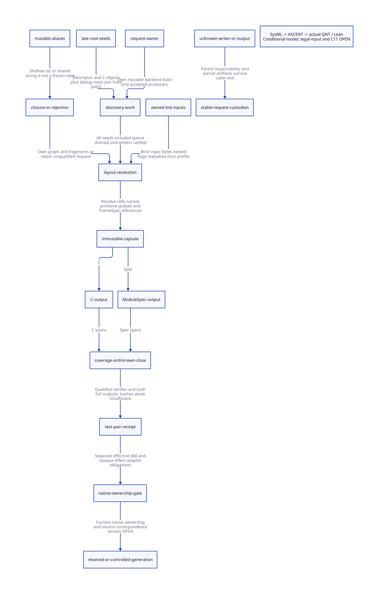

#+TITLE: Sealed Emission View, Writer Closure and C/ModuleSpec Correspondence
#+SETUPFILE: ../../modeling/org/setup.org
#+LANGUAGE: en
#+PROPERTY: header-args :eval never

* RESEARCH Decision and revision of the sealing premise
:PROPERTIES:
:CUSTOM_ID: emission-view-correspondence
:AUTHORITY: GambitEmissionViewCorrespondence
:MAINLINE: modern-generated-C
:STATUS: conditional-model; full-source-and-encoder-refinement-open
:END:
The preceding [[file:module-spec-handle-migration-design.org][ModuleSpec/ModuleHandle study]] proposed a cut after late object
registration and before heap-dump emission. That location is necessary for those
roots but is NOT sufficient to freeze the current implementation: heap-dump
performs index-cell backfill, dump-mod invokes a writing global-resource helper,
and unique-name lookup can allocate and retroactively modify a name cell.

The modern C target is a request-owned discovery/planning stage, a sealed
immutable emission capsule and independent readonly C/ModuleSpec consumers.
Scheme retains semantic identities, phases, source attribution, exceptions and
continuation intent. The C/native ABI is an explicit consumer contract. This is
an architectural separation of mutating planning from serialization, not a claim
that an existing list conversion already freezes state.

No compiler/runtime implementation, native program or performance test is part
of this study. Existing source and historical receipts are preserved. ModuleSpec
and all new capsule/receipt interfaces below remain proposed designs.

* RESEARCH Source-backed writer and alias closure
** Root discovery is more than the first empty queue
[[file:../../../vendor/gambit/gsc/_t-c-1.scm::337][targ-dump]] captures c-intf lists, clears their original vector fields, starts
heap state, uses initial procedures and drains the procedure queue. It THEN uses
the descriptor and maps targ-use-obj over C-object payloads before calling
heap-dump. Recursive object registration may add symbols, constants, subtyped
objects or procedure work. [[file:../../../vendor/gambit/gsc/_t-c-2.scm::26][scan-procedure]] also registers generated debug
metadata and fills shared procedure/code/label records and resource maps.

The closure protocol must include all root seed classes and accepted publishers,
not just observe a transiently empty queue. For a finite admitted object graph,
canonical seen/ordered-table identities prevent repeatedly registering an unchanged
object, but arbitrary mutable input, extension behavior and repeated publication
need their own domain/termination proof. This study does not derive termination
for all compiler extensions from the existing seen table.

*** Reachability qualification for late procedure work
The generic procedure branch of targ-use-obj calls targ-use-prc and can enqueue
new work. However, the current named [[file:../../../vendor/gambit/gsc/_ptree2.scm::2586][add-c-obj caller]] found in the bounded
GSC Scheme inventory passes a tag-list; [[file:../../../vendor/gambit/gsc/_ptree2.scm::2376][check-c-type]] restricts checked tags to
false, a symbol, or a proper list of symbols. The descriptor main is also an
initial procedure root. Therefore a new unscanned procedure introduced by a
standard legal late C tag has NOT been demonstrated. Retain the generic adapter
obligation without reporting an observed legal-input compiler failure.

** List conversion and interface clearing do not own payloads
[[file:../../../vendor/gambit/gsc/_utils.scm::854][queue->list]] returns car of the queue; queue-put! mutates the previous tail.
A previously returned list can therefore see later appends. ordered-table->list
creates an outer list while retaining stored key/result entry pairs. Sorted
table lists likewise retain entries whose cells and resource vectors are mutable.

[[file:../../../vendor/gambit/gsc/_ptree2.scm::2093][c-interface-end]] reverses list spines but retains fragment payloads. The
c-intf setters only replace vector slots. Clearing those slots in targ-dump does
not revoke other references to lists, strings, procedures or C-object values.
Parser/extract-defs paths pass source strings directly to add-c-init/add-c-decl;
the C-string IR constructor similarly retains the original Scheme string.

[[file:../../../vendor/gambit/gsc/_gvm.scm::2825][Debug compaction]] rebuilds/shares container graphs but deliberately returns the
original string from its string branch. Compaction is not a deep-ownership proof.
A capsule requires private owned payloads or a complete stable borrow over every
reachable writer; copying only a root vector/list is insufficient.

** Existing emission mutates layout and resource state
[[file:../../../vendor/gambit/gsc/_t-c-1.scm::1495][Symbol/key/global emission]] assigns cell indices. Cells are pairs mutated by
targ-cell-set!, and targ-code dereferences their current contents. Procedure scan
writes label/entry cells and code vectors. unique-name maintains conflict tables
and can patch the first procedure name when a second name collides. FrameSpec,
OFD counts, label indices, code references and resolved names must share a
consistent completed plan.

[[file:../../../vendor/gambit/gsc/_t-c-1.scm::2191][dump-mod]] invokes targ-use-glo through def-mod-prm-glo for both native sections.
Even an existing entry can have its demander vector rewritten. Mere existence of
the global is not proof of a readonly operation. Emission may call a checked
readonly lookup only after its allocation AND metadata-write requirements have
been satisfied or represented explicitly in the plan.

*** Preserve temporal observations rather than blindly hoisting writes
The linker header/resource classification is emitted BEFORE these later primitive
helper calls. Moving every helper write before the header can change the old
observation if that write was not already idempotent. The admitted domain in which
it is idempotent remains to be proved; no actual mismatch for a legal input is
claimed here.

Represent HeaderResourceClassification and NativePrimitiveBindingRequirements as
separate roles in the immutable plan. Preserve the baseline observation at each
logical emission point, or label and prove an intentional semantic change. A
single immutable capsule can contain multiple role-specific snapshots; it need
not flatten all historical reads into one final flag vector. This removes implicit
temporal coupling while retaining the ability to prove legacy output equivalence.

** Linker inputs are shallow and external inputs need a real snapshot
[[file:../../../vendor/gambit/gsc/_t-c-1.scm::880][targ-link-info]] opens a file, reads its first line and metadata, closes, and
checks limited header/compiler/target shape. [[file:../../../vendor/gambit/gsc/_t-c-1.scm::1086][targ-get-mod]] converts only the
outer metadata list to a vector; nested lists, strings, flags and payloads remain
aliased. append-based flag/resource composition can reuse tails and entries.
OLD/NEW and preload order must remain explicit, including duplicate effect edges.

The managed request should parse an owned artifact byte snapshot, validate its
full schema and bind input/child/profile digests, then construct owned nested
records. A timestamp check or header-version equality is not equivalent. A later
on-disk change may simply create another request generation: it need not invalidate
an already owned old input snapshot. The model's rejectSnapshot means discovered
failure of THIS request's claimed snapshot/proof basis before publication.

[[file:../../../vendor/gambit/gsc/_host.scm::760][The Gambit host branch]] constructs a standard case-preserving keyword-enabled
readtable when opening; other host branches differ. Bind the effective host
implementation and writer/encoding behavior. Do not indiscriminately claim this
branch accepts arbitrary reader callbacks. Input port effects, malformed schemas,
exceptions and unsupported host profiles still require explicit admission rules.

** Scoped complete inventory versus open whole-program closure
The [[file:emission-view-correspondence-matrix.org][derived writer matrix]] enumerates twelve storage/ownership classes: lifecycle
state, recursive object graph, procedure work, index cells, global flags, unique
names, debug sharing, C interface, resource/lowering scratch, linker inputs,
output-private state and profile/ABI inputs. Eight lexical inventories count
actual mutating forms/callers in frozen source snapshots. They include reset and
cleanup writers as well as productive writers.

This is a source-grounded classification of the inspected paths, NOT proof that
arbitrary compiler code, Scheme aliases, FFI, dynamically rebound helpers or
continuations cannot write them. Missing such a closure proof denies capsule
admission and reuse eligibility, not the legality of the Scheme input; a retained
request or independently qualified compilation path remains necessary. A completion of the source audit must map every reachable writer to
one owned planning capability or a rejected/retained route.

* RESEARCH Proposed planning and sealing protocol
** Two planning cuts and one publication cut
#+begin_src text
MutableRequestOwner
  -> capture front + descriptor + C-object + debug roots
  -> close fresh producer admission; settle accepted writers/work
  -> fixed point over all admitted roots
  -> own nested input/fragment graphs and role-specific observations
  -> resolve cell/index/name/layout/native-binding plan
  -> ImmutableEmissionCapsule
  -> readonly C consumer + readonly ModuleSpec consumer
  -> independent coverage verification + known full output closes
  -> paired correspondence receipt
#+end_src
Native fragment bytes may be copied earlier under their own stable lease, but no
final capsule is published before every required planning obligation completes.
An accepted writer may publish after admission closes; its existing credit keeps
the request alive. Unknown writer completion retains the request and roots.
A late layout/global/name write reopens planning and invalidates the candidate
snapshot; it cannot be hidden behind an earlier count or hash.

#+begin_src text
ImmutableEmissionCapsule = {
  RequestId, semanticIntentId, generation, source/profile/ABI/input digests,
  typed resources and canonical identities,
  resolved cell/index/name and FrameSpec/PointId references,
  HeaderResourceClassification, NativePrimitiveBindingRequirements,
  ordered native fragments and linker edges/flags,
  immutable source-map roles, opaque-capability records,
  aliasClosureWitness, producerCloseWitness, layoutClosureWitness
}
#+end_src
Preserve graph sharing/cycles and interned identity where relevant; owned bytes
must not be obtained by silently normalizing source strings, newlines, numeric
bits or filenames. Mutable scratch such as output line/column counters and the
output port belongs to each consumer, not the shared semantic capsule. A private
builder may be memory-expensive; a verified stable borrow or shared immutable
subgraph is an alternative, not a presumed zero-copy guarantee.

Independent sessions require private backend, target/profile, primitive and input
state as well as this capsule. Freezing the final view alone does not make the
current global scanner/optimizer safe for concurrent gxc sessions.

** C initialization fragments and opaque native code
Record c-declare/c-initialize and generated out-of-line C fragments in exact order,
including append/cell-derived code and their provenance. Capturing their exact
bytes/IR can support text correspondence without inferring what arbitrary C does
at runtime. Includes, compiler conditionals, registration, dynamic loading,
converter/destructor dependencies and native callbacks require separate effective
ABI/dependency/effect contracts. A literal digest cannot supply those contracts.

* RESEARCH Precisely when a correspondence receipt may issue
** Distinguish the three evidence levels
| Receipt | Issuance requirements | What it does not establish |
|---------+-----------------------+----------------------------|
| FrozenViewReceipt | All root seeds and producers closed; complete writer/alias ownership; nested inputs owned; all role-specific layout resolved | Correctness of either serializer |
| C/ModuleSpec text-pair receipt | Same frozen generation; constructor/chunk witness; exact bytes/profile/order; complete spans; both outputs and witness fully closed; verifier qualified | Expanded C ABI layout, successful native compilation or arbitrary native effects |
| NativeStructure/Ownership receipt | Selected gambit.h macro/profile expansion matches every typed resource/entry/FrameSpec; actual placement/dependencies and opaque adapters qualified; runtime owners enrolled | Global unload without all VM/frame/FFI/maintenance detach and loader outcome evidence |

An opaque fragment may appear in a correct text-pair receipt as an explicitly
opaque ordered region. It cannot be promoted to native ownership merely because
the text hash matches. Conversely, an early-unload qualification gap need not
invalidate a byte-faithful record of generated text.

** Required emission correspondence relation
#+begin_src text
For each constructor event e in the frozen ordered plan:
  CProjection(e, effectiveEncoder) yields exactly its recorded byte span;
  SpecProjection(e) records its typed identity, role and dependencies;
  span payload / identity / role / order agree under the constructor contract.
Every emitted region is covered exactly as specified (including opaque regions).
Every required spec/resource/reference maps to its constructor or explicit metadata role.
Counts, offsets, names, label/OFD/layout and references agree across those mappings.
All output digests refer to known-complete bytes from the same request generation.
#+end_src
A formatting/source-map event need not be a native member, but must still be
classified in coverage. A Spec-only metadata role must be explicit rather than
mistaken for missing C bytes. Raw opaque C may embed directives or tokens that
interact with neighboring regions; native interpretation is not proved by a
text span boundary.

The verifier must be independent of the mere assertion that both outputs used the
same view. Possible evidence includes checked typed-emitter/template proofs plus
an independent span/constructor replay checker. The actual current C encoder and
future ModuleSpec schema have not been proved by this study. The abstract
verifyCoverage action requires an externally qualified verifier; it is not a
certificate manufactured from matching counters.

Legacy line-length helpers count Scheme characters. Native byte spans must be
measured after the selected encoding, or justified by an encoding proof; character
counts cannot be treated as byte offsets. Bind host escaping, prefix/options,
source maps and conditional ABI definitions. Equal counts/lengths alone admit
same-length, different-byte counterexamples.

** Unknown output and publication responsibility
Legacy start-dump opens the target path and end-dump closes one output; these do
not provide paired artifact publication. The proposed service owns provisional
C, Spec and witness artifacts plus a stable operation record. It publishes one
pair manifest only after all known completion and correspondence checks succeed.
Known failure retains diagnostic/provisional custody as required; unknown close
or delivery retains the operation for reconciliation, not blind semantic rerun.
A lost reply retrieves the same operation, using the preceding service contract.

Before receipt issuance, discovered snapshot/coverage failure quarantines the
candidate. After external consumption, an uncontrolled raw mutation cannot be
made harmless by retroactive revocation. Exclusion of that writer and reader
lease lifetime is a necessary source obligation; the model does not simulate
such a forbidden mutation after issuance as if it were safe.

** C11 and GC refinement obligations
Use one stable authority for producer reservation versus close. Completion of an
accepted writer/child publishes work before returning its last credit. Keep roots
scannable across GC-capable copying and reentry; moving-GC updates cannot leave
frozen payload references stale. Unknown completion retains parent responsibility.

Publish the complete immutable capsule with release/acquire or a proven mutex
handoff, and keep it pinned through both consumers and their receipt observers.
No registry/compiler-state lock spans Scheme callbacks, allocation/GC or waiting.
Native unsafe aliases and reentrant/multi-shot continuations require explicit
ownership and semantic-intent mapping. Sequential QNT transitions do not prove
C11 weak-memory, root scanning or independent session correctness.

* RESEARCH Actual formal and evidence chain
[[file:models/sysml/emission-view-correspondence.sysml][Native SysML]] owns all source/inventory/writer rows, migration seams, receipts,
benefit conditions and model routing. [[file:../../modeling/tools/emission-view-correspondence-study.py][Python orchestration]] queries that native
model and drives the [[file:../../modeling/ascent/emission-view-correspondence.rules.scm][actual ASCENT DSL]],
[[file:models/quint/emission_view_correspondence.qnt][QNT histories]], restricted [[file:models/lean/EmissionViewAst.lean][typed-IR extraction]] and
[[file:models/lean/EmissionView.lean][Lean induction]]. Source producer AND consumer anchors, actual action names,
checked lemmas and digest/scope identities must agree for each migration seam.
Missing observations or stale/foreign receipts block the synthetic admission lane.

The QNT model has 28 actions, twelve positive histories and eight deliberately
corrupted negative histories. It models one request generation with up to two
outstanding work items and one admitted writer, then one paired publication.
Work/writer counters are representative aggregates; complete source charging,
finite closure, no-overflow/ABA, deep alias ownership and verifier qualification
remain explicit external premises. Safety does not establish liveness or all
parallel compiler sessions.

Lean proves initial/all-step/reachable safety, same-generation receipt conditions,
coverage/full-close requirements, native qualification separation and retention
of unknown writer credit. [[file:models/lean/EmissionViewComposition.lean][Composition]] proves exact ordered replay of symbolic
chunk payloads, an equal-count/different-byte counterexample and the qualifier
premise of the preceding ModuleHandle model. It does not identify those symbolic
chunks with real legacy C output. That source/encoder bridge remains open.

| Obligation | Established evidence | Missing proof |
|------------+----------------------+---------------|
| Actual post-drain mutation paths | Late use-obj, layout cells, primitive global helper, unique names | Full qualified legal-input idempotence/fixed-point/alias closure |
| Real shallow aliases | Queue spine, ordered entry, C strings, debug shared strings, linker nested data | All writers/FFI/reentrant escape exclusion or owned copy refinement |
| Temporal header/native roles | Source ordering and mutable resource helper | Exact legacy observation preservation for admitted inputs |
| Same frozen generation | Extracted all-step Lean induction and QNT controls | Actual producer/consumer publication and GC refinement |
| Exact ordered symbolic chunks | Lean replay theorem and length counterexample | Actual encoder/template/escaping/source-map span fidelity |
| Text/native distinction | Opaque text receipt model does not authorize native permit | Effective C ABI and complete native effect/placement adapters |
| Actual receipt admission | ASCENT checks models, anchors and seams | EV-source, EV-platform and EV-emission remain absent |

Retained counterexamples: first queue drain omits late roots; an accepted writer
is ignored; a shallow mutable alias is labeled frozen; layout cells remain
unresolved; C and Spec use different generations; coverage is presumed from equal
counts; output truncation is ignored; and an opaque text receipt is promoted to
native ownership without qualification. These are model controls, not reports
of observed native compiler failures.

* RESEARCH Net benefit and retirement gates
The [[file:emission-view-correspondence-matrix.org][SysML-derived matrix]] includes writer costs and seven producer/consumer cuts.
For R distinct reachable resources, E retained ordered edges and B copied fragment
bytes, indexed closure/materialization needs conditional O(R+E+B) work/storage,
plus source/identity maps. A visited index avoids repeated ownership discovery;
required repeated initialization effects remain. Naive list lookup, repeated
flattening, graph cycles and encoded payload expansion can exceed these bounds.

With discovery D, layout L, capsule ownership/copy K, C emission C, Spec emission
S and verification V, the proposed shared path costs D+L+K+C+S+V. Against two
hypothetical consumers each reconstructing D+L, sharing saves D+L only if that
exceeds K+V and additional coordination. This is an explicit alternative-design
comparison; the current compiler does not already run a second ModuleSpec pass.
A new manifest may increase work relative to today's C-only baseline.

| Mechanism | Potential eliminated work | Mandatory new cost / countercondition |
|-----------+---------------------------+---------------------------------------|
| Explicit shared capsule | Independent repeated closure/layout reconstruction | Owned graph/fragments and provenance; a tiny capsule may not amortize cost |
| Readonly consumers | Global writer serialization during C/Spec output | Private output cursors and immutable lifetime; scanner sessions still need isolation |
| Cached producer result | Repeated GSC emission for identical complete inputs | Input/profile validation and storage; unknown input capabilities deny reuse |
| Resolved role-specific plan | Emission backfill and ad hoc consumer rediscovery | Source-equivalent role snapshots; blindly hoisting helper writes may change output |
| Paired receipt | False reuse after partial output or mismatched generations | Span/schema verification and publication coordination; hash alone cannot substitute |

Retirement sequence: own backend request and input roots; close late producer
classes; complete discovery; normalize cells/names and temporal role observations;
qualify readonly access; implement both consumer correspondences; qualify paired
publication; compose native ABI/ownership and runtime lifetime separately. Only
then may the old global tables/queue spines, mutable emission cells and writing
emission helpers cease to be the authority on the migrated route. Formatting
state remains private to each output. No current compiler/runtime path retires
from this research alone, and no Zig advantage or speedup is established.

Research receipts: [[file:../../../evidence/research/emission-view-correspondence/checks.json][checks]],
[[file:../../../evidence/research/emission-view-correspondence/input.json][identities and logs]],
[[file:../../../evidence/research/emission-view-correspondence/source-witnesses.json][immutable source witnesses]],
.
