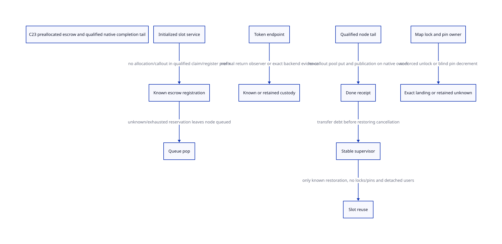

#+TITLE: C23 pre-pop escrow registration, qualified completion tails and resolver landing custody
#+SETUPFILE: ../../modeling/org/setup.org
#+LANGUAGE: en
#+PROPERTY: header-args :eval never
#+STARTUP: overview

* RESEARCH Decision and evidence boundary
:PROPERTIES:
:AUTHORITY: GambitEscrowCriticalTail
:STATUS: conditional model; no native escrow/receipt/tail qualification
:CUSTOM_ID: escrow-critical-tail
:END:

Refine [[file:nr-inflight-handoff-design.org][NR in-flight handoff]] by making allocation-free registration a bounded
service contract rather than assuming a guard can always be allocated before pop.
Separate a callout-capable cleanup body from a qualified short completion tail.
POSIX cancellation masking alone does not exclude Scheme longjmp, signals,
foreign exceptions or reentry. Unknown map/pin outcomes retain stable owner debt.

[[file:models/sysml/escrow-critical-tail.sysml][Native SysML]] owns source, consumer, issuer, obligation, action/lemma routes,
gain and edge records. [[file:escrow-critical-tail-matrix.org][Org matrix]] and  are projections. [[file:../../../evidence/research/future-frame-commit/escrow-critical-tail/][Evidence]] binds current
source and formal inputs. C23 is the design baseline; no runtime source edit,
native compiler/preprocessor, native test or performance measurement occurs here.

* What current source actually supplies
TclNRAddCallback invokes TCLNR_ALLOC before filling and linking its node. That
may use a pool, a refill, a debug object path or ckalloc. Existing callback-node
allocation therefore is not a demonstrated nonallocating escrow registration
service. TclNRRunCallbacks pops a node into a C local then calls its proc; there
is no persistent DispatchEscrow receipt at that cut.

ExprObjCallback and RewindCoroutineCallback supply concrete token-specific normal
endpoints: Restore or Discard returns to the callback, then the generic dispatcher
releases the node. The observer of that normal return could sign a token receipt,
and the dispatcher/native allocator owner could sign the later node receipt.
Neither function currently publishes an OperationId-backed durable completion
record. A function return is source evidence for an endpoint, not proof that
publication can survive an escape immediately afterward.

Gambit's resize source-root path supplies an actual precedent for stable state
and cancellation sequencing: reserve WRITING source state, disable POSIX
cancellation, publish a stable serial/root request, use BEGIN_TRY around the
collective, consume or retain the source state, then restore cancellation. It is
not the new NR registry, and it does not prove that the earlier reservation-to-mask
window is universally safe under asynchronous cancellation. The proposed entry
requires an already admitted NativeThreadDomain before mask/slot acquisition.
See the existing [[file:guard-thread-admission-design.org][thread-admission study]]; do not duplicate its roots/TLS enrollment.

In the setjmp branch, Gambit THROW uses LONGJMP1 to the current catcher. In the
plain-C cleanup branch, BEGIN/END_CLEANUP are ordinary lexical code, not automatic
finalization for arbitrary nonlocal exit. C23 does not turn those blocks into
unwind guards. No C++ destructor solution is proposed for this modern-C mainline.

* Nonallocating pre-pop service
** Capacity and stable slot identity
Create a service-owned, preinitialized slot array or equivalent bounded owner
freelist before native dispatch admission. It outlives callback nodes, C frames,
continuation replay and unresolved outcomes. Each slot binds service/owner identity,
slot index/incarnation, InvocationId, node/snapshot/result identity, native thread,
root/source holds, OperationId and publication/cleanup phase.

For P slots of concrete descriptor size S, reserved descriptor bytes are P*S
before alignment/service/allocator overhead. A conservative capacity condition is
P >= A + R + U, where A is known active slots, R reserved/preparing slots and U
retained unknown slots, counted as disjoint ownership classes. No maximum legal
Scheme/Tcl nesting or U bound follows from current source. Unknown slots can
exhaust the service indefinitely. A model with one slot is a bounded witness,
not proof one slot suffices or all histories fit finite P.

Slot reuse requires completion and observer/source detachment; a slot generation
must not wrap into an old identity. Exact size, P and target counter widths remain
design/profile inputs rather than fabricated benchmark numbers.

** Claim, initialize, publish, pop
1. The outer source/native-thread authority already exists; queued node and its
   payload/code remain owned. No TLS initialization or root allocation is hidden
   inside the registration promise.
2. Under a qualified cancel/nonlocal-exit policy, claim a ready slot through its
   existing owner list/index. No malloc, Tcl allocation, Scheme GC, logging, hook,
   arbitrary destructor, lazy map growth or callout is allowed in this prefix.
3. Initialize exact identities and attach the record to a stable owner-visible
   registration index; release-publish the valid record. Any cross-thread observer
   uses acquire and the matching lifetime authority. Owner-private indexing need
   not impose a redundant global atomic counter.
4. Only known registration permits dequeue. If the publication outcome is unknown,
   keep the claimed slot and the queued source responsibility; query the same
   registration operation. Do not refund or pop on the assumption it never happened.
5. Transfer the queue duty to the independently registered in-flight record before
   invoking a callout. Never depend on C callbackPtr surviving abandonment.

A known unpublished preparation failure can refund a private slot. A published or
unknown record cannot be refunded as private. Source roots cannot be dropped
merely because a native slot exists: GC slot registration/relocation and native
metadata lifetime are separate contracts from the earlier root studies.

The no-allocation claim applies to admitted claim/register/pop, not initial pool
creation, growth, TLS setup or the entire callback. A bounded owner freelist can
make selection a fixed sequence of stores; a growing hash table cannot inherit
that property just by being written in C23.

** Exhaustion is an admission result, not a hidden wait
If no slot is ready, leave the node queued and report unavailable/deferred/refused
through an admitted service boundary. Waiting inside nested dispatch for an older
slot held by that same callback ancestry can deadlock. Returning early from raw
TclNRRunCallbacks while preserving pending callbacks is not silently equivalent
to its original interface. A managed scheduler/admission adapter must define that
result, preflight capacity before native entry, or qualify an outside-prefix growth
path while queued payload remains protected. Refusal cannot call an unauthorized
Scheme error translator. Unbounded native nesting does not acquire a free bound
because the critical prefix is nonallocating.

* True receipt issuers and the cleanup tail
| Evidence | Candidate actual observation/issuer | Required qualification |
|----------+------------------------------------+------------------------|
| registration known | new stable slot service before TOP_CB update | service index/source/owner readiness; known publication |
| token consumed | expression or rewind callback observes Restore/Discard return | exact snapshot/attempt and rooted/native lifetime; normal return only |
| node released | dispatcher observes selected TCLNR_FREE completion on native owner | no later data access; actual pool/debug/free target and effects |
| done published | independent record owner after prior endpoints | non-abandoning publication or exact-operation reconciliation |
| map/pin returned | resolver native owner landing | operation phase and outstanding pin credit reconciled before releasing lease |
| cancellation restored | stable supervisor/native-thread authority | all critical locks/pins handed off or settled before restoration |

These are candidate source cutpoints, not existing installed receipt APIs. Token
and node targets are different signers. A returned code or cleared pointer does
not identify an exact attempt. The current raw Tcl APIs cannot be assumed to
provide recoverable same-operation backend receipts after arbitrary abandonment.

** Cleanup body can call out
Restore mutates interpreter fields, changes object state and invokes Discard.
Discard decrements multiple referenced objects then frees its own state. The
object-decrement slow path may invoke type-specific cleanup; allocator/debug
providers need independent effects classification. The whole consumer is not a
bounded no-callout segment. Cancellation disable does not make such a path
nonreentrant, GC-free or immune to Scheme longjmp.

Unknown token consumption retains opaque OperationId and dependent native/root
custody. Never rerun Restore/Discard to discover whether it already consumed the
token. The physical-effect/receipt distinction from the previous model remains.
The new knownTokenEndpoint action denotes authoritative evidence, not a newly
available query on an already-freed Tcl_InterpState.

** Narrow node completion candidate
In the selected thread-cache put branch, object storage writes the node's free
link, updates the cache head/count, then optional TclIncrObjsFreed statistics.
That is a candidate short tail only when all guards and the complete selected
expansion are qualified. Empty/full-cache conditions call TclThreadFreeObj instead;
other profiles use a global mutex, PURIFY ckfree or debug object teardown. The
captured NRE_USE_SMALL_ALLOC default alone does not identify the loaded expansion.
Tcl's small allocator explicitly forbids crossing native thread boundaries.

A qualified tail could fuse its bounded pool put and release-publication of the
node receipt, followed by done publication, with no allocating/callout step between
irreversible effect and stable status. Qualification must exclude nonlocal exits,
unsupported signal jumps, hooks and restored cancellation during that interval.
No native compiler/control-flow proof has been performed. The QNT fused action
is admitted only after tailQualified; it is not a general transaction around free.

For unqualified release, retain a node-unknown state until authoritative backend
completion exists. An owner flag prevents duplicate attempts but cannot tell
whether an abandoned pool put already made the address reusable. Do not dereference
or repeat-return that node. Merely moving its metadata to a worker does not move
its original allocator/native-thread obligations.

* Restore cancellation after stable handoff
The saved cancellation state may itself be DISABLE in a nested activation. A
known exit restores that exact saved state; it must not unconditionally enable
cancellation. The model's cancel codes describe protocol phases, not literal
POSIX state values.

Before invoking state restoration, settle native map locks/pins under this
conservative profile and transfer remaining completion/return debt into an
independent supervisor. Restoration can fail or not return; code after the call
cannot be the first custodian. The slot remains registered through an unknown
restoration, so it cannot be silently reused by a later activation. Exact native
landing/termination evidence would be needed to release it; the model provides
only a trusted knownRestoreReturn transition, not a generic recovery algorithm.
A stable guard surviving does not allow returning to a dead C activation.

* Resolver lock and pin-return custody
Resolver operations also borrow a preexisting stable operation record before
acquiring the map lock. A native operation tracks lock identity/owner, selected
mapping generation, candidate validation, whether pin credit was published,
last record access and pin-return progress. Never allocate this record only after
a possibly abandoning lock call succeeds.

- Escape before pin publication retains the mapping operation and source authority.
- Escape while holding the map lock retains the lock-owned phase. Missing ACK is
  not permission for another worker to unlock it or reuse the mapping.
- Escape with a known published pin retains that lease even if query code vanished.
- If decrement/return outcome is unknown, retain a pin-return debt. It is not a
  physical refcount of two, nor proof the decrement did not happen. Never decrement
  again until exact landing/reconciliation identifies the original operation.
- An exact owner landing may restore known lock ownership, or settle a pin-return
  operation when that specific effect is known. A generic catcher entry does not
  discharge arbitrary pin debt or repair partial mapping writes.

Do not keep the map lock while waiting for another reader that needs it to return
its pin. Lookup/close/reuse ordering remains the prior same-authority protocol.
Unknown native mutex acquisition/unlock also requires its own phase/receipt; the
new model begins its lock-held state only after known acquire, so it does not
prove acquisition failure or a partially applied unlock was recovered.

A robust mutex/error return can expose an inconsistent owner; it does not prove
slot initialization, pin census or mapping identity is correct. Native repair
must validate the stable ledger and restore invariants before normal unlock.
If that cannot be established, retain/quarantine the resolver and dependent VM
resources rather than manufacture zero. Root/GC participation must still avoid
blocking a collector on a lease whose owner is needed for that collector.

* C23 obligations and real reuse
C23 supplies explicit atomic storage/order vocabulary and checked arithmetic; it
supplies neither nonallocating TLS initialization nor automatic cleanup across
longjmp. Registration publication, query pin acquisition and last-use release
need actual matching acquire/release/mutex edges. Alignment/types and generation
bounds must be valid objects, not casts of old plain storage. Effective POSIX
cancellation/mutex semantics and selected Tcl macro branches remain platform
qualification obligations.

Reuse the earlier NativeThreadDomain/NativeReturnDomain stable owner and roots,
existing normal SFUN landing, callback node/token payload and selected Tcl allocator.
The new slot service and typed receipt adapters are genuinely additional support.
No current source site is claimed to implement all their responsibilities.

* Actual models, counterexamples and limits
[[file:models/quint/escrow_critical_tail.qnt][QNT]] has twelve fields and twenty-eight actions. One preallocated slot is
conserved among free, claimed and another external/retained owner. Unknown
registration leaves queue/source responsibility intact. Known registration precedes
pop. Token/node unknown outcomes remain separate; only a qualified node tail can
fuse release and receipt. Resolver lock states distinguish known versus unknown
ownership; pin=2 means retained unknown-return debt. A normal owner landing cannot
clear that debt without the specific pin-return receipt.

Before cancellation restoration, supervisor handoff and zero lock/pin debt are
required. Unknown restore retains the slot and registration. The retirement action
is only a conservative slot-release boundary; all independent result/raw observer
and sender graces from prior studies remain additional premises. The model does
not implement cancellation, object destruction, GC relocation or a resolver map.

[[file:models/lean/EscrowCriticalTailAst.lean][Typed QNT IR]] supplies the AST used by [[file:models/lean/EscrowCriticalTail.lean][Lean]]. Per-action preservation and reachable
induction establish abstract safety. Unknown pin not being returned and unknown
restoration retaining the slot are explicit lemmas. The guarded join uses the
actual prior NrInflightHandoffAst retirement transition under separate done and
remaining-retirement mirrors. This is not a full product/native execution proof.

Seven histories cover known tail, exhausted pool, unknown registration/token,
unknown pin return, restoration that has not returned, and exact pin-return
landing. Thirteen reachable negative controls reject missing capacity/registration,
popping/refunding unknown registration, unqualified fused release, replay of
unknown pin return, a generic owner landing that lacks the pin-return receipt, speculative unlock, restoring with outstanding lock/pin,
unmasking before supervisor handoff and slot reuse after unknown restore.
ASCENT binds source hashes, actual compiled action/lemma routes, five consumer
classes and five issuers; it rejects 'cancel disable excludes longjmp' and
'unknown pin means zero'. Current native gaps block admission. Synthetic full
receipts qualify only the wiring of this research chain.

* Benefit / added-cost and retirement gates
An admitted nonallocating claim/register/pop needs zero allocator calls in that
prefix; this remains a theoretical mechanism pending native effect closure.
Preinitialized metadata costs P*S bytes plus service overhead. For arbitrary
nesting and unknown retention, finite P has no unconditional sufficiency proof.
Exhaustion needs explicit admission rather than a hidden self-dependent wait.

The qualified narrow tail may remove a separate post-release reconciliation step
on selected normal paths, but preserving a stable record and cancellation/owner
policy adds work. Token cleanup remains a full effectful operation. Resolver
common authority can reuse its guard/service rather than invent another lifetime
system, yet unknown locks/pins can retain resources indefinitely. No byte-layout,
latency, throughput or human-days estimate is fabricated.

Retire raw managed dispatch only after real pre-pop issuer and source-root coverage
exist. Retire separate node receipt publication only after a complete selected
no-abandon tail is qualified, never by macro name. Retire generic unknown-pin
cleanup only after operation-specific native landing proves balance. All are
future runtime changes; zero paths retire from these formal checks alone.

Feeley's retained [[file:../../../evidence/research/source-references/feeley-sfp/8bb2fae8ae4b54d3a86206596f90e9cf73da39846af0f39244a476074cf81ed4.txt][continuations/C paper]] grounds persistent store/native activation
and Scheme control separation. It does not supply the new escrow/receipt service;
source facts, bounded model and explicit native premises are kept distinct here.
