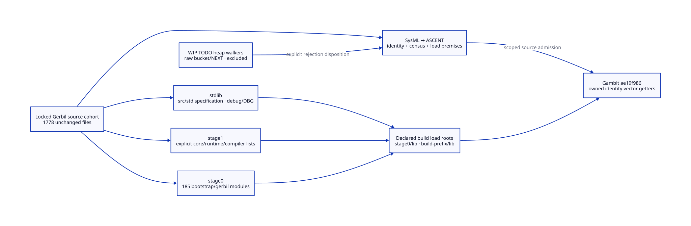

#+TITLE: External private registry-layout admission
#+SETUPFILE: ../../modeling/org/setup.org
#+LANGUAGE: en
#+PROPERTY: header-args :eval never :exports code
#+COLUMNS: %42ITEM(Responsibility) %AUDIT_NUMBER(Audit) %STATUS(State)

* Source-qualified 3.4.3 External reader boundary :roots:admission:audit:
:PROPERTIES:
:CUSTOM_ID: ROOT-VIEWS-EXTERNAL
:AUDIT_NUMBER: 3.4.3
:PARENT_ITEM: 3.4 / ROOT-VIEWS
:BASE: ae19f98624ad19820040e5afbe08219206bfd0a1
:AUTHORITY: GambitExternalViews
:SOURCE: models/sysml/external-views.sysml
:STATUS: SOURCE_QUALIFIED_DEFAULT_BUILD_ONLY
:END:

** Real callers and finite source identity

The retained Gerbil cohort has1778 regular source files, all byte-identical to
the managed input snapshot, with no source symlinks. Its canonical content/mode
digest is =5ee4fdfd8ee4407552030c6c7e5db4c8d9d9aedc2764d39d0348a3848dec1c3a=.
This is an explicit source-content pin; no Git revision is guessed from a directory
name or from the Gambit revision stored in old compiler configuration. The
[[file:../../../evidence/research/retained/modern-c/external-views/source-cohort.json][full source manifest]] and [[file:../../../evidence/research/retained/modern-c/external-views/receipt.json][source/native receipt]] retain actual files, excerpts and
typed admission observations. No additional Gerbil checkout/build is created.

#+NAME: external-reader-chain
| Actual source producer/consumer | Observed root or operation | Disposition |
|--------------------------------+----------------------------+-------------|
| Root build.sh → src/build.sh | Enters src, then explicit prepare/stage0/stage1/stdlib targets | Build-source authority, not arbitrary user imports |
| build_stage0 → build/build0.scm | Copies only bootstrap/gerbil; recursive SCM list |185 source files exactly match185 recorded module keys |
| build/build1.ss | Explicit core/runtime/expander/compiler/base lists | No WIP/TODO heap source or raw getter reader |
| std/build.ss → build-std.ss → build-spec.ss | Build root is src/std; spec contains debug/DBG | No debug/heap entry or installed src/std/debug/heap.ss |
| src/build.sh load setup | GERBIL_LOADPATH assigned to build-prefix/lib | Incoming loadpath is not silently treated as an allowed extra source root |
| runtime/init.ss in build mode | Uses build-prefix lib instead of adding user lib; appends declared GERBIL_LOADPATH | Stage0/build-prefix library mapping is part of admission premise |
| runtime/loader.ss | Resolves requested module under configured load-path roots | A custom root invalidates this source receipt; no runtime sandbox is added |
| WIP TODO debug/heap.ss | Two walk-interned functions call raw getters then intrusive field2 NEXT | Explicitly excluded from this build cohort's selected/installed sources; not migrated or executed unsafely |

The complete source search finds only these two raw reader functions in one
excluded file. No active source contains a raw getter/NEXT consumer. Other
compiler symbol tables are Gerbil's own hash tables, not these Gambit registry
buckets. Gambit's provider source is independently qualified by its selected
native tree; its private implementation is not counted as an external reader.

** Exact closure and invalidation contract

This closes ROOT-VIEWS only for the C-target owned getters/direct consumers and
this locked/default-build source boundary. It does not prove semantic reachability
for arbitrary eval, custom initialization, dynamically composed imports or every
Gerbil execution profile. Full Gerbil build/correctness remains SMP family11 OPEN.
Unknown roots, new source, installed aliases or extensions reopen admission; they
must receive a new complete census and either migrate to owned vectors or remain
unadmitted. The old TODO code is not made safe merely by documenting it.

ASCENT requires matching source digest, complete source and load premises, and a
disposition for every known reader. It rejects stale source, an omitted reader
disposition, activating an excluded TODO reader, an unknown load root, and missing
source/load closure. These six real rejection controls run from native SysML
fields and actual source facts, not a manually declared green filename link.

The native probe on the current source-qualified runtime checks both getter
vectors, canonical element types, separate mutable identities, ordinary GC
retention and mutation isolation. A count/bucket-layout precondition is false:
element0 is a canonical symbol/keyword, not a fixnum count. No unsafe legacy NEXT
walk is executed. The earlier ae19f986322-action PBT and actual predecessor
getter/fold13→1 controls remain the implementation evidence; no whole Gerbil
execution or new formal schedule proof is inferred from this probe.

** Benefit and cost matrix :matrix:

| Responsibility | Established benefit | Cost / limitation |
|----------------+---------------------+-------------------|
| External reader disposition | Retires the last known private bucket-layout admission ambiguity for this source/default-build profile |1778-file hash/census and build/load mapping must be refreshed when inputs change |
| Getter interface | Keeps one owned-vector representation; no legacy bucket escape or compatibility branch | Existing N-reference capture/retention/GC costs remain |
| Runtime support | Zero new runtime code, locks, fields, buffers or manual roots | No throughput or physical-peak improvement claimed |
| Source assurance | Actual source/module counts, native API probe and six invalidation controls | Conditional source admission, not a semantic theorem about arbitrary eval |
| Programme | ROOTS becomes4 scoped-closed groups/2 remaining |3.5 writer/borrow coverage and3.6 total source/lifetime union still block independent worker composition |

QNT retains task/lease histories; Lean retains distinct conditional cell/census/
address laws. Neither is rewritten or rerun for this static source admission.
The LLM reviews source premises; native SysML/ASCENT and actual runtime evidence
remain the authorities for their separate claims.

#+CAPTION: Default build/load selection excludes the unported private heap walkers.

