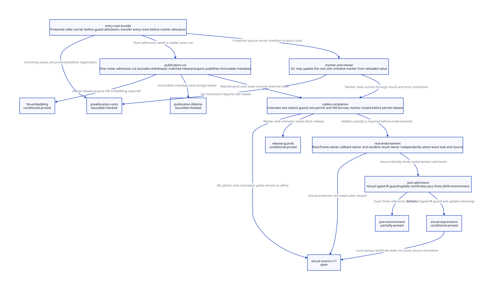

#+TITLE: FFI Scope Admission, Entry Root Bundles and Stable Completion
#+SETUPFILE: ../../modeling/org/setup.org
#+LANGUAGE: en
#+PROPERTY: header-args :eval never
#+OPTIONS: toc:3 num:t

* RESEARCH Architecture and evidence scope
:PROPERTIES:
:CUSTOM_ID: ffi-scope-root-admission
:ARCHITECTURE_SOURCE: models/sysml/ffi-scope-root-admission.sysml
:EVIDENCE: ../../../evidence/research/ffi-scope-root-admission/checks.json
:STATUS: conditional-models; actual-integration-and-C11-refinement-open
:END:

Modern generated C remains the required design. This study specifies how existing
write_authority authority could join actual FFI entries, moving Scheme roots and
resident completion records. It adds formal models and research documents only.
It neither adds FFI hooks nor claims current write_authority already provides roots.
[[file:models/sysml/ffi-scope-root-admission.sysml][SysML]] owns contracts, accountable components,
proof dependencies, concrete endorsement sources and gain rows. Python invokes the
native tool, projects [[file:ffi-scope-root-admission-matrix.org][Org matrix]] and
, and feeds the queried evidence requirements to ASCENT.
The [[file:pin-roster-detachment-design.org][predecessor pin/detachment study]] remains a frozen dependency.

* Actual entry and conversion chain
:PROPERTIES:
:CUSTOM_ID: ffi-scope-real-entry
:END:

** Generated native-to-Scheme entry

[[file:../../../vendor/gambit/gsc/_ptree2.scm][gsc/_ptree2.scm]] c-function chooses a static MLBL procedure
for c-defined functions and FAL for a dynamic closure. c-make-function emits
BEGIN_SFUN[_VOID/_SCMOBJ], parameter conversions, SFUN_CALL and result/error
conversions. [[file:../../../vendor/gambit/include/gambit.h.in][gambit.h.in]] BEGIN_SFUN invokes make_sfun_stack_marker;
SFUN_ARG later writes each converted argument to PSSTK. The compiler therefore
knows the entry parameter kinds, ordering, conversion functions and cleanup shape.
It is the owner of a generated EntryRootSpec, not Zig or a handwritten per-binding
array of guessed live values.

The source-level order matters: marker allocation precedes parameter conversion
and SFUN_ARG materialization. Protecting only proc_or_false is not a complete
entry-root contract. Direct scheme-object parameters, dynamic closure payload and
any Scheme-bearing conversion state must already have updateable roots. The
complete argument converter inventory and actual generated binaries are not
established by this source-only study; a potential window is not a claimed
reproduced failure.

** Tcl is a concrete caller

[[file:../../../vendor/gambit/examples/tcltk/tcltk.scm][examples/tcltk/tcltk.scm]] scheme_call_cmd reads data_rc(client_data)
and calls tcltk_call. The c-define entry accepts (scheme-object
nonnull-char-string-list). Its Scheme body reads the vector's procedure and applies
it. Thus the vector is a concrete pre-existing Scheme argument, while argv
conversion may construct Scheme strings/lists. The vector comments explicitly
explain indirection because the procedure can move. A copied C local does not
become updateable merely because another root retains the original object.

scheme_delete_cmd releases the Scheme object and RC header. The create path
allocates RC storage, allocates a Scheme vector and installs it as data_rc before
Tcl_CreateCommand. The result path gives Tcl bytes plus a release_string function
pointer. None of these source facts proves all in-flight callbacks, nested calls,
result destructor invocations or failed creation ownership have drained.

** Direct run, dynamic closure and reverse FFI

setup.c ___run independently creates a marker for thunk, calls ___call and kills
the marker on the direct return path. ___call installs the marker into a return
frame, sets SELF, and executes host code or trampoline; mismatching unwind
propagates to an outer catcher. _kernel.scm return_to_c checks processor identity
and marker validity, diagnoses repeated C return and writes register state before
throwing UNWIND_C_STACK. Those checks do not grant root retirement or a new
write_authority generation.

make_sfun_stack_marker in c_intf.c explicitly records a TODO for moving
proc_or_false during allocation. For FAL, it obtains the procedure through
c_closure_self/data_rc after allocation. Both alternatives need a protected
preallocation source. Root and native closure borrows must be established before
that fallible work; an entry code/module lease must already protect the code
executing admission itself. Untracked raw host pointers cannot be made revocable
by checking a tag after dereference.

Reverse Scheme-to-C CFUN writes GVM state with W_ALL and reloads on exit. CFUN
cleanup variants use TRY, whereas C-only BEGIN_CLEANUP has an explicit epilogue,
not a general longjmp destructor. Native scope admission can share the same
resident service, but CFUN roots/results and blocking participation need their own
EntryRootSpec direction and acceptance evidence; this study does not claim a
complete CFUN converter audit.

* Proposed modern C entry ABI
:PROPERTIES:
:CUSTOM_ID: ffi-scope-entry-abi
:END:

| Artifact / owner | Required fields and responsibility | Must not substitute for |
|------------------+------------------------------------+-------------------------|
| EntryRootSpec / Scheme generator | parameter root offsets/kinds, proc source, converter temporaries, result roots, FrameSpec/PointId, cleanup/effect manifest | a runtime root registration receipt |
| IngressRootCarrier / caller root owner | protected source slots and collector epoch before raw value load; retain source until target root publication | retroactive protection of an already stale SCMOBJ |
| StableEntryGuard / resident coordinator | VM incarnation, activation/tag, parent guard, root-bundle ID, permit roles, module/code lease, marker state, outcome custody | C automatic locals surviving longjmp |
| RootBundle / VM root-domain owner | updateable Scheme slots, nonzero processor membership, collector epoch and scan lease | a write_authority word containing no Scheme values |
| NativeScopePermit / native authority | exact prepared candidate, actor, spent/live roles and last-use release | physical thread stop, GC root, or VM free authority |
| EntryCompletion / resident release owner | exact task/tag, settled result/error and cleanup states, delivery replay identity | permission to run Scheme effects again |

Before the guard, an IngressRootCarrier must already protect all supplied Scheme
values. A VM storage borrow does not prevent their relocation. Tcl must borrow the
RC owner and enter the collector/root handshake before reading data_rc; direct
___run(thunk) needs a caller-rooted handle or a proved no-GC handoff interval from
its source. Dynamic closure entry likewise needs a retained closure/RC carrier.
If an arbitrary external caller passes a potentially stale raw SCMOBJ, registering
it later cannot repair identity: reject that managed-entry mode. The new ABI must
accept a root handle or require a qualified protected handoff. Holding both source
and target registrations during transfer is safe; releasing the source first is not.
The model represents the transfer as one collector-serialized reference step,
not as two unsynchronized C stores. The incoming protection is an explicit initial
premise; current source does not automatically satisfy it.

The guard is reserved and registered before fallible entry work, from resident
preallocated capacity or a non-GC allocator under a prior VM/storage borrow. No
available slot means reject before creating a public activation. Candidate/tag
storage is prepared before handoff. Lost acknowledgement queries the same tag;
REPLAY cannot authorize another initializer. Each nested entry reserves a distinct
activation guard and preserves its parent's permits and roots.

The root bundle covers the entry procedure, every live Scheme-valued argument,
closure payload, incremental conversion temporaries, marker and result until their
individual last use. It is published through the VM collector rendezvous, then
marker allocation may trigger GC. Reload from the collector-updated slot before
initializing marker or Scheme stack. A still marker's address stability does not
stabilize the procedure, vector or result that it references.

Existing mem.c mark_registers/mark_saved scan PSTATE arrays. mark_rc is called in
the processor-zero branch. register_rc splices a current-processor list and
cleanup_rc frees its headers. These are source anchors, not an all-processor
RootBundle implementation. Do not borrow saved[] or temp1..4 without generated
liveness and nested-entry ownership: SFUN_ERROR itself overwrites temp1..4 before
reentering the conversion error handler. A dedicated VM root-domain adapter and
collector scan/withdrawal handshake are necessary refactoring responsibilities.

* Entry and completion protocol
:PROPERTIES:
:CUSTOM_ID: ffi-scope-completion
:END:

1. Hold caller IngressRootCarrier, parent VM/storage and entry-code leases. Reserve and register a stable
   activation guard before taking write_authority authority or allocating marker.
2. Acquire the exact write_authority generation/roles; publish the updateable entry
   root bundle and obtain collector-visible registration. Failed admission has no
   permission to call Scheme or to mutate the RC/marker state.
3. Allocate marker, reload proc and arguments from updated slots, initialize marker,
   materialize converted arguments and enter ___call. Each allocating conversion
   extends the generated root map before the next allocation.
4. On direct completion, keep roots/permits across result conversion and cleanup.
   On exception/nonmatching unwind, the stable guard retains all pending custody.
   Only an independently qualified completion/last-use receipt may settle unknown.
5. Invalidate marker and complete all work requiring producer writes/old PSTATE.
   Release that producer's role only after its last actual use. A separate resident
   root/maintenance owner then drains scan leases and unregisters the RootBundle.
6. Retire the guard only after root/scan custody, VM/code leases and result delivery
   obligations are settled. No statement after a potentially final decrement may
   touch the record without an independently retained parent/journal lease.

Native producer permit release is not code-unload permission: the C return path,
catcher restoration and any old-code continuation may still require an executable
lease. Root removal after producer release runs through the resident coordinator's
separate maintenance authority, not through an already released producer or old
PSTATE pointer. The two example models deliberately isolate these seams; their
composition with full continuation/root/code lifetimes remains open.

** Exception and continuation cases

| Case | Custody decision | Required source refinement |
|------+------------------+----------------------------|
| marker allocation returns error | registered guard keeps roots until known rollback; no Scheme entry | distinguish returned fixnum from nonlocal exit |
| conversion error invokes handler | keep root bundle, marker and original guard through handler reentry | temp1..4 overwrite and nested handler roots |
| ___call throws to outer catcher | stable guard survives; unknown retains VM/root/permit responsibility | all catcher landing points and C stack last use |
| nested callback | child activation/roots; parent remains admitted | deletion cannot dispose parent RC while child borrows it |
| multi-shot restoration | old completed activation cannot become a fresh native entry | preserve existing multiple-return error; new invocation needs new tag |
| custodian interrupted | stable parent/journal retains pending ownership | no timeout, failed join or local flag grants release |

* C11 lowering obligations
:PROPERTIES:
:CUSTOM_ID: ffi-scope-c11
:END:

[[https://www9.open-std.org/JTC1/SC22/WG14/www/docs/n1570.pdf][C committee draft N1570]],
5.1.2.4, 7.17.3 and 7.13.2.1, supplies the memory-model and nonlocal-jump rules.
These are proposed portable-C lowering conditions, not claims that the current
volatile fields and compiler-specific macros already satisfy the composition.

| Shared state | Proposed synchronization and linearization | Open qualification |
|--------------+--------------------------------------------+--------------------|
| immutable guard/root metadata | initialize privately, release-publish descriptor; reader acquire observes that publication before fields | all readers and record storage lifetime |
| roster membership/admission | one serialized cut for admit/scan lease reservation versus close/withdraw | mutex baseline may not be held over GC, Tcl, foreign calls or waiting for its own lease |
| write_authority word | atomic compare/exchange with acq_rel success, acquire failure where result inspection needs publication; spent role is not reused | current sequential, intrinsic and emulated backends require distinct proofs; failure order may not be release/acq_rel |
| native snapshot pin | SC publication/revalidation and SC scan baseline inherited from predecessor, within stable roster borrow | weakening unrelated atomics to acquire/release alone is not justified |
| moving Scheme root slot | collector rendezvous or ownership transfer excludes mutator access during relocation; reader reloads updated slot | C atomics alone do not implement moving GC or replace its barriers |
| completion and role release | publish settled resident completion before final relinquishment; observer acquires matching publication | no writes to old record after final release without separate lease |
| withdrawal / reuse | close admission, drain access and scan leases, withdraw; no wrap of VM/slot/activation identity | old continuation/raw alias closure and global generation allocation |

The reference publication model assumes matched release/acquire and an indivisible
roster admission cut. Lean event-number lemmas prove order consequences only when
there is an actual HB/SC embedding. Neither model enumerates the C11 allowed
executions or proves data-race freedom. The scope backend's full-barrier RMWs are
not a proof that a separate root directory or lifetime protocol is safe.

For setjmp/longjmp, modified non-volatile automatic locals in the relevant function
cannot be relied upon after the jump. Keep mutable guard state in resident storage
and recover it from a qualified stable activation record at the catcher. Merely
marking a pointer volatile does not keep its pointee alive or solve concurrent
writes. Calling longjmp into a returned activation is not a supported recovery
mechanism. Asynchronous signals must not enter this allocating callback service;
they require the separately qualified resident signal/mailbox path.

* Concrete three-party endorsement
:PROPERTIES:
:CUSTOM_ID: ffi-scope-endorsement
:END:

The resident release coordinator assembles endorsements; no current runtime
function issues this proposed certificate. Each endorsement names the exact task,
VM/activation generation, root/entry ABI, payload/codec identity and source evidence.

| Endorser | Real caller/consumer | What evidence must be supplied | Present admission |
|----------+----------------------+--------------------------------+-------------------|
| Scheme generator and frame/root owner | c-function/SFUN, ___call return frame, return_to_c | EntryRootSpec completeness; no remaining continuation/denv/root or old-code return; all restores covered | blocked: full converter and continuation closure absent |
| FFI resource owner | scheme_call_cmd, command creation and scheme_delete_cmd | close callback ingress; drain nested/in-flight callbacks; settle creation failure and RC/Scheme releases | blocked: deletion notification alone is insufficient |
| resident result/codec owner | Tcl_SetResult with release_string, result/error conversions | immutable copied bytes; resident decoding, error and destructor closure; no old function pointer | blocked until actual destructor/code ownership is established |

A Tcl command record with a live Scheme vector/procedure is not terminal data.
Deleting the command does not prove that a nested callback has completed. A result
string may be native bytes while its free procedure still carries executable
lifetime. If release_string is in a separately retained runtime, bind that runtime
lease explicitly; do not incorrectly demand unrelated code stay alive. If destructor
ownership cannot be resolved, refuse detachment. Scope quiescence or invalid marker
cannot manufacture any of the three endorsements.

ASCENT now requires each endorsement's concrete source identity in addition to
issuer and scope, plus the independent source/C11 needs. Synthetic controls supply
otherwise complete evidence before removing one prerequisite; each refusal must
name its own missing/incorrect fact. Current source anchors are observations only,
not actual runtime endorsements. A stale source digest rejects admission even if
the issuer label matches.

* Models, JSON and closure matrix
:PROPERTIES:
:CUSTOM_ID: ffi-scope-models
:END:

| Layer | Actual artifact / check | Boundary |
|-------+-------------------------+----------|
| SysML | package FFI contracts, typed module references, source routes, endorser sources and proof dependencies | architecture source only, not runtime implementation |
| QNT entry | guard, permit, root bundle, bounded moving GC before entry, marker/result completion, unknown custody and maintenance scan | one activation and one input bundle; arbitrary active Scheme GC/nested histories are not modeled |
| QNT publication | immutable payload publication, lease, close and scanner/withdrawal cut | supplied RA/HB premise; not a weak-memory execution model |
| maintained Lean | no-borrow/no-guard rejection, marker/active/unknown release exclusion, root slot update, event-order and endorsement guards | local conditional lemmas, not global induction |
| generated Lean | actual registerGuard/publishRoots/releaseScope guards and updates | trusted restricted typed-IR emitter and parser |
| JSON reference evidence | separate pinned map witness, 91 finite-domain rows; exact ordered projection and no-fabrication theorem | does not prove source binding extraction or converter completeness |
| ASCENT | task-scoped digest/scope needs, actual QNT/Lean/certificate links, source-bound endorsements and targeted refusal controls | synthetic-all is control evidence only; actual source/C11 closure blocked |

Counterexamples retain lost incoming root protection, missing entry roots, a stale local after GC, lost guard on
exception, early permit release, scan retirement, publication before initialization,
read without a storage lease, free with a lease and removal during scan. An action
providing a qualified exception completion receipt is an environment assumption;
it cannot be implemented by setting done after a timeout. Complete continuation,
root relocation and code-retirement simulation remain explicit obligations.

The incremental compiler service keys generated FFI artifacts by EntryRootSpec,
FrameSpec, calling convention and runtime root/guard ABI digests. A changed root
contract invalidates affected generated stubs, consumers and descriptors; it does
not justify rebuilding unrelated Scheme semantics. Exact dependency propagation,
independent compile sessions and artifact equivalence retain their build-model
obligations. This ABI seam can support LLVM without changing root semantics.

* Benefit and migration conditions
:PROPERTIES:
:CUSTOM_ID: ffi-scope-benefit
:END:

For A live entry Scheme slots, the new unavoidable work is O(A) root publication
and necessary reloads; P registered bundles add O(P) root-domain enumeration per
scan, plus actual root traversal. Keep one stable record per admitted activation,
including nested entries. Unknown holders retain their own R bytes; no universal
bound or eventual-release claim is made. Terminal detachment releases C old-code
bytes at cost B copied terminal bytes plus E resident metadata/codec/endorsement
storage, with positive retained-space benefit only when C > B + E and the alias
closure is genuinely complete. These are work/storage inequalities, not timings.

The substantive refactor is a generated FFI entry contract and shared root/guard
service replacing scattered implicit assumptions. Retire direct SFUN marker
allocation only after all generated entry kinds use preallocation root admission;
retire normal-only scope cleanup only after stable catcher and continuation
completion covers every admitted route; retire processor-local registration as a
callback-root authority only after the VM root adapter covers every participating
processor. Existing marker invalidation, multiple-return detection, collector
barriers and required object reclamation stay until semantic replacements qualify.

Modern C can express every required mechanism here. Zig would still require the
same root maps, source closure, native borrowing, memory ordering and endorsement
proofs; this study establishes no additional Zig net benefit.

* TODO Remaining qualification
:PROPERTIES:
:CUSTOM_ID: ffi-scope-open
:END:

- [X] Identify actual static/dynamic SFUN and Tcl entry, error reentry and return consumers.
- [X] Specify pre-marker roots beyond proc_or_false and stable completion custody.
- [X] Bind all three endorsement requirements to actual source consumers.
- [X] Add local formal models, expression certificates and targeted admission refusals.
- [ ] Complete every parameter/result converter and CFUN blocking-root inventory.
- [ ] Refine all-processor RootBundle publication/relocation and withdrawal.
- [ ] Prove complete catcher/multi-shot/nested-callback and code-return closure.
- [ ] Establish actual C11/backend relation and safe final-release implementation.
- [ ] Verify JSON parser/emitter and source-to-model extraction.
- [ ] Qualify any runtime endorsement signer and measured net benefit.

No runtime implementation, native test, preprocessing or performance experiment is
part of this research. Read local receipts for exact checked scopes and hashes.

* CHECKED Local formal receipt
:PROPERTIES:
:CUSTOM_ID: ffi-scope-local-receipt
:STATUS: conditional-local-checks-only
:END:

The current models have 17 checked histories including ten negative controls,
500 sampled runs of up to 200 steps per model, 15 maintained Lean theorems and
eight generated certificate theorems. Fourteen ASCENT scenarios include targeted
refusals for missing endorsement and stale endorsement source identity. Each
negative admission case checks its own blocked reason with other synthetic
prerequisites supplied; absence of unrelated evidence must not mask a broken gate.
Three strict JSON-row projection refusals and one altered-guard Lean rejection are
retained. The predecessor input remains frozen. The earlier model without an
explicit ingress carrier is retained as superseded research evidence, not reused
as proof of current admission. Source/C11/full-parser and native qualification stay
open regardless of these local counts.
