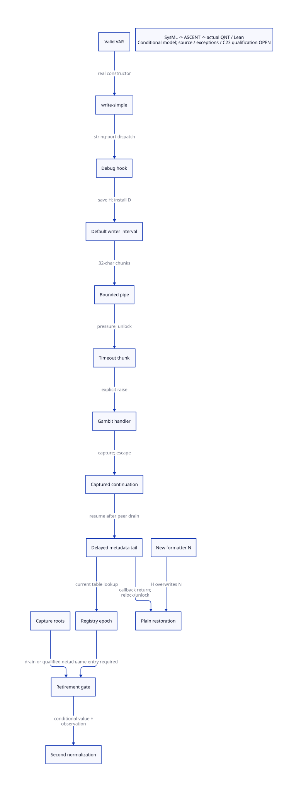

#+TITLE: Legal VAR Output, Handler Capture and Delayed Registry Effects
#+SETUPFILE: ../../modeling/org/setup.org
#+LANGUAGE: en
#+PROPERTY: header-args :eval never
#+STARTUP: overview
#+OPTIONS: toc:3 num:t

* Decision and evidence levels
:PROPERTIES:
:CUSTOM_ID: legal-output-decision
:BASELINE: C23 / ISO IEC 9899:2024
:STATUS: source-composable witness; full source simulation open
:END:

A valid VAR can enter the temporary default-writer interval without malformed
PTREEs, native I/O failure or simultaneous OS threads. A bounded string-pipe
provides an actual callback call site in that interval. An application-supplied
timeout thunk can explicitly raise to an original Gambit exception handler,
which can capture and escape. Restoring that capture retains the old save-wr.
This establishes a concrete source-composition route, conditional on the stated
session capabilities and successful completion. It is not a native reproduction,
a full source operational-semantics proof, or a claim that stock compilation
already installs the witness callback.

The conditional overwrite route is therefore stronger than an arbitrary
malformed-node example, but full multi-shot mutable port/writeenv refinement and
the matching generated artifact remain OPEN. Second normalization still has
no actual retirement permission.

Native [[file:models/sysml/formatter-legal-output.sysml][SysML]] owns the source inventory, semantic claims, migration links,
contracts, gains and policy profiles. It drives [[file:../../modeling/ascent/formatter-legal-output.rules.scm][ASCENT]],
[[file:models/quint/formatter_legal_output.qnt][QNT]], [[file:models/lean/FormatterLegal.lean][Lean induction]],
[[file:models/lean/FormatterLegalAlgebra.lean][algebra]], the [[file:formatter-legal-output-matrix.org][matrix]] and .
The source-bound parent is [[file:formatter-restore-reentry-design.org][the formatter restoration study]].

* A lawful source witness with actual runtime dispatchers
:PROPERTIES:
:CUSTOM_ID: legal-var-chain
:END:

** Admission domain

Use an isolated interpreted compiler debug session with igsc.scm modules loaded.
The loader explicitly includes _gscdebug after compiler modules. This is not an
assumption that normal gsc or Gerbil gxc automatically loads the debug hook.
Keep the default readtable and write-abstractly true. Run env.begin! before
make-temp-var, so next-var-stamp is a real counter. The existing producer
make-temp-var accepts an interned symbol and constructs the actual tagged VAR.
An 80-character lower-case ASCII symbol is legitimate; no vector tag is forged,
no VAR field is damaged, and no invalid parse-tree node is required.

Keep a live initialized target heap only for the separate resource-effect
extension. For the same-entry case, perform the first targ-use-glo demand before
output and retain its actual cell/resource identity in the plan; a merely live
empty table is not enough. The model initial demand=1 assumes this first demand.
Its epoch equality is necessary, not a replacement for full cell/alias identity. targ-heap-begin! is the real initializer and targ-heap-end! clears
the table. Do not call these on a concurrently active production compiler as
an experimental setup. They are source preconditions of this design witness,
not commands executed by this study.

** Source program specification, deliberately not executed

#+begin_example
Session setup:
  igsc module loader -> c#env.begin! -> c#make-temp-var(interned 80-char name)
  open-string-pipe(capacity: 1, output-buffering: #t) -> two live peer ports
  output-port-timeout-set!(output peer, 0, timeout thunk)
  original Gambit with-exception-handler(handler, write-simple(VAR, output peer))

Timeout thunk supplied by this application specification:
  (lambda ()
    (raise 'formatter-pause)
    (c#targ-use-glo 'late-binding #f) ; optional authority-bearing tail
    #t)

Handler supplied by this application specification:
  (lambda (exc)
    (call-with-current-continuation
      (lambda (k)
        (set! saved-handler-continuation k)
        (escape-to-coordinator 'parked))))

Coordinator after escape:
  retain VAR, pipe peers, write environment through the captured stack,
  old/new formatter closures and target ownership;
  install a distinct pass-through formatter N with ##wr-set!;
  release peer pressure; invoke saved-handler-continuation with #t;
  after completion, install N again and resume the same continuation again.
#+end_example

These callback bodies are a user-extension witness specification, not discovered
stock callback implementations and not runtime implementation added by this task.
The actual consumers invoked by them are the public timeout setter, actual
vector-port timeout application, original Gambit handler dispatch, public call/cc,
real global-resource helper and the existing debug hook restoration statement.
A stock example's use of a default timeout is not evidence for this body.

** Checked source sequence

| Step | Real producer/consumer | Effect and condition |
|------+------------------------+----------------------|
| VAR | _env.scm make-temp-var -> _envadt.scm make-var | Constructor stamp initialized; interned symbol remains the name |
| Entry | write-simple -> ##write-simple -> ##write-with-style | Character output uses writeenv; default sharing policy avoids a preliminary mark pass |
| Dispatch | ##write-generic-to-character-port -> string-port write-datum | String-port local method calls current ##wr |
| Debug | _gscdebug save/install -> VAR: list -> ##wr | Saves H, installs D; conversion here is var-name, not eval |
| Output | ##wr-pair / ##wr-symbol -> ##wr-str -> ##write-substring | Long name forces finite 32-character buffers to drain |
| Pressure | generated string-wbuf-drain | Tests capacity < wlo - peer-rlo; timeout thunk is called before port relock |
| Exception | timeout thunk explicitly calls raise -> macro-raise | Original Gambit handler is directly called and can return |
| Capture | handler -> call-with-current-continuation -> coordinator escape | Capture includes callback tail, output continuation and lexical save H |
| Delayed effect | handler continuation resumed -> callback tail -> targ-use-glo | Genuine reexecution per resume, not a delivery retry |
| Completion | callback #t -> relock/drain -> writer returns -> restore H | Can overwrite N; full mutable frontier simulation is still required |

Seven hash-bound bounded slices also check concrete method selection and both
wait branches through actual ASCENT slice relations, with missing/wrong-call
negative controls. They check text within the intended producer interval, not
full macro expansion or semantic simulation.

The source footprint disambiguates generic generated methods from concrete string
instantiation. The string constructor starts at _io.scm:3590; its local
write-datum is at 3676. The macro definition of vect-wbuf-drain is at 2688,
instantiated by define-prim-vector-port-procedures for string. Literal source is
not a claim that macro expansion or compiled machine code was inspected.

** Capacity argument and its limit

The string constructor chooses K=32. With positive capacity C=1, no peer reads
and enough output, one full chunk can be published because 0 is not greater
than C. At the next full-buffer drain, wlo-peer-rlo=32>C. The finite ordinary
VAR representation with an 80-character name exceeds 64 characters under the
qualified default readtable, so this pressure point precedes debug restoration.
Zero timeout becomes false in ##absrel-timeout->timeout. Both SMP and non-SMP
false-timeout wait paths unlock the port mutex and return false; the timeout
thunk then executes without owning that port mutex. Capturing here therefore
does not by itself retain that mutex lock.

The QNT fill action coarsens the two full buffers to produced=64, consumed=0.
Its timeout guard subtracts the current K=32 buffer, so it agrees with the actual
published-prefix threshold at that selected frontier. It is not a model of all
pipe FIFO/rlo/whi rebasing. drain summarizes sufficient peer progress. Before
each resume, a source-level coordinator must free the known queued prefix and
keep port/peer and callback roots live. The selected finite frontier ledger is now explicit in SysML: pause (wlo,whi,rlo)
=(32,32,0); drain 64 -> (0,32,32); resumed publication -> (32,0,32);
remaining r characters, 0<r<32 -> (32,r,32); drain r -> (0,r,r);
second resumed publication -> (r,0,r), then replay -> (r,r,r).
The default representation of the selected 80-character name has r=23 under
suffix keyword syntax. Retain the symbolic bound if that readtable detail is
not independently admitted. Lean proves reader rebasing and chunk publication
preserve wlo+whi-rlo, and that the drained frontier has no capacity pressure.

Crucially, the captured drain activation has not evaluated the fresh-buffer
branch that binds vect-wbuf/vect-whi. After the timeout returns, it reenters
loop, reads the current buffer and then allocates/publishes. The captured
write-substring path likewise continues to loop i after drain; it does not
write through its old full-buffer local. This supplies a finite source argument
for completion with retained peers, sufficient allocation and a pass-through N.
A full operational simulation for arbitrary pipe rebasing, faults, GC and many
resumes remains open. The QNT produced counter records only the selected initial
prefix; tail frontier obligations are discharged separately, not silently encoded
by keeping produced=64 forever.

* Exception and continuation semantics
:PROPERTIES:
:CUSTOM_ID: handler-multishot
:END:

The exception edge is explicit application raise, not an assumed consequence of
a timeout thunk returning false. The manual says output timeout abandonment
raises, but the selected source paths have false/EAGAIN returns and comments
about their behavior. That documentation alone cannot establish this exception
edge. The witness deliberately raises before choosing a Boolean timeout result.

The Gambit manual at gambit.txi:11511–11515 explicitly states that handler return
invokes the continuation of raise; this agrees with macro-raise. This is a
documented native Gambit interface, not merely an incidental tail-call inference.

The port's io-exception-handler is not the handler producer on this path.
macro-raise calls the current dynamic Gambit handler when a current thread
exists. The distinct R7RS handler wrapper must not be silently substituted:
noncontinuable exceptions and handler restoration can differ.

Capture inside the original handler and escape to an outer continuation bypasses
the ordinary restore statement. A subsequent invocation of k resumes inside that
handler and preserves the lexical save H in the suspended debug activation.
It does not rerun the earlier installation of D. If N is installed while parked,
plain restoration can assign H over N. Repeating the resume permits repeating
that old assignment, subject to successful remaining I/O and valid roots.
No simultaneous threads or C data race are necessary for this control-flow route.

Use a pass-through N so subsequent recursive dispatches remain defined. It
should delegate to ##default-wr and be distinct from H; an arbitrary N could
escape again. Captured mutable writeenv fields and the pipe buffers are shared
between resumes, not deep snapshots. We do not claim identical bytes on repeated
output, or source-completion liveness merely from the value-level restore theorem.
A fresh coordinator stage is required to avoid confusing reexecuted return
continuations with a delivery acknowledgment.

Dynamic-wind winding remains governed by the actual dynamic environment; neither
call/cc nor handler return makes a callback effect exactly once. Captured stack
roots survive normal return. Closing a writer registration or clearing the current
timeout thunk does not invalidate a callable or continuation already fetched.

* Delayed resource writes are an independent authority
:PROPERTIES:
:CUSTOM_ID: delayed-resource-authority
:END:

| State at delayed callback tail | Actual helper behavior | Receipt consequence |
|--------------------------------+------------------------+---------------------|
| Same live target/entry | targ-use-glo finds existing entry and writes canonical demand | Named-history value theorem applies; output/fault closure still required |
| Newly initialized target | Global lookup uses the new table; may allocate/insert a new cell/resource | Equal demand value does not preserve old entry/plan identity |
| Target ended | targ-glo-vars is #f | Old successful-helper premise fails; no fabricated successful write or released custody |
| Retained raw resource alias | targ-rsrc-demanders-set! can write arbitrary demanders | Raw writer can break canonicality even if formatter is restored |

The delayed named call above is deliberately capability-bearing. Default debug
printing has no direct targ-use-glo call. We have not found a stock installed
callback that ties this legal VAR chain to the interval between the selected
DEF_MOD_PRM and DEF_MOD_GLO emissions. Do not promote the legal interactive
extension witness to a demonstrated production compiler corruption.

The model's rejectDead transition is a failure-custody abstraction: a qualified
handler must preserve the continuation/root carrier on failed table access. It
is not a claim that every error handler automatically captures again. The model
uses a captured Boolean, not a complete heap alias/capture count. detach requires
an external complete root-retirement receipt. Outstanding aliases cannot be
made dead by the model action alone.

* C23 contract and retirement gate
:PROPERTIES:
:CUSTOM_ID: legal-output-retirement
:END:

Prefer a session-owned immutable WriterView and target/entry handles over a shared
temporary global override. This removes a restoration responsibility instead of
serializing all formatting behind another lock. It explicitly changes conflicting
registration interleavings; managed semantics must identify this as a repair.
Scheme continues to own formatter semantics, dynamic scope and multi-shot control.
C23 owns the typed native publication/lifetime contract where native consumers
exist; it does not turn Scheme values into unrooted atomic pointers.

Initialize and root a view before release publication, acquire before native
consumption, and serialize registration/restore with the same generation protocol.
Close admission then drain accepted callbacks, fetched callables and capture-root
debt before releasing view/target storage. Reaching an exception handler, returning
from it, or comparing formatter objects is not such a drain receipt. Generation
wrap, allocation failure and unknown completion preserve custody and deny reuse.
Native lowering and GC relocation are still open.

Second normalization can retire only under the conjunction below:

1. Retain first demand and immutable NativeBindingPlan for the same target/entry epoch.
2. Close every writer capability: same-entry named writes only, no raw resource aliases.
3. Qualify the actual legal entry/handler profile, formatter generation and recursive resolver.
4. Settle restoration; close producer admission; drain tickets, fetched callbacks and capture roots.
5. Prove output bytes/events and exception prefixes equivalent for each permitted resume.
6. Bind those facts to the actual emission interval and C/ModuleSpec result.

The policy DSL now independently requires legal-entry-qualified and
output-equivalence in addition to the parent profile premises. A legal source
witness is not a blanket qualification receipt. First demand and metadata workspace
stay live while callbacks can consume them. No actual helper call retires here.

* Formal chain and closure matrix
:PROPERTIES:
:CUSTOM_ID: legal-output-models
:END:

QNT has actual separate actions for pressure, timeout, capture/escape, registry
reset/end, resume, delayed write, relock, finish and certificate issuance. Each
maps to an explicit SysML producer/consumer seam and a Lean action theorem.
Full source simulation is intentionally not derived from matching names.
Only the named-writer value algebra is imported through hash-bound parent proof
artifacts. The new guard protocol is proved independently. Unlike the preceding
conservative unknown-error guard, it separates an observed fault from an externally
qualified handler/output equivalence receipt: a handled fault does not itself
prove inequivalence, and handler return does not itself prove equivalence. The
attest action is an explicit external obligation, not a reset of the observed
fault flag or a permission issued by current source. Typed IR projection checks identifiers, kinds, expressions and action
roster; its implementation remains trusted.

| Topic | Established at this level | Still open |
|-------+---------------------------+------------|
| Valid object | Real VAR constructor and initialized stamp, checked public writer path | Selected deployed mode and application setup admission |
| Actual callback call site | Bounded pipe timeout with mutex released | Full generated-method/port frontier simulation |
| Capture/escape | Original Gambit handler/call/cc composition bypasses ordinary restore | Complete runtime root and generated program-point correspondence |
| Old save | Resume retains save and does not reinstall default | Completion and event equivalence over shared mutable I/O |
| Resource effects | Actual named helper and reset/end branches identified | Full aliases and stock emitter-interval interposition |
| Managed retirement | Conditional abstract guard and same-entry named history | Source, exceptions, C23 platform and emission receipts |

Receipts: [[file:../../../evidence/research/formatter-legal-output/checks.json][checks]], [[file:../../../evidence/research/formatter-legal-output/source-witnesses.json][source witnesses]],
[[file:../../../evidence/research/formatter-legal-output/source-call-slices.json][bounded call slices]],
[[file:../../../evidence/research/formatter-legal-output/ascent-results.json][ASCENT controls]] and [[file:../../../evidence/research/formatter-legal-output/contract-profiles.json][policy profiles]].
QNT samples and inductive proofs establish only their stated abstract contracts.
The weakened issuance-guard negative control tests inductive modularity; it is
not automatically a reachable source counterexample.

* Benefit and additional cost
:PROPERTIES:
:CUSTOM_ID: legal-output-benefit
:END:

The SysML gain rows are authoritative. For N binding emissions and qualified
fraction p, removing one second normalization of cost Cn saves at most p*N*Cn.
Qualification Cq plus W additional resolver calls of cost Cv gives the runtime
subset condition p*N*Cn > Cq+W*Cv. These are symbolic costs, not invented timings.

The larger architectural gain is session-independent compilation: a writer/view
and registry epoch belong to an explicit compilation context. It can remove
cross-consumer global mutation dependencies. That requires migrating consumers;
a lock around the old shared global keeps that bottleneck. The actual bound is
two temporary global writes per special invocation and one normalization per
qualified emission. No macro-expansion, macOS latency or parallel speedup follows
from this local proof. First demand, target storage, root registration and fault
observation remain real work.

* Primary semantic references

[[https://standards.scheme.org/r7rs-html5/index.html][R7RS sections 6.10 and 6.11]] motivate continuation/dynamic extent and exception
boundaries, but the source witness deliberately selects original Gambit handler
semantics rather than assuming R7RS noncontinuable handler return.
[[https://www.open-std.org/jtc1/sc22/wg14/www/docs/n3096.pdf][WG14 N3096]] is a public pre-publication C23 draft for the memory-model vocabulary;
see the maintained [[file:language-baseline-design.org][C23 baseline]] for published-standard/target distinctions.
Neither standard establishes this source witness without the actual code chain.

* Retained model diagnostics

The first induction attempt required an explicit split of the locked Boolean at
resume; its diagnostics are retained. A separate algebra elaboration failure
required unfolding the threshold definition, with no runtime/model behavior change.
Native SysML rejected a reserved attribute name; the corrected name is matchIndex.
These failures remain evidence and are not rewritten as passing receipts.

* Qualification receipt

Native SysML validated 193 inputs without errors. The source record binds nine
snapshots, 37 anchors and seven bounded call slices. Lean checked 37 own theorems
including every one of the 21 projected action steps and frontier algebra. QNT
passed 16 directed histories (five negative controls) and 500 sampled traces.
Four projection corruptions and the weakened-issuance proof control were rejected.
ASCENT checked 13 scenarios and seven conditional profiles; only synthetic complete
evidence qualifies. Current source, exception, C23 platform and emission obligations
remain blocked. No runtime implementation, native test or benchmark was performed.
