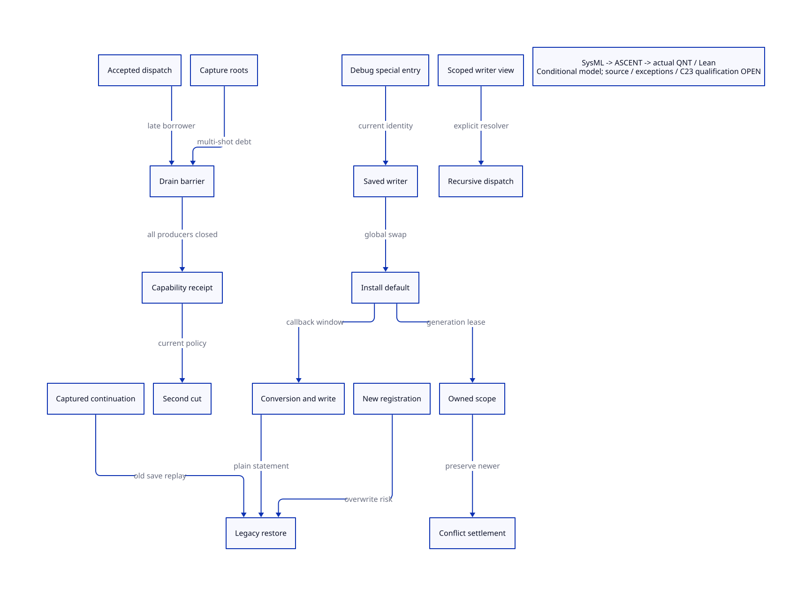

#+title: Formatter Restoration, Multi-shot Reentry and Native Binding Retirement
#+SETUPFILE: ../../modeling/org/setup.org
#+LANGUAGE: en
#+PROPERTY: header-args :eval never
#+startup: overview
#+options: toc:3 num:t

* Decision and scope
:PROPERTIES:
:CUSTOM_ID: formatter-restoration
:BASELINE: C23 / ISO IEC 9899:2024
:STATUS: conditional-model; source refinement open
:END:

Keep Scheme semantics and continuation ownership in Scheme. C23 provides explicit
native publication, rooting and lifetime contracts; it cannot repair a Scheme
callback protocol by making a pointer atomic. This study changes no runtime or
compiler implementation and executes no native tests.

The architecture source is [[file:models/sysml/formatter-restore-reentry.sysml][native SysML]].
Its rows drive the [[file:../../modeling/ascent/formatter-restore-reentry.rules.scm][ASCENT DSL]],
[[file:models/quint/formatter_restore_reentry.qnt][QNT actions]],
[[file:models/lean/FormatterRestore.lean][Lean induction]],
[[file:models/lean/FormatterRestoreAlgebra.lean][value algebra]],
[[file:formatter-restore-reentry-matrix.org][closure and benefit matrix]] and
.
See [[file:language-baseline-design.org][C23 qualification baseline]] and
[[file:binding-observer-reentry-design.org][preceding writer closure study]].

* Source execution windows
** Saved identity is per invocation
:PROPERTIES:
:CUSTOM_ID: saved-identity
:END:

[[file:../../../vendor/gambit/gsc/_gscdebug.scm][The debug hook]] saves the current global
=##wr=, installs =##default-wr=, converts a VAR/PTREE, writes it and restores
=save-wr= only after the inner call returns normally. There is no dynamic-wind
or local continuation capture in this file. An old hook invoked after a new
registration saves that new registration; it need not restore itself.

A nonlocal escape between installation and restoration skips the restoration.
A continuation captured inside that interval retains the lexical =save-wr=;
resuming it can later restore that stale value, repeatedly overwriting a newer
registration. Resuming inside the body does not rerun the earlier installation.
These are conditional control-flow witnesses, not native reachability receipts.
No native example was executed.

The inner expression evaluates a global operator and a conversion operand.
The model leaves their resolution order open. Host/compiled evaluation order
must be qualified rather than inferred from textual order. A callable already
fetched before admission closes remains a borrower.

** Conversion, printing and exceptions are separate producers

[[file:../../../vendor/gambit/gsc/_ptree2.scm][parse-tree->expression]] traverses nodes,
constructs lists and for primitive constants can evaluate a symbol name. Evaluating
the name does not call the returned procedure. An unknown-node compiler error is
not evidence of legal Scheme reachability. Ordinary expansion converts before
printing; it does not prove the debug hook receives a raw PTREE.

The selected native binding's scalar string/integer output does not directly
enter the special VAR/PTREE branch under stable predicates and registration.
Indirect conversion/output callbacks, interrupt paths and live predicate mutation
require a separate closure. The lexical absence of resource writes in the debug
file is not absence of indirect effects.

The default runtime writer contains 20 direct recursive global =##wr= applications
(22 exact token occurrences including definition and setter). Replacing only an
outer call with =##default-wr= does not close recursive dispatch. Port-specific
and dynamic exception handlers can run Scheme. An exception handler may return;
a catcher can escape through continuation grafting. These cases need distinct
outcomes and prefix effects, not a single error flag in the implementation.

** Dynamic-wind is necessary machinery, not a complete solution

[[file:../../../vendor/gambit/lib/_thread.scm][Runtime winding]] invokes before/after
procedures during denv transitions. They are callbacks that can fail or reenter.
Adding dynamic-wind does not establish nonabandonable cleanup, prohibit stale
restoration, or retire captured roots. Multi-shot continuations remain supported;
only an obsolete reuse permission may be rejected or requalified.

* Contract and architectural replacement
** Capability lifecycle
:PROPERTIES:
:CUSTOM_ID: capability-lifecycle
:END:

A qualified capability identifies VM/session/epoch, writer object and registration
generation, callback effect policy, resource entry identity/generation, output
operation/cursor and fault state. Tickets, active borrowers and captured roots
are separate debts. Registration, temporary swap, restoration and replay each
change generation: restoring the same object cannot revive an old capability.
Raw metadata mutation, changed epochs, unknown callback classes or a fault revoke
qualification. Accepted tickets can start after admission closes and must drain.

A capture's roots survive return and failed stale-permit attempts. Detachment
requires an external root/capture closure proof; the QNT detach action assumes
that qualification. It is not a GC notification implementation. Fresh resume
operations require fresh operation identities and managed resource ownership.

** Three choices with different semantics

| Choice | What changes | Semantic boundary |
|--------+--------------+-------------------|
| Legacy | Keep unconditional global restoration | Preserve observed interleavings; no blanket reuse permission |
| Guarded restore | Compare owner generation and epoch with current registration; serialize publication and restoration | Prevent overwriting a newer registration; explicit semantic repair of conflicting-writer histories |
| Session WriterView | Immutable invocation-scoped resolver propagated through every recursive writer | Remove temporary global swap/restore obligation; explicit change to registration interleavings, preserve qualified single-session outcomes |

WriterView is the stronger refactoring direction. Thread the resolver through the
write environment or dynamic environment and qualify every recursive consumer.
Scheme owns formatting, dynamic scope, callback effects and continuation semantics.
Typed C23 structures own native roots and lifetime only where the native boundary
actually needs them. No dual-language runtime is required for this change.

For native publication: initialize and root the immutable view before release
publication; acquire before dereference. Publication and restore need a common
linearization protocol; separate atomics alone allow a stale restore. Close
admission, drain accepted tickets/borrowers and captured root debt, then retire
storage. Last-release acquire synchronization does not prove the caller has
stopped accessing a Scheme frame. Generation wrap and allocation failure must
fail qualification without releasing custody. C23 platform lowering remains open.

** Second normalization retirement

Named demand/supply writes to the same resource entry preserve canonical demand
under the preceding algebra. They do not prove output/exception-prefix equivalence.
First demand remains necessary. Second value normalization can retire only when
all of these hold simultaneously:

1. First demand and the same entry identity are retained.
2. Every writer belongs to the canonical named-write class; no raw alias/table replacement.
3. Formatter profile generation is current and restoration is settled.
4. Registration is closed and tickets, borrowers and captured roots have drained.
5. Fault and output-prefix behavior remain equivalent; full emitted-byte mapping is qualified.

Callback use of =targ-use-glo= keeps metadata workspace live even if two emitter
calls disappear. Neither that table nor first demand retires merely from the
value theorem. Until source, exception, C23 platform and emission obligations
close, the actual retirement permission is false.

* Models, evidence and limits
:PROPERTIES:
:CUSTOM_ID: evidence-limits
:END:

QNT contains separate managed and legacy alternative worlds in one record for
bounded comparison. They are not two real registries used simultaneously. Legacy
histories demonstrate escape, stale multi-shot overwrite, late old-hook entry
and both operator-resolution cuts. Managed actions assume atomic owner checks,
root custody and external qualification. The detached-capture and qualified-profile
actions encode proof obligations, not existing source mechanisms.

Typed QNT IR is projected into a restricted Lean AST with binding/field/operator
checks and negative controls. Lean proves each action preserves the abstract
invariant and hence all finite reachable steps; it does not prove source simulation,
liveness or compiled C23 correctness. ASCENT requires matching source digests,
action/lemma bindings, producer/consumer seams, parent algebra and policy assumptions.
Only a synthetic complete receipt set may qualify; current source admission stays
blocked. Finite samples supplement induction and are not native acceptance.

Evidence is recorded in [[file:../../../evidence/research/formatter-restore-reentry/checks.json][checks]],
[[file:../../../evidence/research/formatter-restore-reentry/source-witnesses.json][source anchors]],
[[file:../../../evidence/research/formatter-restore-reentry/ascent-results.json][DSL controls]] and
[[file:../../../evidence/research/formatter-restore-reentry/contract-profiles.json][conditional profiles]].

| Obligation | Closed result | Remaining gap |
|------------+---------------+---------------|
| Restore control flow | Source ordering and conditional escape/stale-save paths | Legal callback/capture chain and matching generated execution |
| Identity | Object identity alone cannot identify a registration epoch | Real managed registry and captured callable census |
| Custody | Abstract certificate requires ticket/borrower/capture drain | Complete root retirement and late callback source simulation |
| Canonical value | Named-history second demand is identity | Resource alias closure and exception/output observation |
| Platform | C23 design contract | Actual memory-order lowering and native configuration qualification |
| Emission | Source-linked retirement conditions | Full C/ModuleSpec byte correspondence |

* Net benefit without invented timings
:PROPERTIES:
:CUSTOM_ID: net-benefit
:END:

Let N be eligible native binding emissions, p the qualified fraction, Cn the cost
of second normalization, Cq incremental qualification cost, and Cv added resolver
cost across W recursive dispatches. Removing only the second normalization saves
p*N*Cn and adds Cq plus W*Cv. A positive runtime balance needs
=p*N*Cn > Cq + W*Cv=. No speed ratio is inferred from lexical call counts.
WriterView's larger gain is removal of shared mutation and restore obligations;
it does not automatically eliminate expansion or C preprocessing costs.

| Mechanism | Exact avoided work | Added work / retained cost | Positive condition | Current status |
|-----------+--------------------+----------------------------+--------------------+----------------|
| Canonical second demand | At most one demand normalization per eligible emission | First demand, metadata table and callback demand retained | Qualified profile plus value and observation equivalence | Conditional; actual 0 authorized retirements |
| Session writer | Two temporary global stores per special invocation, if all dispatches migrate | Resolver propagation across 20 direct recursive calls; captured view roots | Removed shared coordination exceeds resolver/root cost | Design; no measured gain |
| Guarded restore | Stale overwrite of newer registration | Token/generation comparisons and failed-conflict handling | Repair semantics explicitly accepted | Conditional safety mechanism |
| Callback drain | Unsafe early retirement and repeated ad hoc lifetime reasoning | Tickets, captures, fault/custody state | Shared service replaces old duties rather than wraps them | Source closure open |
| C23 baseline | One explicit publication/lifetime contract shared with native consumers | Target atomic support and Scheme/C boundary qualification | Native contract genuinely consumed | No automatic Zig premium claimed |

#+begin_quote
The modernization claim is architectural: make formatting and effects session-owned,
then retire shared mutable machinery with its consumers. Deleting an apparently
redundant normalization before that closure would only hide a semantic dependency.
#+end_quote

* External semantic references

[[https://standards.scheme.org/r7rs-html5/index.html][R7RS, sections 4.1.3 and 6.10]] specifies unspecified operator/operand
evaluation order and dynamic-wind transitions through continuation invocation.
It motivates the alternate ordering cuts and winding obligations; the current
Gambit source and selected host artifact still determine their refinement.
[[https://www.open-std.org/jtc1/sc22/wg14/www/docs/n3096.pdf][WG14 N3096]], a public pre-publication C23 draft, sections 5.1.2.4 and 7.17,
provides the memory-model vocabulary used here. It is not substituted for the
published standard or target compiler qualification.

The retained initial induction failure exposed a missing completed-frame custody
invariant. The corrected model requires phases 3/4 to own closed-frame custody;
the proof also explicitly splits retired state during certificate revocation.
These corrections do not discharge source or native obligations.

* Qualification receipt

The corrected model passed 31 action-preservation checks in Lean, with 42 own
theorems including the value algebra. QNT passed 20 directed histories (five
negative histories) and 500 sampled traces. Four projection corruptions were
rejected. Removing capture drain from the actual issue guard made the Lean proof
fail, as required. Eleven ASCENT scenarios and seven conditional policy profiles
keep current admission blocked while allowing only synthetic complete evidence.
None of these receipts closes the four source/exception/platform/emission gaps.
