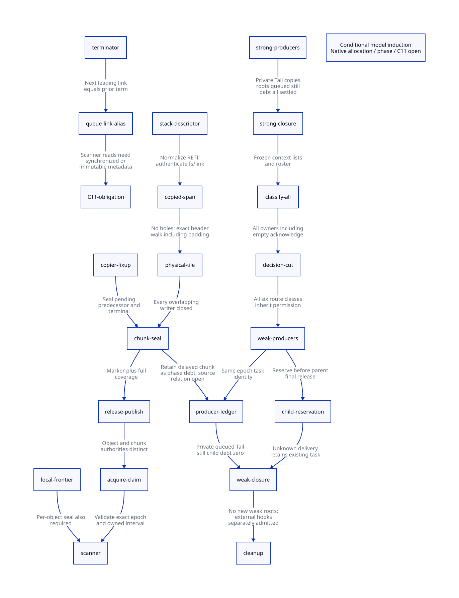

#+TITLE: Physical Frame Coverage and Weak Producer Admission
#+SETUPFILE: ../../modeling/org/setup.org
#+LANGUAGE: en
#+CATEGORY: modern-c
#+PROPERTY: header-args :eval never
#+OPTIONS: toc:3

* RESEARCH Architectural decision and evidence boundary
:PROPERTIES:
:CUSTOM_ID: frame-chunk-weak-decision
:AUTHORITY: GambitFrameChunkWeakProducers
:STATUS: MODEL-INDUCTION; CONDITIONAL-INTERVAL-PROOF; SOURCE-C11-OPEN
:MAINLINE: modern-generated-c
:END:

Modern C is the required implementation mainline. Scheme owns language semantics
and generated FrameSpec; the collector owns copy/link sealing, chunk admission
and derived work; control owns the frozen roster and collective decision cut.
Zig supplies no necessary mechanism for the contracts below.

[[file:models/sysml/frame-chunk-weak-producers.sysml][SysML]] owns source witnesses, coordinate premises, producer routes, component
seams, proof obligations and benefit rows. Its native projection produces the
[[file:frame-chunk-weak-producers-matrix.org][matrix]] and . The [[file:../../modeling/ascent/frame-chunk-weak-producers.rules.scm][actual ASCENT rules]] check receipts, action/lemma pairs,
composition obligations and observed direct marking calls against those routes.
Source association is a structural check; it does not discharge source simulation.

The [[file:chain-seal-will-cut-design.org][predecessor study]] is frozen. Current source still has explicit chunk identity,
per-object READY/OWNED/DONE, and unified pair/general scanning. Historical
allocation-position ownership and pair scan bypass are already replaced in the
worktree and earn no new retirement/performance credit here. During this study,
queue publication and dequeue also acquired a shared CAS gate (=lock_chunk_fifo=
and =take_heap_chunk=). That concurrent runtime work is separately owned; this
study re-read it and pins the reviewed source, retaining the superseded baseline.
It does not eliminate later frame fixups or the intra-weak classification issue.
All source hashes
are retained; concurrent/runtime edits are neither attributed to this study nor
reverted. This study changes no runtime source and executes no native workload.

* RESEARCH Word coordinates from source frame to copied chunk
:PROPERTIES:
:CUSTOM_ID: physical-frame-map
:OBLIGATION: PW-source
:END:

** Exact mapping, including RETI

For a fresh frame let H be =copy_header=, B=H+1 the body, fs the physical decoded
frame size, and E=H+fs+2 the allocation pointer after the copy. The copy path has
compile guards =SUBTYPED_BODY=1= and =FRAME_EXTRA_SLOTS=1=. The extra body word
at H+1 stores the return address. The fs copied stack words occupy [H+2,E).

#+NAME: physical-frame-equations
#+BEGIN_EXAMPLE
P = old cf + FRAME_SPACE(fs)                 ; adjusted source stack coordinate
FRAME_SPACE(fs) = round_up(fs + 3, 4)        ; stack reserve/alignment, not copied size
source slot i: P-i                          ; FP_STK(P,i)
copy destination for slot i: H+2+(fs-i) = E-i
copier link slot L = E-(link+1)
scanner fp = B+FRAME_EXTRA_SLOTS+fs = E
scanner link slot = scanner fp-(link+1) = L
admission: 0 <= link < fs
therefore H+2 <= L < E
#+END_EXAMPLE

These equations follow the descending copy loop and actual =FP_STK= macro.
For RETI the descriptor's stored cfs must be normalized by =RETI_CFS_TO_FS=;
RETN uses stored fs directly. Stack frame alignment is not copied heap padding.
Physical root runs use i in 1..fs and map to E-i. Exact root liveness still comes
from the live generated descriptor, not from treating every slot as a root.

[[file:models/lean/ChunkCoverage.lean][Lean]] checks copier/scanner coordinate equality, root-coordinate mapping and
valid-link containment for arbitrary integer coordinates. The proof assumes
valid descriptors and live modules; it does not validate arbitrary native
pointers or replace C provenance, integer overflow or object-bound obligations.
The current link bounds are not established merely by decoding an IFD/OFD.

** From object spans to mixed physical chunks

A real chunk may contain frames, ordinary objects and zero-word padding vectors.
The leading queue-link word at chunkStart-1 is a distinct state identity; it is
not the first object header. The terminal FORW word is at term. Objects tile
[chunkStart,term); the terminal word extends storage to term+1.

The maintained =SpanTile= relation permits any list of nonnegative-sized object
spans, each advancing by 1+words. A frame is one entry with words=fs+1.
=mixedChunkLinkCovered= proves that a valid frame link lies in its chunk's object
interval for an arbitrary such mixed list. Zero-word padding participates in the
header walk; it must not become an unexplained gap. Separate lemmas prove that
links precede the terminator and cannot belong to two disjoint half-open chunks.

This is a conditional spatial proof, not extraction of the actual heap. To
instantiate it from C, the owner must account for each allocation, alignment
pad, CAS-loser undo, closed marker and section transition. The chain copier does
not itself allocate vector padding; other allocation producers sharing a physical
chunk can do so. A header walk must not follow an unpublished or malformed size.

** Source allocation induction and shared sentinel boundary

A source-level Tile witness can be built incrementally: start_heap_chunk selects
its first object boundary; a committed ordinary copy appends 1+words; a committed
captured copy appends fs+2; a zero-word alignment vector appends one word. On a
CAS loss, mark_array decrements the speculative header reservation and follows
the winning address. A prefix padding vector already published before that CAS
is not undone; a trailing pad belongs only to the successful copy. The native
refinement must distinguish speculative reservations from committed spans.
=spanAppend= proves the mathematical composition step, including mixed spans;
it does not prove that each actual source update issues that witness correctly.

end_heap_chunk writes a terminal word then advances alloc. A subsequent
start_heap_chunk uses that next position as its start. Consequently:

#+NAME: sentinel-alias-equation
#+BEGIN_EXAMPLE
nextChunkStart = previousTerm + 1
nextChunkLeadingLink = nextChunkStart - 1 = previousTerm
#+END_EXAMPLE

Thus adjacent chunks share that metadata word. Their object intervals remain
disjoint, but their metadata footprints are not disjoint. FIFO next-link writes
can reuse a previous chunk's terminator. Current scan_complete_heap_chunk and
local scan loops read =*ptr= to detect FORW outside the FIFO gate. A possible
source schedule has a scanner approaching an earlier terminator while later
queue publication changes the same word as a next-link. Both values carrying
FORW does not remove the C11 conflicting-access obligation.

The alias equation is proved; the complete legal-input schedule and absence or
presence of other happens-before edges are not. No native data race is claimed
as observed. The gate must cover scanner metadata access too, or all such loads
and stores must use compatible atomic storage, or an immutable end marker must
be separated from the mutable queue-link record. Casting selected plain words
to atomic pointers alone is not a storage/type/provenance proof. Separation can
cost another queue-link word/descriptor per chunk plus lifetime management; it
must not be credited as free. This is a new admission obligation, not a silent
runtime change. A terminal word is counted once in physical storage even when
it also serves as the next chunk's leading link.

A section lookup and two-bit object state establish neither the owning chunk nor
coverage of every object in it. In particular, after rollover the pending link
may lie in an older chunk; current =alloc_heap_chunk_start= cannot identify it.
The creator must retain its original chunk identity in the pending fixup record.
Do not rediscover it by walking a concurrently changing unpublished chunk list.

* RESEARCH Delayed publication receipt and complete admission conditions
:PROPERTIES:
:CUSTOM_ID: physical-chunk-admission
:RECEIPT: PhysicalChunkSealReceipt
:ISSUER: allocation-owner-plus-copy-seal-authority
:END:

#+NAME: candidate-chunk-records
#+BEGIN_EXAMPLE
FrameFixupRef:
  epoch, sectionIdentity, frameHeader, linkSlot, owningChunkStart,
  descriptorIdentity, sourceStackPin, unfinishedCopyOwner
ChunkSealRecord:
  epoch, sectionIdentity, chunkStart, terminator, grantPast,
  initializedFrontier, scanFootprintSealFrontier, openOverlapDebts,
  publicationAuthority, retainedStoragePin
#+END_EXAMPLE

These are design records, not new runtime structs. Generated descriptors can
supply static facts; allocation-owned frontiers can supply interval coverage.
A second object graph or per-slot dynamic registry is not automatically required.

| Admission condition | Required issuer/evidence | Failure or unknown result |
|---+---+---|
| Authentic coordinates | Same normalized fs/link and live descriptor/code epoch | Retain source and copied storage; no READY |
| Complete physical tile | Allocation owner accounts for every header/pad and exact terminator | No enqueue from a sealed prefix alone |
| Finished overlapping writes | Copier resolves pending predecessor and terminal/forwarded suffix; no late alias writer | Original transaction retains debt |
| Correct original chunk | FrameFixupRef keeps chunk ID across rollover | Current allocation pointer is insufficient |
| Whole-chunk scan footprint sealed | Every contained frame and object admitted for its consumer footprint | Delay chunk or retain local frontier |
| Marker installed and grant valid | Terminator and leading-link storage within live section grant | Reject admission; no unbounded no-fit retry |
| Object and chunk authority ordered | Release object READY before queue release; acquired claim | No inferred authority from an address alone |
| Local scan also gated | Open local frontier observes per-object seal before read/write | Local ownership alone does not admit scanning |
| Lifetime retained | Old stack, destination, descriptor and epoch pins until final users finish | No rollback/free on unknown publication |
| Termination custody | Queued/private/copy/Tail/still/descendant debt remains represented | No idle/retirement receipt from queue emptiness |

** Overlap rather than permanent immutability

Frame scanner snapshots, hides and restores the same link slot the copier later
fixes. Those operations must not overlap unsafely. Moving READY after all such
fixups eliminates the modeled post-READY overlap only if every scanner entry
(including the owner's incomplete local frontier) respects it.

Ordinary subtypes through BOXVALUES have a different footprint: =mark_array=
retains first-field Tail and loops through =goto again=, whereas general scan
skips the first body field. Tail may therefore outlive READY without overlapping
that scanner footprint, but it remains termination debt. A rule requiring every
field to stay immutable would overconstrain this existing optimization. A rule
requiring only initialized headers would admit the captured-link race.

The new QNT model has two frames in one closed physical chunk. A sealed first
frame does not authorize publishing an unsealed last frame. The model also
requires exact marker, alias closure and registration before publication. Its
constants are word offsets, not native addresses. Generic mixed-span reasoning
lives in Lean; a complete C-to-span extraction is still absent.

** Capacity and owner progress

The predecessor's one-delayed-closed-chunk bound is per sequential copier under
fit admission and drain-before-next-close. It excludes the new open chunk, side
metadata, leading link and retained old-stack/epoch storage. The copied loop
checks a published allocation pointer while advancing local alloc, so its
physical chunk-byte bound is still not qualified. Custom allocation and shared
stack grants remain explicit premises. Child scan allocation cannot silently
reuse a deferred chunk's publication authority. Failure after forwarding needs
epoch-retained recovery or a failed-epoch exit; no native recovery is designed
away by a Boolean model flag.

* RESEARCH Full weak-production inventory and decision cut
:PROPERTIES:
:CUSTOM_ID: weak-production-closure
:OBLIGATION: PW-weakHistory
:END:

** Seed and transitive producers

The native SysML producer table distinguishes routes rather than claiming six
disjoint object types. The model's six representative route classes cover:

1. List-cell marking in process_wills, which can copy or scan a previously unscanned will.
2. Explicit omitted-testator repair in executable, promoted and retained-nonexecutable branches.
3. Fresh weak-phase will scanning of both action and testator.
4. Ordinary graph edges and strong-policy hash fields, including first-field Tail in mark_array.
5. Continuation/frame root runs, captured-frame copy/heap fallback, denv fields and return-address roots.
6. Still-object claiming and still-list scanning, which do not use movable-object READY/DONE.

Local/FIFO/stolen chunk scans carry these producers. A new will reached from an
already accepted weak scan inherits the permission and its own retained task;
it cannot bypass the classification cut. Task classes can overlap along a path;
unique task identity, not class membership, must prevent double accounting.

All literal =mark_array=, =mark_frame= and =mark_captured_continuation= call sites
in mem.c are inventoried with caller, line and digest. Native SysML contains the
route or explicit strong-only exclusion for every observed direct call. ASCENT's
missing-route control removes scan-to-mark_array coverage and must block
admission. This checks call coverage, not C preprocessing or semantic reachability.
A source search finds these direct marking names only in mem.c among lib C files;
indirect callbacks, includes/macros and generated configurations remain separate.

** Explicit exclusions and unrestricted boundaries

- Context roots, registers, saved roots, startup thunk, entry marker, RC payloads,
  VM/global/symbol roots and uncaptured stack scanning belong to strong entry.
  They must close before the strong receipt; labeling them strong-only is not a
  proof that unmanaged native writers cannot mutate them during GC.
- Hash-table cleanup resolves forwarded references or deletes weak entries; its
  current body makes no mark_array/capture/scan calls. Its eager branch can call
  gc_hash_table_rehash_in_situ, whose reviewed body rearranges entries without
  invoking those marking entries. Macro/configuration closure remains separate.
  Strong-policy table fields
  are already covered by ordinary graph scanning. No ephemeron fixed point is
  claimed for this implementation.
- move_continuation copies the remaining physical stack after weak scan closure;
  it is not a new marking producer in the current body. Pins and restoration
  descriptor validity must nevertheless survive that move.
- free_unmarked_still_objs runs after weak closure and can call release_foreign;
  release_foreign clears its function/pointer slots then calls external release_fn.
  This is not a closed-world proof of non-reentry, no allocation, thread affinity
  or absence of late work. A profile must reject such a closure receipt unless
  the hook is separately admitted or deferred under a managed cleanup contract.
- Scheme will actions execute later through the finalization path; no permission
  to execute them during classification is introduced here.

** Complete decision-cut admission

A global strong receipt requires all roots, private/queued chunks, in-flight
copy initialization, Tail and still debt to have settled, not just each local
phase label. Then freeze list membership and the epoch roster. A classification plan must
cover every frozen context list exactly once; worker acknowledgments alone are
not context-list coverage. Current source couples carrier and context; future
independent workers must receive explicit context/list assignments instead of
implicitly consulting PSTATE through process_wills. Classify every
nonexecutable list, including empty owners, without invoking any weak-retention
producer. All acknowledgments must refer to the same roster and strong epoch.

Only after that collective cut may workers enable weak traversal, process list
cells, repair testators, run newly discovered will scans or drain their derived
work. Existing executable wills retain their prior status; this cut does not
reclassify them or invent a global finalizer execution order. List moves and
flag clearing must preserve the decisions and deferred-field repair obligation.

The current code enables the worker-local weak flag then runs fused
process_wills. Current BARRIER wraps a sync-op protocol, not an automatically
proved acquire/release collective. Splitting classify from retention and gating
all six route classes are necessary changes for the barrier design. An immutable
strong-mark snapshot is an alternative with its own epoch identity and storage
cost; mutable forwarding headers alone cannot distinguish the mark's cause.

Top-level weak producers eventually close their source admission. Accepted
parents may still reserve children before final settlement; closeRoots does not
revoke that inherited authority. Unknown queue acknowledgment retains the
already accepted task, rather than minting another one. The counter model has
no task IDs: it proves retained debt and absence of premature completion, not
retry deduplication or exactly-once recovery. Those remain source/identity
refinement obligations. finishWeak requires
closed roots and zero represented private/queued/active/child debt. A zero counter
has no meaning if a physical producer was omitted from the representation.

* RESEARCH C11 obligations and formal refinement map
:PROPERTIES:
:CUSTOM_ID: physical-weak-c11
:OBLIGATION: PW-platform
:END:

| Boundary | Required C11 condition | Missing native refinement |
|---+---+---|
| Link fixup to READY | Overlapping ordinary writes sequenced before release READY | All source exits and alias writers |
| READY to chunk FIFO | Release queue after object seals and terminator; acquire claim | Concrete lock/atomic profile and all polling accesses |
| Packed bitmap | All accesses to one packed state word use compatible atomics; CAS preserves neighbours | Two-bit address extraction, generation and reset proof |
| Header versus link identity | Leading chunk-link word is not an object header | Actual allocation-span table and bounds |
| Shared sentinel | Synchronize marker reads against next-link stores or separate their storage | Exact happens-before and typed atomic/immutable layout choice |
| Duplicate scan | No field access on OWNED/DONE; first owner retains debt | Full consumer/C11 simulation |
| Local incomplete frontier | Acquired per-object seal before advancing into that footprint | Current scan-before-initialization fatal path needs admission redesign |
| Strong closure to classify | Same frozen roster and all strong publication/producer debt settled | Existing idle decrement and sync-op collective proof |
| Classify to weak permission | Release each decision/ack, acquire collective result before any weak route | All participants, empty lists and failure paths |
| Parent to child | Reserve child before parent release; release/acquire queued payload | Unknown delivery and late observer lifetime |
| Epoch retirement | All readers, fixup cursors and scanner/cleanup users drained before reset/free | Storage/code pins and external callback closure |

C11 atomic fences alone do not repair a release that precedes a later ordinary
link store. Historically volatile-only queue observations cannot establish portable atomic
admission. Current source instead gates queue accesses with CAS; the exact
legacy adapter and lifecycle still require refinement.
Packed two-bit identities share one machine word: per-object logical separation
does not permit racing non-atomic accesses to the shared word. A release sequence
argument must account for every intervening RMW and forbid same-epoch reset/ABA.
The concrete current GCC branch uses legacy __sync operations; GCC documents
those separately from modern __atomic operations. This study selects no effective
Darwin preprocessing branch and grants no toolchain-specific qualification.

The [[file:models/quint/frame_chunk_coverage.qnt][spatial QNT]] and [[file:models/quint/weak_producer_admission.qnt][producer QNT]] include executable histories and injected
failures. The [[file:../../modeling/tools/frame-chunk-weak-producers-projection.py][restricted extractor]] reads actual typed IR initial state, guards,
updates, invariant and exact step roster into Lean AST. The maintained proofs
establish every projected step and reachable-state induction. JSON parsing,
emission and equivalence to full Quint operational semantics remain trusted.

| Refinement | Discharged in this study | Still required |
|---+---+---|
| C slot expressions to integer coordinates | Algebra under stated descriptor constants | Valid C pointers, same live descriptor and arithmetic bounds |
| Mixed span list to chunk interval | Arbitrary-length conditional tiling theorem | Real allocation/header walk to SpanTile witness |
| QNT to Lean | Actual restricted AST and all-step induction | Verified parser/emitter and broader QNT semantics |
| C producer to route | Exact direct-call coverage and negative route control | Conditional compilation, callback and full task mapping |
| Root-close to no future work | Model inherited-child conservation and zero-debt condition | Real registry, private cursors, queue and shutdown protocol |
| Spatial gate plus weak cut | Shared architecture seams and explicit dependency | Cross-model source relation and temporal/C11 composition theorem |

The direct-call contrast initially rejected an omitted scan-to-mark_frame route.
That edge is now explicit; the rejected route and missing-route controls remain
part of the study history. Covering names does not prove their phase admission.

Separate model passes do not prove their composition. The spatial receipt must
be one of the producer ledger's retained debts, and all weak scan tasks must
carry both phase authority and object/chunk authority. An independently issued
receipt for either side cannot stand in for the other.

* RESEARCH Net benefit, retirement and next gap
:PROPERTIES:
:CUSTOM_ID: physical-weak-net
:END:

The primary gain is a runtime foundation for safe parallel graph work. Sealed
prefixes can be scanned while the copy owner advances a chain, without a global
scanner lock for the whole chain. This avoids O(N) candidate whole-chain staging;
it is not an O(N) cost removed from today's C runtime. Existing suffix reuse,
DONE deduplication and weak-field repair receive no new speedup credit.

For W wills, classification remains O(W); the barrier design adds one collective
rendezvous before weak retention, not another strong-graph scan. If the existing
active-owner lifetime covers reserve through final settlement, a separate
publication counter can be avoided, but all private/Tail/still/child debt must
really be represented. Formal class coverage is not that native proof.

Maintaining the allocation Tile frontier can take O(1) bookkeeping per committed
allocation rather than an additional O(K) header reconstruction at every chunk
publication. That is a proposed alternative to a new reconstruction pass, not
a pass removed from current C. Generated FrameSpec supplies slot arithmetic;
no per-root dynamic map lookup is inherently required.

Let H be useful scan overlap, A seal/identity/ledger work, and B classification
synchronization. Runtime speed benefit needs H>A+B in the actual workload. Low
parallel work or dominant barrier latency can refute it. Staging is at most one
delayed closed chunk per admitted sequential copier under fit/drain premises,
plus an open chunk, metadata and required stack/code/epoch retention. No measured
speed ratio or unconditional byte-peak improvement is claimed.

Retire early captured-frame READY, ungated local frame scan admission and fused
classify/retain entry only after every caller and branch migrates. Keep Scheme
semantics, continuation restoration, C portability, source-stack forwarding
identity and specialized weak-field policies. Concrete replacement APIs and
shared generated descriptors should remove duplicated implicit layout reasoning;
a second runtime language is not needed to obtain that benefit.

The remaining global copy lock can also limit useful overlap when a scanner
discovers another captured continuation; removing that lock needs a separate
forwarding-uniqueness and lifecycle proof. No parallelism credit assumes its removal.

The next source proof must construct the real mixed-span witness, connect its
pending fixup to producer debt, and close native root/foreign-hook admission.
Another scalar history is not a substitute for those obligations.

* References and receipts

- [[file:../../../vendor/gambit/lib/mem.c][Collector and allocation source]], [[file:../../../vendor/gambit/include/gambit.h.in][frame/atomic definitions]],
  [[file:../../../vendor/gambit/lib/setup.h][barrier selection]], [[file:../../../vendor/gambit/lib/setup.c][sync-op implementation]], and
  [[file:../../../vendor/gambit/lib/c_intf.c][foreign release callback]] are pinned by the study.
- [[https://www.open-std.org/jtc1/sc22/wg14/www/docs/n1570.pdf][C11 draft N1570]], sections 5.1.2.4, 6.5.6, 6.5.8 and 7.17:
  concurrency, pointer/arithmetic and atomic obligations. This is not a native proof.
- [[https://gcc.gnu.org/onlinedocs/gcc/_005f_005fsync-Builtins.html][GCC legacy __sync documentation]]: concrete legacy operations and documented
  ordering boundaries; effective configuration remains unresolved.
- [[file:../../../evidence/research/frame-chunk-weak-producers/][Formal receipts and exact source identities]] retain negative controls and
  keep source/C11 admission blocked even when all mathematical checks pass.
