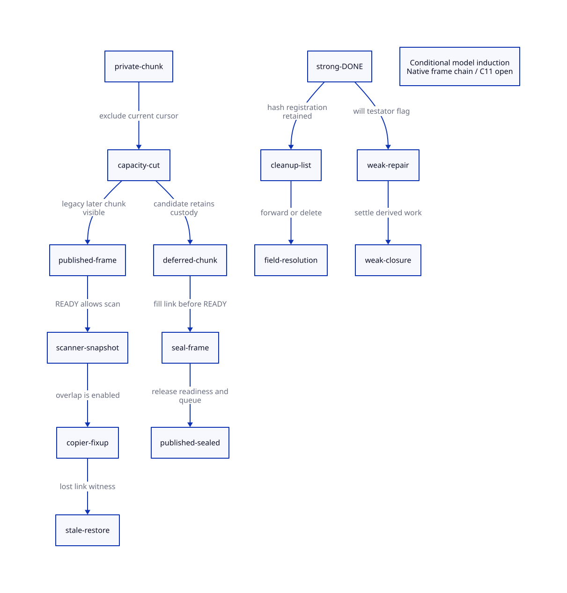

#+TITLE: Captured Frame Publication Seals and Strong/Weak Field Coverage
#+SETUPFILE: ../../modeling/org/setup.org
#+LANGUAGE: en
#+PROPERTY: header-args :eval never
#+OPTIONS: toc:3

* RESEARCH Architecture decision
:PROPERTIES:
:CUSTOM_ID: frame-weak-coverage
:AUTHORITY: GambitFrameWeakCoverage
:MAINLINE: modern-c
:STATUS: source-enabled-schedule; conditional-model-induction; native-open
:END:

Frame readiness must cover all copier writes overlapping the scanner's footprint,
including the subsequent chain-link fixup. Initial payload copying alone is not
that receipt. A closed chunk cannot expose an unsealed frame. Keep object DONE
across strong/weak scanning only where phase-specific field obligations are
already covered or explicitly discharged by weak consumers.

This extends [[file:object-scan-custody-design.org][object scan custody]]. The current runtime is read-only evidence;
no C implementation, native test, compilation or performance experiment is part
of this study. Source, finite models, mathematical induction and C11 refinement
are separate admission scopes.

* RESEARCH Which frame schedules are enabled by source
:PROPERTIES:
:CUSTOM_ID: frame-source-witness
:END:

** A local exclusion is not a chain-wide guarantee

=end_heap_chunk= excludes FIFO publication when the worker's =scan_ptr= lies
inside the chunk being ended. Setup initially sets that cursor to the initial
chunk start. =prepare_heap_msection/start_heap_chunk= can change the allocation
chunk without changing that private scan cursor. During =mark_execution_roots=,
the collector has not yet entered its local =scan_movable_objs_to_scan= loop.
Another carrier can finish its own roots and enter stealing; no root-only
collective barrier appears between these two calls.

The first capacity cut can therefore leave the first chunk private and move the
allocator into a second section. A later capacity cut can close a different chunk
that no longer contains the old cursor. That later chunk is eligible for FIFO
publication. This uses the real capacity slow path, not the suspicious post-frame
threshold check: that check reads the published allocation pointer while copying
uses a local =alloc=. It must not be the sole premise of a reachability claim.

** Source-enabled witness with explicit premises

| Step | Copier | Other carrier |
|---+---+---|
| First capacity cut | End initial cursor-covered chunk; advance section | May finish a small root set |
| Copy nonterminal frame A | Initialize A; publish READY; retain ptr to A's link | No access required yet |
| Next fresh frame does not fit | End A's later chunk before copying successor B | Can dequeue that chunk |
| Scan A | Copier still holds MISC_MEM_LOCK and has not filled A's link | Claim READY; snapshot old link and temporarily hide it |
| Copy B | Store new forwarding value through retained ptr into A | Scanner remains an active invocation |
| Restore A | Copier's fixup is complete | Restore retagged old snapshot over newer link |

Required premises: a valid nonterminal captured chain spanning at least two
capacity cuts, sufficiently small individual frames to fit sections, available
destination space, two synchronous GC participants, and an independently runnable
stealer. Queue locks are released before =scan_complete_heap_chunk=. The frame
scanner's link read/hide/restore does not acquire the copier's MISC_MEM_LOCK at
entry. Choose frame payloads that do not themselves force a blocking nested
captured-continuation copy before the restore. This is a control-flow-enabled
source schedule under stated state premises, not an observed native execution
or a proved Scheme-input/effective-Darwin witness.

The concrete reference model preserves the lost-fixup trace. It is an SC
load/store interleaving witness for the missing ordering obligation. Once the
ordinary C stores race without happens-before, C11 does not promise that exact
result; the witness is not a defined-C outcome prediction.

The retained copier pointer and scanner link refer to the same slot under matched
descriptors: copier end is =body + (fs + extra)=; scanner fp is
=body + extra + fs=; FP_STK subtracts =link+1= in both cases.
The Lean coordinate lemma proves that arithmetic identity. Valid descriptor
decoding and in-bounds C pointer arithmetic remain source premises.

** Rejecting false positives

- The initial cursor-covered chunk cannot simply be assumed stealable.
- A same-carrier synchronous frame copy and scanner cannot be arbitrarily
  interleaved as if they were two native workers.
- A fixup completed before scan admission is not the lost-fixup schedule.
- The already-forwarded branch also writes through =ptr=, but its existence alone
  does not prove an intervening capacity publication. The witness above uses a
  fresh successor's actual capacity loop.
- READY/OWNED excludes a second object scanner, not an unmodeled copier writer.

* RESEARCH Modern C frame producer contract
:PROPERTIES:
:CUSTOM_ID: frame-publish-seal
:END:

Introduce a producer-owned pending-link record identifying section/round, copied
frame header, mutable link slot and owner invocation. The candidate protocol is:

1. Copy frame A's payload and retain its link obligation locally.
2. If the next frame requires capacity, close A's chunk but retain it on a private
   deferred list. Allocation may advance without exposing A to scanners.
3. Construct the successor and commit A's link fixup. Only now release-publish
   A's READY. A final chain frame seals when its terminal link is final.
4. Publish a closed chunk only after every frame in its scan footprint is sealed.
   Transfer custody from the private list to FIFO under the normal queue protocol.
5. Keep copier, deferred chunks and derived work covered until their last use;
   READY/DONE alone does not grant idle or storage retirement.

Delaying READY while still publishing the chunk is insufficient: current =scan=
treats an uninitialized scan state as fatal. Readiness and chunk visibility must
move together. Deferral requires storage available without recursively allocating
inside GC; intrusive chunk links or pre-reserved descriptors need a separate
representation/failure contract. With one sequential chain cursor and frames that
fit a section, there is one pending predecessor at a time. A physical bound on
deferred metadata still needs a proof including section rollover and all entry
paths; no heap multiplier or unconditional capacity bound is claimed.

An alternative is to serialize the overlapping frame scanner accesses with the
copy lock. It needs lock-order, reentrance, allocation/fatal-path and active-worker
progress proofs, and can serialize stealing across a long captured chain. Keep it
as an equally correct design candidate for cost comparison, not an assumed free
fix. The seal design aims to preserve scanning parallelism after data is final.

Old early frame READY and unconditional publication of a mutable closed chunk can
retire only after both fixup branches, RETI/RETN frame consumers and allocation
failure paths use the new contract. Forwarding, frame descriptors, object scan
authority, copier exclusion and collective barriers remain necessary.

* RESEARCH Strong/weak DONE: actual field consumers
:PROPERTIES:
:CUSTOM_ID: phase-field-coverage
:END:

** Wills

Strong =scan= marks the action and sets UNMARKED_TESTATOR_WILL in NEXT. It can
then set the object's state to DONE. In =process_wills=, =mark_array(&will)=
first obtains the destination object. The cursor then points at that object's
NEXT field. NEXT is offset zero and TESTATOR is offset one, so
=tail_exec + WILL_TESTATOR= and the nonexecutable equivalent address the actual
testator slot. All three list outcomes perform this direct mark when the saved
NEXT value contains the deferred-testator flag: existing executable, newly moved
to executable, and retained nonexecutable.

The current will's flag is read before the next iteration rewrites that list link.
Thus a generic scanner's later DONE return does not by itself omit this testator
repair. A will first discovered in the weak phase receives a normal weak scan of
both action and testator. These paths do not require resetting every DONE bit.

This closes a local field-consumer argument, conditional on list completeness,
exclusive will-list ownership, flag preservation and root lifetime. It does not
prove =determine_will_executability= semantics across processors sharing a
testator: one list's weak marking can interfere with another list's decision
unless their strong-reachability observation is fixed before weak marking. A
strong/weak entry barrier alone is not an all-list classification barrier.
That separate global decision obligation remains open.

** GC hash tables and ordinary objects

Generic table scanning selects keys using !WEAK_KEYS and MEM_ALLOC_KEYS, and
values using !WEAK_VALS. This policy does not depend on =traverse_weak_refs=.
The scanner registers the table in its worker's reached list. That list is reset
at strong entry, retained across weak entry, and consumed in cleanup. Tables
newly reached in the weak phase use the same ordinary scanner and join that list.

Weak keys/values are not missing strong roots: cleanup updates surviving forwarded
references or deletes entries with unreachable weak referents. The four flag
combinations and non-heap-key mode have distinct field obligations; the model
covers those policies without turning weak edges into tracing roots. It does not
prove every in-situ rehash/count mutation, concurrent list alias or GC hash-table
API invariant. This is not an ephemeron fixed-point algorithm claim.

Ordinary object, closure and symbol scan footprints do not gain fields merely
because the phase changes. Continuation/frame consumers retain their separate
fixup obligations. Still objects do not use this movable-object DONE bitmap;
their mark/list protocol is a separate source refinement.

* RESEARCH Models, extraction and C11 obligations
:PROPERTIES:
:CUSTOM_ID: frame-weak-formal
:END:

[[file:models/quint/frame_publish_seal.qnt][The frame QNT model]] includes the old-cursor capacity distinction, an explicit
legacy lost-fixup trace, and a managed deferred-publication candidate.
[[file:models/quint/weak_done_coverage.qnt][The weak coverage model]] includes already-DONE/fresh wills, the saved repair
flag, stable hash policies, reached-list registration and cleanup resolution.
Both retain injected negative controls. Their scope is one representative frame
and one will/table policy instance, not an arbitrary heap or all source inputs.

The [[file:../../modeling/tools/frame-weak-coverage-projection.py][restricted extractor]] projects actual typed IR initial states, invariants,
guards, updates and full step rosters to [[file:models/lean/FrameSealAst.lean][frame]] and
[[file:models/lean/WeakCoverageAst.lean][weak Lean definitions]]. [[file:models/lean/FrameSeal.lean][Frame]] and [[file:models/lean/WeakCoverage.lean][weak proofs]] establish each modeled
step's preservation and reachable-state induction. Additional lemmas cover cursor
exclusion, pending-owner retention, managed-mode preservation, the legacy update
trace, DONE-preserving repair and phase-independent hash footprints. JSON parsing,
emission and full QNT operational semantics remain explicit trusted boundaries.

| C11 refinement obligation | Required evidence |
|---+---|
| Copier writes to READY | All overlapping frame fixups happen-before release READY |
| Closed chunk to scanner | Every contained header is sealed before release FIFO visibility; acquire claim |
| Link snapshot/hide/restore | No unsynchronized copier write overlaps that scanner footprint |
| Deferred custody | Private descriptors/chunks remain owned across allocation failure and rollover |
| Phase reuse | Same scan footprint or explicit consumers discharge the difference |
| Weak repair | Strong workers drained; flag/list fields uniquely owned; target slot rooted and updateable |
| Cleanup | Reached list retained until weak work closure; weak repairs do not create new strong edges |
| Final idle/reset | Copier, deferred batch, scanner frames and descendants drained before counter/epoch retirement |

Legacy full-barrier CAS cannot order future copier writes before a past READY.
No memory-order strengthening alone repairs that program-order gap. Effective
Darwin macro selection, ordinary/atomic access compatibility and wait-loop
progress remain unqualified; no native preprocessor or runtime test was run.

* RESEARCH Net benefit and closure matrix
:PROPERTIES:
:CUSTOM_ID: frame-weak-worth
:END:

The frame change is a correctness admission, not a measured speedup. Moving READY
does not inherently add object-state transitions; it adds pending-link/seal and
closed-chunk custody work. Its value relative to global scanner serialization
depends on captured-chain size, deferred lifetime and contention, which remain
unmeasured. A no-fixup frame or no-cross-chunk case must not pay for unnecessary
general manifests or a second global publisher ledger without evidence.

Reusing DONE and specialized weak consumers avoids introducing a whole strong
graph rescan. That work is already avoided by the existing architecture, so it is
baseline reuse, not a new improvement credited to this study. Modern C can carry
these typed producer/consumer contracts without adding another runtime language.

[[file:models/sysml/frame-weak-coverage.sysml][SysML]] owns seams, source paths, field policies, proof bindings and net-benefit
rows. Native queries derive [[file:frame-weak-coverage-matrix.org][the matrix]] and . The
[[file:../../modeling/ascent/frame-weak-coverage.rules.scm][ASCENT DSL]] checks module-qualified actions/lemmas and exact receipt scopes;
source/C11 admission stays blocked even when both mathematical models pass.

| Claim | Current status |
|---+---|
| First private chunk can be stolen during this root-copy prefix | Excluded by source predicate under valid cursor coordinates |
| Later capacity chunk may expose a pending predecessor link | Source-control-flow enabled under the explicit witness premises |
| Particular Scheme input reaches that schedule on effective Darwin build | Unresolved; no native observation or complete extraction proof |
| Managed seal prevents the modeled lost fixup | All-step conditional proof and finite histories |
| Existing DONE necessarily loses will testators | Refuted locally: direct weak repair exists in all list outcomes |
| Shared DONE proves whole weak semantics | Not established: list/flag/global-decision and cleanup refinement remain |

* References

- [[file:../../../vendor/gambit/lib/mem.c][Collector source]] and [[file:../../../vendor/gambit/include/gambit.h.in][frame/weak object layouts]], pinned by study receipts.
- [[https://www.open-std.org/jtc1/sc22/wg14/www/docs/n1570.pdf][C11 draft N1570]], 5.1.2.4 and 7.17, supplies happens-before/data-race
  and atomic publication terminology; it is not a verification of this source.
