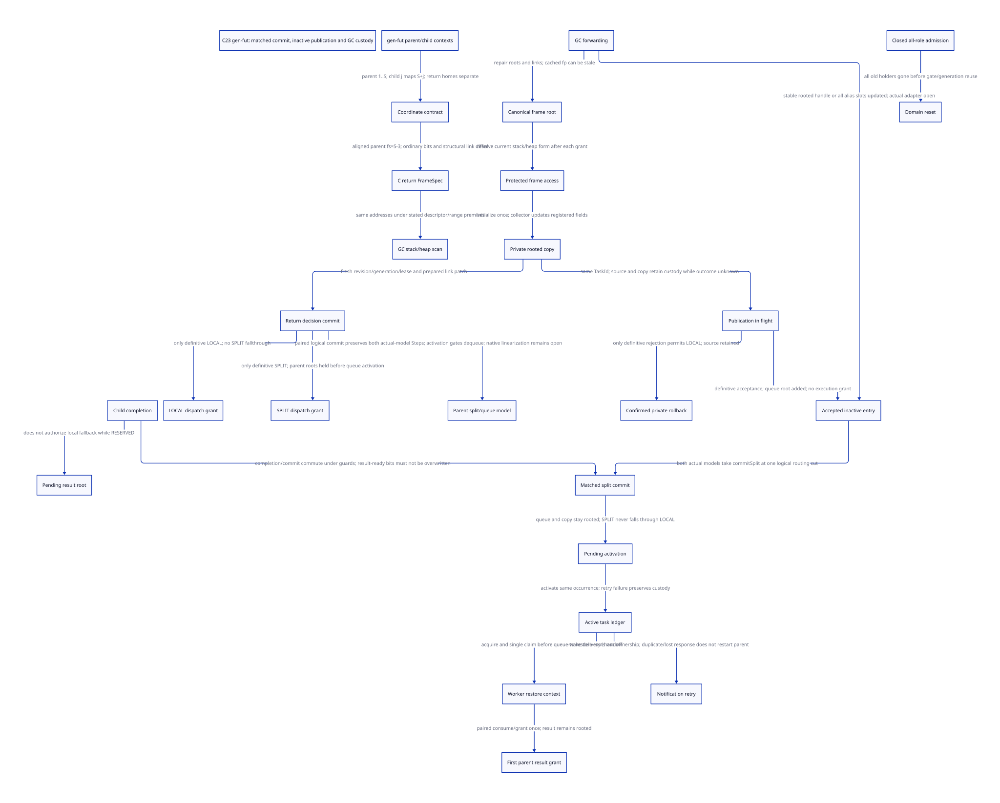
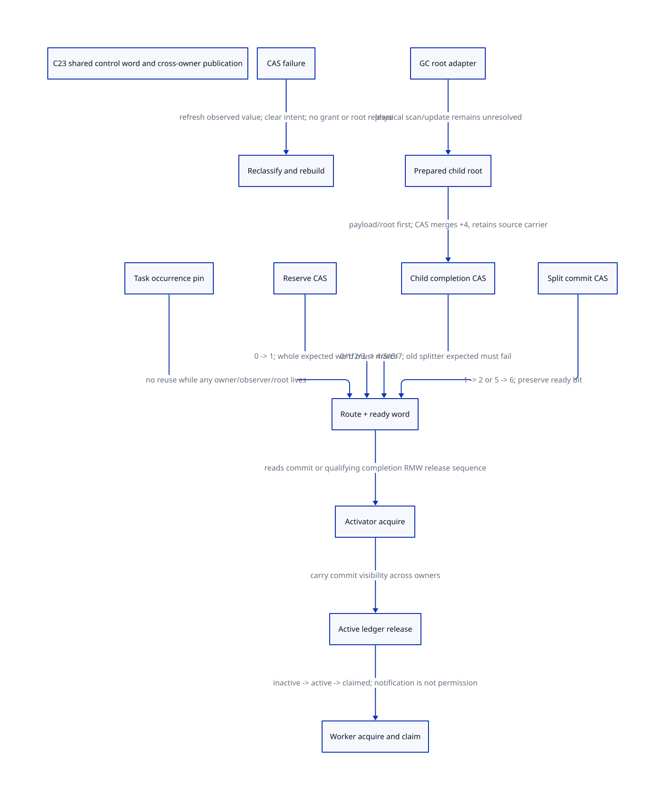
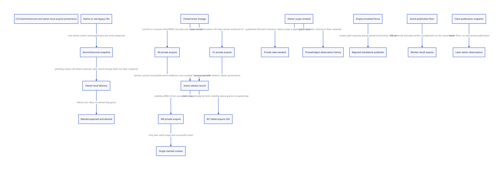

#+TITLE: gen-fut frame coordinates, forwarding and one return decision
#+SETUPFILE: ../../modeling/org/setup.org
#+LANGUAGE: en
#+CATEGORY: modern-c
#+PROPERTY: header-args :eval never :tangle no
#+OPTIONS: toc:3 num:nil

* RESEARCH Decision and evidence boundary :c23:gvm:gc:
:PROPERTIES:
:CUSTOM_ID: future-frame-commit
:AUTHORITY: GambitFutureFrameCommit
:BASELINE: C23
:STATUS: COORDINATE-LAWS; NORMAL-PRODUCT-PROOF; NATIVE-REFINEMENT-OPEN
:END:
Retain one Scheme-owned frame/return contract across future generation, physical
C emission and GC interpretation. A future split must decide LOCAL versus SPLIT
once, protect canonical source resolution against GC forwarding, and preserve
the executing child's roots while transferring only the parent region.

[[file:models/sysml/future-frame-commit.sysml][Native SysML]] owns source, component, learning, route, ordering, cost and
obligation records. Python invokes native SysML, [[file:../../modeling/ascent/future-frame-commit.rules.scm][actual ASCENT DSL]],
[[file:models/quint/future_frame_commit.qnt][QNT]], [[file:models/lean/FrameCommit.lean][Lean action preservation]], [[file:models/lean/FutureCoordinates.lean][coordinate laws]] and
[[file:models/lean/FrameCommitBridge.lean][the retained conditional bridge]]. [[file:future-frame-commit-matrix.org][The derived matrix]],
[[file:diagrams/future-frame-commit.d2][D2]] /  and [[file:../../../evidence/research/future-frame-commit/checks.json][check receipt]] distinguish each claim. This refines
[[file:lazy-future-split-design.org][the prior lazy-future study]]. No runtime implementation, generation/preprocessing,
native test or performance experiment is performed.

* RESEARCH Facts from paper versus source versus inference :evidence:
:PROPERTIES:
:CUSTOM_ID: future-frame-evidence
:END:
Feeley/Miller PVM section 2.7 supplies lazy parent materialization and task/work/done
control. The [[file:../../../evidence/research/future-frame-commit/pvm-paper-source.json][retained author-paper hashes]] identify the primary material. It does
not define the C23 access-generation, root-update or return-commit protocol below.
Those are explicitly proposed adaptations. Erlang's qualified-reader progress
mechanism motivates complete access/retirement boundaries; it is not proof that
Gambit's current GC gate admits scheduler readers.

This study uses current local vendor bytes, including earlier FrameSpec, GC-worker
and context refactoring. No statement upgrades these files to an unmodified
upstream release, effective installed Darwin configuration or native execution.

* RESEARCH gen-fut's exact logical partition :framespec:
:PROPERTIES:
:CUSTOM_ID: future-logical-partition
:END:
Use these symbols at the post-save construction point in
[[file:../../../vendor/gambit/gsc/_front.scm::(define (gen-fut node live reason)][gen-fut]]:

| Symbol | Current producer meaning |
|--------+--------------------------|
| T | highest live parent slot after saving live registers |
| R, A | target frame reserve and alignment; inspected C source sets 3 and 4 |
| S | frame-start, A*(ceil((T+R)/A)+1) |
| N | total nb-slots after child closed-variable placement and adjustment |
| k | original logical slot number, one-based |
| j | child-local logical slot number, one-based |

[[file:../../../vendor/gambit/gsc/_front.scm::(define (get-var opnd)][get-var]] and var->opnd show that slots is stored high-to-low: logical k
uses list index N-k. The parent return-context keeps the low logical interval
1..S via drop(N-S). The task-context keeps the high interval S+1..N and renumbers
j=k-S, with its high-to-low list rebuilt by reverse/drop/reverse. These are
coordinate/value-list operations; they do not prove ownership isolation from
reflective or foreign aliases.

The extra +1 alignment block is explicit source behavior. For A=4 and R=3,
S=4*((T+6)/4+1); the padding above T+R is between 4 and 7 slots. gen-fut marks
S-R+1..S as empty in its compiler slot bookkeeping via put-var. That operation
does not itself emit physical zero stores. A slot in a retained interval is not necessarily live
or an ordinary pointer root.

Before installing the task-return label in R0, live parent registers are saved.
[[file:../../../vendor/gambit/gsc/_front.scm::(define (save-opnd-to-reg opnd reg var live comment)][save-opnd-to-reg]] also preserves a live old register before overwriting it.
In the combined context, the temporary ret-var* names the new task-return label.
The task-context then reuses the ret-var role for its R0; the parent return-context
retains the old ret-var stack home, found later by its descriptor. This is a
context-relative role distinction, not a claim that child and parent always use
different compiler var objects.
Child R0, the parent structural return-link slot and a future result home are not
interchangeable coordinates.

* RESEARCH GVM to physical C to GC :coordinates:
:PROPERTIES:
:CUSTOM_ID: future-physical-coordinates
:END:
Let F be Gambit's virtual Scheme stack pointer =___fp= as emitted in C, and h
the emitter's current Scheme frame height. F is not the native C ABI stack pointer. The emitter
uses STK(k-h); the runtime macro defines FP_STK(F,o)=F[-o]. In word coordinates:
#+name: future-word-coordinate-law
#+begin_src text
address(F,h,k) = F+h-k
B = F+h
adjusting h to h' sets F' = F-(h'-h), preserving B
childBase = B-S
childAddress(j) = childBase-j = B-(S+j)
#+end_src
For valid 1<=k<=S and 1<=j<=N-S, parent and child word intervals are disjoint.
This is not a C pointer-provenance, allocated-range, global alias or source-value
proof. Those remain separate admission conditions.

A subtle emitter boundary is closed by source inspection:
[[file:../../../vendor/gambit/gsc/_t-c-2.scm::(set! targ-proc-entry-frame targ-proc-exit-frame)][label handling resets entry-frame to the label's own frame]] before generating
return metadata. One must not accidentally use the preceding linearized child's
instruction frame. At parent task-return, h=S and normal/task fs=S-R. Since S is
aligned, FRAME_SPACE(S-R)=S. The scanner adds that space to F and then scans
FP_STK(B,k), exactly B-k. Thus GC bit i and GVM parent slot k=i+1 meet at the same
word address under these stated conditions.

The child task-entry is a simple label with an empty TASK_PUSH hook, not a normal
return descriptor. At arbitrary child execution points, do not subtract R from
child height and call the result a GC frame size. Use the actual call/poll or
internal-return descriptor, saved registers and context roots. RETI also expands
stored cfs using its aligned saved-register region. Floating-point/boxed-value
readiness must match the actual point: targ-gen-jump calls targ-update-fr before
its jump/check sequence. The coordinate laws do not prove those flush effects.

** RESEARCH Structural link and ordinary roots
The return generator reverses/truncates the slot list to ascending 1..fs.
=targ-build-gc-map= puts live entry i in bit i. The zero-based ret-var position L
becomes structural slot L+1. The ordinary root cursor excludes that slot and the
GC traverses/repairs its link separately. Do not copy a bitmap and forget the
link interpretation.

A source mark_frame run [first,past) uses mark_array starting at B-(past-1),
length past-first, so ascending memory visits the same slot set in reverse slot
order. Captured-frame copying places RA at body[0], then copies source slots
fs..1 into body[1..fs]. Heap slot k is body[1+fs-k]; its inverse agrees with the
heap-frame scanner. RA, RETI's actual RA and structural links need their own
handling in addition to ordinary pointer bits. The captured-frame constructor
copies fs data cells, adds the RA body cell and the object header; it does not
blindly copy all S stack cells as GC-scannable payload. Under the inspected
EXTRA_SLOTS=1 and SUBTYPED_BODY=1, fs=9 uses 10 body words plus one header word,
whereas the aligned source span S is 12. The illustrative numbers are not a
compiled artifact. A new private-copy InitSpec must provide real GC-safe values
or a qualified initialized-slot map; compiler empty-var bookkeeping is insufficient.

** RESEARCH Illustrative layout, not a generated fixture
| Parameter / slot | Value / word address |
|------------------+----------------------|
| T=5, R=3, A=4 | S=12, normal parent fs=9 |
| N=14 | child slots j=1,2 correspond to original k=13,14 |
| B=100 | parent F=88, child F=86 at child-local height 2 |
| Parent ordinary roots k=2,5 | addresses 98,95 |
| Parent link L=2, hence k=3 | address 97, traversed separately |
| Illustrative full map 22 | bits for k=2,3,5; ordinary cursor yields [2,5] |
| Parent reserve k=10,11,12 | outside normal fs=9 |

Lean proves these arithmetic/bitmap observations. No Scheme example was compiled
to assert that its real live map equals this illustrative mask.

* RESEARCH Forwarding and reset races from actual writers :gc:
:PROPERTIES:
:CUSTOM_ID: future-forwarding-races
:END:
[[file:../../../vendor/gambit/lib/_mem/continuation-roots.inc][mark_captured_continuation_locked]] reads RA, obtains fs/link, adjusts the base,
and reads structural slot link+1. It may restore a stack RA, fill a destination
link, leave a fixnum-tagged forwarding pointer in the source link, and repair the
canonical root. A cached raw fp/link can therefore become stale even when an
immutable FrameSpec is unchanged.

Current public captured-continuation scan, stack continuation scan and heap-frame
scan acquire frame access using a collector_worker. The stack scan calls the
_locked helper inside the same access scope; it does not recursively reacquire.
[[file:../../../vendor/gambit/lib/_mem/copy-reservations.inc::___HIDDEN void acquire_frame_access][The helper]] spins on one VM gc_round.frame_gate. [[file:../../../vendor/gambit/lib/_mem/heap-sections.inc::___vms->gc_round.frame_gate = 0;][Round setup resets it]] only under
the stated premise that all old-round users crossed the barrier. The round epoch
is incremented there, before collection completes.

There are real non-GC writers too. =##frame-set!= in _kernel.scm stores to
body[fs-i+1] without acquiring this GC helper; =##implode-frame= in _io.scm is an
actual caller filling a newly constructed frame. The continuation-frame setter
is also a plain field store. Unpublished construction and later semantic mutation
must be classified separately. These paths do not establish a currently observed
race, but they prevent claiming that the GC frame gate already covers every
writer or exposed alias needed by a future concurrent split.

A scheduler cannot become an authorized reader by manufacturing collector_worker
or observing frame_gate==0. The mutex is released between GC operations while
other collection work may remain. A real runtime grant needs the broader GC
admission/phase-completion contract as well as local link exclusion. If new split
users survive a round reset, the old reset premise no longer covers all users.

The model's gate=2 denotes the whole relevant collector representation-update
interval, not the literal current 0/1 frame_gate. Its relocation action assumes
the source and registered initialized copy are updated before runtime access
resumes. It is not a one-store model of the forwarding-pointer write. Actual
root-census, closure and round-completion refinement remain open.

| Interleaving | Required protection / response |
|--------------+--------------------------------|
| GC forwards before split source read | Resolve a rooted canonical frame after the new grant; select current stack/heap coordinates |
| Split copies under a protected view | Exclude forwarding and conflicting child/alias writes until that read/copy interval ends |
| GC runs after private copy, before commit | Keep destination rooted and updated; refresh canonical source and prepared return patch before commit |
| Gate reused without relocation | A new grant still cannot blindly reuse an expired physical-address patch; retained logical coordinates may be re-resolved |
| Domain closes with accepted user | That user may finish; reset waits for all old access grants to end |
| Metadata unchanged but source moved | Descriptor equality alone is insufficient; source identity/representation and access grant must also match |

* RESEARCH One irreversible return decision :control:scheduler:
:PROPERTIES:
:CUSTOM_ID: future-return-decision
:END:
The proposed decision is OPEN -> RESERVED -> SPLIT or LOCAL. The child may close
OPEN directly to LOCAL after completion. Once closed, a decision never switches
between SPLIT and LOCAL for this admitted occurrence.

1. Root child completion independently of the parent's final route. RESERVED is
   not permission to fall through into the ordinary local parent.
2. Resolve source identity under a current frame/GC access grant. Create a GC-safe
   registered destination before initialization, then copy under an admissible
   snapshot. Keep the executing child's ordinary context roots throughout.
3. Prepare logical return/link metadata, resolving physical patch coordinates
   within the current grant. A post-GC validation can reuse an updated payload
   copy, but cannot reuse stale raw source addresses.
4. While RESERVED excludes local dispatch and frame access excludes GC/link
   writers, patch the relevant return/link/root interpretation. Release-publish
   SPLIT last. Resolve/validate/prepare may fuse when one protected interval suffices; the
   model does not require separate APIs or heap records. The logical QNT commit
   is atomic; the concrete C23 segment must
   prove it is non-abandonable or provide authoritative recovery custody.
5. Child dispatch acquires a definitive decision. LOCAL grants the existing
   ordinary-parent route; SPLIT publishes the rooted result and uses the remote
   parent/scheduler route. A child that read OPEN earlier must win an OPEN-to-LOCAL
   CAS before taking that route; check-then-return is insufficient.

The model's localGrants/remoteGrants count the first return-dispatch authorization
for one task occurrence. They do not count all Scheme suffix execution. Later
legal continuation shots retain their ordinary semantics. Cancellation, exception
and escaping-child control are not proved by this normal-return model.

Private preparation can abort to LOCAL while source custody remains intact.
The model does not abandon an already partially installed physical patch: patch
preparation is private, and commit abstracts the protected installation plus
final decision. An interrupted concrete installation must retain its stable
owner/roots and be settled; it cannot guess LOCAL and free the destination.

** RESEARCH Matched commit and separately gated activation :composition:
:PROPERTIES:
:CUSTOM_ID: future-matched-commit
:END:
[[file:models/quint/future_frame_activation.qnt][The paired QNT product]] retains all fields of both original models and adds
publication, active and attempt state. [[file:models/lean/FrameActivationMaps.lean][The projection maps]] select the actual
FrameCommitAst and LazySplitAst records, not independently invented summaries.
[[file:models/lean/FrameActivationProjection.lean][Every product action]] must refine one actual action or stutter in each original
Step relation. [[file:models/lean/FrameActivation.lean][The composition induction]] also preserves their cross-model relation
from the common initial state. Product schedules are deliberately restricted to
an admitted normal occurrence through its first return grant. This is neither a
simulation of every original-model schedule nor a complete Scheme semantics.

The physical proposal uses one stable task occurrence and one shared routing
decision. Both models' split flags denote the same logical decision; the design
does not propose atomically storing two unrelated flags. A protected frame patch
and durable root bookkeeping precede release-publication of that decision. The
paired model commit is its proposed linearization point. Real C23 instructions,
non-abandonment and recovery of partial bookkeeping remain unresolved.

| Cut | Product transition / exact projection | Root and execution responsibility |
|-----+---------------------------------------+-----------------------------------|
| Private initialized parent | allocate / initialize in both models | Source, child context and GC-safe destination remain registered |
| Publication request in flight | sendPublication; both original models stutter | Same stable TaskId; private copy and source retain custody even if an inactive queue entry exists |
| Definitive acceptance | acceptPublication maps to old publishReady; new model stutters | Old phase 3 has queueRoot but split=0; dequeue is still forbidden |
| Matched routing commit | commit maps to commitSplit in both models | Same logical SPLIT cut releases the parent source role; copy and queue own the parent; child roots are independent |
| Pending activation | activationFailed stutters in both models | No LOCAL fallback; queue and copy roots remain; retries may not create a new task identity |
| Execution activation | activate stutters in both models and sets active | Stable ledger authorizes dequeue; notification itself is not the transfer |
| Worker claim / restore | dequeue / restore map to old model; new model stutters | Queue to restore to execution context custody; destination role continues across these representations |
| First result consumption | grantRemote maps to consumeSplitResult | Both first-return accounts advance together; legal later continuation shots are outside this product |

*** RESEARCH C23 realization obligations, not instruction-level proof
:PROPERTIES:
:CUSTOM_ID: future-commit-memory-order
:END:
:ASSUMPTIONS:
The current QNT actions are logical atomic steps. No weak-memory, crash, native
pointer, scheduler implementation or asynchronous-unwind proof is issued here.
:END:

| Edge | Required happens-before / atomicity | Counterexample excluded only by this obligation |
|------+-------------------------------------+------------------------------------------------|
| Copy to inactive entry | Initialize GC-safe storage, register every pointer slot, then publish a stable rooted handle | A queued raw address becomes stale after GC even though the private root was updated |
| Child completion versus reservation | One serializable control decision covers OPEN/reservation and result-ready state, or an equivalent shared gate | Reading done=0 and later claiming OPEN after completion need not refine the atomic reserve guard |
| Return patch to SPLIT | Protected patch and root-role bookkeeping precede release commit | Publishing SPLIT before patch visibility permits a wrong return link |
| SPLIT to activation by another owner | Activator acquires the same committed occurrence before release-publishing active | A relaxed observation followed by release does not establish the required inter-thread handoff |
| Active to worker claim | Acquire active/decision and atomically claim the same TaskId; root transfer to restore/context is covered | Seeing a notification alone does not authorize payload reads or remove a root |
| Completion concurrent with commit | Preserve ready bits while updating routing; merge/retry rather than overwriting an entire stale control word | A whole-word store can lose a completed result or restore an obsolete route |
| Retry / duplicate response | Reconcile the same occurrence and acceptance record, including generation | Creating a fresh task identity can duplicate parent execution |

A packed control word or a non-abandonable shared control gate are candidate
realizations, not established implementations. Identity width, overflow, ABA,
late observers and asynchronous escape still need their own native proofs.
The native C23 contract must establish these edges; sequentially consistent QNT
execution is not evidence of weak-memory correctness.

The extra active guard strengthens old dequeueParent: SPLIT alone is insufficient
for admission to dequeue. Activating the ledger happens before an attempted wake.
A lost wake acknowledgement therefore cannot revoke a claim or permit a second
claim. Conversely, a failed activation before ledger acceptance leaves active=0
and the committed queue root in place. Recovery must inspect the stable ledger;
a timeout alone cannot distinguish these cases.

A local child may complete before reservation and choose LOCAL, or finish during
RESERVED and leave a rooted pending result. Completion does not authorize local
parent execution while a splitter holds RESERVED. If publication is definitively
rejected before the commit cut, abort maps to both original abort actions; the
source remains rooted and the subsequent local first-return is granted once.
Once acceptance is recorded, this reference protocol does not withdraw the entry:
it completes the matched commit or retains custody. Adding withdrawal would need
a separate negative-acceptance/late-claim proof.

** RESEARCH Unknown outcomes, GC and liveness boundaries :custody:
A definitive rejection is stronger than a negative acknowledgement or timeout:
it must certify that no accepted entry can later activate for this TaskId. While
publication remains unknown, abort is disabled and both source and private copy
remain rooted. Reconciliation may accept or definitively reject the same request.
This models delivery uncertainty without pretending an unobserved queue root is
already known. The destination's registered private root covers that interval. Any physical
inactive entry must refer through that same stable rooted handle, or independently
register its pointer slots; a stale raw copy address is not covered by this claim.

GC entry pairs new enterGc with old closeGc. The old freeze/begin/end root-scan
steps surround the new representation-forwarding steps. Runtime frame access and
GC update are mutually exclusive. Completion cannot add result roots while this
root view is frozen. GC may occur before commit or during pending activation;
the initialized destination must be scanned and updated, and a subsequent commit
requires fresh source resolution and patch preparation. This is an abstract
root-publication and relocation premise, not an implementation of slot scanning.
GC after worker restore must update the execution-context representation too.

Do not hold a FIFO gate while waiting for frame access. Current
[[file:../../../vendor/gambit/lib/_mem/heap-sections.inc::___HIDDEN void end_heap_chunk][GC chunk publication]] changes chunk authority before linking, orders payload/link
visibility before tail visibility, and notifies after publication. Its
[[file:../../../vendor/gambit/lib/_mem/heap-sections.inc::___HIDDEN ___WORD *take_heap_chunk][consumer]] claims authority before advancing the head. These are useful local
ordering facts, not an existing future-task queue or proof of the new protocol.
The current frame-access code can publish GC work while holding frame access;
reversing that lock order is not admitted.

K uncertain responses or lost notifications require zero extra child starts and
zero additional parent initializations in this fixed-occurrence model. They do
require K reconciliation/notification attempts and potentially unbounded root
retention. No fairness, eventual successful service or bounded-memory progress
claim follows from safety induction. Permanent service failure can strand the
accepted task; Scheme-preserving recovery, cancellation and shutdown remain open.

** RESEARCH What is proved versus still missing
[[file:models/lean/FrameCommitBridge.lean][The earlier bridge and safe-pair witness]] remain unchanged: separate safe
milestones do not establish Coupled. The new product adds an explicit protocol
whose steps maintain matching from the initial state; it does not invalidate or
hide the earlier witness. Matched commit and activation are different cuts, with
root custody retained between them.

| Claim | Status / boundary |
|-------+-------------------|
| Each admitted product step maps to both actual Step relations | Lean projection equations, including stutters |
| Matching and both safety predicates hold for reachable product prefixes | Induction over the 36 product actions |
| Unknown publication cannot authorize rollback; inactive committed parent remains rooted | Model guards and safety consequences |
| Child completion never independently grants a duplicate local parent | First-grant accounting; not a restriction on legal multishot suffix execution |
| C23 release/acquire implementation realizes the paired cut | Unresolved; no task queue implementation exists in the empty hooks |
| Actual GC updates every copied field, link and restored context | Unresolved source-to-slot and root-census refinement |
| Exceptions, escaping continuation, cancellation, retirement and shutdown compose | Unresolved; not covered by normal-prefix induction |
| Speedup or bounded retry/retention cost | Unmeasured; conditional cost formulas only |

Paper fact: PVM section 2.7 describes lazy parent reconstruction and the child's
local-return versus placeholder-result alternatives. Current source fact: GVM
emits task hooks and descriptors, but these C hooks are empty; the GC chunk queue
has its own authority and publication ordering. Our inference: inactive staging,
a shared routing linearization point and separately gated activation are a
candidate C23 realization. The paper does not supply this memory-order protocol.

* RESEARCH Reuse versus structural refactoring :architecture:
:PROPERTIES:
:CUSTOM_ID: future-frame-reuse
:END:
| Responsibility | Reuse | Necessary change / admission condition |
|----------------+-------+---------------------------------------|
| Logical partition | gen-fut saves, parent/child context construction | One sealed semantic cut and exact program-point root/return plan |
| Physical root interpretation | Current normal/internal decoder, bit order and ordinary/link traversal | Prove source/destination addresses, boxing state, sparse initialization and actual variable identities |
| Canonical root | Existing captured-continuation moving updates | A registered task/frame handle and a real resolver for the current representation |
| Frame access | Current GC exclusion discipline and existing GC admission machinery | All-role lifetime/reset contract; no fake collector worker |
| Return labels | Existing task-return and ordinary fallback labels | A single decision protocol plus protected link/routing patch; hooks are currently empty |
| Queue and restore | Existing runnable-thread machinery | Rooted handoff and product proof; no need to duplicate the whole scheduler |

The single global frame gate is a correctness reference and a potential contention
source: it currently covers root-chain scanning/link mutation. No dominant
bottleneck is inferred without measurement. Finer per-frame/chain domains need a
canonical identity and overlap/alias proof: two processors can share captured
tails, and local parent/child coordinate disjointness does not prove global
independence. A read-only lock shortcut is also unjustified where scanners write
roots or return/link cells.

* RESEARCH Model, laws and countercontrols :qnt:lean:ascent:
:PROPERTIES:
:CUSTOM_ID: future-frame-model
:END:
Source stability concerns the frame cells, layout and structural links being
copied. It is not a deep freeze or copy of referenced Scheme objects. A shared
lexical box or heap object must keep its identity in both continuations; copying
the frame does not copy that object's contents. Concurrent effects on those
referents need their own Scheme memory/effect contract. A direct frame-slot or
link mutation is a different snapshot-invalidating writer.

The QNT protocol has 21 actions and unbounded logical revision/generation/grant
counters for one normal return occurrence. Root presence, an initialized copy,
canonical-view freshness, patch freshness, all-role gate closure/reset and first
route grants are modeled. Registered-copy GC updates and complete access census
are premises until mapped to real slots and callers. Finite native counters need
an exhaustion policy; no wraparound/ABA correctness follows from Int counters.

Typed IR extraction produces FrameCommitAst. Lean checks action preservation,
reachable-state safety, no local dispatch after SPLIT, one first-route grant,
root presence and at most one copy initialization across relocation/revalidation.
FutureCoordinates proves word-coordinate laws and the explicit illustration.
Neither establishes C pointer provenance, all actual root values, GVM source
semantic equivalence or C23 weak-memory behavior.

Ten controls include seven invariant-breaking mutants and three transition-guard
requirement mutants. The latter show that admitting a stale relocation patch,
a stale grant patch or overlapping runtime/GC access violates the declared
precondition; they are not mislabeled as proof of native memory corruption.
Every prefix is independently checked with the original AST. Expected mutant
failures and earlier unsuccessful proof attempts remain retained.

ASCENT executes exact source/action/lemma/component, source-path, learning,
ordering and gain joins. It rejects calling the GC helper an existing scheduler
API, ignoring new users at reset, equating a logical slot with a C pointer, using
child height-minus-reserve everywhere, falling through locally after SPLIT,
reusing stale fp, or treating coordinate disjointness as alias closure. The real
native candidate remains blocked; a complete synthetic fixture is only a check
of the evidence plumbing.

* RESEARCH Net return and added work :benefits:
:PROPERTIES:
:CUSTOM_ID: future-frame-benefit
:END:
| Measure | Conditional gain | Added work / invalidating condition |
|---------+------------------+-------------------------------------|
| Source/layout rules | Reuse one coordinate/descriptor interpretation | Semantic boxing/liveness and actual pointer ranges still need validation |
| One copy across J GC cycles | Avoid J redundant full payload initializations when GC already updated the copy | J canonical revalidations and patch preparations; new roots add GC scan/retention |
| First-return routing | Exclude duplicate local/remote grant | Decision atomics, pending result roots and protected patch |
| Shared access domain | Reuse known exclusion rather than unrelated link readers | Global gate can serialize unrelated work; new roles/reset may add contention |
| Finer domains | Potentially reduce unrelated-chain waiting | Identity, aliases, lock order and lifetime proof are required first |
| Current empty task hooks | Add real routing capability | No existing task-hook allocation is removed; useful parallel work must pay for new overhead |

If B_i bytes would otherwise be recopied after each of J relocation cycles, the
conditional avoided copy work is sum(B_i). It wins only when that work exceeds
extra validation, root scanning/retention and contention in the same units. It
may save zero if a frame-slot/link semantic write forces reconstruction, a private field was not
registered, or the correct competing design already revalidates without recopy.
No timing, byte volume, speedup or person-day estimate is invented.

* RESEARCH Closure ledger :gaps:
:PROPERTIES:
:CUSTOM_ID: future-frame-open
:END:
- [X] Static parent/child indexing and current aligned-parent GC coordinate laws.
- [X] Distinguish child R0, saved parent return link, result and descriptor RA.
- [X] Locate actual forwarding/link writers and current GC-only gate/reset premise.
- [X] Check abstract return-decision, root presence, revalidation and copy count.
- [X] Import actual parent AST with an explicit conditional coupling law.
- [ ] Prove actual variable/type/boxed-slot maps and safe allocated pointer ranges.
- [ ] Implement/qualify canonical resolver, all-role census and registered-copy GC updates.
- [ ] Refine concrete return patch, interrupted installation and C23 atomics.
- [ ] Prove product steps, queue activation, full continuation and error/cancel semantics.
- [ ] Establish native/effective cohort and net runtime return before retiring old paths.

The design stays within the existing [[file:runtime-blueprint.org][modern-C runtime blueprint]]. No native
path retires merely because coordinate arithmetic and an abstract protocol pass.

* RESEARCH Shared route/completion control word :c23:cas:handoff:
:PROPERTIES:
:CUSTOM_ID: future-control-word
:AUTHORITY: GambitFutureFrameCommit
:STATUS: SC-REFINEMENT; CONDITIONAL-HB; NATIVE-ADAPTER-OPEN
:END:
[[file:models/quint/future_control_word.qnt][The CAS refinement]] extends the actual paired product. Its 84-field state
projects back to that product through [[file:models/lean/ControlWordMaps.lean][a checked record map]], and
[[file:models/lean/ControlWordProjection.lean][each of its 48 actions]] refines a product action or stutter.
[[file:models/lean/ControlWord.lean][Reachability induction]] composes with the previous induction into both original
models. [[file:models/lean/ControlWordLaws.lean][Encoding, stale-CAS, budget and conditional HB laws]] have distinct scopes.
[[file:diagrams/future-control-word.d2][The focused D2 source]] /  is generated from native SysML edges.

** RESEARCH Actual primitive boundary
The local [[file:../../../vendor/gambit/include/_gambit/activity_log.h.in][ordered-word service]] exposes a real adapter mismatch:

| Conditional source branch | Observed behavior | Refactoring consequence |
|---------------------------+-------------------+-------------------------|
| __atomic native CAS | strong CAS; success acquire; failure relaxed; expected is an output lvalue | Cannot publish result or patched frame with this acquire-only success order |
| Legacy Boolean CAS wrapper | compares observed old value with expected; does not assign expected | A caller cannot assume the native branch's expected-update semantics |
| Legacy acquire load | can be implemented using old-value CAS(p,0,0) | A load can add backend RMW work beyond the model's state-changing CAS budget |
| No-thread / stopped-storage access | source restricts plain access to qualified exclusive situations | New concurrent task control must not mix atomic and plain access |

These are conditional-source facts, not a claim about an installed Darwin
binary or an executed preprocessing profile. Current TASK hooks remain empty.
The proposed publisher needs a typed, observation-returning atomic service. An
AtomicOutcome contains exchanged and observed; callers rebuild desired from
observed after every failure. This is a design schema, not implemented C code.

Use a distinct stable task record with suitably aligned typed atomic storage,
for example a qualified _Atomic(uint32_t) when that exact-width type exists, rather than casting a live
Scheme object's raw word to an atomic pointer. Padding-free representation must
be qualified too; a minimum-width typedef alone does not establish that property.
A nonpadding unsigned-char or qualified emulated service is a separate portability
choice, not assumed to share the same lock-free behavior. Lock-freedom, emulated fallback,
reentrancy and async-signal behavior require profile qualification. None is
inferred from the existence of a builtin macro.

** RESEARCH Encoding and occurrence lifetime
For one pinned occurrence, route is OPEN=0, RESERVED=1, SPLIT=2 or LOCAL=3.
The ready bit occupies bit 2: word=route+4*ready. SysML owns the eight layout rows;
Lean proves injectivity for route in 0..3 and ready in 0..1. The integer proof is
not a proof of concrete C object representation or atomic address alignment.

| Word | Route | Result |
|------+-------+--------|
| 0 / 4 | OPEN | pending / ready |
| 1 / 5 | RESERVED | pending / ready |
| 2 / 6 | SPLIT | pending / ready |
| 3 / 7 | LOCAL | pending / ready |

A task occurrence pin must precede any load or CAS. The word has no generation
field: its address and identity may not be reused while an owner, queue entry,
GC root or late observer remains. Domain-generation reset in the older frame
access model is not permission to recycle this task record. Within one modeled
occurrence, state-changing word CAS only increases the word; cross-occurrence
ABA, retirement and wraparound remain unresolved native obligations.

** RESEARCH Rebuild from the whole observation
:PROPERTIES:
:CUSTOM_ID: future-word-cas-races
:END:
| Operation | Expected / desired | Required custody and failure response |
|-----------+--------------------+---------------------------------------|
| Reserve | 0 -> 1 | Compare route and readiness together; a separate done load is insufficient |
| Child completes | observed pending word -> observed+4 | Result is already in a registered child-context carrier; failure retains that carrier |
| Split commits | 1 -> 2 or 5 -> 6 | Require fresh frame/root/patch grant as well as matching expected; never overwrite ready with a stale desired=2 |
| Private abort | 1 -> 3 or 5 -> 7 | Only definitive rejection/no-publication permits this route; preserve ready |
| Local closes | 4 -> 7 | Completion won before reservation; return locally only after successful close |
| Any failed weak CAS | no control-word or parent transfer | Record observed, clear intent and reclassify; equal observed can still be a spurious failure |

The child carrier remains live even after successful completion until shared-root
delivery permits explicit retirement. This avoids treating CAS success as an
implicit physical root deallocation. The model relies on existing child context
root coverage; actual slot registration and GC updating are still adapter gaps.

If child completion wins over reserve, 0 becomes 4 and the stale reserve fails.
If reserve wins, the child reloads 1 and publishes 5. At commit, a child changing
1 to 5 invalidates expected=1; a rebuilt commit publishes 6. If commit wins first,
the child reloads 2 and publishes 6. Neither history authorizes local parent
execution after SPLIT. The ten source-bound histories also cover weak spurious
failure, confirmed abort and GC between patch preparation and commit.

A matching word does not validate raw frame addresses. GC can move a frame while
leaving the control word unchanged. Therefore commit retains the earlier frame
access/revision/lease guard; reacquire and prepare a fresh patch after relocation.
The stable native control address and the movable Scheme frame are different
lifetime domains.

** RESEARCH Cross-owner publication and reads-from
The reference order policy uses success acq_rel and failure acquire for control
CAS; it is intentionally conservative. Narrower operation-specific orders need
separate refinement. [[https://www.open-std.org/jtc1/sc22/wg14/www/docs/n3096.pdf][WG14 N3096]] 7.17.7.4 supplies the failure-order and weak-CAS
rules; 5.1.2.4 supplies the release-sequence/acquire rule. The
[[file:../../../evidence/research/source-references/c23-control-word/observations.org][retained observation note]] identifies the inspected working draft and limits;
it is not a locally retained primary PDF or a final-ISO equivalence receipt.

#+name: future-word-owner-relay
#+begin_src text
copy/result storage and root preparation
  -> commit CAS release
  -> activator acquire reading commit or its qualifying RMW release sequence
  -> active-ledger CAS release
  -> worker acquire / single claim
  -> frame restoration and payload use
#+end_src
If child completion follows commit, its RMW can carry the commit publication to
the activator. If completion precedes commit, commit can acquire that completion.
Actual reads-from and live occurrence identity are required; seeing the numeric
value 2 or 6 alone does not prove either edge. Active-ledger and worker acquire
witnesses are separate. Remote result consumption also needs the result's
publication edge; the reference model tracks it separately. A real observation
could discharge multiple edges only with a proof that its reads-from does so.

The QNT model abstracts qualifying observations with witness state. The aSeen
and workerSeen slots belong to the modeled activator and claimant roles; they
are not global permissions that another owner can borrow. Actual per-owner
event provenance and multiple competing activators/claimants require further
refinement.  Lean proves
that active and claimed states retain those witnesses and composes an HB graph
from explicit sequenced-before / synchronizes-with premises. It does not prove
that arbitrary C23 executions satisfy those premises. Full modification-order,
reads-from, data-race freedom, alias/root coverage and architecture lowering
remain unresolved. Stale/nonqualifying polls grant nothing and may stutter;
no fairness or successful retry bound is claimed.

** RESEARCH Benefit and added-work budget
| Dimension | Established model result | Cost / remaining admission |
|-----------+--------------------------+----------------------------|
| Successful state-changing word CAS | At most 3 per normal occurrence | Unbounded contention/spurious failures; prepare/registration/GC work excluded |
| Word plus activation/claim | At most 5 state-changing protocol CAS | Not a bound on all backend RMW instructions; legacy loads can themselves use CAS |
| Duplicate execution | Whole-word arbitration preserves ready and route and inherits the first-return uniqueness proof | One shared task cache line and stable occurrence pin |
| GC relocation | Does not force rebuilding the control record | Still requires actual frame/root update and fresh patch preparation |
| Cross-owner relay | Conditional publication witnesses and HB graph compose | At least the required ordering edges; no measured latency or weak-memory implementation proof |
| Current service retirement | New protocol can avoid split-specific Boolean-CAS/expected conventions | Existing lock callers cannot be retired wholesale; no runtime path has been replaced |

This makes C23 the shared runtime contract. It does not depend on Zig and does
not establish a language-specific advantage. Against an equally correct modern C
reference, the gain is a proved bounded protocol and explicit adapter boundary;
useful parallel work must still exceed synchronization, copy and GC overhead.

* RESEARCH AtomicOutcome and owner-local acquire authority :c23:ffi:provenance:
:PROPERTIES:
:CUSTOM_ID: future-atomic-outcome
:AUTHORITY: GambitFutureFrameCommit
:STATUS: MODEL-REFINEMENT; NATIVE-LOWERING-AND-RF-CLOSURE-OPEN
:END:
[[file:models/quint/future_atomic_owner.qnt][The owner refinement]] adds per-owner outcome delivery, two activators, two
claimants and immutable publication-source snapshots to the actual control-word
model. [[file:models/lean/AtomicOwnerProjection.lean][Each action projects]] to its real prior-model action or stutter;
[[file:models/lean/AtomicOwner.lean][induction]] and [[file:models/lean/AtomicOwnerOutcomeLaws.lean][normalization laws]] have separate source and backend premises.
[[file:models/lean/AtomicOwnerMaps.lean][Semantic domains]] separate publication history, delivered outcomes and private
owner views. [[file:diagrams/future-atomic-outcome.d2][D2]] /  and [[file:future-frame-commit-matrix.org][the SysML-derived matrix]] expose the boundaries.

** RESEARCH Minimal interface and actual local consumers
#+name: atomic-outcome-schema
#+begin_src text
AtomicOutcome = { exchanged: Boolean, observed: Word }
observed = the read component of THIS atomic attempt
success: observed = immutable expected-before, not desired-after
failure: observed = the operation's returned old value / expected-after
#+end_src
Word here is the native scalar protocol code, not an arbitrary SCMOBJ. Extending
this interface to object-valued CAS requires a separate GC root/update contract.
This is an interface schema, not implemented C. Operation kind, AtomicRef,
occurrence pin, owner scope and memory-order policy are separate inputs. They
must not be inferred from exchanged or from numeric equality. Expected and
desired are evaluated once, with no expected/object alias or effectful macro
argument admitted. The new caller explicitly rebuilds desired from observed.

| Local source | What it supplies | What it does not supply |
|--------------+------------------+-------------------------|
| activity_log native conditional branch | expected-after on failure; source success acquire / failure relaxed | A release publisher or an acquire credential on failure |
| legacy Boolean wrapper | Equality of returned old value and expected | The discarded old value as a caller-visible result |
| os_thread emulated CAS | temp captured under the address's hash mutex, then returned | A lock-free, reentrant or async-signal-safe guarantee |
| emulated_shared_memory_barrier | Empty function body | A standalone release fence |
| PRIMTRYLOCK -> TICKETLOCK_TRYLOCK2 | Existing Boolean caller initializes temp from current | A current AtomicOutcome delivery/retry client |
| thread_set_pstate | TLS/PSTATE rebinding | A NativeScope generation or owner acquire authority |

The raw emulated CAS unlocks before returning its local temp. Another owner can
change the cell during that return interval without changing the captured result.
Calling the Boolean wrapper and loading again cannot reconstruct the same event.
An explicit raw old-value adapter can avoid that extra read. A returned false
is a known comparison outcome, distinct from a native call abandoned before
response capture. The model covers normal capture and delayed delivery; unknown
completion after unwind/cancellation must retain its task pin and recovery
responsibility and is not permission to retry as a fresh task or free storage.
That native capture/guard refinement remains open. This is not a claim
that existing Boolean ticket-lock callers are wrong or should all change at once.

The branch algebra proves agreement for matching strong-CAS observations. A
native weak CAS may fail with observed==expected; a legacy raw equality comparison
means success in that case. Legacy strong behavior refines the weak contract but
does not reproduce every weak-failure history. Normalization must preserve this
distinction rather than manufacture success from equality after a weak failure.

** RESEARCH Four independent rights
| Right | Evidence required | Insufficient substitute |
|-------+-------------------+-------------------------|
| Value observation | Single atomic event and immutable local snapshot | A later load or desired value |
| Visibility | Qualifying read order and reads-from/release lineage | exchanged alone, numeric SPLIT or an empty fence |
| Task ownership | Correct object/occurrence and successful single claim | An acquire view, including one obtained on failed CAS |
| Storage access | Live task pin, root/update lease and descriptor lifetime | HB alone or a stale raw Scheme pointer |

The proposed acquire-failure policy can give a losing claimant visibility from
the winner's release, while leaving claimedOwner unchanged. The old native
macro's relaxed failure cannot do that. The model has a specific failed-claim
acquire action; it does not turn every failure or every observed value into a
credential. Root custody is preserved across failed split/child attempts.

** RESEARCH Private views and publication records
A0 and A1 each issue their own view; W0 and W1 do likewise. Private view validity
includes its owner slot and scope generation. A0's successful observation cannot
permit A1 activation; W0 visibility cannot permit W1 claim. Scope renewal clears
that owner's private view. A winning worker cannot renew away its claimed context
without a separate ownership transfer, which this normal-prefix model excludes.

Already published active/claim records retain copied semantic evidence, not a
pointer to an expiring observer's stack view. Renewing the issuing scope therefore
does not undo an earlier publication. The claim's HB floor is captured at claim
time; it is not retroactively strengthened by the winner's later observations.
The native thread/return domain and root handoff needed to realize these records
remain open. A processor index, PSTATE pointer or TLS binding is not that proof.

** RESEARCH Real reads-from versus proof ghosts
The C atomic API returns no historical write identifier. RF kinds in QNT identify
proof cases: commit release, covered child RMW, active publication or claim
publication. Runtime code cannot issue those identifiers merely by inspecting
AtomicOutcome. A valid implementation must prove the closed writer set, source
lineage, fixed occurrence identity and per-owner ordering for its generated sites.
Unknown stores, raw aliases, reset/reuse or untracked native callbacks invalidate
that argument and must prevent admission.

The model retains commit/child write snapshots, including the case where both
orders produce numeric word 6. Source identity and carried publication differ
between those histories. Activator views may read a qualifying older commit while
a child RMW exists, if coherence permits it. The old model's aWord remains an
abstract route representative; the new owner's Value/Rf fields carry the chosen
observation. The projection is not a claim that those two scalars are identical
physical reads.

For this fixed occurrence only, successful control-word transitions strictly
increase their encoded value. Numeric observation floors therefore model a
necessary modification-order constraint. They are not a general atomic-value
ordering rule and cannot survive arbitrary reset/ABA. Read-read and write-read
coherence from WG14 N3096 5.1.2.4 are applied as follows:

| History | Required restriction |
|---------+----------------------|
| Owner observed child word 6, then renews its scope | Renewal revokes the view but retains the same thread's observation floor; it cannot reread older commit word 2 |
| Child publishes 5, splitter commits 6, activator relays that commit to worker | Worker cannot use earlier control-word write 5 as its later read; use commit 6 carrying child publication |
| Worker acquired claim write 2 on activation cell | A later read of active write 1 is below its activation-cell floor |
| Native call returns an earlier captured outcome after another owner writes | Local delivery is not a new atomic read; it retains the original observed snapshot |

Each modeled role has a stable thread-domain interpretation for the fixed atomic
object. Nested scopes sharing a physical thread must share/join its observation
history; migration must establish a new owner handoff. Neither mapping is inferred
from the finite owner slots.

Floors are proof ghosts expressing C23 constraints, not a proposal for a global
runtime event counter or a log per CAS. Scope generations and thread observation
history are different. Native thread migration, arbitrary owner counts, complete
HB/MO/RF consistency and compiler lowering are still unproved. Necessary coherence
guards do not constitute a complete C23 execution model.

** RESEARCH Backend admission and retirement
A typed AtomicRef selects one storage domain. A C23 atomic cell cannot be mixed
with arbitrary plain loads or casts through the old volatile-word interface.
A mutex-backed cell is a separate qualified representation: all accesses must
use the same domain, with data sequenced before release unlock and after matching
acquire. Hash collisions may add contention. The empty emulated fence is never a
substitute for that lock/unlock argument.

| Old responsibility | Proposed replacement | Retirement condition |
|--------------------+----------------------+----------------------|
| Branch-specific expected mutation in new managed callers | AtomicOutcome plus explicit caller rebuild | Every new call consumes the single-event normalized result |
| Boolean-plus-reread reconstruction | Raw old-value / native expected-after capture | Source audit excludes the second load as CAS evidence |
| Global aSeen/workerSeen treated as executable permission | Owner-local view plus valid scope and exclusive claim | Native issuer, aliases and exception paths refine the private-view contract |
| Blanket legacy-fence assumption | Explicit native-order or qualified mutex-domain evidence | All relevant writers/readers are covered; unsupported paths reject admission |
| Existing Boolean ticket-lock ABI | Keep until separately migrated, possibly project exchanged later | All real consumers and storage/layout profiles qualify; not retired by this study |

No runtime path has been replaced. The reference AtomicOutcome has two logical
scalar outputs; ABI padding/register return costs are unmeasured. Normalization
needs no extra atomic load to obtain that same event and no mandatory heap
receipt. Per-owner scopes, pins, root updates and backend qualification still
cost support work. Equally correct modern C can implement the same interface;
there is no established Zig-specific gain or measured native speedup.

* RESEARCH Net-work accounting against an equally correct reference :cost:
:PROPERTIES:
:CUSTOM_ID: future-product-net-return
:END:
The product adds 36 actions to the research model, not 36 mandatory native APIs
or 36 atomics per task. Canonical resolution, validation and patch preparation
may fuse inside one qualified access interval. The reference protocol retains
two distinct ordering cuts: routing commit and activation permission. Any fusion
needs a proof that inactive publication and worker admission preserve both cuts.

| Dimension | Proven or conditional bound | Cost / fair comparison |
|-----------+-----------------------------+------------------------|
| K outcome/notification retries | No additional child starts or parent initialization in this fixed-occurrence model | K attempts; stable identity and possibly unbounded root retention |
| J GC representation updates | At most one initial copy, conditional on complete registered-copy updates | J revalidations/patch preparations; actual pointer scanning remains open |
| First parent dispatch | At most one first grant across local and remote routes | Shared routing decision, active guard and root handoff |
| Equally correct modern C reference | Avoided retry-copy work may be zero | Do not assume every alternative recopies or rematerializes |
| Parallelism | Protocol can admit the previously suspended parent safely under its premises | Useful parallel work must exceed copy, synchronization, GC and contention overhead |
| Long failure interval | Safety preserves roots and task responsibility | No finite memory or completion bound without progress/recovery assumptions |

No speedup, byte count or latency estimate is claimed. Retained bytes include
additional reachable object graphs, not only copied frame words. This study
provides a necessary correctness foundation for exploiting Feeley's lazy-future
design; it does not replace the separate source-to-runtime and performance gates.
The final derived matrix is [[file:future-frame-commit-matrix.org][generated from native SysML rows]].

* RESEARCH NativeScope issuance and native writer closure
:PROPERTIES:
:CUSTOM_ID: native-scope-writer-closure-link
:END:

See [[file:native-scope-writers-design.org][NativeScope issuance and closed native writers]] and its
[[file:native-scope-writers-matrix.org][SysML-derived evidence/return matrix]]. The actual owner AST is linked to a
conditional scope-interface proof; native issuance, all-writer closure and
full C23/product refinement remain unresolved. No runtime path is retired.
