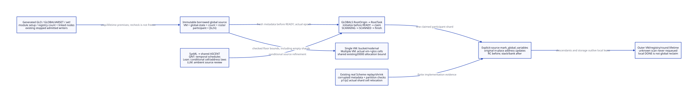

#+TITLE: Global-variable shards as explicit sources and tasks
#+SETUPFILE: ../../modeling/org/setup.org
#+LANGUAGE: en
#+TODO: VERIFYING READY | PUBLISHED
#+PROPERTY: header-args :eval never :exports code
#+COLUMNS: %44ITEM(Responsibility) %STATE(State) %GAP(Boundary)

* Current source-period boundary :audit:historical:
The =GambitGlobalsRootTask::storageReplacement= SysML reference points to
=GambitRequestProduct::globalStorage=. The fixed-array descriptions below are
historical REV evidence, not the current storage contract. See
[[file:request-product.org][the current whole-delivery projection]] and
[[file:../../../evidence/research/retained/modern-c/request-product/global-storage-evidence.json][source-bound storage qualification]].

* READY Complete globals shard-entry responsibility :rev:gc:ownership:
:PROPERTIES:
:CUSTOM_ID: REV-GLOBALS-ROOT-TASK
:AUTHORITY: GambitGlobalsRootTask
:SOURCE: models/sysml/globals-root-task.sysml
:BASE_REVISION: caa630e99a2d48b4a338eeb248f788990b73b19a
:SOURCE_TREE: 93111a9e643162dbd8d30d47d85d0932c2ab6d85
:STATUS: Scoped source/native/model review complete; actual admission/publication recorded separately
:END:

[[file:models/sysml/globals-root-task.sysml][SysML]] owns the responsibility, dependencies and five scoped needs.
[[file:globals-root-task.d2][D2]] projects those contracts. [[file:symkey-root-task-result.org][SYMKEY]] is the predecessor. This is one complete
local globals entry protocol, not a registry lock, total census or whole SMP.

** Real sources, writers and consumers :source:contract:

| Source path | Writer / consumer | Disposition |
|-------------+-------------------+-------------|
| =memory-lifecycle.inc:setup_mem_vmstate= | Allocates20000 glos slots and initializes UNB1 | Same physical size, now shared =GLOBALS_CAPACITY=; no increase |
| =global-bindings.inc:glo_list_setup/add,make_global_var= | Initializes count/list, assigns global index, appends node | Count/list topology must be stable while view is admitted |
| =setup.c= module binding | Writes UNB markers; registration adds globals | Existing setup/VM lifetime and stop premises; cross-VM additions OPEN |
| =gsc/_t-c-2.scm:##global-var-set!= | Emits GLOBALVARSET for actual ordinary cell | Generator namespace/semantics unchanged |
| =gambit.h:GLO,GLOBALVARSET,GLOCELL_IN_VM= | Generated ordinary global reads/writes | VM glos or single-VM val cells; existing writer safepoints retained |
| =_kernel.scm:##global-var-set!= | Reflective Scheme writer through same primitive | Ordinary controlled writer, not a new bypass |
| =root-tasks.inc= | Captures count,roster,index and checked interval before READY | Descriptor borrowed read-only; fresh publication guard shared |
| =root-origins.inc:mark_global_variables= | Explicit descriptor drives actual cell traversal | Original visitor name retained; no payload-value snapshot |
| =collection-round.inc= | After RC and before stack/bank, one task per current participant | Actual nonzero RC epoch and old ordering retained |

Primitive PRMCELL setters belong to a separate permanent/runtime contract;
they are not silently added to ordinary global roots. Arbitrary raw/native
writes and other-VM registration are not made safe by the new task tag.
The audited tree has a glos growth TODO and no explicit glos free endpoint;
this REV does not infer reclamation safety or fix that lifetime design.

** Physical source and partition :layout:

=global_root_source= contains actual global-state/VM pointers, registry count,
participant count/index and half-open bounds. It lives in valid fresh caller
C storage and is read-only through the task origin. Its lifetime covers all
uses of the pointer. This is not an asynchronous address/identity service.

- Single VM: partition =GLO_SUBLIST_COUNT= buckets, visit each selected linked
  node's =val= cell. Under SINGLE_VM, old GLOCELL is that exact identity.
- Multiple VM: partition the captured registry count, visit the actual
  =source.vm->glos[lo..hi)= cells.
- Bounds are =floor(id*N/R)= and =floor((id+1)*N/R)=. Zero-length shards are
  valid. Checked unsigned multiplication rejects unrepresentable products;
  ordinary valid old bounds remain mathematically identical.
- The old allocation literal20000 becomes the shared private
  =GLOBALS_CAPACITY= definition. Multiple-VM admission rejects counts beyond
  that actual backing extent. No new capacity, allocation or heap increase. This checks scan admission; it does not guard an earlier out-of-range global creation/store or prove all registry growth safe.

The existing profile qualifies the multiple-VM branch. The single-VM branch
has source-level address/order refinement and shared finite partition checks;
there is no claim of a second native profile or single-VM linked-topology run.

** Publication, failure and writer exclusion :memory_order:ownership:

1. Caller holds actual stopped admitted writers, stable registry topology/
   count/roster, and VM/global/round storage before lookup or publication.
2. Shared fresh-record eligibility is checked before descriptor initialization.
   Descriptor fields are written before READY. Failed publication never
   overwrites exposed/unknown metadata. Known retries require identical pointer
   and fields; they do not reconstruct a second source snapshot.
3. Claim, scan and finish check the current expected view. Corrupted/stale
   count, roster, owner, range or source rejects without scanning payload or
   granting completion. Only original scanner's normal return gives SCANNED;
   shared finish releases the lease once.
4. Unknown partial scanning cannot reset/requeue or silently acknowledge. The
   existing caller refuses incomplete GC entry. This is not a recovery protocol.
   Local DONE releases the entry borrow, not VM/glos/registry/descendant lifetime.

Task/descriptor metadata is confined to one nonreentrant C invocation, with
C sequencing rather than a new mutex/atomic/queue. Existing copy/frame/weak
synchronization stays unchanged. View checks have a TOCTOU interval: equality
of count does not freeze writers or detect arbitrary topology mutation. A VM
safepoint does not close another VM or raw FFI writer. These are explicit
premises/open duties, not credentials issued by the checks themselves. A registry
growth between one participant finishing and another capturing can satisfy
both local checks yet produce different partition counts. No common-round
registry-count credential is issued here; that closure remains OPEN.

#+begin_quote
Recomputing each shard from a different count can miss or duplicate slots.
Treating empty shards as invalid loses a legitimate participant completion.
Copying root values loses relocation updates to actual cells. Using referent
identity merges aliased root cells. Resetting unknown metadata or freeing the
VM at local DONE loses pending scan/descendant obligations. None is admitted.
#+end_quote

** Existing formal duties and refinement :sysml:ascent:

| Authority | Exclusive duty | Remaining premise |
|-----------+----------------+-------------------|
| Existing QNT root_dispatch | Temporal publication/claim/scan/finish/stale/unknown/drain | Selected projection, not a full census/round seal |
| Existing Lean RuntimeRoles | Conditional cell census/partition/current-address laws | Correct live source and actual C address adapter |
| C source refinement | Checked bounds and exact VM glos or bucket/node/val addresses | Stable topology/count/roster, writer exclusion, source lifetime |
| Existing Scheme PBT | Actual implementation replay, corrupted-view refusal and deletion shrinking | Finite histories/partition checks, not duplicated proofs or exhaustive scheduler |

At p2 there are RC2+BANK2+STACK2+GLOBALS2+VM1+SYMKEY1=10 local strong-entry tasks.
The unchanged two-origin QNT is a selected projection. Counting task families
cannot certify all caller roots, foreign roots, total census or whole-round
completion. No new QNT/Lean file or duplicated temporal model; Lean unchanged
and not rerun. LLM source review is ambient. SysML drives the five existing
ASCENT needs against exact source/profile/native/checklist/audit identities.

Under the actual stable-view premises, the checked bounds equal the old valid
arithmetic and the source consumer visits the same cells in the same order.
Other root visitors and frame/copy/weak algorithms remain byte-identical.
This is conditional source refinement, not universal C memory-model proof.

** Actual implementation property tests :pbt:

Extend only =tests/root-task.scm= and its existing Make target. GLOBALS joins the
shared typed actions/oracle/fresh replay/deletion shrinker. Four additional
requests alter one descriptor field (count,lo,participants,VM identity), check
that a current-epoch claim rejects, then restore test metadata in the stopped
synchronous child. This is an adversarial input control, not a production
mutation/recovery API. There is no concurrent in-flight scanner in that child.

Immediate-only replay snapshots all C inputs then clears actual global payload
to FAL, without changing registry count or roster. It performs no Scheme
allocation/lookup/callback/return before _Exit. Existing families retain their
histories, including actual map multi-shot/dynamic-wind/GC semantics.

A finite real C partition check covers extent0..64, participants1..8, every
participant, empty shards and malformed inputs. Positive p1/p2 native tests
borrow one actual UNB1 cell per real shard, install moving pairs, call native
GC, require every actual cell to update, then restore before Scheme operations.
No user foreign cleanup callback is installed. A normal generated set! also
stores an owned pair/vector and checks survival through GC. These are controlled
one-VM inputs, not concurrent registry growth or unknown-owner recovery.

The existing target still compiles once. It keeps p1 histories and p2 bank
execution, adding one named p2 =--moving-globals= execution of the same binary.
No old name/flag is repurposed, no extra fixture framework/profile/executor.
Portable replay inputs belong under repository tests/fixtures, not execution
state. Calibrated invocation mutations must replay the same failure and shrink
to deletion1-minimal causal histories; they are not discovered runtime defects.

** Benefit and added work :matrix:

| Mechanism | Concrete benefit | Added cost / boundary |
|-----------+------------------+-----------------------|
| Explicit immutable shard | Retires hidden source/count/partition selection inside scanner | Borrowed metadata lifetime and fresh initialization discipline |
| Source/epoch task | One named obligation per real participant, including empty shards | Same current participant binding; no W!=R yet |
| Shared fresh eligibility | Refusal cannot overwrite an exposed descriptor | Reuses existing protocol, source-specific checks remain |
| Actual physical extent | Allocator/admission share old20000 bound | No expansion/reclaim/capacity policy change |
| In-place roots | Same cells/order and multi-shot/alias relocation semantics | Same scan work, no throughput/pause improvement claimed |
| Metadata/control | No intended persistent growth, mutex or GC-time task allocation | Descriptor/task/epoch locals and validation calls; machine peak unmeasured |
| Existing PBT | Adds real snapshot corruption/shard controls and replay/shrink | Additional histories/child launches and one p2 parent execution |

** Native qualification and cost boundary :evidence:matrix:

[[file:../../../evidence/research/retained/modern-c/globals-root-task/receipt.json][Repository receipt]] binds exact source/profile/toolchain/artifact identities,
shards, native outputs, original inventory and every failed/current/comparison
sample.  projects the maintained architecture.

| Required observation | Actual result | Scope / added work |
|----------------------+---------------+--------------------|
| Exact source tree | =93111a9e643162dbd8d30d47d85d0932c2ab6d85= | Seven files,+310/-53; unrelated prototypes excluded |
| Producer | Two complete phase1--4 passes159.282s; stock core30.135s | Same cache/profile;600s outer/575s internal cap unchanged |
| Existing roles/frame/exit | PASS0.569/4.795/0.563s |290 layout assertions,2387 descriptor checks/306 fixtures;18 frames/36 wide slots and map multi-shot retained |
| Existing RC p2 | PASS2.588s;1440 draws/720 legal actions, owners0/1 | Six origin/seed cases; no broader CFFI claim |
| Real partition helper |2340 cases,120 empty shards,6 invalid inputs PASS | Finite arithmetic refinement check, not a new proof model |
| Globals PBT |24 cases/960 actions PASS; four metadata corruption fields per core | Current-key rejection checked, not a production metadata mutation API |
| Combined native PBT | Seven families168 cases/6144 actions;428 fresh child trials |+960 actions/+92 children over SYMKEY predecessor |
| Shrink/replay | Globals28→4,92 trials; other six24→4,56 each | Same signatures replayed, deletion1-minimal; labeled invocation controls |
| Actual p1 globals |[0,6249) source shard PASS | Borrowed actual UNB1 cell relocates and restores before Scheme; generated global pair/vector survives |
| Actual p2 globals |[0,3124),[3124,6249) both PASS | Real source partitions, no registry count/roster manipulation |
| Existing target | Fresh compile +p1 +p2 bank +p2 globals PASS55.539s | One compiled fixture, three parent executions; not runtime speedup measurement |
| Physical bound | Same allocated20000 cells, shared GLOBALS_CAPACITY | Allocator bytes identical after literal substitution; no heap increase/growth policy change |
| Persistent layouts | Origin16/task48/domain192/header48/carrier896/VM78504 | Persistent structural delta0 |
| Local metadata | Source40 +task48 +epoch8 =96 caller-declared bytes | Additional40-byte validation temporaries; optimized C stack/process peak unmeasured |
| Entry checking | Source-level view/bounds calculations1→4 per participant | O(R) validation; same root visit work and no new O(G) payload pass; real timing unbenchmarked |
| Synchronization | No new mutex/atomic/queue/task allocation | Existing two setup BARRIER calls retained; no per-store barrier added |
| Native models/views | SysML scope/stage/formalDuty and D2 PASS; existing QNT10 runs+10000 samples/64 steps PASS | Lean unchanged/not rerun; no new QNT/Lean files; single-VM native profile OPEN |
| First original GSI |407/408 FAIL61.287s; thread_interrupt.scm:41 Thread-is-not-active | Full failed output retained; tests unchanged |
| Fixed baseline comparison | Predecessorcaa630e9 GSI408/408 PASS65.629s | Actual official outer/child interpreter path bound, exact current artifact restored |
| Fixed second current sample |408/408 PASS61.848s | One fixed second sample, no retry loop; first failure not erased or reliability upgraded |
| Official whole check | Known test8 startup FAIL19.744s | setup_mem_pstate6/6 sections,1/12 members,max_heap0; no capacity expansion |
| Later official consumers |9/10/12/entry/inline PASS6.093s | Separate disposition, not whole check/GSC/Gerbil success |

Portable new calibrated input: [[file:../../../tests/fixtures/globals-root-task/globals-minimal.scm][GLOBALS]]. Existing identical inputs are reused:
[[file:../../../tests/fixtures/stack-root-task/rc-minimal.scm][RC]], [[file:../../../tests/fixtures/stack-root-task/vm-minimal.scm][VM]], [[file:../../../tests/fixtures/stack-root-task/bank-minimal.scm][BANK]], [[file:../../../tests/fixtures/stack-root-task/stack-minimal.scm][STACK]],
[[file:../../../tests/fixtures/symkey-root-task/symkey-minimal.scm][SYMKEY]], [[file:../../../tests/fixtures/stack-root-task/continuation-minimal.scm][continuation]]. The existing =--replay= reader consumes these Scheme data;
negative calibration expects exit71 and its recorded mismatch. In a build
configured with the retained profile, existing =make test-root-task= recreates
the histories/minimal inputs and executes all three named parent runs.

The first failed GSI sample, baseline comparison and fixed second sample remain
separate. Passing samples do not establish scheduler reliability or prove the
failure probability unchanged. Scope stays globals entry ownership; thread
interrupt and test8 are not repaired, weakened or given longer waits here.
No heap/wait increase, extra source copy or remote CI observation is claimed.

Submission preparation detected an evidence attachment error: the public
original-test receipt pointed to the first sample instead of the fixed second
sample/composite check. The report builder refused the missing remaining-check
record before admission or commit. The corrected attachment and original
misattachment are retained; no runtime/test result changed or failure erased.

** Submission checklist :ascent:

- [X] Exact producer and existing roles/frame/map/exit/RC consumers pass.
- [X] Seven real replay/shrink families, empty/malformed partitions, metadata refusals and p1/p2 actual shard relocation pass.
- [X] Actual allocator bound/addresses/writers and unchanged non-globals algorithms reviewed; original failures retained.
- [X] Native SysML projection/D2 and existing QNT checks pass; distinct unchanged Lean duties recorded.
- [X] Benefits/costs/process/questions and nine-field audit reviewed; five gates/21 controls required before commit.

Complete census/writer closure, independent arenas/workers, R-context restore,
unknown-join isolation, global reclamation/expansion, generations, CFFI and full
GSC/Gerbil/performance remain open. No inherited patch-line numerator/12 or
unobserved push/remote CI result is claimed.
