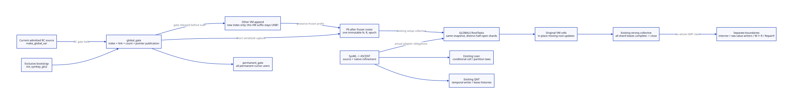

#+TITLE: Published globals snapshot and registration REV
#+SETUPFILE: ../../modeling/org/setup.org
#+LANGUAGE: en
#+PROPERTY: header-args :eval never :exports code

* PUBLISHED One registry-prefix responsibility :rev:roots:audit:
:PROPERTIES:
:CUSTOM_ID: REV-GLOBALS-SNAPSHOT-RESULT
:REVISION: 7abe6770067f7f4073001286d64437f53ab39c35
:PARENT: ff44e8f82352c4196e4874714c6f329e1611595a
:SOURCE_TREE: 7b1bf734cb51cd1d66fd55840e33ca131b0e0492
:AUTHORITY: GambitGlobalsSnapshot
:END:

The =modern-c= branch now contains this11-file REV,+471/-77. All five actual
ASCENT gates and21 rejection controls passed before publication. Its commit
body records responsibility, retired paths, tests, benefits, costs, process,
models and remaining boundaries. This is a local publication; no new push or
remote CI result is claimed.

[[file:globals-snapshot.org::#REV-GLOBALS-SNAPSHOT][Frozen per-REV checklist and source argument]], [[file:models/sysml/globals-snapshot.sysml][SysML authority]],
[[file:globals-snapshot.d2][D2 source]], [[file:../../../evidence/research/retained/modern-c/globals-snapshot/receipt.json][native/source receipt]] and
[[file:../../../evidence/research/retained/modern-c/globals-snapshot/publication.json][publication packet]] bind the exact tree, profile, artifact hashes, reviewed
comment and frozen model/Org/DSL snapshots. Post-publication roadmap views do
not rewrite that pre-commit evidence. All133 prior pending working paths and
all other staged entries remain preserved and unqualified; only the already
tested existing Scheme fixture was materialized/staged. The selected commit
and leased producer are the acceptance source, not the entire dirty checkout.

** Delivered replacement and net-benefit matrix :matrix:
#+NAME: published-globals-net-benefit
| Dimension | Delivered / verified benefit | Added overhead / remaining boundary |
|-----------+------------------------------+-------------------------------------|
| Common root extent | R independent live-count authorities -> one serialized VM-round prefix; all shards use identical count/roster/epoch | R source checks; short per-shard publish/finish and begin/end locking |
| Registration ownership | Bootstrap/runtime use one index/list/count commit; node initialized before release-publication | RC and registry gates on every call; permanent allocator gate for allocation, including non-registry callers |
| Cross-VM progress | Other VM appends after the cut without a mutex spanning physical GC; stopped VM suffix remains initialized UNB1 | Raw cross-VM value stores and concurrent symbol interning remain unqualified |
| Original Scheme semantics | Same root cells and original scanner; map multi-shot, dynamic-wind, wide roots and GC pass | Frame aliases, unique heap copying, Tail ownership and W/R restoration remain separate |
| Native property histories |392 actions; real second VM and admitted/refused registration/scan/close transitions | Finite histories and controlled C ordering, not exhaustive OS scheduling |
| Real C falsifier | One consumer line restored to live count:20 ->4 steps,29 trials; current implementation replays the4-step trace successfully | A calibrated implementation mutation, not a full predecessor build or global minimality proof |
| Observer calibration |20 ->2 steps,43 trials; replayed, deletion-one-minimal and normal implementation passes | Explicitly labeled observation mutation |
| Physical bound |6259 +13741 actual registrations =20000; next binding refuses before publication, existing binding remains usable | Original fixed backing and Scheme heap-exception escape; no new error API or capacity growth |
| Persistent metadata | No snapshot heap allocation or new identity table | Shared =gstate_mem= metadata+176 bytes; each VM pointer+8 bytes |
| C records | Same48-byte RootTask | Snapshot88 bytes; source56 vs40 bytes; actual physical stack/RSS peak unmeasured |
| GC synchronization | Existing setup and strong-completion collectives reused | No added GC barrier; new short mutex operations remain a real cost |
| Build/generator | Scheme core and official build/workflow names preserved; all15 managed generated products match predecessor bytes | Necessary public-layout C consumers rebuild; unchanged products are not a measured compile speedup |
| Exact producer | Two phase1--4 passes139.172s; stock core32.800s | Existing600s outer limit; validation durations, not release performance |
| Original consumers | GSI408/40861.634s; all remaining original Make108.421s | Existing300/120s groups; includes test8/test9 and290 assertions, but no whole12-family numerator |
| Previous startup/exit contract | Target5.022s; unknown join retained and early nodes/borrows0/0 | No healthy-VM/global retirement or arbitrary owner-loss closure |
| Models/audit | Native SysML -> actual ASCENT five gates/21 controls; existing QNT10 trajectories and10000 samples/64 steps | Lean unchanged/not rerun; source ordering/prefix/coverage premises are not proved by model filenames |
| Producer custody | Existing service now compares child source with admitted predecessor;5 framework regressions pass | Failed source admission preserved; exact known-owned repair precedes strict requalification |

No measured throughput, latency or peak reduction is asserted. The immediate
net gain is correct shared ownership/publication, with an explicit and bounded
new synchronization/metadata cost. Release performance remains its own gate.

** Reproducible native histories :pbt:
The new mode is part of the existing =tests/root-task.scm= fixture. In a build
configured from this exact commit with the recorded profile, use the existing
test Make interface:

#+begin_src sh
make test-globals-snapshot
make test-root-task
make test-startup-publication
#+end_src

Run these in that configured build's =tests= directory. The first target
compiles the same fixture once and executes snapshot/capacity modes; the other
targets retain their original names. Framework Python does not enter the
vendor's runtime tests.

The real C regression shrank to:

#+begin_src scheme
(globals-snapshot-trace 1
  (#(1 0 0) ; freeze source and begin shared snapshot
   #(3 0 0) ; publish shard
   #(2 0 0) ; actual other-VM registration
   #(4 0 0)) ; claim the original shard
  0)
#+end_src

[[file:../../../evidence/research/retained/modern-c/globals-snapshot/legacy-minimal.trace][Exact replay input]] and [[file:../../../evidence/research/retained/modern-c/globals-snapshot/legacy-calibration.json][portable mutation/driver recipe]] retain the actual
one-line C consumer mutation, unchanged oracle/replay/shrinker identities,
entry-driver text and observed commands/outcomes. Only three target-specific
source artifacts were copied for mutation calibration; no second checkout or
SDK was created. Root-slot disjointness is not unique heap-object copying:
several distinct roots may legitimately reference one continuation.

** Closed gates and explicit remaining steps :checklist:
- [X] Exact source/profile producer and all selected required tests.
- [X] Architecture learning, benefit mechanisms, added cost and falsifiers.
- [X] Current refactoring stage and dependency-bound exclusions.
- [X] Native SysML -> ASCENT with disjoint existing QNT/Lean duties.
- [X] Gambit semantic/amplification questions and reviewed commit comment.
- [X] All unrelated working/index prototypes preserved; no repair transplant,
  heap/wait increase, new configuration/executor or official name changes.
- [ ] Complete root/writer/lifetime census: symbol/keyword anchor/interner
  publication, controlled cross-VM value writers and raw/native boundaries.
- [ ] Independent workers, copy/restore capacity, frame aliases and Tail work.
- [ ] Request-service/wait/control and Repair9, resource-specific exit and
  healthy-VM/unknown-join reconciliation.
- [ ] Full compiled/stress/Gerbil and matched release/remote-platform evidence.

The strict first submission stopped when Git index stat metadata refreshed.
HEAD, semantic staged entries and working bytes were independently unchanged;
a fresh admission retained the same guard and passed. The earlier fixture
compile error and source-overlay refusal remain retained as failed evidence.
Neither a failed run nor a successful neighboring REV is promoted to current
acceptance. The branch still has no complete12-family numerator.

#+CAPTION: Shared prefix ownership and separate proof duties
#+ATTR_ORG: :width 1000

