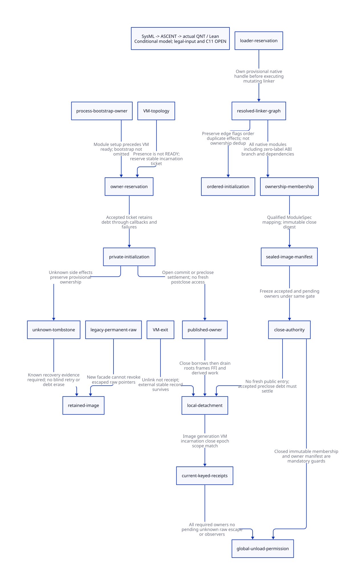

#+TITLE: Image Membership and Cross-VM Owner Enrollment
#+SETUPFILE: ../../modeling/org/setup.org
#+LANGUAGE: en
#+PROPERTY: header-args :eval never

* RESEARCH Decision and architecture boundary
:PROPERTIES:
:CUSTOM_ID: image-membership-enrollment
:AUTHORITY: GambitImageMembershipEnrollment
:MAINLINE: modern-generated-C
:STATUS: conditional-formal; native-alias-and-C11-refinement-open
:END:
The previous [[file:global-module-unload-design.org][global unload study]] requires a complete owner roster. This study
makes that premise explicit at the loader, Scheme descriptor, bootstrap and VM
lifecycle boundaries. An OS image handle, a returned descriptor vector, supply
names, and the circular VM list are four different objects. None independently
provides a complete image-owner manifest.

The target is an explicit modern C lifetime architecture shared by generated
module binding, continuation/FrameSpec consumers, GC maintenance and FFI. It can
support incremental old/new code coexistence and independent VM drains. It does
not change Scheme semantics by discarding a live continuation, mutable alias or
native callback. Unqualified routes retain the image. No runtime path is retired
by these research artifacts; no Zig-specific benefit is established.

* RESEARCH Evidence-backed membership and alias inventory
** Linker resolution is executable and mutating
[[file:../../../vendor/gambit/lib/setup.c::1580][linker_to_mod_or_lnk]] invokes the linker with GSTATE and recursively replaces
link-table edges with resolved pointers. [[file:../../../vendor/gambit/lib/setup.c::1611][for_each_module]] traverses those edges,
preserving flags around recursive calls. A provisional loader owner must therefore
exist before invoking the linker. Discovery failure does not establish that
nothing was initialized, published or retained.

Maintain two views: a deduplicated ownership graph for lifetime accounting, and
an ordered initialization/effect plan for the actual traversal. Deduplicating
ownership does not authorize skipping repeated setup effects, changing edge
flags or reordering initialization. Generated ModuleSpec should supply the static
sidecar; the loader adapter reconciles native dependencies and dynamically
resolved members before sealing. Paths, dladdr, pointer ranges, supply names and
the descriptor subset alone are insufficient membership evidence. Relocated label
and OFD storage may lie outside the mapped image while still depending on it.

[[file:../../../vendor/gambit/lib/setup.c::2173][setup_module_collect_moddescrs]] adds a descriptor only for lblcount > 0, yet
calls setup_mod outside that conditional. A complete manifest must cover this
zero-label ABI branch as well. This is a source-supported completeness case;
this study has NOT established a legal GSC-generated zero-label module witness.
It must not be reported as an observed Scheme-input failure.

** Complete module-field classification and limits
[[file:../../../vendor/gambit/include/gambit.h.in::12079][module_struct and linkfile_struct]] enumerate the ABI storage classes. The
SysML member rows classify every module field: ABI/name/flags; globals and
supply counts; symbols/keys and name tables; entry/labels; OFD; pair/constants
and subtyped tables; setup/init hooks; script line; next; and Scheme moddescr.
Linkfile symbols/keys and mutable ordered linker edges are separate members.
The derived matrix adds external native exports and dependency images, which
cannot be inferred completely from those C struct fields. Field completeness
is not whole-program alias completeness or a current binary membership census.

** Permanent and raw aliases have real consumers
The same routine allocates a permanent foreign wrapper for the module pointer
with a null release callback, stores it in descriptor field 5 and puts that same
descriptor in the permanent program array. [[file:../../../vendor/gambit/lib/_kernel.scm::5113][program-descr]] exposes the process
array. Registration creates module wrappers around the same descriptor and may
register several supply names for it. Removing one registry cell does not detach
other wrappers, callbacks, descriptor vectors or previously obtained pointers.

[[file:../../../vendor/gambit/lib/_kernel.scm::5119][init-mod]] casts FOREIGN_PTR_FIELD directly to module_struct and calls init_mod.
[[file:../../../vendor/gambit/lib/_kernel#.scm::61][The field accessor/setter macros]] expose ordinary vector state. The bounded
inventory finds a setter definition and no named setter call in _kernel.scm;
that is not proof against arbitrary vector mutation or FFI exposure. Module
script callbacks also retain descriptor metadata by reference.

| Alias/owner class | Producer and real consumer | Migration requirement |
|------------------+----------------------------+-----------------------|
| Permanent module foreign pointer | setup_module_collect_moddescrs -> init-mod | Migrate reader and exporter together; retain legacy image for unknown aliases |
| Program and registry wrappers | GSTATE program_descr -> supply-name registrations and lookup | Intern stable logical identity; removing a cell cannot revoke a published object |
| Native labels/OFD and captured frames | setup fixup -> GC/frame restoration | Keep descriptor/code generation leased until last root and maintenance use |
| FFI converter/release pointers | c_intf/os_dyn -> native invocation and cleanup | Track executable owner separately from Scheme proc payload root |
| Bootstrap process state | setup_modules -> GSTATE program_descr before setup_vmstate | Process owner exists even before a ready VM roster |
| VM under initialization or exit | setup_mem_vmstate / cleanup_mem_vmstate | Stable owner record survives VM storage and topology removal |

** VM list publication is not ready-owner publication
[[file:../../../vendor/gambit/lib/mem.c::5140][setup_mem_vmstate]] inserts the VM into the global circular list under vm_list_mut,
unlocks, then allocates and initializes glos and continues memory setup. Conversely,
cleanup frees memory and removes the list node under an externally held topology
lock. These are topology operations, not per-image lifetime transactions.
Module/bootstrap setup precedes setup_vmstate in process startup. A VM-only scan
would miss process/bootstrap ownership and in-flight initialization.

The #ifndef SINGLE_VM branches define source capability, not proof that every
branch is enabled in the current Darwin artifact. Effective profile, generated
module ABI and object provenance remain required qualification inputs. No native
preprocessing or binary acceptance was performed.

* RESEARCH Proposed explicit contracts
** ImageMemberManifest and ModuleHandle
#+begin_src text
ImageMemberManifest = {
  ImageId, generation, effectiveProfileDigest, ModuleSpecDigest,
  nativeMembers: set<ModuleIdentity>, dependencies: set<ImageGeneration>,
  initPlan: ordered<EdgeIdentity, flags, setupHookIdentity>,
  relocatedMetadataOwners, executableExports, bootstrapOwners,
  coverageWitnessDigest, sealEpoch
}
OwnerKey = (ImageId, generation, OwnerKind, VMId, incarnation)
EnrollmentTicket = (OwnerKey, acceptedEpoch, uniqueOperationId)
ModuleHandle = runtime-owned interned identity + stable ImageControl reference
DetachmentReceipt = (OwnerKey, closeEpoch, manifestDigest, drainScopeDigest)
#+end_src
These are design data structures, not implemented C layouts. Membership sealing
requires every native member and dependency covered and every effect-plan item
accounted for. Setup failure with unknown publication leaves a provisional owner.
The immutable manifest and mutable lifetime control live outside unloadable code.
A handle facade must preserve observable module identity where the source exposes
shared objects; a source/ABI migration must not silently replace identity with
fresh copies. Existing field 5 cannot simply hold a handle while init-mod still
blindly casts it. Reader, writer, generated ABI and native exporters change as one
migration cut. Overwriting field 5 cannot erase an escaped permanent raw wrapper.

** Enrollment, close and exit
#+begin_src text
ABSENT -> RESERVED -> PUBLISHED -> CLOSED -> DETACHED -> TOMBSTONE
                 \-> known abort -> TOMBSTONE
                  \-> unknown outcome -> RETAINED_UNKNOWN
OPEN -- close under same authority --> CLOSING -- all evidence --> PERMITTED
#+end_src
Reserve before exposing executable references or invoking module-dependent setup.
Close freezes all accepted and pending records under the same authority. A
reservation accepted before close may finish or abort after close, but that is
settling existing debt: it cannot open new public borrowing. A fresh registration
after close is rejected before image payload access. The existing valid Scheme
request may use a retained/new image generation or wait for a qualified service;
rejecting early-unload eligibility must not reject a formerly legal program.

Known abort requires proof of no surviving root, callback, published alias, child
work or native effect; returning an error code alone is insufficient. Unknown
completion retains the record and dependencies. VM exit does not erase its owner
key. A stable coordinator keeps the tombstone until local detach is established.
Reuse needs a new incarnation; an older receipt cannot satisfy it. Preclose
observers and borrowed references remain debt until a known last use.

Once a legacy raw escape is admitted, this model has no operation that clears it.
The conservative outcome is retention. A future explicit revocation protocol may
clear that debt only with an independently complete alias/FFI proof, not a field
assignment. Membership invalidation before permission prevents sealing/permission;
post-permission invalidation must be excluded by the native immutable-manifest
contract. Its impossibility is an external obligation, not a theorem about C.

* RESEARCH C11 realization and failure ownership
The mutable linker/fixup phase also needs an exclusive setup-owner state. A
reserved ticket protects lifetime but does not serialize concurrent mutation of
the same module tables. Admit one setup writer, release the short metadata lock
before invoking its hooks, and retain setup authority until known completion.
Nested initialization needs an explicit reentry/dependency policy; graph cycles
and unknown effects cannot be made safe merely by ownership deduplication.

One stable mutex is a valid modern C reference design for reserve/close/borrow
linearization. Release-publish initialized immutable records; acquire-validate
identity, generation and scope before consuming. If an atomic ledger replaces
the mutex, it must prove the same linearization and non-overflow/ABA conditions.
Independent gate check followed by list insertion is not equivalent.

Last dereference precedes release return of borrow debt. Receipt issuance needs
an acquire observation of complete drain plus exclusive completion authority.
Counter zero alone is not a detachment certificate. Keep descriptor users,
maintenance children, native exports, roots and pending reservations visible to
the same closure ledger. Do not hold topology/image locks through linker hooks,
Scheme callbacks, allocations that may GC, foreign teardown or waiting.

| Failure/race | Custodian | Required fact before permit |
|--------------+-----------+-----------------------------|
| Reserve allocation fails before acceptance | Caller; no image access allowed | No accepted record or published payload |
| Init partly publishes then errors | Provisional stable owner | Reconcile effects or retain unknown tombstone |
| Close races reservation | Same authority serializes | Include accepted ticket; reject later request |
| Preclose commit acknowledgment lost | Ticket/operation record | Query same operation; never create a second owner by retry |
| VM unlink races late borrow | Stable owner, not VM list node | Close borrowed ingress; drain earlier reservations |
| New incarnation at reused address | New OwnerKey | Old receipt is not accepted |
| Receipt reader outlives VM/image | Runtime coordinator and observer pin | Reader last use known before freeing control storage |
| Module manifest/dependency changes | Manifest authority | Invalidate before permit or retain generation |

C11 weak-memory, actual FFI ingress closure, arbitrary owner count, teardown and
all exception/continuation exits remain source refinement obligations. Sequential
QNT interleavings and Lean algebra do not prove these native conditions.

* RESEARCH Actual QNT, Lean and ASCENT chain
[[file:models/sysml/image-membership-enrollment.sysml][Native SysML]] owns the source anchors, lexical inventories, module seams,
contracts, benefit conditions, action-to-lemma bindings and model routing.
[[file:../../modeling/tools/image-membership-enrollment-study.py][Python]] invokes native SysML queries and drives the
[[file:../../modeling/ascent/image-membership-enrollment.rules.scm][ASCENT DSL]], [[file:models/quint/image_membership_enrollment.qnt][actual QNT]] and extracted
[[file:models/lean/ImageEnrollmentAst.lean][Lean AST]]. It does not parse SysML or infer C proofs from file associations.

The QNT model has one mandatory owner and one optional owner aggregate, 27 actions,
10 positive and seven deliberately corrupted negative histories. It covers pending
registration, post-close settlement, known abort, unknown exit, raw alias retention,
observer drain and incarnation reuse within one closing cycle. Multiple image
generations and repeated closing cycles need an additional product refinement.
The extractor checks binding IDs, field kinds,
complete action roster and supported expressions; negative extraction controls
must reject modified evidence.

[[file:models/lean/ImageEnrollment.lean][Lean induction]] proves preservation for all extracted steps and reachable-state
safety. [[file:models/lean/ImageEnrollmentComposition.lean][Composition]] connects required-owner receipts with the preceding
AllDetached predicate using an explicit native-owner-to-slot coverage premise.
That theorem proves receipt coverage in the model; a slot must additionally mean
that ALL native owners mapped to it really detached. It does not manufacture
native detachment, a complete owner list, weak-memory correctness or an arbitrary
VM-product refinement from two slots. Those premises remain open.

| Closure obligation | Evidence status | Missing evidence |
|--------------------+-----------------+------------------|
| Descriptor subset versus setup traversal | Source-established | Legal generated zero-label witness not established |
| Permanent/raw pointer reader and registry aliases | Source-established bounded inventory | Whole-program aliases, arbitrary vector/FFI writes |
| VM topology versus READY state | Source-established ordering | Concrete per-image reservation integration |
| Accepted pending owner survives close | Model induction | C11 linearization and actual exception/GC refinement |
| Current-keyed receipt coverage | Model induction and conditional composition | Complete native owner mapping and aggregate detachment soundness |
| Raw facade does not revoke old pointer | Model invariant; actual raw producer/reader | Concrete controlled profile and migration closure |
| SysML/ASCENT routing and negative evidence controls | Mechanically checked research lane | Source/platform receipts deliberately absent |
| Global unload eligibility | NOT closed for current runtime | Full aliases, all VM/source refinement, loader teardown qualification |

Retained counterexamples: descriptor subset misses a setup member; close drops a
reserved VM; post-close insertion bypasses the gate; a new facade is treated as
revoking a raw escape; reused VM address accepts old receipt; unknown exit is
counted as detach; preclose observer disappears from the final check.

* RESEARCH Net benefit, retirement and decision gates
The [[file:image-membership-enrollment-matrix.org][SysML-derived matrix]] includes exact source anchors and costs. Let M be native
members, E ordered init edges, V registered owners, P pending records, A alias
classes and K receipt observers. Discovery needs O(M+E); closure metadata needs
O(V+P+K), with additional dependency storage. Those are structural bounds, not
measured timings. Repeated receipt deliveries are O(1) keyed updates under a
suitable index; initial complete discovery and real drain are not eliminated.

| Capability | Work potentially eliminated | Mandatory added work | Positive-net condition / falsifier |
|------------+-----------------------------+----------------------+-----------------------------------|
| Incremental generation coexistence | Process restart solely to replace a qualified module | Generation handles and ABI invalidation | Old frame/native aliases fully owned; otherwise no early release |
| Independent VM completion | Repeated topology traversal and unrelated VM serialization | Stable owner tickets and receipt set | Short authority sections; frequent contended borrows may outweigh savings |
| Descriptor lifetime | Unnecessary process-lifetime image retention | Manifest, aliases, observer retirement | Untracked permanent/raw pointer makes reclaimable bytes ZERO |
| Correct closure | Duplicate message recounting and lost pending ownership | Idempotent keyed receipts and tombstones | Complete native coverage; missing one owner invalidates permit |
| Native portability | Shared modern C ABI across GC/FFI/compiler service | Generated adapters and explicit ownership discipline | Native callbacks remain platform-qualified; no automatic LLVM gain |

Memory net benefit = actual released image/data bytes minus stable metadata and
quarantined retained bytes. Runtime net benefit = avoided restart/re-enumeration/
serialization work minus gate, receipt, migration and drain work. Neither term is
numerically established here. No person-day estimate is used as the decision.

Migration dependencies: generate complete ModuleSpec membership and ordered effect
plan; introduce runtime-owned identities without changing alias semantics; enroll
bootstrap/VM/native owners before publication; qualify close/borrow/detach; compose
all-owner receipts; qualify loader teardown last. Then the process-global loader
list and raw init-mod field can cease to be the sole lifetime/access authorities
on admitted routes. Legacy raw routes retain their conservative lifetime. No old
C path can be removed based on these model checks alone.

Research receipts: [[file:../../../evidence/research/image-membership-enrollment/checks.json][checks]],
[[file:../../../evidence/research/image-membership-enrollment/input.json][source/model identity]],
[[file:../../../evidence/research/image-membership-enrollment/source-witnesses.json][immutable source witnesses]],
.
