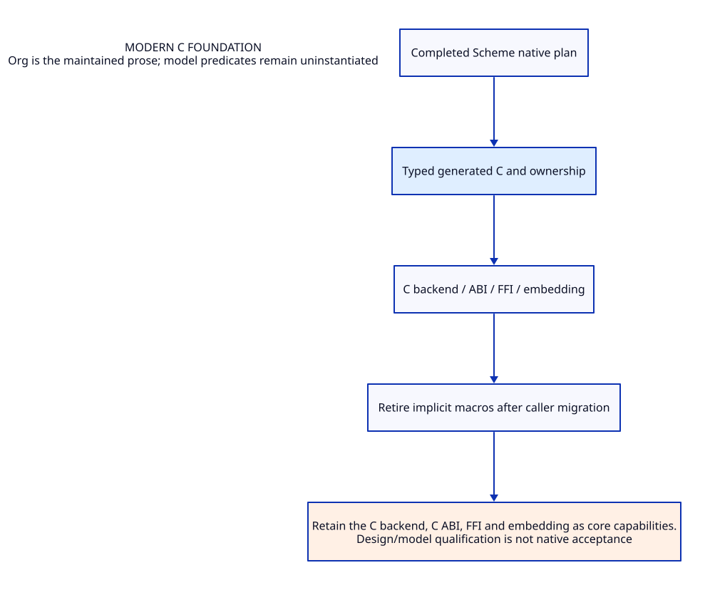

#+TITLE: Modern C foundation
#+SETUPFILE: ../../modeling/org/setup.org
#+CATEGORY: modern-c

* Current structural delivery :modern_c:process:
:PROPERTIES:
:CUSTOM_ID: modern-c-current-structural-delivery
:AUTHORITY: GambitMemoryDelivery
:STATUS: LOCAL-STRUCTURAL-COMMIT; RUNTIME-PROGRAMME-OPEN
:END:
[[file:memory-delivery-record.org][Submission db7e3425]] delivers the exact lossless memory-source unit.
[[file:models/sysml/memory-delivery.sysml][SysML]] selects its scope; [[file:memory-delivery-matrix.org][the derived matrix]] records eight
observations and five gates. The code, source patch and reproducible evidence
are distinct from acceptance of the complete role/GC/FFI/SMP programme.
Header consumer closure and semantic ownership replacement remain later work.
The SMP gitlink is unchanged; earlier semantic vendor commits are not admitted
by this structural package.

* RESEARCH Modern C foundation :modern_c:
:PROPERTIES:
:ID: 0c33afee-a8ce-533c-847e-7c1f106c2e0b
:CUSTOM_ID: modern-c-contract
:OWNER: Gambit architecture research
:STATUS: design-only
:EVIDENCE_CLASS: source-and-model-design
:END:

Typed generated interfaces, native requests, physical layout and actual retirement of implicit macro/C decisions.

Retain the C backend, C ABI, FFI and embedding as core capabilities.

Begin with [[file:../why-refactor.org][the source-backed refactoring rationale]], [[file:../pressure-map.org][replacement and benefit matrix]] and [[file:../../research-lanes.org][research responsibilities]]. Modern C is a change to explicit ownership, generated semantic contracts and native lifecycle mechanisms; changing syntax or adding a wrapper is insufficient. C++ is outside scope.

The [[file:runtime-blueprint.org][multicore runtime blueprint]] now composes these responsibilities with [[file:../../architecture/toolchain/incremental-build-design.org][incremental/parallel builds]]. Its [[file:blueprint-matrix.org][eight benefit cases and eleven migration nodes]] derive from SysML. The [[file:diagrams/migration.svg][dependency view]] makes independent build-graph work and runtime prerequisites explicit.

** Contract and ownership
:PROPERTIES:
:CUSTOM_ID: ownership
:END:
One Scheme semantic contract; one selected implementation owner for each mechanism. C-facing capability remains mandatory. Imported alternatives are comparisons, not simultaneous deployment decisions.

** Models and views
:PROPERTIES:
:CUSTOM_ID: models
:END:
- [[file:models/sysml/architecture.sysml][SysML architecture and necessary requirements]]
- [[file:diagrams/overview.d2][Maintained D2 view source]]
- 

#+NAME: modern-c-sysml-source
#+INCLUDE: "models/sysml/architecture.sysml" src sysml

#+NAME: modern-c-d2-source
#+INCLUDE: "diagrams/overview.d2" src d2

** OPEN Evidence and admission gaps
:PROPERTIES:
:ID: 6fec09bc-3aed-5c7c-8e72-54b593ad982b
:CUSTOM_ID: gaps
:STATUS: unresolved
:END:
Source reading, model validation, checked proof, native semantic acceptance and measured benefit are distinct. No validation result satisfies the runtime gates automatically.

** Study catalogue
:PROPERTIES:
:CUSTOM_ID: studies
:END:
#+NAME: modern-c-studies
| Study | Evidence lineage |
|---+---|
| [[file:studies/d1h-c-runtime-refactor.org][d1h-c-runtime-refactor]] | ~12c208c189ed~ |
| [[file:studies/generated-c-contract-cost-matrix.org][generated-c-contract-cost-matrix]] | ~45c824dd589c~ |
| [[file:studies/generated-c-contract-evidence.org][generated-c-contract-evidence]] | ~651ebf1a216a~ |
| [[file:studies/generated-c-native-contract.org][generated-c-native-contract]] | ~64cc1df8df21~ |
| [[file:studies/generated-c-provider-retirement.org][generated-c-provider-retirement]] | ~447ea5a3c6c7~ |
| [[file:studies/native-caller-retirement-plan.org][native-caller-retirement-plan]] | ~fcba4b8e53d1~ |
| [[file:studies/native-layout-provider-design.org][native-layout-provider-design]] | ~ccd80564af8e~ |
| [[file:studies/native-layout-provider-evidence.org][native-layout-provider-evidence]] | ~b7689def8116~ |
| [[file:studies/scheme-native-generator-design.org][scheme-native-generator-design]] | ~bb2c7687d05d~ |

** Cross-cutting references
- [[file:../../index.org][Development architecture]]
- [[file:../../catalog.org][Complete source-to-Org and diagram migration map]]
- [[file:../../research/validation.org][Validation boundary and retained receipts]]

** Column view for local research obligations
#+BEGIN: columnview :id local :format "%ITEM %STATUS %EVIDENCE_CLASS"
#+END:

** RESEARCH Stable-view lifecycle and macOS development cost
[[file:../../architecture/toolchain/stable-view-design.org][Stable-view issuance/revoke/continuation entry]] and
[[file:../../architecture/toolchain/macos-development-design.org][macOS development architecture]] use separate owned SysML models.
Nine lifecycle transitions reference shared runtime contracts. Thirteen duties
add bounded source/history/refinement and benefit accounting; 82 standalone Lean
statements pass and ten QNT modules typecheck only. Actual issuer/provider/control/
I/O and whole-request native performance remain unqualified. No implementation
or native tests are added.

- [[file:../../architecture/toolchain/stable-view-map.org][Lifecycle evidence/transition matrix]] / [[file:../../architecture/toolchain/diagrams/stable-view.svg][D2 lifecycle]]
- [[file:../../architecture/toolchain/macos-development-map.org][Darwin evidence/cost matrix]] / [[file:../../architecture/toolchain/diagrams/macos-development.svg][D2 dependencies]]

** RESEARCH Source-to-runtime descriptor refactoring
[[file:../../architecture/toolchain/native-descriptor-design.org][ModuleSpec and FrameSpec]] now distinguish immutable blueprint, image/binding instance, semantic frame facts and physical encoding. The [[file:../../architecture/toolchain/native-descriptor-map.org][SysML-derived matrix]] tracks actual consumers, macro-role retirement, eight proposed proof duties and six gain/cost cases. Bindgen-like ABI observation is a candidate adapter; Scheme-owned contract generation is the preferred design direction, without adding another implementation language.

** RESEARCH GC and same-VM SMP are T0 refactoring
[[file:t0-foundation-design.org][Target foundation]] / [[file:../../architecture/runtime/models/sysml/composition.sysml][target and baseline model records]] / [[file:diagrams/t0-foundation.svg][D2]]. Existing root models remain their unique scoped owners. [[file:../../architecture/runtime/interfaces/frame-contract-design.org][FrameSpec]] connects generated frame layout to new ownership/root/work contracts rather than duplicating a current GC model.

** RESEARCH Coherent runtime reconstruction
[[file:runtime-blueprint.org::#coupled-runtime-redesign][Architectural commitment]] selects a coupled redesign of contexts, generational
GC, continuation/native roots, resource drain and generated contracts. The
[[file:../../architecture/runtime/gc/modern-c-generational-design.org][collector design and benefit matrix]] links exact source evidence to owned
SysML, QNT, Lean and ASCENT prerequisites. Cost analysis selects mechanisms;
it is not a requirement to remain within local repairs.

** RESEARCH Semantic amplification through barrier contracts
[[file:../../architecture/runtime/gc/generational-barrier-design.org][Current-epoch elision, remembered cards and promotion custody]] uses Scheme
knowledge to remove unnecessary work. [[file:../../architecture/runtime/gc/generational-barrier-matrix.org][The generated benefit matrix]] records
mechanisms, new costs and falsifiers for continuation reuse, high-order/tail-call
execution, multicore C embedding and parallel promotion.
