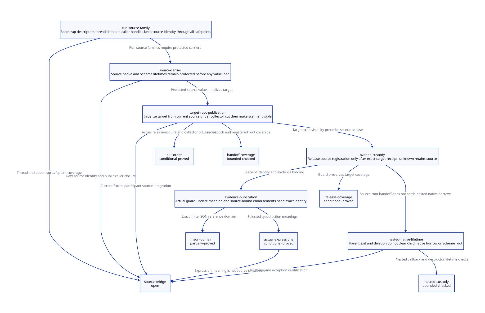

#+TITLE: Ingress Root Carrier Transfer and Nested Native Custody
#+SETUPFILE: ../../modeling/org/setup.org
#+LANGUAGE: en
#+PROPERTY: header-args :eval never
#+OPTIONS: toc:3 num:t

* RESEARCH Authority and current source boundary
:PROPERTIES:
:CUSTOM_ID: ingress-carrier-transfer
:ARCHITECTURE_SOURCE: models/sysml/ingress-carrier-transfer.sysml
:EVIDENCE: ../../../evidence/research/ingress-carrier-transfer/checks.json
:STATUS: conditional-models; actual-source-and-C11-composition-open
:END:

Modern generated C remains the main architecture. This study refines the explicit
incoming-root premise of [[file:ffi-scope-root-admission-design.org][FFI scope/root admission]] into a source-to-target
handoff protocol. It changes research/formal artifacts only. SysML owns typed
component responsibilities, proof dependencies, source anchors, endorsement
requirements and gains; native SysML queries drive the [[file:ingress-carrier-transfer-matrix.org][Org matrix]] and
. Python orchestrates actual ASCENT, QNT and Lean checks.

The current mem.c differs from the predecessor's pinned source: mark_rc now takes
collector_worker and execution_context, and mark_execution_roots scans RC for its
frozen participant context. The earlier processor-zero-only observation is not
current evidence. Credit this existing checkout change without claiming it was
implemented or natively qualified by this study. The predecessor receipt remains
frozen; source drift is recorded rather than rewriting its history.

* Actual source families
:PROPERTIES:
:CUSTOM_ID: ingress-carrier-sources
:END:

** Tcl source: stable header, still vector, movable contents

[[file:../../../vendor/gambit/examples/tcltk/tcltk.scm][tcltk.scm]] creates an RC header, allocates a still vector with initial
refcount one, writes the Scheme procedure into its element and installs that
vector as RC data. scheme_call_cmd passes data_rc(client_data) to tcltk_call.
scheme_delete_cmd releases the Scheme vector and RC header. Tcl result bytes use
a release_string callback whose executable lifetime is a separate responsibility.

[[file:../../../vendor/gambit/lib/mem.c][mem.c]] data_rc is a plain h->data load and set_data_rc a plain store.
RC addref/release use ordinary refcount/list operations. They are not a concurrent
safe-borrow API. A thread cannot safely increment a possibly freed header after
reading client_data. The Tcl command-owner admission gate must first retain native
header ownership while publication and deletion are mutually excluded; if raw Tcl
users bypass that owner, managed carrier admission must be refused or require an
explicit external lifetime guarantee.

The vector address is stable because it is still, not because write_authority pins
it. The contained procedure may move; current mark_rc scans &h->data and the
collector scans live still-object fields. Root lifetime, synchronized field reads
and post-GC reloading remain necessary. No vector copy is needed solely to
stabilize this already stable address. Refcount one on a still object does not
protect an independently freed RC header or a copied movable procedure value.

The concrete RootCarrier therefore names the owned RC header generation and
payload slot; its root-kind distinguishes still carrier with movable fields from
a directly movable root. RootBundle may register the still vector as an input
root, with the procedure loaded only after safe entry. If it instead extracts the
procedure, that extracted value needs its own updateable slot before any GC.

** ___run sources are not one uniform raw argument

| Real path in setup.c | Source identity | Required carrier qualification |
|----------------------+-----------------+--------------------------------|
| setup bootstrap to ___run | MODULE_DESCR_THUNK through GSTATE program_descr/module vector | retain exact descriptor/storage/code owner and safe slot-read interval; do not assume a plain GSTATE field is an independently scanned root |
| resize to start_processor_execution | t->data_scmobj = thunk, then local copy from self->data_scmobj | retain source from before thread publication through sync participation; fresh context root before any GC-capable transition |
| run_and_throw_error_on_processor_0 | forwards local thunk to ___run, later services sync ops forever | forwarding a C local creates no new root; completion includes surviving sync participation |
| exported ___run function signature | arbitrary caller-provided SCMOBJ | require an owned root handle or proved protected handoff; raw stale values cannot be repaired on arrival |

The processor start local is loaded before execute_sync_op_loop. This is an actual
safepoint-sensitive interval to qualify, not proof of a reproduced failure. The
bounded source search finds thread payload stores/loads but does not establish
that data_scmobj itself is included in the collector root inventory. Its stable
native address alone would not make its Scheme contents collector-visible.
Bootstrap descriptor construction uses alloc_scmobj with NULL for permanent
objects in selected setup paths; this is useful evidence, not proof that every
nested thunk or external ___run input is permanent. Trace exact owner chains
rather than generalizing permanence from the outer vector.

** Existing collector seam

mark_execution_roots requires GC_ROOTS_FROZEN, then scans continuation, registers,
saved state, cache, processor Scheme object and RC list for participant->context.
Before scanning, GC assigns participant->context, freezes its phase, publishes the
participant count and executes BARRIER. This is the concrete integration seam for
a RootBundle adapter. It does not automatically cover a new VM root directory,
late foreign attachment, source mutation or context retirement. The full frozen
membership and future-round scan closure remain separate proof obligations.

* Transfer contract and release authority
:PROPERTIES:
:CUSTOM_ID: ingress-carrier-protocol
:END:

The proposed carrier contains VM/context incarnation, source kind, source owner,
source-slot identity, root/GC lease, native header lease if applicable and entry
code lease. Object identity, slot registration generation and GC validity epoch
are distinct. The QNT integer stamps track validity after collection; they do not
mean that still objects physically move or that every GC changes object identity.

1. The source owner closes the race with deletion and admits the native borrow
   before dereferencing RC/header or descriptor storage. It obtains qualified GC
   source-root access, never merely a scope token or VM storage borrow.
2. Preallocate the target guard/root record before the short collector cut. Under
   that cut, reload the current source slot; initialize the private target slots.
   No allocation, callback or wait for a GC participant is allowed while holding
   the cut's serialization resource.
3. Register target membership and publish scanner visibility. The complete target
   value/map must become visible before the registration receipt can authorize
   source retirement. A private initialized target is not a scan-visible root.
4. If GC occurs before reading, read its updated source. If it occurs between
   private preparation and publication, discard/reinitialize the stale private
   copy. If it occurs after publication, update both registered views while both
   owners remain. Once source retirement is committed, update target only.
5. Release the source registration only after observing an authentic exact-target
   receipt. A lost publication reply leaves source protected; query the same
   transfer identity instead of redoing Scheme effects. An unknown result keeps
   responsibility with the stable source/transfer custodian.
6. End the cut. The consumer reads through current RootBundle slots before use.
   Marker allocation and Scheme execution retain the previous entry-guard/root
   obligations. Source registration release is not RC ownership release.

Source and target have distinct writable root slots in the reference model.
If RootBundle instead aliases an existing RC slot, assign that RootSlotId to one
scanner or explicitly serialize its relocation writes. Forwarding protection on
the pointed-to object alone does not prove two unsynchronized writes to the same
root slot safe. Canonical slot deduplication/scan assignment is an additional
refinement obligation, not a modeled optimization already established here.

If a GC round has frozen roots, the baseline adapter defers transfer until that
round restores mutator access, retaining the source's lifetime lease. It must
wait outside the short exclusion cut. A lifetime lease preserves root/header
storage while still permitting collector updates; it is not a read lock that
blocks the very GC needed to make progress. Completed GC epochs are atomic in
the transfer model; real worker-phase interleavings are not proved by it.

The root-domain coordinator issues TargetRootRegistrationReceipt after its
membership publication, bound to source and target generations, transfer ID,
root-map identity and future scan owner. A naked target pointer, local success
flag, marker validity or target allocation result is not a receipt. Registration
generation and map changes invalidate new admissions; ordinary GC updates do not
invalidate an otherwise live root registration. Receipt data must not depend on
a C automatic local surviving longjmp.

RootBundle retirement needs consumer completion and scan-lease drain. Source RC
header, still refcount, executable code and native result destructor each have
independent last-use conditions. A successful root handoff can retire a redundant
source registration but cannot transfer somebody else's deletion responsibility
without an explicit ownership operation. Conversely, an independently owned
native result must not retain the Scheme RC solely because its destructor runs
later; keep the destructor provider's code lease instead.

* Failure and nested-callback custody
:PROPERTIES:
:CUSTOM_ID: ingress-carrier-custody
:END:

| Outcome | Who retains responsibility | Release condition |
|---------+-----------------------------+-------------------|
| target preparation fails | source owner and stable transfer guard | discard private target; source remains GC-visible |
| target publication definitely rejected | source owner | no source release; retry only with fresh validity and same effect semantics |
| publication committed but reply lost | source custodian, with target also scan-visible | query exact transfer receipt; no re-execution |
| callback throws before completion | stable parent/entry custodian | authentic completion and no further old activation access; no timeout inference |
| delete requested inside nested callback | command owner closes new admission; parent/child keep their own native borrows and roots | all admitted nested borrows and unknown outcomes drain before still/RC release |
| result outlives callback | result owner and destructor provider | bytes/code lease settle independently of already-drained RC lifetime |

A child may share an immutable source value under its own native borrow, but its
root registration is independently accounted. Parent completion cannot release
the child's only root/header. A command deletion callback is a request to retire
under the modern contract; blindly using the old immediate two-release body would
violate this protocol while a child remains. This is a required owner-adapter
change, not evidence that Tcl currently invokes the failing interleaving in every
supported configuration. Tcl's exact nested/deletion behavior and unmanaged users
remain admission evidence to obtain.

Multi-shot continuation completion cannot consume a newer source/target generation
or repeat still/RC decrements. The previous stable guard and spent-role protocol
supplies the identity requirement; this finite study does not prove arbitrary
continuation histories or global exactly-once cleanup. A custodian failure leaves
the parent journal/VM borrow alive under the same unknown-result rule.

* C11 and collector ordering
:PROPERTIES:
:CUSTOM_ID: ingress-carrier-c11
:END:

[[https://www9.open-std.org/JTC1/SC22/WG14/www/docs/n1570.pdf][N1570]], 5.1.2.4 and 7.17.3, supports release/acquire publication
when the acquire observes the relevant release sequence. Proposed lowering:

| Obligation | Required ordering | What remains unproved |
|------------+-------------------+-----------------------|
| native header admission | owner gate serializes retain vs delete; registered lease before dereference | legacy plain RC counters/list cannot be made safe by an atomic data load |
| source Scheme value access | freeze/rendezvous excludes concurrent relocation while copying; source stays rooted | exact current sync-op and foreign-thread participation |
| target root publication | initialize metadata/slots, release-publish registration; scanner acquire before reading | actual directory/map lifetime and every scan consumer |
| source release | acquire exact target receipt, then retire source under same membership protocol | old scanners/late writers and effective target backend |
| native object free | last native borrower and root/scan retirement precede free | root-registration retirement alone does not grant RC/header free |
| final code release | all return/continuation/callback and destructor code leases drain | no tag check through already unloaded code or freed VM |

A mutex/cut baseline may serialize short admission/publication operations, but it
must not be held over Scheme allocation, Tcl invocation, blocking GC participation
or waiting for one's own root lease. Preflight allocation happens before the cut;
GC runs after the cut or participates in a qualified explicit transfer protocol.
A raw thread mutex shared only by mutators does not exclude collector relocation.
The current BARRIER calls are source anchors; no effective Darwin macro expansion,
backend C11 refinement or native evidence is established here.

Native retain acquisition is safe only under the source owner that already keeps
the header reachable. An increment after an unprotected pointer read cannot
retroactively protect freed storage. No arbitrary native pin prevents moving GC.
Registration snapshot generations must not wrap; apply the predecessor identity
and exhaustion obligations separately from the bounded GC validity stamps.

* Formal refinement and evidence
:PROPERTIES:
:CUSTOM_ID: ingress-carrier-models
:END:

The transfer QNT model separates private target registration, scanner visibility,
receipt delivery, source release and collection. The source-root initial premise
is explicit and is not itself proved by the model. The nested model separates
parent/child borrows, deletion, unknown outcome, Scheme root/header and destructor
code lease. All negative histories assert a violation of the intended invariant;
they are retained controls, not failures discarded to obtain green results.

Maintained Lean proves stale-local rejection, release-guard exclusions, coverage
preservation on legal source release and conditional order/overlap lemmas. Generated
Lean certifies the actual typed-IR expressions for registerTarget, publishTarget
and releaseSource. The 91-row map JSON witness is independently checked and linked
to exact finite-domain lookup; it is separate from the handoff IR. Parser/emitter,
all-action simulation and source-to-root-map fidelity remain trusted/open.

SysML declares typed accountable/counterpart components and model needs with
predecessor dependencies. ASCENT checks path/digest/scope receipts, actual action
and lemma names, expression certificates and three source-bound endorsements.
Each negative admission scenario supplies its unrelated synthetic prerequisites
and checks its own blocked reason. Current source/C11 needs and predecessor source
closure stay blocked. Synthetic-all is only an admission-control fixture.

* Net benefit and retirement matrix
:PROPERTIES:
:CUSTOM_ID: ingress-carrier-benefit
:END:

| Design change | Work or retention removable | Added necessary cost | Positive condition |
|---------------+-----------------------------+----------------------+--------------------|
| overlapping root transfer | redundant source registration after known handoff | two registrations briefly, exact receipt and failure custody | target scan coverage is complete; overlap duration bounded on successful path |
| reuse current context RC scan | parallel duplicate root-enumeration infrastructure | RootBundle adapter, freeze/membership and lifetime proof | every admitted context and future round covered |
| reuse Tcl still vector | allocation/copy solely for address stability | native header lease and synchronized field reload | vector stays live; no falsely assumed pin of movable procedure |
| independent result/code lifetime | RC/Scheme retention while only native result remains | result owner plus actual destructor provider lease | result contains no Scheme/old-root alias |
| generated modern C service | duplicated ad hoc FFI lifetime decisions | shared EntryRootSpec and root/custody metadata | all callers migrate and old paths become unreachable |

For A slots, brief overlap can expose up to 2A registered source/target views;
a collector intersecting the overlap may scan both. After qualified source
retirement, that redundant registration contributes zero additional root slots.
These bounds exclude independently required nested roots and an RC owner that
still has an obligation to retain its payload. The actual gain is not automatically
A fewer live Scheme objects, and keeping the Tcl RC for command lifetime may mean
no root-scan reduction at all. If source registration is shared, retire only the
transferred borrow, not the shared owner's last root.

For N admitted nested callbacks, native lease/accounting grows with N. Unknown
transfers retain source storage without a universal memory/time bound. No elapsed
time percentage, native throughput or measured Darwin improvement is claimed.
Modern C expresses the mechanism directly; Zig still needs identical ownership,
collector and evidence obligations, with no additional benefit established here.

Retire the immediate Tcl delete release only after every callback borrower is
accounted and owner deletion cannot bypass the adapter. Retire raw ___run(thunk)
admission in the managed service only after bootstrap/thread/external callers use
qualified carriers or documented protected handoffs. Retire source registration
only with target receipt and scan coverage, never by deleting a root solely to
make accounting zero. Existing Scheme marker/continuation semantics remain until
independent replacement evidence qualifies.

* TODO Closure obligations
:PROPERTIES:
:CUSTOM_ID: ingress-carrier-open
:END:

- [X] Separate Tcl still-vector identity from moving procedure fields.
- [X] Trace current per-context RC scanning and root freeze seam.
- [X] Identify bootstrap, processor/thread and exported ___run source families.
- [X] Model source/target overlap, lost receipt, private failure and nested deletion.
- [ ] Prove source root/lease acquisition for every actual entry, including unmanaged callers.
- [ ] Prove thread data and bootstrap nested object lifetime across every GC-capable transition.
- [ ] Refine RootBundle membership into current frozen/future collector rounds.
- [ ] Establish actual Tcl nested-delete/creation-failure and continuation completion closure.
- [ ] Prove full C11/backend, parser and source-to-model refinement.

No runtime implementation, native test, preprocessing or performance measurement
is authorized or performed by this study. Formal receipts qualify local claims only.

* CHECKED Local model receipt
:PROPERTIES:
:CUSTOM_ID: ingress-carrier-local-receipt
:STATUS: conditional-local-models-only
:END:

The current local receipt has 14 QNT histories including seven negative controls,
500 sampled runs of at most 200 steps per model, 13 maintained Lean theorems and
eight generated certificate theorems, 14 ASCENT scenarios, three strict JSON-row
projection refusals and one altered-guard Lean rejection. Native SysML validates
the whole current DEV input scope. These counts do not establish exhaustive
verification, actual FFI admission or native performance. Read exact source/input
hashes and the recorded predecessor source drift before reusing the receipt.
