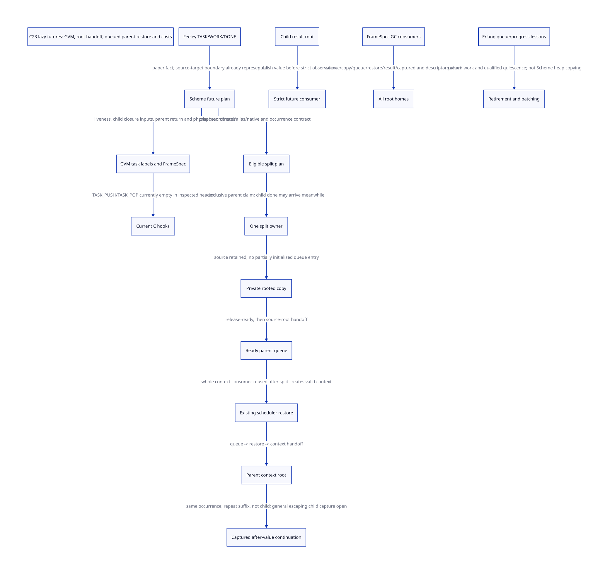

#+TITLE: Lazy futures from current GVM to rooted split and continuation contracts
#+SETUPFILE: ../../modeling/org/setup.org
#+LANGUAGE: en
#+CATEGORY: modern-c
#+PROPERTY: header-args :eval never :tangle no
#+OPTIONS: toc:3 num:nil

* RESEARCH Decision and achieved scope :c23:smp:gvm:
:PROPERTIES:
:CUSTOM_ID: lazy-future-split
:AUTHORITY: GambitLazyFutureSplit
:STATUS: SOURCE-SEAMS-CONFIRMED; ABSTRACT-SPLIT; NATIVE-SEMANTICS-OPEN
:BASELINE: C23
:END:
Current Gambit has real future parse/GVM/emitter seams and real queued-thread
stealing. The inspected C header defines TASK_PUSH and TASK_POP as empty macros.
These are different facts: task labels do not establish working lazy stack
splitting, and working thread queues do not create that missing transaction.

Reuse Scheme semantic analysis, frame/root coordinates and scheduler consumers.
Study an explicit split/return/root contract that bridges them. Modern C remains
the required realization. No runtime implementation, native compiler invocation,
preprocessor run, native test or performance validation occurs here.

[[file:models/sysml/lazy-future-split.sysml][Native SysML]] owns source, mechanism/mismatch, component, issuer, profile,
action, cost and gap rows. Python drives native evaluation, [[file:../../modeling/ascent/lazy-future-split.rules.scm][actual ASCENT DSL]],
[[file:models/quint/lazy_future_split.qnt][executable QNT]], [[file:models/lean/LazySplit.lean][typed-IR Lean preservation]] and [[file:models/lean/LazySplitCost.lean][conditional cost/identity laws]].
[[file:lazy-future-split-matrix.org][The matrix]] and [[file:diagrams/lazy-future-split.d2][D2]] /  derive from that authority. The
[[file:../../../evidence/research/lazy-future-split/checks.json][check receipt]] keeps source correspondence, abstract safety, semantic equivalence,
C23 refinement and native benefit separate. This extends the
[[file:dispatch-joint-admission-design.org][native-scope/multicore learning study]], not a parallel runtime architecture.

* RESEARCH Paper facts and current-source correspondence :evidence:
:PROPERTIES:
:CUSTOM_ID: lazy-source-correspondence
:END:
The [[https://www.iro.umontreal.ca/~feeley/papers/FeeleyMillerLFP90.pdf][Feeley/Miller PVM paper]], section 2.7, describes TASK/WORK/DONE support and
lazy futures. A child can run call-like on the current processor; another
processor materializes its suspended parent and placeholder at a split marker.
The runtime provides the split operation. This is a historical mechanism, not
proof of today's runtime. The author PDF and extracted text are identified by
[[file:../../../evidence/research/lazy-future-split/pvm-paper-source.json][the retained primary-paper hashes]]. No historical speedup is transferred here.

The source evidence below is the *current local working tree*, including earlier
refactoring edits such as physical FrameSpec and collector contexts. It is not
presented as an unmodified upstream release or a matched installed binary.

| Layer | Exact producer/consumer | Current fact | What does not follow |
|-------+-------------------------+--------------+----------------------|
| Parse | [[file:../../../vendor/gambit/gsc/_ptree1.scm::(define (pt-future source env use)][pt-future]] -> fut node | Future has a distinct tree node | Public parallel future semantics are fully implemented |
| Semantic generation | [[file:../../../vendor/gambit/gsc/_front.scm::(define (gen-fut node live reason)][gen-fut]] | Computes live-after, child closed vars, ret-var and task/return labels | A steal grant or effect/control eligibility proof exists |
| Source frame cut | gen-fut save-regs, frame-start, task-context, return-context | Parent live registers are saved; reserve/alignment includes a break frame; child and return contexts differ | The whole source interval is immutable or safe to copy concurrently |
| GVM | [[file:../../../vendor/gambit/gsc/_gvm.scm::(define (make-frame size slots regs closed live)][frame]] and task-entry/task-return | Logical slots, registers, closed variables and liveness are retained | Scheduler ownership and root publication are encoded |
| C emission | [[file:../../../vendor/gambit/gsc/_t-c-2.scm::(define (targ-gen-label-task-entry lbl sn)][task entry]] / task return | Emits TASK_PUSH and TASK_POP with return metadata | Hook emission implements the protocol |
| C header | [[file:../../../vendor/gambit/include/_gambit/module_generation.h.in::#define ___TASK_PUSH(i)][TASK_PUSH]] / TASK_POP | Both inspected definitions have empty replacement lists | No other backend ever supports tasks, or any installed binary was tested |
| Physical frame | [[file:../../../vendor/gambit/gsc/_t-c-3.scm::(define (targ-make-frame-spec kind fs link gc-map)][FrameSpec]] -> descriptor decoder | Validates normal/task/internal kind, size, link and live map | A task tag carries exclusive run authority or immutable compiler-session state |
| Scheduler | [[file:../../../vendor/gambit/lib/_thread.scm::There are no runnable threads locally, so try to steal][steal path]] -> btq removal -> thread restore -> resume thunk | Steals an already queued Scheme thread; pinned threads are skipped | It splits the parent continuation of an executing child |
| GC | [[file:../../../vendor/gambit/lib/_mem/root-origins.inc::mark_continuation (work, context);][root origin]] -> stack/regs/saved/RC; frame decoder -> mark_frame | Existing precise coordinates and moving updates have concrete consumers | New private/queued task roots are already registered |
| Capture/restore | [[file:../../../vendor/gambit/include/_gambit/gvm_operations.h.in::#define ___CONTINUATION_CAPTURE][capture]] / graft plus Scheme winding | Retains frame and denv identity; restores dynamic state | A copied frame is automatically a new task or a completed task may be memoized |

The empty hooks bound the current C-path finding; this is not a global statement
about historical Gambit targets. The driver records exact macro lines without
performing preprocessing. Generated artifacts and effective Darwin/native cohort
correspondence remain unresolved.

* RESEARCH A shared semantic split contract :framespec:architecture:
:PROPERTIES:
:CUSTOM_ID: lazy-split-spec
:END:
SplitSpec is proposed research vocabulary, not an existing runtime structure.
Extend the existing Scheme-owned semantic plan; do not ask a C macro or scheduler
to rediscover parent liveness and control meaning.

#+name: lazy-split-contract-fields
| Field group | Derive/reuse | Required consumer |
|-------------+-------------+-------------------|
| Site and occurrence | Stable semantic point, module/frame ABI cohort; fresh dynamic TaskOccurrence | Claim, completion, capture/reentry and module lifetime |
| Parent continuation | gen-fut live-after, saved register homes, return-context and return label | Materializer, scheduler restore and GC |
| Child environment | Child closed variables and task-context | Child roots and alias preservation |
| Coordinates | FrameSpec normal/task/internal physical size, link and maps | Existing frame decoder; split source/destination mapping |
| Root homes | Stack/reg/saved/denv, private copy, queue, restore, result, captured object | Every relevant GC round and moving update |
| Eligibility | Memory/alias, exception, escaping control, native affinity and exposed-frame policy | Admit parallel split or retain sequential execution |
| Return protocol | Child completion versus parent ownership, strict consumer, error/cancel contract | Marker/DONE and result delivery |
| Retirement | Source interval, copied frame, descriptor/code cohort and late-reader closure | Collector, scheduler and module owner |

Logical roots and physical frame descriptors are related but not interchangeable.
The link is a structural coordinate (physical link+1), excluded from the ordinary
root cursor and traversed separately. Internal return uses saved-register/actual
return metadata rather than the normal layout. A parent split must specify both
new link topology and ordinary live slots; copying a union live mask is not a
proof of either partition.

Existing physical FrameSpec is a validated Scheme vector. Its comment about
freezing does not prove a complete mutable-alias closure or independent compiler
sessions. The existing primitive side-effects boolean is likewise not a complete
exception, control-capture, native-affinity or concurrent-alias analysis. Those
are eligibility obligations, not benefits already obtained.

* RESEARCH Split, child completion and root handoff :gc:scheduler:
:PROPERTIES:
:CUSTOM_ID: lazy-split-sequence
:END:
1. Execute an admitted child using the existing local source frame and precise
   roots. A split marker identifies the parent continuation, not a separately
   queued child. If no split is claimed, use local completion; a losing probe
   does not allocate another parent.
2. One claimant reserves the parent occurrence. The child can reach completion
   during preparation; its result remains rooted while the owner settles split
   versus private abort. Do not return through or overwrite parent source cells
   that a claimant still needs.
3. Establish a GC-safe destination before initialization can allocate or pause.
   Retain the source frame/root authority. A partially built copy needs safe
   initialized slots and a real root enumeration policy, not just a pointer to
   uninitialized memory.
4. Initialize the parent snapshot and result placeholder, then publish READY.
   READY must not expose an uninitialized frame. Commit transfers parent
   execution ownership; only then can source parent-root responsibility end.
5. Queue ownership transfers to a rooted restoring context, then to the actual
   resumed context. Existing queue locks/steal/restore are reuse candidates once
   the new parent context satisfies their thread, denv and pinning contracts.
6. The parent may perform permitted prefix work before the child finishes.
   A strict future-value consumer waits for published completion. Child result
   publication must precede consuming it; the result remains rooted while queued,
   waiting, captured or in an unknown transfer.
7. Retirement requires actual final use of task state, captured references,
   source/copy/context roots and descriptor/code readers. A queued-thread count
   alone does not close that set.

At the native task-return point, LOCAL can follow the existing normal return;
CLAIMED/PREPARING must root the pending child result while settlement finishes;
SPLIT must publish completion and leave through the scheduler rather than execute
the original local parent again. Child return routing, structural-link changes
and the parent root-map transition are one commit contract. TASK_POP with only a
fallback label does not currently implement it.

The model's sourceRoot denotes the *parent region*, not the entire old execution
context. The executing child remains in its ordinary context, whose stack,
registers, saved values and denv must continue to be scanned. Detaching parent
root responsibility must not unregister that child context, nor leave its return
or frame links pointing into retired parent storage. Actual child/parent
partition, link rewiring and moving updates remain explicit frame-partition and
copy-forwarding obligations; the parent-root flag theorem does not prove them.

No separate thread object, closure, queue operation or placeholder should be
created for every unclaimed task merely to implement the API. Actual allocations
may be packed or shared; the count model measures a logical materialization group,
not a guaranteed number of malloc calls.

** RESEARCH Real GC interaction is a major remaining refinement
[[file:../../../vendor/gambit/lib/_mem/continuation-roots.inc][Captured-frame copying]] already rewrites links and forwarding pointers.
[[file:../../../vendor/gambit/lib/_mem/object-scanning.inc][Heap-frame scanning]] validates payload/descriptor agreement. Reuse their
coordinate logic, but do not treat a collector copy reservation as scheduler
ownership. Earlier captured-frame publication obligations still apply.

A source interval must be stable against child return writes, reflection/FFI
aliases and moving-GC mutations during copy. Two refinement choices remain to
justify: a bounded, non-abandonable copy at a qualified safepoint with source
mutation/GC excluded, or a GC-aware incremental initializer with per-chunk
progress, roots and relocation repair. The former adds pause latency; the latter
adds metadata and proof obligations. No numeric copy budget or algorithm is
selected without that tradeoff.

The QNT initializeCopy step is atomic at the logical level. It is not a proof
that memcpy is atomic or safe during moving GC. A retained physical
=___frame_root_cursor= explicitly cannot cross a safepoint or module lifetime;
reconstruct it from a live descriptor when required. Root-presence flags alone
do not prove actual slot addresses, sparse initialization or forwarding updates.

** RESEARCH C23 obligations
| Handoff | Required condition | Source refinement still open |
|---------+--------------------+-----------------------------|
| Claim versus local return | One arbitration state for the dynamic occurrence | Real atomic state, failure and ABA policy |
| Source -> private copy | Source still scanned until initialized destination roots are valid | Address/slot mapping and GC exclusion or incremental repair |
| Private copy -> READY | Initialize frame and result protocol before release publication | Consumer acquire and object lifetime |
| READY -> committed owner | Exactly one parent run grant; pending child result retained | Actual queue and context identity adapter |
| Child result -> strict consumer | Rooted value before release completion; acquire before use | Wakeup, cancellation and exception paths |
| Context -> captured continuation | Shared heap aliases and denv identity preserved; private execution image per shot | Full current capture/restore/wind semantics |
| Last use -> retirement | Closed admission, all aliases drained, descriptor readers ended | Native reclamation proof and actual cohort |

C23 is the realization baseline. This is not a weak-memory execution proof.
Prefer existing frame, context, queue and root support where it can discharge
these obligations. New services or global receipt databases are not prescribed.

* RESEARCH Migration and retirement are compiler/runtime changes :abi:build:
:PROPERTIES:
:CUSTOM_ID: lazy-migration
:END:
| Existing responsibility | Reuse | Required change before retirement |
|-------------------------+-------+-----------------------------------|
| GVM task constructors, copying and consumers | Logical task/return labels and frame state | Carry the same completed SplitSpec through every relevant clone, transform and target consumer; unsupported targets retain sequential behavior |
| C task entry emits TASK_PUSH with literal 0 | Existing mechanical emission seam | Supply an authenticated per-site plan reference or prove an equivalent descriptor lookup; 0 alone is not a split plan |
| C task return emits TASK_POP with a return label | Return metadata and proc-result home | Connect the dynamic occurrence and normal/error/cancel result protocol; do not infer ownership from label kind |
| Module/frame metadata | Existing physical decoder and descriptor lifetime machinery | Bind semantic split point, root maps and code to one admitted cohort |
| Empty hook responsibility | Current sequential path for unsupported profiles | Retire only after real producer/consumer, GC, queue, control and effective-cohort refinement |
| Incremental products | Existing semantic-versus-layout artifact separation | Split/effect contract changes invalidate semantic consumers; layout/runtime ABI changes invalidate dependent native artifacts |

A retained GVM product can be reused only if it actually carries the semantic
information the new consumer requires. Missing effect/control/alias information
cannot be recovered by changing a C build flag. Purely mechanical layout changes
need not redo expansion when their semantic inputs remain valid, but the precise
invalidation rule belongs to the existing incremental-build contract. Old code
and descriptors stay live while any captured frame, task, restore or foreign
reader can reference them. This study does not prove mixed-cohort execution or
old-code unloading.

* RESEARCH Continuation identity and effect semantics :control:
:PROPERTIES:
:CUSTOM_ID: lazy-continuation-semantics
:END:
TaskOccurrence, semantic split site and continuation shot are different identities.
Exactly one scheduler claim per occurrence is not an exactly-once law for all
Scheme computation.

| Capture/restore location | Required meaning | Status |
|--------------------------+------------------+--------|
| Before executing the future/spawn | A restored computation executes a fresh dynamic occurrence when it reaches the site again | Fresh-ID arithmetic law only; real source classification open |
| After the future value/capture point | Keep the referenced occurrence/result identity; repeat the captured suffix and its legitimate effects | Fixed-occurrence after-value model checked; native value/wind equivalence open |
| Inside a child already exposed by split | Escaping and multi-shot control can revisit child completion and involve multiple runnable contexts | Not covered by this normal-result model; full semantics unresolved |
| Native-affine or externally exposed frame | Cannot migrate its C return/storage authority by copying Scheme slots | Exclude parallel split before commit unless a stronger native contract is proved |

The initial parallel profile must prove eligibility for the region, or use the
existing sequential path *before* split effects. An unknown indirect call is not
proved capture-free or nonthrowing by a generic side-effects flag. Rejecting a
parallel optimization must not reject a legal Scheme program. After a split has
committed, discovering an unsupported control escape is too late to silently
pretend no split occurred.

Normal, exceptional and cancelled future completion need an explicit semantic
contract. Running a parent prefix early can change the timing of a child's
exception or visible mutation. Total/normal eligible code or a separately
specified explicit-parallel contract can avoid assuming sequential equivalence;
the latter still requires proof. This model handles only normal completion.
It does not manufacture a future exception specification from ordinary promise
forcing, and does not justify memoizing effectful Scheme suffixes.

* RESEARCH Erlang learning without substituting process semantics :knowledge:
:PROPERTIES:
:CUSTOM_ID: lazy-erlang-learning
:END:
The pinned Erlang =try_steal_task_from_victim= transfers queued work, and its batch
limit explicitly controls critical-section length. Learn runnable ownership and
bounded transfer work; it is not a running-Gambit-stack splitting algorithm.

Its GC design accounts for message sizing, allocation, payload copy and container
publication. Those are real costs. Gambit can retain shared heap referents when
copying logical stack slots; it cannot replace them with copied actor messages
without changing alias semantics. A separate isolated-actor profile remains an
independent architecture decision. Dirty-native classification also does not
make thread-affine callbacks migratable.

Erlang's thread-progress example requires removing lookup before qualified reader
quiescence. Gambit continuation suspension and a split marker are not automatically
such a boundary. Frame/code/task retirement must use actual last-use evidence.

* RESEARCH Formal model, counterexamples and scope :qnt:lean:ascent:
:PROPERTIES:
:CUSTOM_ID: lazy-formal-scope
:END:
The executable model has 28 actions for one eligible dynamic task, exclusive
claim, rooted private copy, initialization, publication, commit/private abort,
child completion, queued parent restore, strict consumption, after-value capture
and repeated restoration, GC census and retirement. Probe and suffix-execution
counts are unbounded integers. One fixed task and normal completion are modeled;
multiple tasks, arbitrary slot graphs, errors, cancellation and escaping child
continuations are not thereby proved.

The projected Lean AST comes from actual typed QNT IR. Every action preserves
the invariant; reachable-state induction and specialized laws establish parent
root-home coverage, initialized queue publication, strict consumption ordering,
descriptor coverage and child-run preservation for after-value replay. The fresh
pre-spawn identity lemma proves only arithmetic distinctness, not source-level
TaskOccurrence issuance. Conditional cost algebra is likewise not a benchmark.

Eight deliberate mutants test a second claim, uninitialized queue publication,
source release before copy, dequeue before READY, strict consumption before
completion, captured-descriptor retirement and reexecuting the child during an
after-value restoration, and splitting an explicitly denied profile. Each prefix is checked against the original AST separately from the mutant; expected Lean failures
are retained. No proof timeout/limit is widened to produce acceptance.

Actual ASCENT joins source hashes, component contracts, compiled lemma/action
names, source/consumer paths, learning mismatches and cost baselines. Controls
reject treating an empty hook as a split runtime, queue stealing as stack splitting,
a GC map as run ownership, GC forwarding as a steal grant, actor copies as free,
or current noop allocation as an eager baseline. Only a clearly synthetic fixture
supplying unresolved obligations can pass complete admission. Native adoption
remains blocked.

* RESEARCH Net return with two honest baselines :benefits:
:PROPERTIES:
:CUSTOM_ID: lazy-cost-baselines
:END:
#+name: lazy-materialization-account
| Quantity | Meaning | Charging rule |
|----------+---------+---------------|
| N | Dynamic eligible spawn occurrences, including newly reexecuted pre-spawn sites | Charge marker/eligibility work for each |
| S | Successful parent materializations/splits | Charge frame/root transfer, result and scheduling work |
| A | Aborted attempts that already allocated a materialization group | Count allocation even when no split commits |
| U | Allocated materializations not yet settled at the observation cut | Retain and charge them; do not count as avoided work |
| K | Failed probes | Charge contention and traversal, not zero-cost failure |
| B_i | Copied parent bytes/slots for split i | Charge copying and any additional GC scanning/retention |

Against a declared correct *eager parallel implementation*, a settled cohort has
logical avoided materializations =N-S-A= when =S+A<=N=. At a live observation cut,
charge unresolved allocated U as well: =N-S-A-U=. A split-free execution that allocated
and then aborted is not allocation-free. Existing GVM save-reg/frame work remains.
With equal-unit work costs, the conditional net-work law is:
#+name: lazy-net-work-law
#+begin_src text
net = (N-S-A)*C_materialize
      - N*C_marker - S*C_split - A*C_abort - C_probes
positive exactly when avoided materialization work exceeds the added terms
#+end_src
C_split must include actual copy/root/queue work; avoiding double charging must be
part of the cost definition. The Lean threshold theorem proves the declared equation. A separate aggregate
lemma sums allocation/success bounds from the actual reachable-state invariant;
uncommitted allocation includes aborted or still unresolved work. Native distinct
occurrence/cohort mapping and cost values remain premises, not source equivalence.

Against the *current empty-hook C path*, there are no task-hook materializations
to subtract. Real lazy parallel execution adds machinery and may reduce dependency
span for eligible work. It wins only if useful parallel execution outweighs that
new work, GC effects, contention and imbalance. No numerical speedup follows
from either the paper or the model.

| Responsibility | Reuse / true retirement candidate | Added work / falsifier |
|----------------+----------------------------------+------------------------|
| Scheme future analysis | Reuse parse/fut, parent liveness and child-context construction | Eligibility and shared semantic SplitSpec; no proof from side-effects boolean alone |
| Physical C metadata | Reuse validated size/link/maps, normal/internal decoders | Split root/topology contracts; do not maintain an unrelated second frame format |
| Task hooks | Replace empty hook responsibility with a complete admitted operation | Capability gain, not current allocation removal |
| Existing queues/restore | Reuse runnable-context consumer and pinning rules | New materialization/root adapter; duplicate full scheduler is not justified |
| Result/wait | Avoid eager placeholder/context when no admitted split needs one | Completion, wakeup, exception/cancel and retention still need qualification |
| Continuation | Reuse general capture/graft/denv/wind semantics | Per-shot execution work remains; escaping split-child semantics unresolved |
| Root/retirement support | Reuse actual context and frame scans | New root homes, aliases and descriptor lifetime must be covered before retirement |

No runtime path has been retired here. The matrix distinguishes paper facts,
current-source foundations, proposed replacements and their proof gaps.

* RESEARCH Closure ledger :gaps:
:PROPERTIES:
:CUSTOM_ID: lazy-closure
:END:
- [X] Trace the real future -> GVM -> FrameSpec -> C-hook chain.
- [X] Distinguish current whole-thread stealing from paper lazy-parent splitting.
- [X] Check normal single-occurrence split/root/after-value abstract safety.
- [X] Charge initialized aborts and separate eager from current-noop baselines.
- [ ] Complete effect/alias/native/exception/control eligibility from actual callers.
- [ ] Prove physical parent/child slot partition and moving-GC refinement.
- [ ] Qualify result, wakeup, cancellation, exceptions and real scheduler adapter.
- [ ] Preserve arbitrary continuation semantics inside an already split child.
- [ ] Refine fresh pre-spawn occurrence and code/descriptor retirement.
- [ ] Establish effective native cohort, C23 implementation and net runtime return.

These extend [[file:runtime-blueprint.org][the existing runtime blueprint]] and its FrameSpec/GC/SMP/control owners.
A new model file does not close the remaining cross-component obligations.
