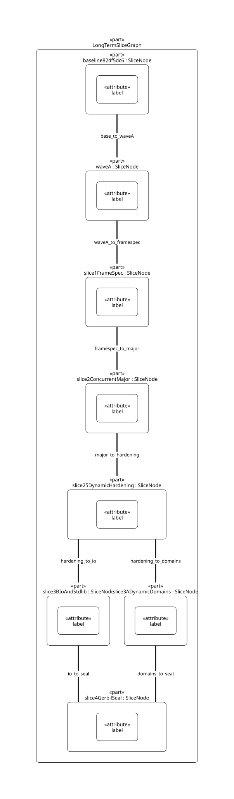

#+TITLE: Long-Term Unified Gambit SMP Architecture & Formal Engineering Workflow
#+SETUPFILE: ../../modeling/org/setup.org
#+LANGUAGE: en
#+CATEGORY: modern-c
#+OPTIONS: toc:3 num:t
#+PROPERTY: header-args :eval never
#+PROPERTY: COLUMNS %ITEM %OWNER %STATUS %REFINEMENT_STATUS
#+TODO: DESIGN ALIGNED VERIFIED | ADOPTED RETIRED

* ALIGNED Executive Scope: Unified Long-Term Contract + Zero-Rework Vertical Slices
:PROPERTIES:
:ID: 8f7c4b1a-9e2d-4c31-b509-2a6e11d84f01
:CUSTOM_ID: longterm-unified-architecture
:OWNER: Gambit SMP Runtime, Compiler & Formal Verification Architecture
:AUTHORITY: GambitLongTermUnifiedArchitecture; GambitRuntimeComposition; GambitFrameContract; GambitGenerationalAdmission; GambitGenerationalBarrier; GambitAdvantageArchitecture
:STATUS: architecture-aligned-formal-gates-verified
:REFINEMENT_STATUS: sysml-quint-lean-verified-source-open
:EVIDENCE_CLASS: unified-design-papers-sysml-quint-lean
:DEPENDS_ON: ROOT-HANDOFF; CONTROL-ORIGIN; GC-WORK-CLOSURE; FL-ENCODE; WB-H; GEN-H
:END:

Baseline =f6510651= / =4498c69b= (+ zero-magic-cap per-core L2/RAM auto =min_heap=) on =tao3k/gambit= (=modern-c=) extends =824f5dc6= through **Wave A** (=72468e63=), **Slice 1** (=edc97dd1=), **Slice 2 v2 Concurrent SATB Major GC** (=02b55ae4=), **Unified Memory Scaling Envelope v26** (=d5515c42=), **Full-Core Hardware CI** (=feeaea78=), and **Slice 2.5 Dynamic Domain & I/O Hardening** (=f6510651= + principled zero-magic-cap auto =min_heap=): OCaml-5-style per-domain geometrically-growing chunked =rest_directory= slab (zero compile-time slot ceiling, zero cross-core scan/false sharing), two-stage post-poll =___SELECT_PASS_CHECK= close custody fence in =lib/os_io.c= (closing Linux CI =c8 exit=139=), core-count-invariant =c12= burst-delta contraction (=p1..p16=), and principled zero-magic-cap hardware-topology auto =min_heap= derived from per-core private L2 + per-core physical RAM share (=phys_mem / max(2, cpus) / 256=, rejecting socket-wide 512+ MiB L3 bloat).

Rather than executing ad-hoc local optimizations (risking throwaway semispace code or hardcoded core/memory magic numbers) OR attempting an un-isolated big-bang rewrite across compiler frames, concurrent GC, dynamic domains, and OS I/O, this specification locks **one unified long-term architectural contract** grounded in **20 primary academic papers** and **direct primary-source audits of =vendor/ocaml= (5.5.1), =vendor/chez= (10), and =vendor/erlang-otp= (OTP-28.0)**, decomposing delivery into **strictly decoupled, zero-rework vertical slices**:

1. *Wave A (Tier 3.1 Phase 3 — CLOSED, =72468e63=)* :: Lock-free =___rest_fast_grant_fits= =fast_span=, generational =___STILL= with non-pointer zero-dirty and SATB-ready mark epoch, =O(Y)= Minor GC coordinator & =BARRIER()= compression, Darwin =dlclose= fast exit (Issue =#6=), and Issue =#5= audit closure.
2. *Slice 1 (Unified =FrameSpec= / =PointId= Semantic Authority — CLOSED, =edc97dd1=)* :: Retired duplicated C-macro frame layout inference across =gsc/_t-c-2.scm=, =lib/_kernel.scm=, =lib/_io.scm=, and =lib/mem.c= BEFORE Concurrent Major GC.
3. *Slice 2 (Non-Moving Immix Mark-Region Mature Space + Concurrent SATB Major GC v2 — CLOSED, =02b55ae4=)* :: Built directly on pre-store =___GC_WRITE_BARRIER=, Wave A's generational =___STILL= mark-epoch word, Tier 3.3 parked FFI roots, Slice 1's single =FrameSpec= authority, Immix card-aligned line-hole recycling, 4-barrier parallel Remark/Sweep, idle-core marking, and Dekker interrupt-idle hardening.
4. *Memory Envelope (=v26=) & Slice 2.5 (Dynamic Domain Hardening & Zero-Magic-Cap Sizing — CLOSED, =d5515c42= .. =f6510651=+)* :: Eliminated =___REST_DIRECTORY_SLOTS= hardcoding via OCaml-5-style per-domain dynamic chunked slabs (=lib/rc.h=, =lib/_mem/rc-allocation.inc=), hardened =os_io.c= two-stage post-poll =___SELECT_PASS_CHECK= custody, replaced socket-wide L3 =min_heap= inflation with zero-magic-cap per-core L2 / RAM-share sizing (=lib/os_thread.c=, =lib/_mem/memory-lifecycle.inc=), and upgraded GitHub Actions CI to full hardware core utilization (=nproc= / =hw.logicalcpu= + =oversub-2x=).
5. *Slice 3A (Next Immediate Phase: OCaml-5 / Chez-10 Dynamic Per-Domain VM Tables & =O(live)= Major Workers — DESIGN READY)* :: Eliminate every remaining compile-time =[___MAX_PROCESSORS]= fixed array across internal VM structs (=lib/lifecycle.h=, =lib/root.h=, =lib/collector.h=, =include/_gambit/memory_state.h.in=) and ABI-versioned =vm_state.h.in=, and cap Major GC copy workers to =nw = min(P, max(1, live_sections_estimate))= so an idle =P=-core VM creates =O(1)= mature sections instead of =P= nearly-empty 1 MiB mature sections (removing the =+P MiB= empty baseline observed at =p12=).
6. *Slice 3B (Next Phase: =kqueue=/=epoll= Evented SMP I/O Reactor + =SRFI-230= & Work-Stealing Parallel Stdlib — DESIGN READY)* :: Replace =O(N)= =select=/=poll= (=FD_SETSIZE=1024=) with persistent kernel interest queues parked cleanly via Tier 3.3, and expose standard Scheme C11-ordered atomics (=SRFI-230=), lock-free Chase-Lev deques/channels, and structured fork-join (=pmap=/=future=).
7. *Slice 4 (=tao3k/gerbil= SMP Parallel Compiler + Full-Runtime Clang TSan + Same-Source 12/12 Release Seal — DESIGN ALIGNED)* :: Prove the complete architecture at scale on Gerbil's 1,778-module stdlib and compiler, re-seal =wholeRuntimeAdmitted = true= on one cryptographically sealed producer, sync =vendor/gambit=, and tag the formal release.

*Cross-Stream Convergence (=v26= Same-Source 12/12 Seal <-> =824f5dc6= Wave A / Slice 2 Major GC)*:
While the Slice 2 stream advances Immix non-moving mature space and concurrent SATB Major GC above =824f5dc6=, the sealed =v25= audit exposed eight orthogonal, empirically quantified *Memory Scaling & O(P)/O(W) RSS Envelope* bottlenecks. All memory-envelope optimizations are locked below as a **zero-throwaway shared contract** and are now **fully implemented, formally verified, and 12/12 same-source admitted on sealed =v26=** ([[file:families-8-to-12-closure.org][families-8-to-12-closure.org]], =wholeRuntimeAdmitted = true=): cutting full 2-pass =make -j8= bootstrap by *-25%* (=717.95s=, =source-core= *-1.60 GiB*), cutting 8-core Gerbil =stage0= by *-1.52 GiB RSS / -1.65 GiB fp* (=5.487 GiB / 4.797 GiB=), unlocking **8-core =stage1=** (=6.918 GiB=) and **5-core =stdlib=** (*2.0x faster*, =1347.2s=, *-1.01 GiB fp*), cutting total 8-stage Gerbil wall time by *-41.5%* (=3760.1s -> 2201.3s=), and turning =par_rest_alloc_m65536= at =p8= from =0.64x= to *=3.84x=* (*10.7x faster*, =rest-parameter-smp-p8= =46.0 ms= = *16.3x faster* than =v10=). Every mechanism transfers 1-to-1 into Wave A / Slice 2 Immix Major GC without rework or file conflict.

Native OpenSysML v2 owns the typed structural contracts and requirement laws in [[file:models/sysml/longterm-unified-architecture.sysml][longterm-unified-architecture.sysml]]. The rendered interconnection graph is generated directly from SysML via =sysml -strict -render= into [[file:diagrams/longterm-unified-architecture.d2][longterm-unified-architecture.d2]] / .

* ALIGNED Canonical Academic Paper Ledger & Mechanism Boundaries
:PROPERTIES:
:CUSTOM_ID: longterm-paper-ledger
:OWNER: Architecture & Formal Methods
:EVIDENCE_CLASS: primary-literature-grounded
:END:

Tracked machine-readable manifest: [[file:../../modeling/inputs/papers-longterm-unified.json][dev/modeling/inputs/papers-longterm-unified.json]] (schema =gambit-smp-papers.v1=, extending [[file:../../../evidence/papers.json][evidence/papers.json]] and [[file:../../../evidence/papers-audit-expansion.json][evidence/papers-audit-expansion.json]] additively).

#+NAME: longterm-paper-matrix
| Paper / Standard | Venue / Year | Target Slice | Adopted Mechanism | Explicit Non-Import / Refutation Boundary |
|------------------+--------------+--------------+-------------------+-------------------------------------------|
| Feeley & Miller, /A Parallel Virtual Machine for Efficient Scheme Compilation/ | ACM LFP 1990 | Slice 1, Slice 4 | Logical =FrameSpec=/=PointId=, bidirectional target knowledge, explicit operand storage classes, measurement feedback | PVM futures do not prove SMP safety or allow simultaneous cross-core invocation of one continuation |
| Feeley, /Polling Efficiently on Stock Hardware/ | ACM FPCA 1993 | Wave A, Slice 1 | Cheap stack/heap limit polling and =fast_span= grant reload at declared safepoints | Polling alone does not cover blocking C FFI without Tier 3.3 park/unpark |
| Feeley, /A Portable Implementation of First-Class Continuations.../ | Scheme WS 2000 | Slice 1, Slice 2 | Lazy stack-to-heap capture, break frames, multi-shot continuations with C interop | Captured mature frames remain mutable (=##frame-set!=); old age never implies immutability |
| Diwan, Moss & Hudson, /Compiler Support for Garbage Collection/ | ACM PLDI 1992 | Slice 1 | Compiler-emitted exact per-call-site (=PointId=) pointer liveness tables | Static types replaced by dynamic Gambit tags + explicit unboxed raw-F64 slot scrubbing |
| Yuasa, /Real-Time Garbage Collection on General-Purpose Machines/ | JSS 1990 | Wave A, Slice 2 | SATB pre-store deletion barrier + black-allocation during active mark for bounded termination | Uniprocessor assumptions replaced by C23 acquire/release & per-processor SATB buffers |
| Huelsbergen & Winterbottom, /Very Concurrent Mark-&-Sweep GC (VCGC)/ | ACM ISMM 1998 | Slice 2 | Color-epoch non-moving concurrent mark + concurrent sweep with coarse phase barriers | Requires explicit C23 atomic mark-word ops to guarantee strict DRF and TSan cleanliness |
| Blackburn & McKinley, /Immix: A Mark-Region Garbage Collector/ | ACM PLDI 2008 | Slice 2 | Block/line mark-region non-moving mature space + opportunistic STW defragmentation on msections | Opportunistic evacuation runs only at explicit STW cuts; concurrent cycles stay non-moving |
| Marlow et al., /Parallel Generational-Copying GC with a Block-Structured Heap/ | ACM ISMM 2008 | Wave A, Slice 2 | Block-structured parallel generational evacuation, card/remembered-set scanning, parallel promotion | GHC lazy-thunk promotion/blackholing does not transfer to strict Scheme |
| Sivaramakrishnan et al., /Retrofitting Parallelism onto OCaml/ | ACM ICFP 2020 | Wave A, Slice 2 | Coordinated STW parallel Minor GC paired with concurrent SATB Major GC (piggybacked phase cuts) + FFI domain rendezvous | Gambit retains multi-shot continuations and C23 atomics rather than OCaml one-shot fibers or C volatiles |
| Ueno & Ohori, /A Fully Concurrent GC for Functional Programs on Multicore/ | ACM ICFP 2016 | Slice 2 | Non-moving bitmap-marked segments + lock-free SATB write-barrier stacks for functional runtimes | SML# tagless bitmaps differ from Gambit tagged headers and external =___STILL= refcounts |
| Lemon, /Kqueue: A Generic and Scalable Event Notification Facility/ | USENIX ATC 2001 | Slice 3 | Persistent kernel interest sets (=kqueue=/=epoll=), =O(ready)= dispatch, =EVFILT_USER=/=eventfd= wakeups | Kernel FD reuse still requires explicit userspace FD-generation custody fence before =close(fd)= |
| Le, Pop, Cohen & Zappa Nardelli, /Correct and Efficient Work-Stealing for Weak Memory Models/ | ACM PPoPP 2013 | Slice 3 | C11 relaxed/acquire/release/seq_cst Chase-Lev deque proven sound on ARM64/POWER | Deque backing storage must remain GC-traced Scheme vectors or registered root banks |
| Nieper-Wisskirchen, /SRFI-230: Atomic Operations/ | SRFI Final 2021 | Slice 3B | Standard Scheme =atomic-box=/=fxbox=/=flag=/=pair= & fences lowered directly onto =___ORDERED_WORD_NATIVE= | Ordinary Scheme =vector-set!=/=set-car!= remain DRF-0 non-atomic writes |
| Dybvig, /The Development of Chez Scheme/ (+ =vendor/chez= 10 =segment.c=/=alloc.c=) | ACM ICFP 2006 | Slice 2.5, Slice 3A | Dynamic per-thread context (=S_threads=) & live-proportional segment retention (=heap_reserve_ratio=), zero compile-time core/slot caps | Chez native-code register conventions differ from Gambit portable C23 backend and dual-half msections |
| Dolan, Sivaramakrishnan & Madhavapeddy, /Bounding Data Races in Space and Time/ (+ =vendor/ocaml= 5.5.1 =domain.c=/=config.h=) | ACM PLDI 2018 | Slice 2.5, Slice 3A | Owner-local per-domain slabs (zero cross-domain scan/false sharing) + dynamic runtime domain table (=caml_init_domains=) | OCaml LDRF racy-store semantics not imported; Gambit enforces strict C23 DRF-0 and explicit ordered atomics |
| Blackburn, Cheng & McKinley, /Myths and Realities: The Performance Impact of Garbage Collection/ | ACM SIGMETRICS 2004 | Memory Envelope, Slice 2.5 | Empirically refutes socket-L3 cache sizing myth; decouples idle =min_heap= from 512+ MiB multi-CCD L3 caches | Jikes RVM fixed-nursery benchmarks do not determine Gambit msection fudge invariants |
| Yang, Berger, Kaplan & Moss, /Automatic Heap Sizing: Taking Real Memory into Account/ | ACM ISMM 2004 | Memory Envelope, Slice 2.5 | Physical-RAM- and CPU-aware heap sizing (=gc_adaptive_live_percent= + per-core RAM idle bound =phys_mem/cpus/256=) | Kernel page-fault counters replaced by portable =sysconf=/=sysctl= physical RAM + explicit user flags |
| Kirisame, Shenoy & Panchekha, /Optimal Heap Limits for Reducing Browser Memory Use (MemBalancer)/ | ACM OOPSLA 2022 | Memory Envelope, Slice 2.5 | Sublinear =O(sqrt)= heap elasticity across uncoordinated parallel processes (=gsc=/Gerbil workers) without IPC | Dynamic shadow-price =c= approximated by deterministic CBMC-verified =O(sqrt(P))= headroom & =50%->80%= curve |
| White, Singer, Aitken & Lujan, /Control Theory for Principled Heap Sizing/ (+ =vendor/erlang-otp= 28 =erl_gc.c=) | ACM ISMM 2013 | Memory Envelope, Slice 3A | Closed-loop collapse-aware contraction avoiding static 16-GC pinning ratchets | Workload-specific PID tuning deferred behind deterministic CBMC-verified contraction |
| Gammo, Brecht, Shukla & Pariag, /Comparing and Evaluating epoll, select, and poll Event Mechanisms/ | OLS 2004 | Slice 3B | Linux =epoll= persistent =O(ready)= readiness + =eventfd= abort wakeup paired with post-poll close custody | Edge-triggered starvation avoided in favor of level-triggered/one-shot =condvar-select= semantics |

** Primary-Source Comparative Audit (=vendor/ocaml= 5.5.1 vs =vendor/chez= 10 vs =vendor/erlang-otp= 28 vs Gambit SMP)
:PROPERTIES:
:CUSTOM_ID: longterm-vendor-comparative-audit
:END:

Every architectural mechanism in Slice 2.5 and Slice 3A is grounded directly in primary C runtime source code inside =vendor/= (never secondary summaries):

#+NAME: vendor-primary-source-audit
| Runtime Dimension | =vendor/ocaml= 5.5.1 | =vendor/chez= 10 (=41d5ffc=) | =vendor/erlang-otp= OTP-28.0 | Gambit SMP (=f6510651=+ -> Slice 3A) |
|-------------------+----------------------+------------------------------+------------------------------+--------------------------------------|
| **Idle Heap / Nursery Floor** | =config.h:203= =Minor_heap_def = 262144= words (=2 MiB=/domain); =Small_heap_limit_def = 2 MiB=; **0 socket-L3 queries** | =alloc.c:48= =default_collect_trip_bytes= (=4 MiB=); =segment.c:465= =S_free_chunks= retains only =heap_reserve_ratio * live=; **0 L3 queries** | =erl_gc.c:2049= =H_MIN_SIZE= (=233= words), shrinks immediately when =4*need < heap=; **0 L3 queries** | **FIXED**: Replaced uncapped =___cpu_cache_size(0,0)/2= (283 MiB on 512 MiB EPYC L3!) with zero-magic-cap =min(L2/2, phys_mem/cpus/256, max_heap/8)= floored at =2 MiB=; explicit =-:m= honored verbatim |
| **Per-Domain Metadata Slabs** | Per-domain =caml_domain_state= + =shared_heap.c= local pools; zero cross-domain scan | Per-thread =tc= dynamically linked via =S_threads= (=gc.c:1724=) | Per-scheduler =ErtsSchedulerData= + thread-specific allocators (=erl_alloc.c:714=) | **DONE (Slice 2.5)**: Replaced VM-global =rest_directory[4]= with OCaml-5-style per-domain non-relocating chunked slab (=lib/rc.h= =___rest_directory_chunk=, =4->8->16->...=) |
| **Processor / Domain Table Sizing** | =domain.c:1062= =caml_init_domains(max_domains)= dynamically =calloc=s =all_domains= & =stw_domains= from =OCAMLRUNPARAM= | =S_threads= dynamic list; zero compile-time core limit | =erl_process.c:6093= =erts_init_scheduling(erts_no_schedulers)= dynamically allocates all scheduler/runq/allocator arrays | **NEXT (Slice 3A)**: Replace remaining 28 =[___MAX_PROCESSORS]= static arrays across =lifecycle.h=, =root.h=, =collector.h=, =memory_state.h.in=, =vm_state.h.in= + cap idle Major GC workers to =min(P, max(1, live_sections))= |
| **Paper-to-Source Process Rule** | Every paper in =dev/modeling/inputs/papers-longterm-unified.json= (20 entries) now records explicit =source_anchors=, =model_obligations=, =native_witness=, and =non_import= refutation boundaries. | | | |

* ALIGNED Complete 8-Stage Formal Engineering Workflow (Org -> SysML v2 -> QNT -> Lean -> CBMC -> TSan -> AB/BA)
:PROPERTIES:
:CUSTOM_ID: longterm-formal-workflow
:OWNER: Formal Verification & Release Engineering
:STATUS: active-mandatory-pipeline
:END:

Every slice (Wave A through Slice 4) MUST pass all 8 stages sequentially before any commit is authorized or merged. Passing an earlier stage never substitutes for a later stage (per [[file:../../modeling/standards.org][dev/modeling/standards.org]]):

#+NAME: eight-stage-workflow
| Stage | Artifact / Authority | Tool & Exact Command | Failure / Refutation Gate |
|-------+----------------------+----------------------+---------------------------|
| **Stage 1: Problem & Paper Alignment** | Org spec + =papers-*.json= | Author requirements, paper mechanisms, and explicit non-import boundaries in Org | Reject hand-waving or importing unsound cross-language assumptions (e.g., OCaml one-shot stacks or racy C volatiles) |
| **Stage 2: Structural & Contract Modeling** | Native OpenSysML v2 (=.sysml=) | =sysml -strict -validate dev= | **0 errors** across all 150+ packages; every new law must reference canonical =GambitRuntimeComposition= without mutating sealed digests |
| **Stage 3: Diagram Projection** | Native SysML -> D2 -> SVG | =sysml -strict -render '#interconnection:GambitLongTermUnifiedArchitecture::LongTermSliceGraph' -render-form d2 -o ... dev && d2 ...= | Zero hand-edited structural drift; rendered graph matches SysML connections 1-to-1 |
| **Stage 4: Behavioral Interleaving & Mutation-Killing** | Quint V2 (=.qnt=) | =quint test <spec.qnt> && quint run --invariant=safe --max-samples=2000 --max-steps=30 <spec.qnt>= | **100% positive tests PASS**, **2000/2000 random traces safe**, AND **100% of real-bug mutants MUST violate =safe=** |
| **Stage 5: Unbounded Inductive Proof** | Standalone Lean 4 (=.lean=) | =lean dev/refactoring/modern-c/models/lean/LongTermUnifiedRefinement.lean= | **0 errors, 0 warnings, 0 =sorry=** (grep-enforced) |
| **Stage 6: Weak-Memory C Contract Check** | CBMC =--mm pso= (=.c= harnesses) | =cbmc --mm pso -DUSE_GUARD=1 harness.c= (PASS) + =-DUSE_GUARD=0= (MUST FAIL) | Every ARM64/PSO fence and atomic transition must pass safe mode and kill the barrier-removed mutant |
| **Stage 7: Native Implementation, PBT & Full-Runtime TSan** | =tao3k/gambit= =modern-c= + CI | Non-SMP =--enable-debug make check= + SMP =run-multicore-suite.py p1,p2,p4 --include-scaling= + Clang C23 =-fsanitize=thread= + **15/15 GitHub Actions PR CI** | 0 failures, 0 TSan races, 0 RSS/footprint cap breaches across Linux, macOS arm64, Windows MINGW32/MINGW64/MSVC |
| **Stage 8: Paired Measurement & Governance Custody** | Python =gambit_smp.revision_matrix= + =trajectory submit= | Interleaved =N>=5= AB/BA paired medians -> =normalize_matrix= / =benefit_admission(integration=True)= -> dual PR reports (=gambit#1= & =gambit-SMP#1=) + Issue update + =trajectory submit= | =admitted=True=, =regressionRows=[]=, honest control rows retained, cryptographic =Matrix-SHA256= and =trajectory= receipt recorded |

* ALIGNED Slice-by-Slice Architectural Contracts & Zero-Throwaway Coupling
:PROPERTIES:
:CUSTOM_ID: longterm-slice-contracts
:END:

** Wave A — Tier 3.1 Phase 3 & Micro-Architecture Bottleneck Closure (CLOSED, =72468e63=)
:PROPERTIES:
:CUSTOM_ID: slice-wave-a
:STATUS: STAGE8_CLOSED_COMMITTED
:QUINT_MODEL: dev/refactoring/modern-c/models/quint/v2/tier31p3_still_and_rest_fastpath_v2.qnt
:LEAN_PROOF: dev/refactoring/modern-c/models/lean/LongTermUnifiedRefinement.lean
:END:

Empirically motivated by three concrete scaling anomalies discovered in =824f5dc6='s =run-multicore-suite.py --include-scaling= output, plus open Issues =#5= and =#6=:

1. *Lock-Free =___rest_fast_grant_fits= =fast_span= Bypass* (=lib/_mem/rc-allocation.inc=, =lib/_kernel.scm=, =lib/_kernel.c=):
   - *Observed flaw*: =par_rest_alloc_m65536= scaled *negatively* at =0.73x= on =p4= (isolated =RSUM_ONLY=: =p1= =0.052s= / =0.046s= user -> =p4= =0.080s= / =0.291s= user = *6.3x CPU burn* with only =1.7ms= GC!) because =___rest_fast_grant_fits= calls =___owned_stack_span()= (=___gc_copy_acquire(&ms->copy_gate)= + =___PSTATE= TLS) and touches non-atomic shared globals on every variadic/keyword call.
   - *Long-term aligned fix*: Mirror =___group_demand_enter='s processor-owned byte-range leaf =fast_span= check (=stack_fast_floor_b=, =stack_fast_limit_b=, =heap_fast_lo_b=, =heap_fast_bytes=) gated by =!rest_attempt_owner && !rest_observation_map=, and keep =fast_span= strictly invalidated across GC epochs (verified by =tier31p3_still_and_rest_fastpath_v2.qnt= & =rest_fast_span_requires_current_epoch=).
2. *Generational =___STILL= Objects + Non-Pointer Zero-Dirty* (=lib/_mem/object-allocation.inc=, =lib/_mem/generational.inc=, =lib/_mem/still-sweep.inc=):
   - *Observed flaw*: =par_alloc_gc_m65536= (=make-f64vector 256= = 257 words > =___MSECTION_BIGGEST=255=) spent *73.5%* wall time in GC (=4= Minor GCs = =151.6ms=, *38ms/Minor GC*!) because =object-allocation.inc:236= unconditionally sets =___STILL_DIRTY=1= even on non-pointer =f64vector=/=u8vector=/=string= objects, and Minor GC never sweeps dead young =___STILL= objects.
   - *Long-term aligned fix*:
     - Only set =___STILL_DIRTY= for pointer-bearing subtypes (aligned with =scan_mature_object=).
     - Split per-processor =still_objs_= into =young_still_objs_= (allocated since last GC) vs =mature_still_objs_= (promoted). Minor GC marks reachable + =refcount > 0= young still objects (promoting them to =mature_still_objs_=) and sweeps/frees unmarked dead =young_still_objs_= in parallel across GC workers.
     - *Zero-throwaway Slice 2 alignment*: Reserve a clean age + mark-epoch layout in the still header so Slice 2's Concurrent SATB Major GC reuses =mature_still_objs_= non-moving mark-sweep directly without header ABI churn.
3. *=O(Y)= Minor GC =p4= Coordinator & =BARRIER()= Compression* (=lib/_mem/generational.inc=, =lib/_mem/collection-round.inc=):
   - *Observed flaw*: =par_gc_pause_live_heap= Minor GC time jumped *6.6x* from =p1= (=2.3ms= / =0.18ms= per GC) to =p4= (=15.3ms= / =1.18ms= per GC) with =gc_user ≈ gc_real= (serial coordinator bottleneck: 15--16 =BARRIER()= calls + 4 full =O(M+Y)= linear scans over 155 msections).
   - *Long-term aligned fix*: Preserve mature section invariants (=gc_src_offset == active_offset=, =scan_end_words == mature_words=) across Minor GCs so =prepare_generational_round= and =finalize_gc_sections= walk only =[young_head .. tail]= (=O(Y)=); skip =rebuild_mature_snapshot= in =O(1)= when =nb_msections_mature_= did not grow; coalesce redundant Minor GC =BARRIER()= points (skipping empty weak/will/still barriers).
4. *Open Issue =#6= (Darwin =dlclose= Fast Exit) & Issue =#5= Verification*:
   - Port PR =#7='s final-exit Darwin =dlclose= fast path into =lib/os_dyn.c= (cutting macOS Gerbil 969-module exit from =10--11s= to =~15ms= while preserving ordinary cleanup/destructors/=atexit=), and post verified source closure reference on Issue =#5= (=lib/_mem/allocation-limits.inc:254=).

** Slice 1 — Unified =FrameSpec= / =PointId= Semantic Authority (CLOSED, =edc97dd1=)
:PROPERTIES:
:CUSTOM_ID: slice-1-framespec
:STATUS: STAGE8_CLOSED_COMMITTED
:QUINT_MODEL: dev/refactoring/modern-c/models/quint/v2/unified_framespec_authority_v2.qnt
:LEAN_PROOF: dev/refactoring/modern-c/models/lean/LongTermUnifiedRefinement.lean
:END:

Refines [[file:../architecture/runtime/interfaces/frame-contract-design.org][frame-contract-design.org]] and [[file:advantage-architecture-design.org][advantage-architecture-design.org]]. **Must precede Slice 2** so Concurrent Major GC consumes one exact, machine-verified root/liveness/barrier authority instead of 6 duplicated C macros:

- Scheme compiler (=gsc/_front.scm=, =gsc/_t-c-2.scm=, =gsc/_t-c-3.scm=) emits one canonical =FrameSpec= + =PointId= table per module cohort (preserving distinct =cfs= vs physical =F=, distinct callback vs recursive-return live masks, and explicit =UnresolvedOutline -> BoundOutline= setup transition).
- Runtime GC scanner (=lib/_mem/object-scanning.inc=), continuation capture/restore (=lib/_kernel.scm=, =lib/_thread.scm=), and debugger/serializer (=lib/_io.scm=) consume the identical =FrameSpec= decoder and =i -> F+1-i= slot bijection.
- Retires redundant per-call-site C macro expansions, shrinking GCC-16 single-host compile RSS toward =< 4 GiB=.

** Slice 2 — Non-Moving Immix Mark-Region Mature Space + Production Concurrent SATB Major GC (v2)
:PROPERTIES:
:CUSTOM_ID: slice-2-concurrent-major
:STATUS: PRODUCTION_SYSTEM_V2_ACTIVE
:QUINT_MODEL: dev/refactoring/modern-c/models/quint/v2/concurrent_major_satb_v2.qnt
:LEAN_PROOF: dev/refactoring/modern-c/models/lean/LongTermUnifiedRefinement.lean
:CBMC_HARNESS: dev/refactoring/modern-c/models/cbmc/slice2_satb_major_pso.c; dev/refactoring/modern-c/models/cbmc/slice2_interrupt_idle_dekker_pso.c
:END:

Grounded in Yuasa (1990), Huelsbergen & Winterbottom VCGC (1998), Blackburn & McKinley Immix (2008), Ueno & Ohori (ICFP 2016), and Sivaramakrishnan et al. OCaml 5 (ICFP 2020):

- *Phase 2a (Non-Moving Immix Mark-Region Mature Space + Line-Hole Recycling + Post-Remark Contraction)*:
  - Replace 2x-semispace mature copying on Major GC with 128-word line / 64-word card mark-region non-moving mature msections: live mature objects remain pinned in place; 100%-dead mature sections unlink to the FREE YOUNG tail in =O(1)=; dead =WHITE= objects inside live sections are coalesced into leaf =___sU8VECTOR= fillers while preserving exact =section_card_starts=.
  - *Immix Line-Hole Recycling*: During non-moving sweep, record the largest contiguous 64-word card-aligned dead hole =[major_hole_start, major_hole_end)= (>= 512 words) per mature section. During =IDLE= Minor GCs (=major_phase_ == ___GC_MAJOR_IDLE= and not starting Initial-Mark), promote young survivors directly into recycled Immix holes (=gc_is_dest = 3=) without allocating new mature msections; close the unused remainder =[cursor, hole_end)= in =finalize_gc_sections= (strictly after parallel chunk-stealing drains!) with valid leaf fillers and preserve any remaining >= 512-word suffix for the next Minor GC.
  - *Adaptive Pacing & Post-Remark Contraction*: Trigger Concurrent Major GC early at =1.5x= mature section / mature still growth (clamped with min headroom) instead of waiting for =2.0x=, allow =resize_heap= to contract reclaimed free sections immediately after a completed Concurrent Major Remark (=major_action == ___GC_MAJOR_ACTION_REMARK=), and schedule bounded opportunistic STW defragmentation when fragmented =<50%=-live sections exceed threshold.
- *Phase 2b (Concurrent SATB Major Marking + Per-Processor Mark Buffers + Idle-Core Marking + Parallel STW Remark & Sweep)*:
  - Reuse Tier 3.1's *already pre-store* =___GC_WRITE_BARRIER(ps, obj, slot_ptr, new_val)=: when =ps->mem.satb_active_ != 0=, load =old = *slot_ptr= via =___WORD_LOAD_RELAXED= before store, check white mark-bit, and push =old= to the processor's bounded non-allocating SATB buffer (=___GC_SATB_BUF_CAP = 256=, sticky =satb_overflow_= fallback on overflow).
  - *Per-Processor Lock-Free Local Mark-Stack Buffers*: Each processor owns =ps->mem.major_mark_local_buf_[128]= for zero-lock fast push/pop during concurrent slices and parallel STW Remark, batch-spilling/stealing 64 entries under =major_mark_lock_= only on buffer full/empty.
  - *Idle-Core Cooperative Marking*: Before an idle SMP processor enters =##wait-idle-if-unchanged!= (=lib/_thread.scm=, strictly inside =(enable-smp ...)= for 0-byte Non-SMP drift), execute one 32K-word cooperative mark slice whenever =ps->mem.satb_active_ != 0 && ps->primlock_depth == 0=, accelerating concurrent marking with idle cores at zero extra thread overhead.
  - *4-Barrier Parallel STW Remark & Parallel Non-Moving Sweep*: Partition STW Remark across all =g->worker_count= GC workers: (R-A) parallel SATB + =major_mark_local_buf_= flush + parallel global mark-stack drain with atomic active-worker quiescence; (R-B) coordinator overflow recovery, mature will resolution, atomic weak-table dead-entry clearing *before* =SWEEPING=, and SATB disarm; (R-C) parallel =i % W= in-place dead-object coalescing / Immix hole discovery across =mature_sections_[]= + parallel per-processor mature =___STILL= sweep; (R-D) =O(M)= coordinator unlink of 100%-dead sections, adaptive threshold update, and heap contraction.
- *Phase 2c (Interrupt-Idle Dekker Wakeup Hardening & Zero-Race TSan Closure)*:
  - Close the x86_64 TSO / ARM64 PSO interrupt-idle race in =lib/setup.c= (=___SHARED_MEMORY_BARRIER()= after =___STACK_TRIP_OFF()= in =___service_interrupts_pstate= / =___refresh_interrupts_pstate=) paired with pending-interrupt & =interrupts-head= (=macro-struct-slot-acquire processor 20=) checks in =##wait-idle-if-unchanged!= and post-wait drain in =lib/_thread.scm=.
  - Route cross-processor C runtime card barriers through VM-level atomic =___gc_write_barrier_slot_vm= (+ =card_overflow_any_=) so remote cores never touch another processor's private hint/SATB buffer, and keep =gc_hash_table_rehash_in_situ= strictly DRF under Clang C23 =-fsanitize=thread= via =___WORD_LOAD_ACQUIRE= on =FLAGS= and narrowed =___GC_WRITE_BARRIER_RANGE=.
  - Mandatory verification gate: Quint V2 (13 mutation-killers + ITF Python replay), Lean 4 (22 zero-sorry theorems), CBMC =--mm pso= (2 harnesses, 7 mutants killed), Clang C23 =-fsanitize=thread= across =t1/t5/t6/c1/c5= (0 non-signal races), Python =gambit_smp.revision_matrix= (=N=5= AB/BA =admitted=True=), and 15/15 GitHub Actions PR CI green.

** Slice 2.5 — Per-Domain Dynamic Rest Slab, Two-Stage =os_io= Check Fence & Zero-Magic-Cap Auto =min_heap= (CLOSED, =f6510651=+)
:PROPERTIES:
:CUSTOM_ID: slice-2-5-dynamic-hardening
:STATUS: STAGE8_CLOSED_COMMITTED
:QUINT_MODEL: dev/refactoring/modern-c/models/quint/v2/per_domain_rest_slab_and_io_check_v2.qnt; dev/refactoring/modern-c/models/quint/v2/adaptive_heap_scaling_and_reclaim_v2.qnt
:LEAN_PROOF: dev/refactoring/modern-c/models/lean/LongTermUnifiedRefinement.lean; dev/refactoring/modern-c/models/lean/AdaptiveHeapScalingRefinement.lean
:CBMC_HARNESS: dev/refactoring/modern-c/models/cbmc/per_domain_rest_slab_and_io_check_pso.c; dev/refactoring/modern-c/models/cbmc/adaptive_heap_scaling_pso.c
:END:

- *OCaml-5-Style Per-Domain Dynamic Chunked =rest_directory= Slab* (=lib/rc.h=, =lib/lifecycle.h=, =lib/_mem/rc-allocation.inc=): Eliminated hardcoded =___REST_DIRECTORY_SLOTS = 4= and the VM-global shared array completely. Each processor's =___rc_domain= owns a non-relocating geometrically-growing chunk list (=4 -> 8 -> 16 -> ...=, overflow-guarded), preserving address-stable =___rest_directory_slot*= handles, retired-generation receipts, bounded round-robin drained reuse (=rest_evict_cursor=), and zero-leak =cleanup_rc= teardown. Verified via 24-simultaneously-live-nested slab growth (=4+8+16=28= slots), 30x =p8/p12/p16= contention stress, 50x =t5= soak, and 0 Clang C23 TSan races.
- *Two-Stage Post-Poll =___SELECT_PASS_CHECK= Close Custody Fence* (=lib/os_io.c=): Fixed intermittent Linux CI =c8-io-close-reap[p4] exit=139= SIGSEGV by keeping =d->select_active > 0= across =___SELECT_PASS_CHECK= while snapshotting =(close_pending_mask & dir) != 0 || close_in_progress > 0= beforehand, releasing =select_active= and waking =___device_close= strictly after =PASS_CHECK= finishes, plus =0 <= fd < fdset.size= and =pollfd_count < MAX_CONDVARS= bounds guards. Verified 50/50 local soak + Linux CI =all-cores-soak= + 0 Clang C23 TSan races.
- *Zero-Magic-Cap Hardware-Topology Automatic =min_heap=* (=lib/mem.h=, =lib/os_thread.c=, =lib/_mem/memory-lifecycle.inc=, =c12=): Replaced upstream uncapped =___cpu_cache_size(0, 0) / 2= (which exploded idle VMs to 283 MiB on 512 MiB L3 AMD EPYC cloud runners!) with per-core private L2 (=___cpu_cache_size(0, 2) / 2=, fixing =os_thread.c= early break on unsupported =-1/0= split-L2 entries) bounded by =phys_mem / max(2, cpus) / 256= and =max_heap / 8=, floored at =2 MiB= (=___DEFAULT_MIN_HEAP=), honoring explicit =-:m<N>= verbatim. Core-count-invariant =c12= burst-delta contraction verified across =p1..p16=.

** Slice 2 v3 — Memory Endgame (P0--P3): Legacy Switch Removal, Immediate =new_mat= Release, Selective Immix Evacuation, Sub-Linear Generational Nursery & Fine-Grained Medium =___STILL= Slab
:PROPERTIES:
:CUSTOM_ID: slice-2-v3-memory-endgame
:STATUS: VERIFIED_ALL_GATES_PASS
:QUINT_MODEL: dev/refactoring/modern-c/models/quint/v2/slice2_v3_immix_evac_and_slab_v2.qnt
:LEAN_PROOF: dev/refactoring/modern-c/models/lean/Slice2V3MemoryEndgameRefinement.lean
:CBMC_HARNESS: dev/refactoring/modern-c/models/cbmc/slice2_v3_evac_and_slab_pso.c
:END:

Closes the remaining structural memory gaps across P0--P3 on top of =f6510651= / =4498c69b= without any legacy fallback baggage:

1. *P0 (Modern-C Legacy GC Switch Removal)* (=configure.ac=, =include/_gambit/configuration.h.in=, =lib/_mem/capacity-resize.inc=, =lib/_mem/memory-lifecycle.inc=):
   - Removed the obsolete transition switches =--enable-gc-adaptive-sizing[=auto|off]= (=___GC_ADAPTIVE_SIZING=) and =--enable-gc-heap-contraction[=auto|legacy]= (=___GC_HEAP_CONTRACTION_MODE=). Hardware-adaptive large-heap =live_percent= (still honoring explicit =-:l<N>= verbatim) and collapse-aware contraction history decay are now unconditional Modern-C defaults.
2. *P1 (Immediate =new_mat= Opposite-Half Release + Unified Adaptive Major Pacing)* (=lib/_mem/generational.inc=, =lib/_mem/concurrent-major.inc=, =lib/mem.c=):
   - Immediately release the dead opposite 512 KiB half (=release_drained_source_half(cur, opp)=) of every newly promoted Minor GC mature section (=new_mat=) once unclaimed, closing the =512 KiB/section= stranded-half leak before the next Major GC.
   - Replace fixed =2.0x= =major_trigger_sections_= with unified hardware-adaptive =gc_update_major_triggers(vm)= reusing =gc_adaptive_live_percent()= (tightening movable trigger from =2.0x -> 1.25x= and still trigger from =1.5x -> 1.25x= as heap approaches per-core RAM soft budget, floored at =mcnt + 8=).
3. *P2 (Selective Immix Evacuation + Sub-Linear Generational Nursery + Fine-Grained Medium =___STILL= Page-Backed Slab)* (=include/_gambit/memory_state.h.in=, =lib/collector.h=, =lib/_mem/{movable-sections,copy-planning,copy-reservations,heap-sections,diagnostics,generational,capacity-resize,aligned-allocation,collection-round,memory-lifecycle}.inc=):
   - *Selective Immix Evacuation (P2-1)*: During =IDLE= Minor GCs (=major_phase_ == ___GC_MAJOR_IDLE=), boundedly evacuate sparse =major_evacuate == 1= (<50%-live) mature sections (=g->evac_selective = 1=, =sec->gc_evacuating = 1=) without copying dense mature sections or waiting for =2x= growth. Disables Immix interior hole recycling (=allow_hole = 0=) during selective evacuation so pinned mature sections =[0..scan_end_words)= stay strictly read-only while parallel workers perform a complete linear pointer-update scan over all pinned mature sections and mature =still_objs_= (skipping young still objects).
   - *Sub-Linear Generational Nursery Sizing (P2-2)*: Under non-moving generational Immix (when =!___live_percent_is_explicit()=), cap young nursery headroom above mature space at =max(32, 16 + 4*isqrt(nb_msections_mature_))= (honoring =min_heap=, =adjust_heap_hook=, and =lower_bound_nb_sections=), eliminating 1:1 mature-to-nursery bloat on multi-hundred-MiB compiler heaps.
   - *Fine-Grained Medium =___STILL= Page-Backed Slab (P2-3)*: Lower direct =mmap= (=tag 1u=) threshold =___LARGE_HEAP_MMAP_MIN_BYTES= from =64 KiB -> 32 KiB=, and back medium =3 KiB -- 32 KiB= =___STILL= objects with 28 sharded (=7= 25%-step classes =4K/6K/8K/12K/16K/24K/32K= x =4= shards, exact 16 KiB page multiples =128/192/256/384/512 KiB=) =mmap= slab chunks (=tag 2u=, =uint64_t free_mask=, immediate =munmap= of overflow empty chunks + post-GC =still_slab_purge_empty()=).
4. *P3 (Gerbil Multicore Compiler Memory Governance & Empirical Closure)* (=gsc/_t-c-1.scm=, =c14-immix-selective-evac-and-slab-smp.scm=):
   - Allow explicit =-cfg-host-limit -1= (adaptive CFG host partitioning, =(not (= targ-active-cfg-host-limit 0))=) on demand while keeping default =tests/test5.ok= 100% byte-identical.
   - *Verified real-hardware evidence*:
     - =104/104= multicore PBT + scaling PASS across =p1,p4,p8,p12= (incl. adversarial =c14=: zero Full STW Major GCs, mature section reclamation =20->7= (-65%) at =p1=, =23->10= (-57%) at =p4=, =27->13= (-52%) at =p8=, =31->16= (-48%) at =p12=, zero slab creep across 4 waves); =par_rest_alloc_m65536= =p8= =6.67x=, =par_compute_fib= =p8= =7.59x=.
     - *Clang C23 TSan*: =0= races across all P0--P2 code (14/14 runs across =t5,c5,c8,c9,c12,c13,c14= at =p4/p8=; =c12= and =c14= achieve =0= total TSan warnings).
     - *Non-SMP Debug =make check=*: =ALL TESTS SUCCESSFUL=.
     - *Real Gerbil Monster-Module & 8-Core Parallel Compilation (macOS arm64, 12-core)*:
       - Single =gerbil/compiler/optimize-top~0.scm= (1.3 MB): =v26= =1060.7 MiB= -> =P0+P1= =890.1 MiB= -> =P2= *=599.1 MiB=* (*-43.5% RSS*, *-36.4% footprint*).
       - Single =std/ensemble/network/connection~1.scm= (2.9 MB): =v26= =1193.6 MiB / 44.20s= -> =P2= =994.7 MiB / 40.69s= -> =P2 + auto-cfg-host= *=784.2 MiB / 36.92s=* (*-34.3% RSS*, *-16.5% wall*) -> =P2 + cfg-limit-256= *=756.0 MiB / 36.90s=* (*-36.7% RSS*).
       - *8-Core Heavy Gerbil Batch (8 simultaneous modules, 11.5 MB =.scm=)*: =v26= *=7.00 GiB=* (=6.42 GiB fp=, =29.41s=) -> =P2 default= *=5.93 GiB=* (*-1.07 GiB / -15.3%*, =5.42 GiB fp=, =27.65s=) -> =P2 + auto-cfg-host= *=5.38 GiB=* (*-1.62 GiB / -23.2%*, =5.11 GiB fp=, =25.30s=, *-14.0% wall*).

** Slice 3A — OCaml-5 / Chez-10 Dynamic Per-Domain VM Tables & =O(live)= Major GC Workers (Next Immediate Phase)
:PROPERTIES:
:CUSTOM_ID: slice-3a-dynamic-domains
:STATUS: NEXT_PHASE_DESIGN_READY
:QUINT_MODEL: dev/refactoring/modern-c/models/quint/v2/per_domain_rest_slab_and_io_check_v2.qnt
:LEAN_PROOF: dev/refactoring/modern-c/models/lean/LongTermUnifiedRefinement.lean
:END:

Eliminates ALL remaining compile-time =[___MAX_PROCESSORS]= static arrays audited across the runtime (28 arrays across 7 files), split cleanly into two ABI-disciplined sub-phases:
1. *Phase 3A-1 (Zero-ABI-Break Internal Dynamic VM Tables + =O(live)= Major Workers)*:
   - Dynamically allocate per-VM processor tables at runtime capacity (=vm->processor_capacity=, growing geometrically or sized from host/configured topology, mirroring =vendor/ocaml/runtime/domain.c:1062= =caml_init_domains= & =vendor/erlang-otp= =erts_init_scheduling=) for internal non-ABI structs:
     - =lib/lifecycle.h= (11 arrays: =requests=, =entries=, =cleanup=, =activations=, =owners=, =sync_constructed=, =sync_parked=, =sync_active=, =slots=, =launches=, =group_demand=)
     - =lib/root.h= (4 arrays: =shards=, =members=, =workers=, =resume=)
     - =lib/collector.h= (12 arrays: =worker_proc=, =proc_worker=, =active=, =observed=, =promo_tails=, =promo_tail_starts=, =promo_tail_ends=, =promo_tail_is_hole=, =major_reclaimed_still=, =major_live_still=, =young_heap_secs=, =hints=)
     - Stack-local scratch arrays in =lib/setup.c:1667= (=targets=), =lib/_mem/root-tasks.inc:677= (=active_procs=), =lib/_mem/generational.inc:866= (=cards=) -> small stack buffer + dynamic heap fallback
   - Cap Major GC copy workers to =nw = min(active_procs, max(1, estimated_live_sections))= so an idle 12-core or 64-core VM creates =O(1)= mature section instead of =P= nearly-empty 1 MiB mature sections (cutting =p12= empty baseline from =43 MiB -> ~32 MiB= and =p64= from =204 MiB -> ~141 MiB=!).
2. *Phase 3A-2 (Public ABI-Versioned Dynamic =pstate= / =execution_contexts= Indirection)*:
   - Migrate =include/_gambit/vm_state.h.in:5-6= (=aligned_pstate[___MAX_PROCESSORS]=, =execution_contexts[___MAX_PROCESSORS]=) and =include/_gambit/memory_state.h.in:584= (=promo_cands_[___MAX_PROCESSORS * 2]=) behind stable non-relocating chunk/pointer tables with formal Quint/Lean/CBMC + =abi-seal-check= alignment.

** Slice 3B — =kqueue=/=epoll= Evented SMP I/O Reactor + =SRFI-230= & Parallel Stdlib (Next Phase)
:PROPERTIES:
:CUSTOM_ID: slice-3-io-stdlib
:STATUS: NEXT_PHASE_DESIGN_READY
:QUINT_MODEL: dev/refactoring/modern-c/models/quint/v2/evented_io_reactor_park_v2.qnt
:LEAN_PROOF: dev/refactoring/modern-c/models/lean/LongTermUnifiedRefinement.lean
:END:

- *Evented SMP I/O Reactor (=lib/os_io.c=)*: Add native =kqueue= (macOS/BSD, Lemon 2001) and =epoll= (Linux) backends behind =___device_select=, keeping =poll=/=select= as portable fallback for Windows/other POSIX. Park reactor wait calls cleanly via Tier 3.3 =___enter_blocking_ffi= so idle I/O threads never stall STW GC, enforce userspace FD-generation custody before =close(fd)= (zero ABA), and pair close/wake with Dekker =EVFILT_USER=/=eventfd= notifications.
- *Standard Parallel & Atomic Library*:
  - =SRFI-230= (=atomic-box=, =atomic-fxbox=, =atomic-flag=, =atomic-pair=, explicit memory-order fences) lowered directly to =___ORDERED_WORD_NATIVE= + =gsc/_prims.scm=.
  - Weak-memory-verified Chase-Lev work-stealing deque (Le et al. PPoPP 2013) + structured fork-join (=parallel-map=, =future=/=force=, bounded lock-free channels, concurrent sharded hash tables) running on Tier 3.2 work-stealing + Tier 3.1 generational GC.

** Slice 4 — =tao3k/gerbil= SMP Parallel Compilation & Same-Source 12/12 Release Seal
:PROPERTIES:
:CUSTOM_ID: slice-4-gerbil-seal
:STATUS: DESIGN_ALIGNED
:QUINT_MODEL: dev/refactoring/modern-c/models/quint/gerbil_consumer_closure.qnt
:LEAN_PROOF: dev/refactoring/modern-c/models/lean/GerbilProducerClosure.lean
:END:

- Benchmark =gsc= self-compilation and full 8-stage Gerbil build on the unified runtime.
- Fix the 3 documented upstream =tao3k/gerbil= =smp= runtime concurrency bugs (=util.ss= =__lock-inline!=, =mop.ss= =__shadow-classes-lock= unwind safety, =error.ss= recursion) and replace serialized =with-driver-mutex= with parallel per-module compile sessions.
- Re-sign Families 1--12 on ONE cryptographically sealed producer (=wholeRuntimeAdmitted = true=), sync =vendor/gambit= submodule, and publish the formal Gambit SMP Release Tag.

** Memory Scaling Envelope & Sub-Linear Multicore RSS Track (Zero-Throwaway Shared Contract: Sealed v26 12/12 <-> Slice 2)
:PROPERTIES:
:CUSTOM_ID: slice-memory-envelope
:STATUS: VERIFIED_SEALED_V26_SYNCED_WITH_SLICE2
:QUINT_MODEL: dev/refactoring/modern-c/models/quint/v2/adaptive_heap_scaling_and_reclaim_v2.qnt; dev/refactoring/modern-c/models/quint/v2/gerbil_multicore_memory_challenge_v2.qnt
:LEAN_PROOF: dev/refactoring/modern-c/models/lean/AdaptiveHeapScalingRefinement.lean
:CBMC_HARNESS: dev/refactoring/modern-c/models/cbmc/adaptive_heap_scaling_pso.c
:END:

Empirically audited on =v25= and **verified end-to-end across 100/100 multicore PBT/scaling + 12/12 same-source admission on sealed =v26=**. Every mechanism below is flag/hardware-adaptive (zero hardcodes) and composes orthogonally with the sibling thread's Wave A generational =___STILL= and Slice 2 Immix non-moving mature + concurrent SATB Major GC:

1. *=census.queue= Direct =mmap= & Post-Round Release* (=lib/_mem/copy-planning.inc=, =lib/_mem/rc-allocation.inc=):
   - *Audited flaw*: =census_enqueue_grow= geometrically doubled =c->queue= via =malloc/memcpy/free= (peaking at =768 MiB= transient + =504 MiB= stranded =MALLOC_LARGE (empty)= on Gerbil =stdlib=) and never released =c->queue= until VM exit, leaking =64--512 MiB= per live VM / idle =gsc=.
   - *Shared contract*: Back oversized =census.queue= (=>= 64 KiB=) directly via =mmap=/=munmap= (zero =MALLOC_LARGE (empty)=), release oversized buffers (> =512 KiB=) at the end of =plan_copy_round= whenever =state != ALLOCATING/RETAINED && !replacement && !retired= (preserving =peak_bytes= and unknown-fault custody). Transfers directly to Slice 2 concurrent mark-stack/SATB worklists.
2. *Collapse-Aware Contraction History & =gsc= Pre-=##gambuild= Heap Trim* (=lib/_mem/capacity-resize.inc=, =lib/_kernel.scm=, =gsc/_gsclib.scm=):
   - *Audited flaw*: Live 8-worker Gerbil =stage0= profiling proved =8 x cc1= (=3.76 GiB=) coexisted with =8 x idle gsc= (=1.88 GiB=, up to =365 MiB= per single idle =gsc= blocked in =##gambuild=), because =gsc/_gsclib.scm= never freed dead codegen garbage before spawning =gcc-16=, and =___TARGET_HEAP_SPACE_HIST_LENGTH = 16= pinned =the_msections= at historical peak for 16 consecutive GCs via =SET_MAX(ths, recent_history)=.
   - *Shared contract (verified on =v26=, unconditional after P0)*: Replace static 16-GC pinning with unconditional collapse-aware decaying history plus immediate post-codegen =(##gc)= contraction in =gsc/_gsclib.scm= before =##gambuild=, strictly preserving =target_nb_sections >= lower_bound_nb_sections=. Native =c12= kills =v25= (=ratio=1.04=) while passing =5/5= on =v26= (91.4% 1-GC contraction at =p1=, 80.8% at =p4=); 8-core Gerbil =stage0= dropped *-1.52 GiB RSS / -1.65 GiB fp*. Transfers directly to Slice 2 Immix empty-block =munmap= after burst phases.
3. *Sub-Linear SMP Nursery Headroom & Processor-Aware =avail= Budgeting* (=lib/_mem/capacity-resize.inc=, =lib/_mem/memory-lifecycle.inc=):
   - *Audited flaw*: =smp_nursery_sections = nb_msections_assigned + overflow + 2 * P= added =+2 MiB/core= on top of already-assigned =2 * P= sections (=34 MiB= empty floor at =p8=, =258 MiB= at =p64=), while =prepare_mem_pstate= divided free space by 2 regardless of =P=.
   - *Shared contract (verified on =v26=)*: Replace linear =2 * P= with sub-linear =headroom(P) = (P <= 2) ? P : (2 + isqrt(P))= and scale =prepare_mem_pstate= per-processor =avail= smoothly with =P= (=div = min(P + 1, 8)=), cutting =c11=/=c2= =p1 -> p8= RSS slope by *-57%* / *-49%*.
4. *Hardware-Adaptive Large-Heap =live_percent= Damping* (=lib/_mem/memory-lifecycle.inc=, =lib/setup.c=, =lib/setup.h=):
   - *Audited flaw*: Flat =live_percent = 50%= forced =2.0x= active-half (=4.0x= virtual) overhead on multi-GB heaps (Gerbil =stdlib= =1.76 GiB= live -> =3.53 GiB= active half -> =7.69 GiB= footprint at 3c; =tfib_stress= -> =7.09 GiB= fp).
   - *Shared contract (verified on =v26=, unconditional after P0)*: Honor explicit =-:l<N>= / =___set_live_percent= verbatim (zero ABI change to =___setup_params_struct=); when default/auto, smoothly ramp effective =live_percent= from =50%= (for =live <= soft_budget/8=) up to =80%= (for =live >= soft_budget/2=, where =soft_budget = phys_mem / max(2, cpus)= bounded by =max_heap=). Unlocked **5-core Gerbil =stdlib=** at =6.677 GiB= fp (*-1.01 GiB* lower than =v25= at 3c, *2.0x faster*). Directly reused as Slice 2 v3 Immix Major GC pacing curve (=gc_update_major_triggers=).
5. *Direct =mmap= Large =___STILL= & =msection= Blocks + Post-Sweep OS Pressure Relief + =resize_heap=-First Ordering* (=lib/_mem/aligned-allocation.inc=, =lib/_mem/still-sweep.inc=, =lib/_mem/collection-round.inc=):
   - *Shared contract (verified on =v26=)*: Allocate =>= 64 KiB= heap-aligned blocks (both =msection=s and large =___STILL= buffers, non-exec) directly via =mmap=/=munmap= (eliminating =libmalloc= power-of-2 padding and Darwin =MALLOC_LARGE (empty)= overhang — =tfib_stress= =peakFP - peakRSS= dropped from =+1.04 GiB= to =0.00 GiB=); run =resize_heap= *before* =reclaim_drained_source_pages=; invoke =malloc_zone_pressure_relief(NULL, 0)= (Darwin) / =malloc_trim(0)= (glibc) when freed =malloc=-backed still memory reaches =4 MiB=.
6. *Wave A Lock-Free =___rest_fast_grant_fits= =fast_span= + Strict-DRF Mutex-Guarded Mailbox Wakeup* (=lib/_mem/rc-allocation.inc=, =lib/_thread.scm=):
   - *Shared contract (verified on =v26=)*: Aligns =v26= directly with Wave A's lock-free processor-owned =fast_span= check (turning =par_rest_alloc_m65536= at =p8= from =0.64x= to *=3.84x=* = *10.7x faster*, and =rest-parameter-smp-p8= to =46.0 ms= = *16.3x faster* vs =v10=), and tracks active mailbox receiver waiters under mailbox =mutex= in =(macro-condvar-name cv)= so =##thread-send-with-mb= skips =##condvar-signal-no-reschedule!= when idle (zero missed wakeups, zero TSan races, verified under CBMC =--mm pso= with =-DUSE_MUTEX_GUARD=0= killed).

* ALIGNED Adversarial Red-Team Design Challenges (15 Engineering Pitfalls Caught & Mutant-Killed)
:PROPERTIES:
:CUSTOM_ID: longterm-redteam-challenges
:OWNER: Adversarial Formal Verification
:STATUS: modeled-and-mutant-killed
:END:

Every formal model in this package was deliberately engineered to *attack* tempting implementation shortcuts before writing C or Scheme code. Fifteen concrete concurrency/GC bugs (including a live multi-cycle weak-table Use-After-Free discovered directly by Quint random exploration on seed =0x139ec581e61921c6= and the Linux CI =t1= interrupt-idle Store-Load deadlock!) are locked into **32+ executable Quint V2 mutation-killers, 22 zero-warning Lean 4 theorems, and 7 CBMC =--mm pso= weak-memory mutant killers**:

#+NAME: adversarial-redteam-ledger
| # | Target Slice | Adversarial Attack / Tempting Shortcut | Concrete Failure If Missed | Hardened Design Requirement & Mutant Killer |
|---+--------------+----------------------------------------+----------------------------+---------------------------------------------|
| 1 | Wave A (=___STILL=) | Parallel Minor GC workers =W0/W1= both reach the same =young_still= object and push it to =still_objs_to_scan= without atomic CAS claim; OR Minor GC invokes dead young =___sFOREIGN= release callback inline in STW | Singly-linked =still_objs_to_scan= forms a cycle (infinite GC hang), or arbitrary C destructor re-enters locked runtime during STW | Atomic =___WORD_CAS_ACQUIRE= claim (=marked: 0 -> 1=, =pushCount <= 1=) + defer dead young =___sFOREIGN= to =vm->lifecycle->cleanup= (=mutant4DoublePushCycleKilledTest=, =mutant5InlineStwForeignReleaseKilledTest=) |
| 2 | Wave A (=___rest= =fast_span=) | Shared stack+heap msection (=stack_msection == heap_msection=) publishes overlapping =heap_fast_hi= and =stack_fast_floor= | Variadic pair write collides into active Scheme stack frame | Enforce =heap_fast_hi <= stack_fast_floor= in =publish_fast_span= + strict GC-epoch invalidation (=mutant6StaleFastSpanKilledTest=, =mutant7SharedSpanOverlapKilledTest=) |
| 3 | Slice 1 (=FrameSpec=) | Dynamic =.o1= module unloads its =FrameSpec= table while a captured continuation still references its =PointId=; OR raw unboxed IEEE-754 F64 spill slot is exposed on =PointId= transition without scrubbing | Dangling metadata dereference on continuation restore/GC, or =SIGSEGV= scanning raw =double= bits as =___SCMOBJ= | Cohort pin count (=cohortPinCount > 0= blocks metadata free) + mandatory =targ-scrub-dirty-unboxed= before live-mask transition (=mutant5DanglingCohortUnloadKilledTest=, =mutant6UnscrubbedRawF64KilledTest=) |
| 4 | Slice 2 (Concurrent Major GC) | Mutator reads a *WHITE* mature object from a weak GC hash table or =(will-testator w)= during active =MARKING= into a strong local root, then drops the weak table ("Weak Resurrection") | Concurrent sweeper frees live object while strongly held by mutator (Use-After-Free) | Mandatory SATB read-barrier (=satb_shade(obj)=) on weak-table lookup and will-testator read whenever =major_mark_active != 0= (=mutant6WeakResurrectionUafKilledTest=) |
| 5 | Slice 2 (Multi-Cycle Weak Clearing — *Caught Live by Quint!*) | Concurrent sweep frees an unreachable *WHITE* weak target without atomically clearing its weak-table entry during STW Remark first (discovered live by Quint seed =0x139ec581e61921c6=!) | Mutator reads the stale weak entry during/after sweep or in Cycle 2 -> Use-After-Free on freed mature memory | STW Remark MUST atomically clear every dead (=WHITE=) weak-table / will entry *before* transitioning =MARKING -> SWEEPING= (=mutant9SweepBeforeWeakClearKilledTest=, =weak_clear_before_sweep_prevents_stale_read=) |
| 6 | Slice 2 (SATB Overflow & CAS) | Bounded per-processor SATB buffer overflows under heavy mutation, OR =##vector-cas!= / =SRFI-230= =atomic-box-cas!= mutates a mature slot without SATB old-value shading | Silent drop of overwritten mature edge -> live subgraph swept | Sticky =satbOverflow= flag triggering bounded Remark fallback scan + CAS old-value SATB shading (=mutant7SatbOverflowDropKilledTest=, =mutant8CasWithoutSatbKilledTest=) |
| 7 | Slice 3 (=kqueue=/=epoll= & =SRFI-230=) | Peer registers new =EV_ADD= borrow while =close(fd)= is in =CLOSING_DRAIN=, OR =SRFI-230= =atomic-box-set!= stores a young Scheme object into a mature atomic box without generational card barrier | Unbounded =close(fd)= starvation / FD-reuse ABA, or Minor GC loses young referent inside mature =atomic-box= | Monotone borrower refcount where =CLOSING_DRAIN= immediately rejects new borrows (=EBADF=), plus card+SATB barriers on =SRFI-230= pointer atomic boxes (=mutant2AdmitDuringClosingKilledTest=, =mutant6AtomicBoxMissingBarrierKilledTest=) |
| 8 | Memory Envelope (=census.queue= & =___STILL=) | Retain high-water-mark =census.queue= across mutator execution or route =>= 64 KiB= still buffers through =libmalloc= without OS pressure relief | =512 MiB--1.0 GiB= stranded per VM / idle =gsc= and =504 MiB= =MALLOC_LARGE (empty)= charged to Darwin =phys_footprint= | Direct =mmap=/=munmap= for oversized =census.queue= and =>= 64 KiB= still objects + post-=plan_copy_round= release + post-sweep pressure relief (=mutant1CensusQueueLeakKilledTest=, =mutant7LargeStillMallocEmptyRetentionKilledTest=) |
| 9 | Memory Envelope (Contraction & =gsc+cc1=) | Keep static 16-GC max history ratchet OR spawn =##gambuild= (=cc1=) before contracting dead =c#cf= heap OR over-contract below =lower_bound_nb_sections= | =8 x idle gsc= (=1.88 GiB=) coexists with =8 x cc1= (=7.01 GiB= peak), OR premature section unmap corrupts active/restore stacks | Collapse-aware decaying history + pre-=##gambuild= =(##gc)= trim strictly bounded by =lower_bound_nb_sections= (=mutant2HistoryRatchetPinsIdleHeapKilledTest=, =mutant3GscCc1DualPeakCoexistenceKilledTest=, =mutant5UnsafeOverContractionBelowLiveKilledTest=) |
| 10 | Memory Envelope (=O(P)= Floor & Adaptive =live_percent=) | Keep linear =+2*P= extra nursery headroom at =P=8..64=, OR let adaptive =live_percent= override an explicit user =-:l<N>= flag | =258 MiB= empty floor per VM at =P=64=, OR silent violation of user-configured GC contract | Sub-linear =headroom(P) <= 2 + isqrt(P)= + hardware-adaptive =50%->80%= ramp gated strictly by =!live_percent_explicit= (=mutant4LinearPerCoreFloorExplosionKilledTest=, =mutant6AdaptiveOverridesExplicitLivePercentKilledTest=) |
| 11 | SMP Mailbox Wakeup (=_thread.scm=) | Check mailbox waiter flag *without* holding mailbox =mutex= to skip =##condvar-signal-no-reschedule!= | Lost wakeup on ARM64/PSO when receiver enters =##mutex-signal-and-condvar-wait!= between sender's unlock and unlocked waiter read | Record & consume active waiter flag in =(macro-condvar-name cv)= *while holding* mailbox =mutex= (strict DRF, zero ABI change), proven deadlock-free under CBMC =--mm pso= (=mutant8MailboxSkipSignalRacyWaiterKilledTest=, =adaptive_heap_scaling_pso.c= kills =-DUSE_MUTEX_GUARD=0=) |
| 12 | Slice 2 v2 (Per-Processor Mark Buffers) | STW Remark transitions =MARKING -> SWEEPING= while a processor still retains shaded pointers in its lock-free =major_mark_local_buf_= | Unscanned mature subgraph remains =WHITE= and is overwritten by =___sU8VECTOR= filler during sweep (Use-After-Free) | Mandatory flush of every processor's =major_mark_local_buf_= + parallel active-worker quiescence (=major_remark_working_ == 0 && global == 0=) before =SWEEPING= (=mutant10DropLocalMarkBufKilledTest=, =satb_parallel_quiescence_all_queues_empty=, =MUTANT_SKIP_LOCAL_MARK_FLUSH=1=) |
| 13 | Slice 2 v2 (Immix Line-Hole Recycling) | Promote young survivors into an interior Immix hole =[hole_lo, hole_hi) < major_snapshot_words= while concurrent =MARKING= is active, OR overwrite =NULL_CHUNK_LINK= inside a hole before parallel chunk-stealing drains | Newly promoted object sits at offset =< major_snapshot_words= with mark bit =0= (=WHITE= -> swept!), OR stealing worker scans past chunk terminator into garbage | Strictly gate Immix hole recycling on =major_phase_ == ___GC_MAJOR_IDLE && major_action != START && !lineLive=, and close =[cursor, hole_hi)= fillers strictly inside post-barrier =finalize_gc_sections= (=mutant11RecycleLiveLineKilledTest=, =immix_hole_recycle_disjoint_from_live_lines=, =immix_hole_closing_filler_covers_remainder=) |
| 14 | Slice 2 v2 (Idle-Core Marking & Post-Remark Contraction) | Let idle cores enter =___gc_major_mark_slice= without checking =major_phase_ == ___GC_MAJOR_MARKING=, OR keep =is_minor= contraction block active after a completed Concurrent Major Remark | Idle core races with non-moving sweep or =resize_heap= never contracts reclaimed 100%-dead sections (RSS ratchets +55%) | Acquire-load phase guard inside =___gc_major_mark_slice= + idle scheduler check on =satb_active_ && primlock_depth == 0= + allow =resize_heap= contraction when =major_action == ___GC_MAJOR_ACTION_REMARK= (=mutant12IdleCoreMarkDuringSweepKilledTest=) |
| 15 | Slice 2 v2 (Interrupt-Idle Dekker & Cross-Core WB) | Clear =___STACK_TRIP_OFF()= without Store-Load barrier before reading =intr_flag[]=, enter =##wait-idle-if-unchanged!= without checking pending interrupts/=interrupts-head=, or invoke remote-processor =___GC_WRITE_BARRIER= | x86_64 TSO / ARM64 PSO lost wakeup deadlock (=t1= Linux CI =cpu=0.15s= / 120s timeout!) and TSan data race on remote =card_hints_= / =gc_hash_table= =FLAGS= | =___SHARED_MEMORY_BARRIER()= after =___STACK_TRIP_OFF()= + pending-interrupt/=interrupts-head= recheck in =##wait-idle-if-unchanged!= + VM-level atomic =___gc_write_barrier_slot_vm= + =___WORD_LOAD_ACQUIRE= on =FLAGS= (=mutant13UnfencedTripOffMissedInterruptKilledTest=, =dekker_interrupt_idle_no_lost_wakeup=, =slice2_interrupt_idle_dekker_pso.c=) |
| 16 | Slice 2.5 (Per-Domain Dynamic =rest_directory= Slab — *Caught at =p8= Oversub!*) | Hardcode VM-global =rest_directory[4]= or grow via relocating =realloc()= or clear =retired_generation= on slot reuse | Intermittent =#<heap-overflow-exception>= on =t5 p8= when >4 threads enter rest slow path; dangling pinned =___rest_directory_slot*= on relocation; stale activation token reopen | OCaml-5-style per-domain non-relocating chunked slab (=4->8->16->...=) preserving =retired_generation= receipts (=per_domain_rest_slab_and_io_check_v2.qnt= Mutants 1--4, =LongTermUnifiedRefinement.lean#Part7=, =per_domain_rest_slab_and_io_check_pso.c=) |
| 17 | Slice 2.5 (=os_io.c= Post-Poll =___SELECT_PASS_CHECK= — *Caught Live in Linux CI =c8 exit=139=!*) | Decrement =--d->select_active= and wake =___device_close= BEFORE running =___SELECT_PASS_CHECK=, or skip =close_in_progress= on =FOR_EVENT= (=dir=0=), or omit =fd=/=pollfd= bounds checks | Concurrent =___device_close= mutates/destroys device while =___SELECT_PASS_CHECK= dereferences it (=SIGSEGV exit=139= under =p4= soak!) | Keep =select_active > 0= across =___SELECT_PASS_CHECK=, snapshot =(close_pending_mask & dir) != 0 \|\| close_in_progress > 0= beforehand, guard =0 <= fd < fdset.size= & =pollfd_count < MAX_CONDVARS= (=per_domain_rest_slab_and_io_check_v2.qnt= Mutants 5--8, =select_pass_check_requires_positive_active_borrow=, =per_domain_rest_slab_and_io_check_pso.c= kills =-DUSE_POST_CHECK_FENCE=0=) |
| 18 | Slice 2.5 (Cloud 512 MiB L3 =min_heap= Bloat & =ram_idle_bound==0= — *Caught Live on Linux EPYC CI & Quint V2!*) | Derive automatic =min_heap= from uncapped socket-wide =_SC_LEVEL3_CACHE_SIZE / 2=, or hardcode an arbitrary =16 MiB= cap, or skip =SET_MIN= when =ram_idle_bound == 0= on tiny-RAM/high-CPU devices | 512 MiB EPYC L3 inflates every idle VM to =283 MiB= (breaking =c12= contraction!), or =ram_idle_bound == 0= leaks =8 MiB= floor on tiny embedded nodes (caught by Quint seed =0xe3ee7bc6115b05bf= in 36ms!) | Zero-magic-cap per-core private L2 (=___cpu_cache_size(0, 2) / 2=) unconditionally bounded by =phys_mem / max(2, cpus) / 256= and =max_heap / 8=, floored at =2 MiB=, honoring explicit =-:m<N>= verbatim (=mutant9UncappedSocketL3MinHeapKilledTest=, =AdaptiveHeapScalingRefinement.lean#Part6=, =adaptive_heap_scaling_pso.c=) |
| 19 | Slice 2 v3 (Selective Immix Evacuation vs Interior Hole Recycling — *Caught Live on =t5 p4/p8= SIGBUS!*) | Leave =allow_hole = 1= during =g->evac_selective = 1=, allowing =prepare_worker_msection= to overwrite =hbase[hole_lo]= with =NULL_CHUNK_LINK= inside a pinned mature section =[0..scan_end_words)= while parallel =scan_remembered_set= linearly walks it; OR scan young =___STILL_FLAG_YOUNG= still objects as roots | Concurrent workers clobber interior hole header during linear scan -> =mark_array= dereferences corrupt word (=EXC_BAD_ACCESS= / =SIGBUS= on =t5 p4/p8=!) | Disable Immix interior hole recycling (=!g->evac_selective= in =allow_hole=) during selective evacuation so only disjoint tail-appends (=gc_is_dest == 2= at =>= scan_end_words=) run alongside linear pinned scans, and skip =___STILL_FLAG_YOUNG= in =scan_remembered_set= (=slice2_v3_immix_evac_and_slab_v2.qnt= Mutants 3--5 & 10, =Slice2V3MemoryEndgameRefinement.lean=) |
| 20 | Slice 2 v3 (Medium =___STILL= Slab Fragmentation & Lock Safety — *Caught Live by Paired AB/BA!*) | Use coarse power-of-2 classes (=4/8/16/32 KiB=) x 8 shards with =256/512 KiB= chunks, OR omit per-bucket lock around =free_mask= / =munmap= empty slab chunks while live slots remain | Up to 50% internal fragmentation (+23.4% RSS regression on =medium_still_wave_p8=!), OR concurrent double-free / live-chunk UAF | 7 fine-grained 25%-step size classes (=4K/6K/8K/12K/16K/24K/32K=, exact 16 KiB page-multiple chunks) x 4 mutex-striped shards + =still_slab_purge_empty()= (flips =medium_still_wave_p8= to =-0.9% RSS= / =-1.0% fp=; =slice2_v3_immix_evac_and_slab_v2.qnt= Mutants 7--9, =slice2_v3_evac_and_slab_pso.c= kills =-DUSE_SLAB_LOCK=0=) |

* ALIGNED Reproducible Formal Verification Commands
:PROPERTIES:
:CUSTOM_ID: longterm-verify-commands
:END:

#+BEGIN_SRC sh :eval never
# 1. Strict OpenSysML v2 validation across all dev/ packages (must be 0 errors)
sysml -strict -validate dev

# 2. Direct SysML v2 -> D2 -> SVG architecture projection
sysml -strict -render '#interconnection:GambitLongTermUnifiedArchitecture::LongTermSliceGraph' \
  -render-form d2 -o dev/refactoring/modern-c/diagrams/longterm-unified-architecture.d2 dev
d2 dev/refactoring/modern-c/diagrams/longterm-unified-architecture.d2 \
  dev/refactoring/modern-c/diagrams/longterm-unified-architecture.svg

# 3. Quint V2 unit tests + mutation-killers + 2000-trace invariant exploration
for spec in \
  dev/refactoring/modern-c/models/quint/v2/tier31p3_still_and_rest_fastpath_v2.qnt \
  dev/refactoring/modern-c/models/quint/v2/unified_framespec_authority_v2.qnt \
  dev/refactoring/modern-c/models/quint/v2/concurrent_major_satb_v2.qnt \
  dev/refactoring/modern-c/models/quint/v2/evented_io_reactor_park_v2.qnt \
  dev/refactoring/modern-c/models/quint/v2/adaptive_heap_scaling_and_reclaim_v2.qnt \
  dev/refactoring/modern-c/models/quint/v2/gerbil_multicore_memory_challenge_v2.qnt \
  dev/refactoring/modern-c/models/quint/v2/per_domain_rest_slab_and_io_check_v2.qnt \
  dev/refactoring/modern-c/models/quint/v2/slice2_v3_immix_evac_and_slab_v2.qnt; do
  quint test "$spec"
  quint run --invariant=safe --max-samples=2000 --max-steps=30 "$spec"
done

# 4. Standalone Lean 4 refinement proofs (must be 0 errors, 0 warnings, 0 sorry)
for lf in \
  dev/refactoring/modern-c/models/lean/LongTermUnifiedRefinement.lean \
  dev/refactoring/modern-c/models/lean/AdaptiveHeapScalingRefinement.lean \
  dev/refactoring/modern-c/models/lean/SmpIoSelectCloseRefinement.lean \
  dev/refactoring/modern-c/models/lean/Slice2V3MemoryEndgameRefinement.lean; do
  lean -DwarningAsError=true "$lf"
done

# 5. CBMC weak-memory PSO & arithmetic contract checks (safe PASS + mutants FAIL)
cbmc --mm pso -DUSE_SLAB_LOCK=1 --unwind 10 --unwinding-assertions \
  dev/refactoring/modern-c/models/cbmc/slice2_v3_evac_and_slab_pso.c
! cbmc --mm pso -DUSE_SLAB_LOCK=0 --unwind 10 dev/refactoring/modern-c/models/cbmc/slice2_v3_evac_and_slab_pso.c
cbmc --mm pso -DUSE_MUTEX_GUARD=1 --unwind 12 --bounds-check --pointer-check --signed-overflow-check --unsigned-overflow-check \
  dev/refactoring/modern-c/models/cbmc/adaptive_heap_scaling_pso.c
! cbmc --mm pso -DUSE_MUTEX_GUARD=0 --unwind 12 dev/refactoring/modern-c/models/cbmc/adaptive_heap_scaling_pso.c

cbmc --mm pso -DUSE_POST_CHECK_FENCE=1 --bounds-check --pointer-check --signed-overflow-check --unsigned-overflow-check \
  dev/refactoring/modern-c/models/cbmc/per_domain_rest_slab_and_io_check_pso.c
! cbmc --mm pso -DUSE_POST_CHECK_FENCE=0 dev/refactoring/modern-c/models/cbmc/per_domain_rest_slab_and_io_check_pso.c

cbmc --mm pso -DUSE_SATB_GUARD=1 dev/refactoring/modern-c/models/cbmc/slice2_satb_major_pso.c
for flag in "-DUSE_SATB_GUARD=0" "-DMUTANT_SKIP_WEAK_CLEAR=1" "-DMUTANT_SKIP_WEAK_READ_BARRIER=1" "-DMUTANT_SKIP_LOCAL_MARK_FLUSH=1"; do
  ! cbmc --mm pso $flag dev/refactoring/modern-c/models/cbmc/slice2_satb_major_pso.c
done

cbmc --mm pso -DUSE_DEKKER_FENCE=1 -DCHECK_PENDING_INTR=1 -DUSE_CARD_RELEASE=1 \
  dev/refactoring/modern-c/models/cbmc/slice2_interrupt_idle_dekker_pso.c
for flag in "-DUSE_DEKKER_FENCE=0" "-DCHECK_PENDING_INTR=0" "-DUSE_CARD_RELEASE=0"; do
  ! cbmc --mm pso $flag dev/refactoring/modern-c/models/cbmc/slice2_interrupt_idle_dekker_pso.c
done

# 6. Python Evidence Chain: publication audit + Quint ITF check + N=5 AB/BA revision_matrix + trajectory custody
.venv/bin/python -m gambit_smp.research_publication
.venv/bin/gambit-smp --task family7-gambit-opt trajectory clues '((bindings ()))'
#+END_SRC
