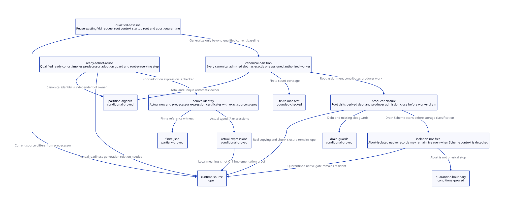

#+TITLE: Canonical Root Partition, Producer Closure and Ready-Cohort Qualification
#+SETUPFILE: ../../modeling/org/setup.org
#+LANGUAGE: en
#+PROPERTY: header-args :eval never
#+OPTIONS: toc:3 num:t

* RESEARCH Decision and current evidence
:PROPERTIES:
:CUSTOM_ID: manifest-scan-qualification
:ARCHITECTURE_SOURCE: models/sysml/manifest-scan-qualification.sysml
:EVIDENCE: ../../../evidence/research/manifest-scan-qualification/checks.json
:STATUS: conditional-local-proofs; full-source-and-C11-bridge-open
:END:

Modern generated C remains the mainline. This study continues the
[[file:pending-start-composition-design.org][pending/context composition research]] with canonical enumeration,
producer closure and a source-qualified readiness boundary. It does not implement
a GC adapter or change runtime files. SysML supplies components, contracts, scoped
needs, dependencies, sources, composition requirements and gains. Native SysML
queries drive the [[file:manifest-scan-qualification-matrix.org][Org matrix]] and ; Python invokes actual formal tools.

** Source correction, not retrospective proof

The active source changed since the predecessor's frozen input. Existing code now
has a resize ledger root, scanned context startup_thunk/entry_marker slots, gated
child entry, post-sync reload, staged create/commit and abort/join/quarantine paths.
The predecessor's fatal-create/ignored-join observations are historical, not current
facts. Freeze its receipt and record the changed source identities; do not rewrite
it or claim this study implemented or natively qualified the new code.

A generic pending-root directory is therefore not automatically necessary for
single serialized resize. The immediate modern-C baseline can reuse the existing
VM request root and context root consumer under its explicit GC-phase exclusions.
A generalized manifest should be admitted only for independently needed services
that require concurrent provider registration or less restrictive admission, with
net benefits beyond the current ledger and its synchronization costs.

* Current constrained protocol
:PROPERTIES:
:CUSTOM_ID: manifest-current-ledger
:END:

| Current source anchor | Observed mechanism | Remaining qualification |
|-----------------------+--------------------+-------------------------|
| mem.c mark_vm_scmobj | mark_array on resize.thunk under worker-zero VM scan | all initial request copies and source handoff before publication |
| mark_execution_roots | startup_thunk and entry_marker are scanned in frozen context | complete frame/FFI/marker lifetime and actual collector backend |
| start_processor_execution | wait on resize.gate for entry; abort returns before TLS binding | exact generation and native record lifetime through delayed entry |
| successful resize | create all children, commit member count, publish run entries | complete collective agreement and transient OS outcomes |
| failed growth | publish abort, join created subset, rollback only if all joins succeed | full state/cancellation semantics and native acceptance |
| failed join | retain slot and isolate only when strict abort-empty conditions hold | no physical stop inferred; quarantined records/gate remain live |
| GC admission | permits IDLE/REQUESTED and qualified abort-isolated RETAINED; rejects most other phases | current blocked-GC behavior is a design cost, not automatically corruption |

The current code copies r->thunk into new context startup_thunk after capacity GC;
thread.data_scmobj is FAL, and child reloads the context slot after sync. This
addresses a concrete part of prior raw-copy concerns. It does not prove every
caller of current_vm_resize or arbitrary native raw SCMOBJ is protected before
r->thunk publication, nor qualify arbitrary concurrent context mutation.

The serialized protocol intentionally avoids collecting during most initialization
and commit stages. A broader pending-manifest design changes that schedule and
must establish additional roots, allocation/capacity accounting and participant
closure before those exclusions can be relaxed. It cannot inherit the old source
proof simply because it reuses mark_array.

* Canonical slot partition
:PROPERTIES:
:CUSTOM_ID: manifest-partition
:END:

Define an admitted immutable manifest M with N indices and positive closed worker
count W. canonical(i) names the exact physical root slot, not its current owner or
Scheme object value. The required enumeration premise is that each admitted
physical slot occurs once in M; canonical is injective on admitted indices.
A duplicate provider alias must be coalesced by RootSlotId before assignment or
have an explicit serialized single-scanner owner.

Assign index i to worker i mod W. Lean proves, for arbitrary natural indices and
positive W, existence of an in-range owner and uniqueness of that owner. A separate
injectivity lemma makes the canonical-identity premise visible. Arithmetic uniqueness
does not prove source enumeration is complete or that two indices do not alias the
same C address. The finite QNT model fixes three distinct slots and two workers;
slots 0/2 belong to worker 0, slot 1 to worker 1.

A generalized adapter should freeze provider count, canonical identities, maps,
storage leases and assignment generation at one cut. Slot relocation writes occur
only through the assigned worker during that round. A pending-to-context owner
change preserves RootSlotId and waits until old manifest views drain. A copied
context slot requires the older overlap protocol instead. Mutable provider data
must not change the enumeration or assignment while workers are reading it.

The partition defines root work only. Reachable-object copying may involve other
workers and shared forwarding claims. Unique root-slot writes do not prove graph
copy termination, forwarding correctness or exactly-once scanning of every object.

* Root producers and terminal cut
:PROPERTIES:
:CUSTOM_ID: manifest-producer-cut
:END:

A worker completes its pending-root producer role only after its assigned root
slots are visited and every derived copying/tail/chunk obligation has transferred
to a qualified consumer or finished. Empty root enumeration is not global work
closure. The finite model includes a root visit that creates one debt, separates
ingress close from debt settlement, and refuses drain with missed visits, active
workers or unpaid debt.

The real mem.c root phase precedes mark_reachable_from_marked. Its chunk queues,
scan worker counts, copying cursors, weak stages and foreign cleanup require their
own closure contracts. The one-debt model proves neither their complete producer
inventory nor their termination. No new async root producer may publish after
strong closure under this design; supporting that would require an explicit
reopening protocol and would invalidate the terminal proof assumptions.

The final cut has four prerequisites: canonical slots all covered; registration
and producer ingress closed for the frozen generation; derived obligations settled
or accounted to admitted consumers; and all old view leases released. Only then
may the mutator phase reopen and ownership/source registration change. C11 source
retirement still requires exact publication and lifetime evidence.

* Readiness, abort isolation and three release permissions
:PROPERTIES:
:CUSTOM_ID: manifest-cohort-permissions
:END:

The current entry gate provides a concrete direction for readiness refinement:
all setup/create operations succeed, the old collective commits the new count,
then children obtain run permission and join the new finish barrier. OS creation
alone is insufficient. The previous joint model's ready/member bits remain supplied
receipts; this study does not prove that every current gate schedule implements
them. Lean explicitly shows that a qualified ready-cohort premise implies the prior
adoption guard and inherits its root-preserving transition. Actual predecessor
adoptA guard/update expressions are independently extracted and checked.

| Permission | What can justify it | What it cannot justify |
|------------+---------------------+------------------------|
| exclude a Scheme/context root reader | irrevocable ABORT before TLS/Scheme access, immutable entry decision, empty-context conditions | the OS thread has stopped |
| detach unused Scheme heap claim | all Scheme/root users excluded; no still/RC/marker work; explicit capacity accounting | refund physical capacity or reuse a native PSTATE |
| free native record/gate/VM | known uncreated or qualified completed/joined users, all readers/receipts/views drained | an abort bit, failed join, or empty Scheme heap alone |

mem.c isolate_aborted_resize states this distinction. It validates abort entry,
slot phases, empty frames/heaps/still/RC and marker conditions, clears startup
slots, detaches selected claims and keeps native identity/descriptors/OS resources.
The request thunk remains worker-zero-scanned. It does not rollback physical
capacity or clean PSTATE. GC admits this qualified isolated RETAINED state while
other unsafe retained states still reject collection.

The current distinction is more precise than retaining all Scheme work forever
or assuming join failure means death. A future recovery may discharge quarantine
with independent qualified stop evidence; the present finite model deliberately
does not implement that recovery, and claims no bounded retention or liveness.
An uncreated failed member and an accepted live member have different retirement
conditions. Per-member failure/settlement and aggregate batch policy remain separate.

* C11 and refinement obligations
:PROPERTIES:
:CUSTOM_ID: manifest-memory-model
:END:

[[https://www9.open-std.org/JTC1/SC22/WG14/www/docs/n1570.pdf][N1570]] 5.1.2.4 and 7.17.3 supplies the memory-order framework.
A release-published immutable manifest requires its matching acquire before any
field/slot access. A gate protecting entry and abort choices does not automatically
publish every independent GC descriptor. Freeze, adoption, admission and retirement
need a shared linearization protocol; unrelated atomics do not imply one total
order. Slot storage and VM lifetime are separately leased.

| Refinement | Required evidence |
|------------+-------------------|
| canonical index to actual slot | complete current provider inventory, bounds, injective physical identities or qualified deduplication |
| assignment to worker | positive stable W, generation agreement, complete index coverage and no conflicting root-slot writes |
| root visits to copying closure | actual forwarding/chunk/tail producers enter accounting before any terminal observation |
| ready receipt to adoption | generation-bound gate/count/context agreement; no reader through abandoned native entry |
| abort isolation | every delayed branch before entry excludes TLS/Scheme/root access; gate/PSTATE remain resident |
| view drain to free | old readers and result/receipt observers have finished; no accesses after final unleased decrement |

A baseline lock may serialize short manifest changes but must not span allocation,
OS creation, Scheme callbacks, GC participation or waits for its own leases.
Existing platform macros/BARRIERs are source anchors, not a proved portable C11
execution. No preprocessing/native execution is performed by this study.

* Formal and assurance chain
:PROPERTIES:
:CUSTOM_ID: manifest-formal
:END:

manifest_scan_cut.qnt models three slots, two workers, root visitation counts,
one derived debt, immutable view capture and native quarantine/retirement. The
predecessor pending_start_composition.qnt remains the second independently checked
input for batch/adoption histories. They are not claimed to have a complete
all-action simulation. Partition arithmetic is unbounded in Lean; QNT sampling and
negative controls remain finite. Safety of a scalar debt is conditional on complete
source-to-work accounting.

Generated certificates cover actual scan0/drain/retireB expressions plus prior
adoptA. ASCENT consumes SysML composition requirements, exact digest/scope receipts,
source-bound endorsements and actual expression certificates. Missing ready-root
lemma or missing prior adoptA update certificate must block their own gate even
when unrelated synthetic prerequisites are supplied. Synthetic-all is admission
control only. The 91-row reference environment remains a separate JSON input;
parser/projector and source-to-IR extraction are not verified.

The partition-total and partition-unique requirements link mathematical lemmas and
finite assignment expression evidence without pretending that the finite literal
assignment proves generic C code. Source injectivity, algorithm extraction, C11
and complete producer closure stay open admission requirements.

* Net-benefit decision matrix
:PROPERTIES:
:CUSTOM_ID: manifest-net-benefit
:END:

| Choice | Avoided work | Added overhead | Admission decision |
|--------+--------------+----------------+--------------------|
| current serialized resize root path | a new generic pending registry just for one request | existing worker-zero request root and per-context startup scans | reuse baseline; no automatic need for another registry |
| generalized canonical manifest | duplicate slot visits caused only by aliasing provider ownership | snapshot enumeration/dedup maps/generations and view retention | useful only for necessary concurrent providers beyond baseline |
| W-way index partition | mandatory serial N-slot root loop | O(N) total enumeration; ideal at most ceil(N/W) root visits per worker | no speedup guaranteed: recursive work and skew are additional |
| producer terminal cut | repeated rescans or unsafe finish from premature empty | explicit producer/debt/lease closure | worth admitting only after real producer inventory refinement |
| abort isolation | some empty execution claims need not block old-member GC forever | native gate/PSTATE/descriptor/root quarantine remains | semantic isolation gain, not physical free or capacity refund |

No native timing, elapsed-time percentage or allocation benchmark is claimed.
Modern C can reuse the existing root consumer and gate mechanisms; adding Zig does
not establish slot identity, debt closure or safe readiness. This study provides
no additional Zig net-benefit evidence.

Retire only duplicated support that becomes unreachable after qualified migration.
Do not replace current constrained GC exclusions with permissive manifest admission
until initialization/capacity/root/copy obligations are closed. Do not discard
current gate or abort isolation merely because historical documents preceded it.

* TODO Open work
:PROPERTIES:
:CUSTOM_ID: manifest-open
:END:

- [X] Rebind research to current resize roots, gated startup and abort-isolation source.
- [X] Prove index-owner totality/uniqueness and expose canonical-slot injection premise.
- [X] Model visit/debt/drain and retain missing/duplicate/early-retirement counterexamples.
- [X] Check qualified readiness against actual predecessor adoptA expression.
- [ ] Prove complete physical slot inventory and concrete generalized adapter refinement.
- [ ] Connect forwarding/chunk/tail/weak/foreign producer accounting to terminal cut.
- [ ] Prove actual gate/count generation and all-member cancellation/retirement protocol.
- [ ] Close C11/backend, JSON parser/projector and all-action source simulation.

The predecessor's frozen receipt and current source drift are both preserved.
Formal checks do not establish runtime implementation or native acceptance.

* CHECKED Local receipt
:PROPERTIES:
:CUSTOM_ID: manifest-scan-local-receipt
:STATUS: conditional-formal-checks-only
:END:

The receipt records 16 QNT histories including nine negative controls, 500 sampled
runs of at most 200 steps per model, 16 maintained Lean theorems, eight generated
manifest-expression certificates and two prior cohort-expression certificates.
Three SysML composition requirements and 16 ASCENT scenarios check exact scoped
admission and targeted missing-evidence refusals. Three strict JSON-row controls
and one altered-retirement-guard Lean rejection are retained. Native SysML validates
the whole current DEV scope, including concurrent existing modeling work; warnings
are retained separately from errors. These checks are not exhaustive protocol or
native evidence. The source drift audit preserves the predecessor input unchanged.
