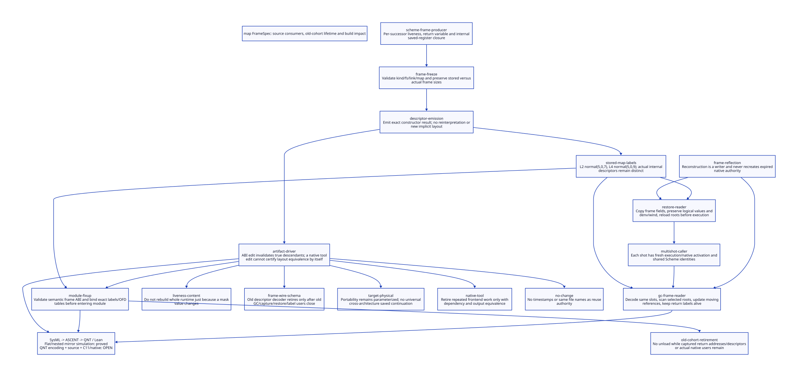

#+TITLE: Real map Frames: Scheme Producer, GC, Multi-shot Restore and Artifact ABI
#+SETUPFILE: ../../modeling/org/setup.org
#+LANGUAGE: en
#+OPTIONS: toc:3 num:nil
#+PROPERTY: header-args :eval never
#+TODO: RESEARCH DECIDED | ADOPTED RETIRED

* RESEARCH Scope and authority
:PROPERTIES:
:CUSTOM_ID: map-frame-abi
:AUTHORITY: GambitMapFrameAbi; GambitAdvantageArchitecture; GambitRuntimeComposition
:STATUS: stored-source-witness; mirror-simulation-proved; source-and-QNT-encoding-open
:MAINLINE: Scheme semantic completion and modern generated C
:END:

This instantiates the [[file:advantage-architecture-design.org][whole Gambit architecture]] with the real map return chain.
The [[file:models/sysml/map-frame-abi.sysml][native SysML model]] references the nine existing owners and owns eleven
source links, two stored normal-frame witnesses, five invalidation classes,
twenty state-field mappings, eleven named events, eight refinement obligations,
four gain rows and seven open gates. [[file:map-frame-abi-matrix.org][The matrix]] and  derive from it.
The [[file:../../modeling/ascent/map-frame-abi.rules.scm][ASCENT DSL]] joins exact source hashes/anchors, model action/guard/theorem
bindings, scoped receipts, refinement premises and parent AA-S. No new runtime
module owner or compatibility layer is introduced.

Current source already contains targ-make-frame-spec and a centralized C frame
decoder. Credit those existing changes; this study implements neither. The task
is to establish the cross-consumer contract, missing semantic/provenance evidence,
old-cohort lifetime and exact build invalidation. No runtime/native tests run.

* RESEARCH Actual Scheme-to-descriptor chain
:PROPERTIES:
:CUSTOM_ID: map-frame-source
:END:

| Stage | Current source | Contract and remaining gap |
|---+---+---|
| map semantics | lib/gambit/list/list.scm:850-869 | One-list path calls proc, recursively computes tail, then cons; selected order, not a universal Scheme evaluation-order claim |
| Semantic frame completion | gsc/_t-c-2.scm:targ-gen-label-return* | Normal branch reverses/extends frame slots, derives size, frame-live? map and return-var link; internal branch adds saved GVM registers and actual return |
| Freeze/validate | gsc/_t-c-3.scm:targ-make-frame-spec | Existing constructor distinguishes stored/actual fs; validates kind, size, link and root-map bounds; computes OFD chunks |
| Physical emission | gsc/_t-c-1.scm:1947-1963 | Existing emitter reads FrameSpec kind/stored-fs/link/map and emits RETN/RETI/RETT with IFD/OFD |
| Stored output | lib/_std.c:74775-74808,146100-146123 | Actual map callback/recursive return paths and 22 return descriptors; not regenerated output for current Scheme producer/configuration |
| Decode | include/gambit.h.in:___decode_frame_descriptor | Current central decoder reads inline or OFD table and applies internal stored-to-actual size conversion; old macros are projections |
| GC | lib/mem.c:mark_continuation, mark_frame and ___sFRAME scan | Both stack and captured heap frame roots follow same descriptor; scanning updates moving roots |
| Restore | lib/_kernel.scm:break handler and frame accessors | Heap frame copies fs slots back to execution stack, installs break links, returns through saved RA; internal returns restore saved registers separately |
| Module binding | lib/setup.c:setup_module_fixup | Version/structure-size checks, host/label fixups and OFD relocation must match descriptor interpretation |
| Incremental consumer | Gerbil compiler/driver.ss:compile-scm-file | Current textual Scheme handoff/native job path; new service must carry semantic/spec/codec/tool dependency projections |

The Scheme vector is a physical frame contract after liveness completion, not the
entire proposed high-level FrameSpec: logical variable identity, PointId, effects,
all exceptional successors, provenance and immutable module ABI still need an
explicit semantic contract and complete source proof. No C macro should rediscover
those decisions. The current centralized decoder must be reused rather than
wrapped in another independent layout authority.

* RESEARCH L2 versus L4: same size, different roots
:PROPERTIES:
:CUSTOM_ID: map-frame-coordinate-witness
:END:

PROC is label zero; map's second and fourth RET entries correspond to L2 and L4.
The stored table gives RETN(fs=5,link=0,map=0x7) and RETN(5,0,0x9). The generated
body at L2 saves the returned callback value in STK(-4), reloads proc/list from
STK(-6)/STK(-5), and recurses with return L4. L4 takes the returned suffix and
constructs CONS from the saved callback value and that suffix, then checks heap.
These different live successors cannot be replaced by a single root mask.

Header reserve=3 and alignment=4 yield FRAME_SPACE(5)=8. For logical i=1..5:
stack relative index is 8-i from the continuation frame pointer; heap body index
is fs-i+1=6-i. GC's FP_STK(fp,i)=fp[-i] uses a rebased top pointer. The GC bit i-1,
frame-slot-live? bit i-1, continuation-ref and restore copies must agree after
that rebase. A constant coordinate difference is not equality of actual stack
and heap addresses or a proof the copied values coincide.

| Point | Live logical slots | Stack indices from captured stack pointer | Heap body indices | Meaning |
|---+---+---+---+---|
| L2 callback return | 1,2,3 | 7,6,5 | 5,4,3 | Saved return link, proc and source list; callback result arrives in R1 |
| L4 recursive return | 1,4 | 7,4 | 5,2 | Saved return link and prior callback result; suffix arrives in R1 |

Link=0 is the return-link offset; link+1 is logical slot 1. Retaining the label
object also retains its descriptor interpretation and code-lifetime obligation.
The saved prefix callback result must survive capture/GC/restoration; cloning all
reachable Scheme objects or reusing a previously delivered output list changes
observable behavior. A union mask is refused by this exact contract; whether an
extra bit can hit an unsafe concrete value requires its own source reachability
proof, not merely our faulty model control.

All 22 stored return descriptors are recorded in the receipt; only these two
normal inline witnesses receive the arithmetic Lean proof. Internal/task returns,
OFD chunk order/width, saved registers and every additional callee frame remain
explicit obligations. A current constructor and stored _std.c table do not prove
that this current source/configuration generated that historical output.

* DESIGN Capture, GC and repeated restoration
:PROPERTIES:
:CUSTOM_ID: map-frame-restoration
:END:

Reuse the [[file:map-multishot-composition.org::#map-witness][existing selected map witness]]: capture during the second callback, then
resume with new second values twice. Expected results (10 2 30), (10 20 30),
(10 200 30), five callback calls, three successful native suffix effects and three
wind before/after pairs are source-derived expectations, not executed results.
Captured map chain includes distinct return points; this model does not collapse
all real frames into one L2 frame or compute Scheme list values.

Capture must root current/saved/register/native/denv origins before a collecting
allocation. Current stack-backed sharing is preserved until materialization is
needed. mark_continuation decodes roots and mark_captured_continuation materializes
frames; ___sFRAME scanning decodes their heap form. Moving roots must update the
actual slots. The break handler later copies all fs fields, not only the root
bitmap's live fields, and reconnects break links before transfer. Root coverage,
logical-value transfer and control/wind semantics are three different proofs.

Each shot reuses captured computation but has a private execution image and fresh
native activation. Shared Scheme cells and denv identity remain shared. Supported
frame setters, serialization and FFI writes must be covered by any future COW or
generational optimization; unchanged root masks alone do not establish mature
scan exclusion. Future minor collection can skip clean mature subgraphs only with
complete remembered-write/root closure and failure-safe promotion/capacity.

* DESIGN Module/descriptor lifetime and ABI changes
:PROPERTIES:
:CUSTOM_ID: map-frame-module-abi
:END:

setup_module_fixup checks module version and sizeof module/global/VM/processor
structures. Those checks do not certify semantic frame-wire identity: equal-sized
structures can interpret masks, saved-register homes or internal sizes differently.
The loader aligns/copies label tables, obtains host labels where required and
replaces OFD placeholder descriptors with table addresses. OFD installation is
not a pure read; unpublished candidate tables need exclusive setup ownership.

A module cohort must bind code labels, FrameSpec contents, descriptor codec,
physical target and runtime readers. Captured return addresses, current/saved
frames, GC scans, callbacks and native diagnostic users pin the old code AND its
matching descriptor/OFD storage. Candidate recompilation cannot overwrite them.
No dlclose or teardown is authorized merely by caller return or no currently
running shot. The actual os_dyn.c cleanup path is a retirement consumer; the full
loader/OS-user grace proof remains open.

A per-procedure mask CONTENT change with the same codec need not rebuild the GC
runtime. It invalidates the affected semantic procedure/module, emitted descriptors,
native code and actual dependency/inline consumers. A frame-wire SCHEMA change
invalidates all codec-dependent emitters/readers, including GC, restore and loader.
Old captured frames require either coexisting compatible decoder/code cohorts or
an independently proven stopped-world migration preserving values and aliases.
If neither is available, activation of the incompatible cohort is refused; old
Scheme computation remains valid under its pinned old runtime. Our finite model
uses a single installed cohort and delays rebinding until admitted all-user grace;
it does not solve coexistence of two incompatible global collector representations.

* DESIGN ABI-to-incremental propagation
:PROPERTIES:
:CUSTOM_ID: map-frame-invalidation
:END:

The five native SysML impact rows distinguish liveness/content, codec/schema,
physical target, ABI-preserving tool and no-change classes. Plan keys include
source, semantic target feedback, declarations, identity/origins, dynamic reads and
macro support. Spec-content keys include per-point liveness/homes and effects.
Codec keys describe bit fields, IFD/OFD rules, word width, saved-register and slot
interpretation. Layout/object/link keys include actual target and native recipes.
These are declared dependency projections, not guessed flag classifications.

Gambit supplies sealed semantic/GVM/spec results and mechanical native products;
Gerbil schedules queries against complete executable iter support and independent
private sessions. Tool-only changes may reuse admitted emission; ABI-changing
flags/compiler output reclassify as layout/schema changes. Physical register or
calling changes can flow backward through target semantics and invalidate earlier
optimization: frontend reuse is not unconditional. Unchanged inputs still need
trace/manifest validation and new stateful module instances where semantics require.

The dependency graph must follow consumed projections and successful multi-output
publication. Clean-versus-incremental consumer observation equivalence includes
source identity, declarations, module initialization, effects and diagnostics.
Output hashes or matching symbol names do not establish that theorem. Runtime
module pins and build-cache ownership are separate: evicting a cached object must
not unload installed code still named by a continuation.

* PROOF QNT-to-Lean: an explicit, bounded claim
:PROPERTIES:
:CUSTOM_ID: map-frame-refinement
:END:

[[file:models/quint/map_frame_abi.qnt][QNT]] has twenty flat fields and eleven named transitions plus stutter. It models
three invocations, reload after abstract GC, candidate ABI/tool edits, native
rebuilds and retention of the old installed cohort. A collecting event only bumps
an epoch; real relocation, graph scanning and Scheme values are not represented.
releaseCaptured has only captured/not-running in its selected mirror guard. Complete
alias/native/scanner grace is an additional SOURCE premise, deliberately not
established by that guard or by this model. It is not an executable retirement
algorithm and its proof never authorizes unloading. Semantic plan reuse is a dependency obligation outside
this finite artifact protocol, not a claim its source trace is constructed here.

[[file:models/lean/MapFrameAbi.lean][Lean]] now defines a flat QState and a distinct nested LState (Shape, Runtime,
Artifacts), with explicit alpha and relates over all twenty fields. It proves:

1. Initial safety for the literal selected record.
2. Guard and update correspondence for every one of twelve Event cases.
3. Forward simulation of each Lean qStep by lStep under relates.
4. Induction of finite histories and preservation of the safety predicate.
5. Safety reflection through relates, rather than unrelated similarly named invariants.
6. Arithmetic decoding of the two stored IFD witnesses and bounded slot coordinates.

This closes more than action/theorem name association, but it does NOT close the
QNT-language bridge. Lean qGuard/qNext mirror the authored QNT expressions;
semantic equivalence of Quint Int/Bool/record updates, any/all/stutter and the
actual evaluator is not kernel-proved. A verified translation or independent
expression-semantics proof is required. Source-to-QNT observation abstraction,
all additional frame kinds, weak memory and fair progress remain open. The native
refinement matrix labels six mirror-law scopes qualified and two larger scopes
open, with premises attached to every row. ASCENT cannot reuse the mirror theorem
as a receipt for qnt-encoding or source-and-progress.

Faulty controls retain wrong/union masks, live frame rebinding, stale reload,
lost old code pin and stale object acceptance. They establish rejection by the
model invariant, not native reachability or a discovered runtime bug. Source
witnesses are bounded exact text/descriptor observations; native provenance,
repository host registration and performance remain unqualified.

* PLAN Retirement and benefit matrix
:PROPERTIES:
:CUSTOM_ID: map-frame-benefit
:END:

[[file:map-frame-abi-matrix.org][The generated matrix]] is the detailed source, ABI-impact and closure report.

| Target | Reuse/retirement condition | Added work or retained cost |
|---+---+---|
| Existing Scheme FrameSpec and C decoder | Reuse them; eliminate remaining independent semantic/layout decisions only after full consumers migrate | Complete metadata, generated validation and joint proof |
| Exact per-point roots | Never replace L2/L4 with one map; future mature-scan exclusion additionally needs all writers | Root scans, barriers, promotion and per-shot restore remain |
| Narrow invalidation | Mask-content change rebuilds actual module consumers; codec change rebuilds all true readers | Fingerprints, trace validation and dependency storage |
| Stable old cohort | Rebuild candidate without invalidating live saved frames | Code/descriptor/OFD pins, possibly unbounded without all-user grace |
| Repeated semantic plan use | For k valid backend variants, avoided work at most (k-1)*F | Sealing, validation and extra state instantiation; target feedback can eliminate reuse |

The exact L2/L4 masks already exist in the baseline: this study adds zero claimed
root-scan reduction to that existing precision. Additional benefit must come from
retired duplicate responsibilities or the separately qualified GC/build architecture.

No old runtime path retires by this design-only study. No measured speedup follows
from twelve formal events or static mask arithmetic. Shared-support and build work
must be charged once; genuine modern-C return requires actual removed duplicate
work to exceed added barriers, validation, copies and retained-space costs.
