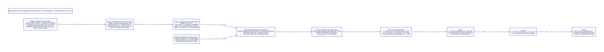

#+TITLE: Gambit SMP Paper Progress Ledger & Structural Amplification Evidence Chain
#+AUTHOR: Gambit SMP Architecture Research
#+OPTIONS: toc:3 num:t

* 1. Purpose & Current Program Gate

This ledger provides one single, machine-checked view of:
1. *Literature progress across all 32 tracked architecture papers/specs*
   (7 legacy SHA-256-locked PDFs + 16 newly SHA-256-locked & chapter-read PDFs +
   1 open HTML spec + 8 remaining paywalled/TLS-unreachable DOI-only items).
2. *Complete 6-stage evidence chain* binding every paper to its reviewed
   chapter note, =vendor/= primary source diff, formal models (SysML v2,
   Quint V2 + mutation-killers, Lean 4 unbounded proofs, CBMC =--mm pso=),
   isolated Apple M2 Pro hardware micro-benchmarks, and open native gates.
3. *Explicit Amp-1 launch prerequisite*: Amp-1 C runtime implementation stays
   strictly *GATED* (=amp1ImplementationAdmitted = false= in
   =GambitModernGcAmplification::amp1ReadinessGate=) until the sibling session's
   *Phase A/B/C* old-gen architecture stabilizes and passes full native Gambit +
   Gerbil acceptance.

Machine-readable companions (verified by =tests/test_modern_gc_papers.py= and
=tests/test_modern_gc_evidence_chain.py=):
- Additive PDF manifest: [[file:../../../evidence/papers-modern-gc-architecture.json][evidence/papers-modern-gc-architecture.json]] (16 PDFs)
- Additive PDF SHA-256 lock: [[file:../../../evidence/papers-modern-gc-architecture.lock.json][evidence/papers-modern-gc-architecture.lock.json]] (16 pins)
- Traceability manifest: [[file:../../modeling/inputs/papers-modern-gc-amplification.json][dev/modeling/inputs/papers-modern-gc-amplification.json]]
- Cryptographic receipt: [[file:../../../evidence/modern-gc-amplification-verification-receipt.json][evidence/modern-gc-amplification-verification-receipt.json]]
- Architecture design: [[file:modern-gc-structural-amplification-design.org][dev/refactoring/modern-c/modern-gc-structural-amplification-design.org]]
- Evidence-chain diagram: [[file:diagrams/modern-gc-amplification-chain.d2][diagrams/modern-gc-amplification-chain.d2]] / 

* 2. Unified Literature Progress Dashboard

** 2.1 Overall Coverage Summary

| Category | Count | Lock / Cache File | Reading Status |
|----------+-------+-------------------+----------------|
| Legacy primary papers (GC / Gambit / Boehm) | 7 | =evidence/papers.lock.json= (untouched) | 6 chapter-audited, 1 screened (=gambit-parallel-vm-1990=) |
| Newly locked modern GC, concurrency & I/O papers | *16* | =evidence/papers-modern-gc-architecture.lock.json= | *16/16 chapter-complete* (247 pages read, 7 reviewed =docs/papers/*.md= notes) |
| External open HTML specification (=srfi-230=) | 1 | =dev/modeling/inputs/papers-longterm-unified.json= | Canonical HTML spec (non-PDF) |
| Paywalled / TLS-unreachable DOI-only backlog | 8 | =dev/modeling/inputs/papers-modern-gc-amplification.json= | Honestly tracked as =metadata_only_paywalled= / =metadata_only_tls_unreachable= |
| *Total unique tracked literature* | *32* | *23 SHA-256-locked PDFs (71.9% full-PDF locked)* | *22 chapter-complete, 1 screened, 1 HTML spec, 8 DOI-pending* |

** 2.2 Newly Locked Primary Papers (16/16 SHA-256 Verified & Chapter-Complete)

| # | Paper ID | Venue | Pages | Read Status | Reviewed Note | Amplification Wave / Lever | Formal & Bench Evidence |
|---+----------+-------+-------+-------------+---------------+----------------------------+-------------------------|
| 1 | =ocaml5-retropar-2020= | ICFP '20 | 31 | =chapter_complete= | [[file:../../../docs/papers/ocaml5-retropar-2020.md][ocaml5-retropar-2020.md]] | Amp-1/2/4 (L2, L3, L4, L8) | SysML, Quint (M5), Lean (4 thms), CBMC (A), M2 Pro *1.71x* prefetch |
| 2 | =ocaml5-effects-2021= | PLDI '21 | 16 | =chapter_complete= | [[file:../../../docs/papers/ocaml5-memory-and-effects.md][ocaml5-memory-and-effects.md]] | Amp-2 (L5) | SysML, Quint (M6), Lean (1 thm) |
| 3 | =dolan-memory-model-pldi-2018= | PLDI '18 | 19 | =chapter_complete= | [[file:../../../docs/papers/ocaml5-memory-and-effects.md][ocaml5-memory-and-effects.md]] | Amp-3 (L6) | SysML, Quint, CBMC (A) |
| 4 | =lxr-pldi-2022= | PLDI '22 | 17 | =chapter_complete= | [[file:../../../docs/papers/lxr-immix-and-g1.md][lxr-immix-and-g1.md]] | Amp-3 (L6) | SysML, Quint (M1, M2), Lean (4 thms), CBMC (B) |
| 5 | =immix-pldi-2008= | PLDI '08 | 11 | =chapter_complete= | [[file:../../../docs/papers/lxr-immix-and-g1.md][lxr-immix-and-g1.md]] | Amp-3 (L7) | SysML, Quint |
| 6 | =rc-immix-oopsla-2013= | OOPSLA '13 | 18 | =chapter_complete= | [[file:../../../docs/papers/lxr-immix-and-g1.md][lxr-immix-and-g1.md]] | Amp-3 (L6, L7) | SysML (negative boundary vs free-list mature heap) |
| 7 | =zhao-deconstructing-g1-vee-2020= | VEE '20 | 15 | =chapter_complete= | [[file:../../../docs/papers/lxr-immix-and-g1.md][lxr-immix-and-g1.md]] | Amp-3 (L6) | SysML (negative boundary vs G1 12.4% dual barrier) |
| 8 | =lbo-ispass-2022= | ISPASS '22 | 12 | =chapter_complete= | [[file:../../../docs/papers/lxr-immix-and-g1.md][lxr-immix-and-g1.md]] | Amp-1..4 (Eval) | SysML (mandates wall-clock + CPU-cycle LBO gate) |
| 9 | =membalancer-oopsla-2022= | OOPSLA '22 | 21 | =chapter_complete= | [[file:../../../docs/papers/chez-racket-and-membalancer.md][chez-racket-and-membalancer.md]] | Amp-4 (L8) | SysML, Lean (4 thms: exact Cauchy-Schwarz optimality) |
| 10 | =dlg-concurrent-ml-popl-1993= | POPL '93 | 11 | =chapter_complete= | [[file:../../../docs/papers/local-heaps-dlg-marlow.md][local-heaps-dlg-marlow.md]] | Amp-1 (L1) | SysML, Quint (M4) |
| 11 | =marlow-local-heaps-ismm-2011= | ISMM '11 | 12 | =chapter_complete= | [[file:../../../docs/papers/local-heaps-dlg-marlow.md][local-heaps-dlg-marlow.md]] | Amp-1 (L1) | SysML, Quint (M3, M4), CBMC (C), M2 Pro *19.83x* flush |
| 12 | =racket-chez-icfp-2019= | ICFP '19 | 15 | =chapter_complete= | [[file:../../../docs/papers/chez-racket-and-membalancer.md][chez-racket-and-membalancer.md]] | Amp-1/3/4 (L2, L7, L8) | SysML, Lean (1 thm), M2 Pro *66.92x* O(1) lookup; RFC citation fix |
| 13 | =le-chase-lev-ppopp-2013= | PPoPP '13 | 12 | =chapter_complete= | [[file:../../../docs/papers/workstealing-and-polling.md][workstealing-and-polling.md]] | Amp-2 / Slice 3B | SysML (C11/ARM64 fence blueprint) |
| 14 | =feeley-polling-fpca-1993= | FPCA '93 | 9 | =chapter_complete= | [[file:../../../docs/papers/workstealing-and-polling.md][workstealing-and-polling.md]] | Amp-2 (L4) | SysML, Quint (M5), Lean (1 thm), CBMC (A) |
| 15 | =lemon-kqueue-usenix-2001= | USENIX '01 | 14 | =chapter_complete= | [[file:../../../docs/papers/evented-io-kqueue-epoll.md][evented-io-kqueue-epoll.md]] | Slice 3B (I/O) | Links to sibling =evented_io_reactor_park_v2.qnt= & =os_io.c= |
| 16 | =gammo-epoll-ols-2004= | OLS '04 | 14 | =chapter_complete= | [[file:../../../docs/papers/evented-io-kqueue-epoll.md][evented-io-kqueue-epoll.md]] | Slice 3B (I/O) | Links to sibling =per_domain_rest_slab_and_io_check_pso.c= & =os_io.c= |

** 2.3 Legacy Locked Primary Papers (7/7 in =evidence/papers.lock.json=, Untouched)

| # | Paper ID | Lock File | Reviewed Notes | Status |
|---+----------+-----------+----------------+--------|
| 1 | =ghc-parallel-gc-2008= | =evidence/papers.lock.json= | [[file:../../../docs/papers/ghc-parallel-gc-2008.md][docs/papers/ghc-parallel-gc-2008.md]] | =chapter_complete= |
| 2 | =hotspot-parallel-gc-2001= | =evidence/papers.lock.json= | [[file:../../../docs/papers/hotspot-parallel-gc-2001.md][docs/papers/hotspot-parallel-gc-2001.md]] | =chapter_complete= |
| 3 | =cakeml-verified-gc-2017= | =evidence/papers.lock.json= | [[file:../../../docs/papers/cakeml-verified-gc-2017.md][docs/papers/cakeml-verified-gc-2017.md]] | =chapter_complete= |
| 4 | =gambit-parallel-vm-1990= | =evidence/papers.lock.json= | [[file:../../../docs/paper-source-reading-ledger.md][docs/paper-source-reading-ledger.md]] | =screened= (historical PVM) |
| 5 | =gambit-incremental-gc-1998= | =evidence/papers.lock.json= | [[file:../../../docs/paper-source-reading-ledger.md][docs/paper-source-reading-ledger.md]] | =chapter_complete= (§4 audited) |
| 6 | =gambit-continuations-2000= | =evidence/papers.lock.json= | [[file:../../../docs/paper-source-reading-ledger.md][docs/paper-source-reading-ledger.md]] | =chapter_complete= |
| 7 | =boehm-benign-races-2011= | =evidence/papers.lock.json= | [[file:../../../docs/paper-source-reading-ledger.md][docs/paper-source-reading-ledger.md]] | =chapter_complete= |

** 2.4 Remaining Non-PDF / Paywalled Backlog (9 entries — Explicitly Tracked, Zero Fabrication)

- *Open HTML spec (1)*: =srfi-230-atomic-operations-2021= (=https://srfi.schemers.org/srfi-230/srfi-230.html=).
- *Paywalled / TLS-unreachable DOIs (8)*: =yuasa-satb-1990= (Elsevier), =huelsbergen-winterbottom-vcgc-1998= (ACM/9p 404), =diwan-moss-hudson-pldi-1992= (ACM), =dybvig-chez-scheme-icfp-2006= (Indiana TLS EOF; covered via =racket-chez-icfp-2019= + =vendor/chez/c/=), =ueno-ohori-icfp-2016= (Tohoku TLS EOF), =yang-berger-mckinley-ismm-2004= (ACM/UMass 404), =blackburn-cheng-mckinley-sigmetrics-2004= (ACM/ANU 404; core results covered via =immix-pldi-2008= & =rc-immix-oopsla-2013=), =white-singer-principled-heap-sizing-ismm-2013= (ACM/Glasgow 404).
- *Rule*: Never invent SHA-256 pins or unverified quotes for paywalled papers; lock them only when an authoritative open-access HTTPS PDF is downloaded and read.

* 3. Six-Stage Evidence Chain Matrix (Levers L1–L8)

| Lever (Wave) | S1: Locked PDF(s) | S2: Note + Vendor Anchor | S3: Formal Models (SysML / Quint / Lean / CBMC) | S4: Isolated Hardware Bench | S5: Phase A/B/C Gate | S6: Native Gambit + Gerbil Gate |
|--------------+-------------------+--------------------------+-------------------------------------------------+-----------------------------+----------------------+---------------------------------|
| *L1* Unified Lock-Free Local Nursery (Amp-1) | =marlow-local-heaps-ismm-2011=, =dlg-concurrent-ml-popl-1993= | =local-heaps-dlg-marlow.md=, =local-nursery.inc= | =UnifiedLocalNurseryLaw=, Quint M3+M4, CBMC Mutant C (*PASS*) | M2 Pro 8-thr flush *19.83x* | *WAITING* (sibling ABC) | *OPEN* (=par_alloc_gc_m65536= + TSan + Gerbil) |
| *L2* Virtual Nursery Arena + O(1) Radix Lookup (Amp-1) | =ocaml5-retropar-2020=, =racket-chez-icfp-2019= | =ocaml5-retropar-2020.md=, =chez-racket-and-membalancer.md=, =address_class.h=, =segment.h= | =ContiguousArenaRadixLaw=, Lean 3 arena disjointness thms (*PASS*) | M2 Pro 20M lookup *66.92x* | *WAITING* (sibling ABC) | *OPEN* (write-barrier + mark-loop LBO) |
| *L3* 256-Entry Prefetch Ring + =addrmap= (Amp-2) | =ocaml5-retropar-2020=, =le-chase-lev-ppopp-2013= | =ocaml5-retropar-2020.md=, =major_gc.c= | =PrefetchRingAndAddrmapLaw= (*PASS*) | M2 Pro 64MiB mark *1.71x* | *WAITING* (Amp-1) | *OPEN* (large-heap concurrent mark LBO) |
| *L4* Opportunistic STW-Spin Major Slices (Amp-2) | =ocaml5-retropar-2020=, =feeley-polling-fpca-1993= | =ocaml5-retropar-2020.md=, =domain.c= | =OpportunisticStwSpinLaw=, Quint M5, Lean =spin_slice_disjoint_from_flip=, CBMC Mutant A (*PASS*) | Deferred to native 8P+4E | *WAITING* (Amp-1) | *OPEN* (hybrid 8P+4E p12 tail latency + TSan) |
| *L5* Incremental Stack Watermark (Amp-2) | =ocaml5-effects-2021= | =ocaml5-memory-and-effects.md=, =fiber.c= | =IncrementalStackWatermarkLaw=, Quint M6, Lean =stack_watermark_sound_after_mutate= (*PASS*) | Deferred to native deep-stack | *WAITING* (Amp-1) | *OPEN* (=c5-multishot-cc= + Gerbil expander) |
| *L6* LXR SATB-with-Interruptions + Line Epoch + Init-Store Elision (Amp-3) | =lxr-pldi-2022=, =dolan-memory-model-pldi-2018=, =zhao-deconstructing-g1-vee-2020= | =lxr-immix-and-g1.md=, =ocaml5-memory-and-effects.md=, =memory.c= | =LxrSatbAndLineReuseLaw=, Quint M1+M2, Lean 4 SATB/epoch thms, CBMC Mutant B (*PASS*) | Deferred to Amp-3 | *WAITING* (Amp-2) | *OPEN* (SATB + Immix reuse soak + TSan) |
| *L7* Chez =static_generation= + Immix Overflow Block (Amp-3) | =immix-pldi-2008=, =rc-immix-oopsla-2013=, =racket-chez-icfp-2019= | =lxr-immix-and-g1.md=, =chez-racket-and-membalancer.md=, =gc.c= | =StaticGenAndOverflowImmixLaw= (*PASS*) | Deferred to Amp-3 | *WAITING* (Amp-2) | *OPEN* (Gerbil multi-module compile + tight-heap) |
| *L8* Compositional =(L,g,s)= MemBalancer + Off-Heap RefC Binaries (Amp-4) | =membalancer-oopsla-2022=, =lbo-ispass-2022=, =racket-chez-icfp-2019= | =chez-racket-and-membalancer.md=, =erl_gc.c= | =MemBalancerAndOffHeapBinLaw=, Lean 4 exact Cauchy-Schwarz optimality thms (*PASS*) | Deferred to Amp-4 | *WAITING* (Amp-3) | *OPEN* (8x parallel Gerbil build RSS x time Pareto) |

* 4. Sibling Phase A/B/C Stabilization Gate & Amp-1 Launch Checklist

Per user direction, *Amp-1 C implementation does NOT start* until the sibling
session's Phase A/B/C old-gen work stabilizes. Exact entry checklist before
touching any file under =vendor/gambit/lib/_mem/=:

1. [X] *Evidence chain complete & verified*: 16 new PDFs SHA-256 locked, 7 reviewed
   notes in =docs/papers/=, SysML / Quint / Lean 4 / CBMC PSO / M2 Pro micro-benchmarks
   all green and hash-pinned in =evidence/modern-gc-amplification-verification-receipt.json=.
2. [ ] *Sibling Phase A/B/C committed & stable*: =vendor/gambit= working tree clean on
   the stabilized Phase A/B/C base commit, with =big_oldgen_chez_immix= / Phase C
   contract tests and full Gambit SMP test suite passing (including Windows/macOS/Linux CI).
3. [ ] *LBO Pre-Amp-1 Baseline Captured*: Record exact wall-clock time, multi-core CPU
   cycles, GC %, and peak RSS for =par_alloc_gc_m65536=, =par_rest_alloc_m65536=,
   =par_gc_pause_live_heap=, =par_sync_mailbox_cas=, and 8-core Gerbil build on the
   stabilized Phase A/B/C base commit.
4. [ ] *Flip SysML Admission Gate*: Update =GambitModernGcAmplification::amp1ReadinessGate=
   (=phaseABCStabilized = true=, =amp1ImplementationAdmitted = true=) and begin
   Amp-1 Patch 1 (lock-free =still_words_delta= flush + unified movable+still local pass
   in =vendor/gambit/lib/_mem/local-nursery.inc=), followed by Amp-1 Patch 2
   (contiguous virtual nursery arena + =O(1)= aligned/radix msection directory).
