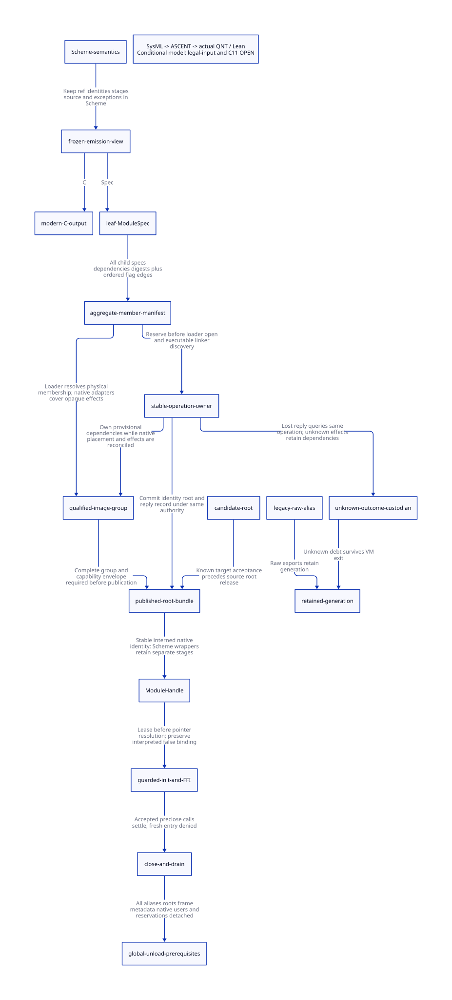

#+TITLE: ModuleSpec Generation and Controlled ModuleHandle Migration
#+SETUPFILE: ../../modeling/org/setup.org
#+LANGUAGE: en
#+PROPERTY: header-args :eval never

* RESEARCH Decision and evidence scope
:PROPERTIES:
:CUSTOM_ID: module-spec-handle-migration
:AUTHORITY: GambitModuleSpecHandleMigration
:MAINLINE: modern-generated-C
:STATUS: conditional-model; emitter-alias-root-and-C11-refinement-open
:END:
This study refines [[file:image-membership-enrollment-design.org][image membership and owner enrollment]] into a producer and
consumer migration contract. ModuleSpec is a proposed generated ownership
interface, not an existing complete Gambit manifest. Modern C remains the
required backend/runtime direction. Scheme owns lexical identity, module/ref
semantics, initialization stages, continuation and exceptions; the C service
owns explicit native identity, roots, borrowing and image lifetime.

The architectural benefit is an incremental compiler/runtime service that can
keep old/new code generations alive independently and retire qualified ones,
without using process shutdown as its sole lifetime boundary. This requires
replacing actual raw consumers and implicit ownership, not adding a wrapper
around the existing permanent pointer path. All current runtime paths remain
unchanged by this research. No independent Zig net benefit is established.

* RESEARCH Actual generation chain and sealing cut
** Semantic descriptor is not a complete native manifest
[[file:../../../vendor/gambit/gsc/_front.scm::390][The front end]] creates a vector of supply/demand names, metadata, flags,
Scheme main and a false placeholder for the native module pointer. The main
procedure and metadata remain Scheme identities. This vector cannot enumerate
all emitted native storage, return descriptors, linker edges or opaque C effects.

[[file:../../../vendor/gambit/gsc/_t-c-1.scm::337][targ-dump]] takes ownership of c-intf declarations, procedures, initializers
and object bindings, clears the mutable interface lists, drains procedure scanning,
registers the descriptor and late C-object values, then calls targ-heap-dump.
[[file:../../../vendor/gambit/gsc/_t-c-1.scm::1137][targ-heap-dump]] obtains symbol/key/global/constant/subtyped/procedure lists,
OFD count and allocated labels, and emits counts, objects, native procedures and
module hooks. A valid sealing cut is AFTER all these object registrations and
BEFORE either C or ownership metadata consumes the frozen emission view.
Freezing only the front descriptor or the lists before late targ-use-obj calls
can omit emitted resources. Single-writer request ownership and no subsequent
mutation are requirements, not properties already established by this study.

** Native membership and ordered effects are different projections
[[file:../../../vendor/gambit/gsc/_t-c-1.scm::906][targ-link]] reads input module entries/flags separately from supply/demand
sets. targ-get-mod combines inherited flags; extension mode separates old/new
inputs; targ-dump-linkfile emits old/new declarations and the ordered concatenated
edge list, including nonpreloaded edges. [[file:../../../vendor/gambit/include/gambit.h.in::9693][The C macros]] distinguish imported
linkers and declared linkers, but do not themselves prove physical OS image
placement. An OLD dependency may still be in the same final executable or another
image; classify it through the qualified link/loader adapter.

| ModuleSpec projection | Required producer data | Completeness boundary |
|-----------------------+------------------------+-----------------------|
| Leaf native resources | Actual frozen resource lists/counts, labels, OFD, native hosts, setup/init hooks | Include every emitted native leaf, including zero-label ABI branch |
| Semantic bindings | Supply/demand names, metadata, Scheme main and per-ref wrapper identity | Names are aliases, not unique physical member IDs |
| Ordered effect plan | Complete old/new edge list, inherited flags and preload bits | Ownership dedup must not remove duplicate effects or reorder hooks |
| Image placement | Every native member instance and imported dependency placement | Cannot infer from file path, OLD/NEW, supply name or pointer range alone |
| Native effects/exports | c-declare/c-initialize bodies, objects, converters, release callbacks and registrations | Arbitrary C may add dependencies; require an explicit effect/ownership adapter |
| Runtime users | VM/bootstrap owners, frames/continuations, roots, native leases and observers | Generated static membership is not a complete runtime-owner roster |

The earlier source branch that executes setup_mod even when lblcount is zero
remains a required ABI completeness case. A legal GSC-produced zero-label witness
has not been established. Current link-info checks compiler/target identity but
does not provide a content-bound full native ownership seal.

** Native capability envelope after sealing
A sealed static member list cannot predict arbitrary future C behavior. A
qualified adapter must mediate every later native registration, import and export
before image-dependent access. Predeclared member/dependency families and rooted
child tasks may transfer existing accepted credit; a new undeclared dependency
cannot silently extend a closed manifest. Deny that optimization admission or
retain all affected generations before the effect. An open-world C extension
without such a capability envelope remains a retained-lifetime route. The model
qualified flag names this external premise; it does not discover or prove it.

** Proposed generation and reconciliation protocol
#+begin_src text
CompilationUnitId = H(semantic inputs, frozen IR identity, generator identity,
                      effective profile, semantic/native ABI identities)
LeafModuleSpec = {
  CompilationUnitId, logicalModuleIdentity, emittedResources,
  nativeEntryIdentities, FrameSpecReferences, semanticBindingReferences,
  opaqueCapabilities, exportAndCleanupOwners
}
LinkModuleSpec = {
  inputBundleDigests, childUnitIdentities, orderedEdgesWithFlags,
  ownershipUnion, unresolvedNativePlacement, effectAdapters
}
ModuleInstanceId = (CompilationUnitId, ImageId, imageGeneration, placementOrdinal)
BundleSeal = H(C artifact bytes, ModuleSpec bytes, effective profile, input seals)
#+end_src
An external bundle seal avoids circular hashes between generated C and its sidecar.
Both outputs carry the same compilation-unit identity and derive from the same
frozen view. Artifact byte digests alone do not prove semantic equivalence; an
emission-correspondence obligation maps every actual table/hook/entry to the spec.

The link service validates each child seal/schema/profile and preserves ordered
flags. It forms the declared ownership union without dropping duplicate ordered
edges. The loader reconciles instances, dependencies, relocated metadata owners
and exports before issuing a sealed image manifest. A provisional loader/setup
operation owns native dependencies BEFORE executing the mutating linker resolver.
Unknown placement, arbitrary C registration, unsupported profile or incomplete
adapter cannot receive an early-unload seal. Keep the legal legacy program working
with retained image lifetime; do not reject Scheme semantics for lacking an
optimization proof. No current binary manifest or native placement is qualified.

The missing source refinement must establish, at minimum:
#+begin_src text
forall x in ActualEmittedResources(C): exists m in LeafSpec, represents(m,x)
forall e in ActualLinkerEdges: exists ordered eSpec, sameIdentityFlagsAndOrder(eSpec,e)
forall p in NativeCodeOrDataDependencies: ownedByQualifiedMemberOrRetained(p)
forall u in RealAliasAndRootUsers: countedOrRetainedBeforePointerAccess(u)
#+end_src
The proved declared-child list union supplies only a structural sublemma. It does
not establish any of these quantifiers over actual C/native objects.

* RESEARCH Real aliases: init-mod, registry and FFI
** Raw producer and native reader must migrate together
[[file:../../../vendor/gambit/lib/setup.c::2165][setup_module_collect_moddescrs]] puts a permanent foreign wrapper with raw
module_struct address, false tags and null release_fn into field 5. The permanent
program array and Scheme registration share the descriptor. [[file:../../../vendor/gambit/lib/_kernel.scm::5119][init-mod]] blindly
casts FOREIGN_PTR_FIELD back to module_struct and calls init_mod. A new handle
cannot be installed into that field while this reader remains unchanged.

[[file:../../../vendor/gambit/lib/c_intf.c::1683][release_foreign]] only clears the pointer when release_fn is nonzero. Therefore
calling foreign-release! on the null-release legacy module wrapper does not
provide revocation. Even clearing a wrapper would not revoke copied native or
integer addresses. A permanent allocation is not automatically a useful handle
finalizer or an image detachment receipt.

** Registry aliases preserve descriptor identity but not one stage cell
[[file:../../../vendor/gambit/lib/_kernel#.scm::11][macro-make-module]] creates a fresh vector containing module-ref, stage zero
and the supplied descriptor. Different supply refs can share a descriptor while
having different wrapper/stage cells. Intern the native ModuleHandle identity;
do NOT silently intern all Scheme wrappers/stages into one object or impose one
global initialization attempt. Registry removal clears one cell, not aliases in
the program array, callbacks, user-visible objects or captured state.

[[file:../../../vendor/gambit/lib/_kernel.scm::5270][init-modules]] advances the wrapper stage BEFORE native init and BEFORE the
Scheme thunk. The stage cell is a logical reentry marker, not successful effect
completion. Preserve these source updates and ordering. Track invocation and
completion separately: return values, Scheme exceptions, native nonlocal exits,
reentry and continuation recovery cannot be collapsed into a successful stage.
The new model's internal stage 0..5 describes one service operation, not a numeric
encoding of the existing Scheme stage 0..2. Inter-wrapper ordering and multi-shot
continuation identity still require source refinement.

[[file:../../../vendor/gambit/lib/_module.scm::530][The interpreted module path]] supplies false field 5 and a Scheme thunk. Preserve
the no-native-init branch. Module binding is discriminated as Interpreted,
NativeControlled or LegacyRaw; not every descriptor denotes a native image member.

** Foreign tags and address exports are not borrow capabilities
[[file:../../../vendor/gambit/lib/c_intf.c::2795][can_convert_foreign_type]] permits conversion whenever source or destination tags
are false (void*). Generic POINTER/STRUCT/UNION/TYPE conversions return raw fields.
[[file:../../../vendor/gambit/lib/_kernel.scm::3892][foreign-address]] exports the address as an integer. Merely changing tags is
insufficient. These mechanisms and the module wrapper producer are real source
paths; this study has not located a concrete external client that passes this
exact module pointer through every generic converter. Keep that client-closure
gap explicit, rather than claiming an observed native use-after-free.

The controlled Scheme handle must be a separate representation resolved by a
runtime-owned table, with generation and borrowing checks before any module
address is read. It must not be an ordinary foreign wrapper whose payload is a
module_struct pointer. Unsafe C with arbitrary memory access remains trusted;
this is ownership discipline, not a security sandbox. A raw export requested
through a legacy interface retains the generation. Changing foreign? or numeric
address observables on existing objects is not transparent compatibility.

| Native interface | Controlled path | Legacy/unqualified path |
|------------------+-----------------+-------------------------|
| Native module init | Resolve ModuleHandle only under accepted operation/borrow lease | Existing field-5 raw reader retains generation |
| Synchronous pointer borrow | with-module-borrow acquires root/code lease and completion guard | Generic converter may retain arbitrary pointer; no early unload seal |
| Escaping native pointer | Explicit ExportLease with known registry close/drain | Permanent raw or integer address requires retention |
| Function conversion | Track proc image AND static host/converter image | Scheme proc root alone does not prove executable lifetime |
| Interpreted module | No native init; preserve Scheme thunk execution | No fabricated native ModuleHandle required |

* RESEARCH Stable operation, roots and closed admission
** Responsibility transfer, not acknowledgment counting
#+begin_src text
PREPARED -> RESERVED -> ROOTED -> APPLIED -> REPLY_OBSERVED
                    \-> known pre-effect abort
                     \-> UNKNOWN -> stable coordinator retains dependencies
Candidate root -- publish target root/identity/result --> known target acceptance
              -- only then --> source-root release
#+end_src
The coordinator and operation record live outside unloadable code and exiting VM
storage. Reserve under the same image authority as close, before exposing native
references or running effects. The applied record binds OperationId, image/member
identity, original owner incarnation, manifest digest, root acceptance and outcome.
Publish a complete rooted target record before returning acknowledgment. Lost
reply means query/retry delivery of the SAME operation, never rerun setup/init.
A real new Scheme execution needs a distinct semantic operation identity. A
multi-shot continuation must not accidentally reuse the old delivery token or
be coalesced as a transport retry; the source-level intent mapping is still open.

Before marker allocation or other GC-capable conversion, candidate Scheme values
must already have a scannable source root. Retain it until target root registration
and scan/update responsibility are known accepted. Unknown handoff retains both
source protection and stable target reconciliation responsibility; duplicates may
be safe, an unrooted gap is not. Actual RootRegistry scanning on nonzero processors,
collector updates, exceptions and source-release synchronization remain linked
obligations; a model Boolean does not close them.

** Close, in-flight completion, abort and VM exit
| Event | Responsible custodian | Allowed completion |
|-------+-----------------------+--------------------|
| Reservation accepted before close | Stable operation coordinator with original owner ticket | Commit or known abort settles existing debt; no new public borrowing |
| Fresh registration/borrow after close | Admission service | Reject before module pointer access; retain or select another qualified generation |
| Candidate allocation failure before effects | Caller and reserved record | Abort only when no published/native side effects survive |
| Error after linker/setup effects | Stable operation with loader/root dependencies | Unknown until reconciled; error code or loaded sentinel is not rollback proof |
| Commit succeeds, reply lost | Applied operation and target root registry | Query same OperationId; source root not dropped merely on presumed success |
| Init throws or nonlocally exits | Completion guard and stable native/root owner | Known call exit does not imply effect rollback; unknown descendants remain debt |
| VM/caller exits | Process/runtime coordinator and surviving ownership record | VM topology disappearance cannot erase pending/unknown records |
| Legacy pointer discovered | Generation owner | Retain; new facade cannot retract previously exported address |

An accepted parent operation may complete after close and transfer existing debt
to a child under the same ledger. This is not permission for fresh external entry.
The exclusive setup-writer authority must serialize mutation of shared module
fixup state; a lifetime reservation alone does not do so. Do not hold an image,
registry or VM-topology mutex across Scheme callbacks, GC, foreign hooks or waits.

** C11 contract
A short stable mutex transaction is the reference linearization for admission,
close and applied-record publication. Initialize the private immutable record,
register roots, then release-publish; acquire acknowledgment/query validates the
exact key/digest before source release. A split root-registration API needs a
receipt and retained parent debt between steps, not a speculative decrement.

Reserve native borrowing before resolving module pointer. Last use precedes
release of code/root debt; an acquire drain observes every prior accepted user.
Counter overflow, ABA/incarnation reuse, delayed observers and unknown CAS/result
outcomes deny retirement. These are design obligations. The sequential QNT model
does not prove C11 weak-memory linearizability, collector synchronization or native
exception cleanup.

* RESEARCH Actual model chain and proof limits
[[file:models/sysml/module-spec-handle-migration.sysml][SysML]] owns producer/consumer witnesses, lexical inventories, migration cuts,
shared component seams, action/lemma obligations and cost conditions.
[[file:../../modeling/tools/module-spec-handle-migration-study.py][Python]] queries the native SysML tool and drives
[[file:../../modeling/ascent/module-spec-handle-migration.rules.scm][ASCENT DSL]], [[file:models/quint/module_spec_handle.qnt][QNT]], the restricted
[[file:models/lean/ModuleHandleAst.lean][typed IR extraction]] and [[file:models/lean/ModuleHandle.lean][Lean induction]]. Migration relations require
matching observed producer AND consumer anchors plus an actual action and checked
lemma; missing or wrong migration observations must block admission. This is an
executable evidence correspondence check, not a generated C proof.

The QNT model covers one operation in one image-close cycle, 30 actions, 10 positive
histories and seven deliberately corrupted negative histories. Registry/payload
aliases and native loans are bounded aggregates. Their completeness is a source
premise: removeAlias is NOT a claim that removing one real registry cell detaches
all native/continuation roots. retirePayload requires complete user/root coverage,
known init completion and no raw/unknown/native loan debt. Known pre-effect abort
is distinct from unknown effects and from committed-but-unobserved reply.

[[file:models/lean/ModuleHandleComposition.lean][Composition]] proves declared-child membership in the explicit list union,
preservation of ordered duplicate effects and transfer of raw-escape denial to
the preceding image-enrollment permit guard. It does not prove that every real
native member appears in the child input list, that C output matches the spec,
or that this local readiness is sufficient for global unload. All other owners,
frames, GC maintenance, observers and loader teardown retain preceding obligations.

| Obligation | Evidence established | Still missing |
|------------+----------------------+---------------|
| Actual producer cut | Procedure scan, late object registration, heap/resource/count emission sites | Private frozen-view closure and exact C/ModuleSpec correspondence |
| Declared aggregation | Old/new inputs, flags, ordered link list; Lean list-union/order properties | All native inputs/dependencies and actual image placement |
| Raw consumer chain | Permanent wrapper, init cast, shared registry descriptor, generic conversion/address mechanisms | Full arbitrary vector/FFI alias closure and concrete external clients |
| Root publication | Model preservation requires target root before source release | Actual RootRegistry scan/update and nonzero processor integration |
| Init/reply semantics | Model separates call completion from reply retry; source stage prewrites identified | Reentrant/multi-shot semantic-operation mapping and concrete guards |
| Closed admission | Model retains preclose operation and unknown-effect debt | Actual C11 linearization and every native ingress/exit |
| End-to-end global retirement | Prior raw denial composes; actual ASCENT candidate stays false | Arbitrary owner product, complete source roots/aliases, platform teardown |

Retained counterexamples: missing declared edges; opaque native effects sealed
without qualification; commit publishes a handle without target roots; unknown
effects treated as abort; a facade assumed to erase a raw export; init still in
flight when receipt issues; and a surviving native loan ignored at retirement.

* RESEARCH Net benefit and real retirement gates
The [[file:module-spec-handle-migration-matrix.org][SysML-derived matrix]] separates avoidable work from mandatory work. With M native
members, E ordered linker edges, R resource records and X native exports, a full
initial spec needs O(M+E+R+X) storage/traversal (or explicit shared summaries).
A content-bound cached child spec can avoid rescanning its unchanged internal
resources; parent edge/dependency validation and actual changed output are still
required. With V owners, P pending operations and K observers, stable closure
metadata remains O(V+P+K) plus real user/root obligations. Hash-consing and indexed
lookup costs need their own representation/complexity assumptions. A visited
manifest index can avoid revisiting shared child summaries for ownership; it
cannot skip semantically required repeated initialization. Compact dependency
graph edges and expanded execution occurrences are different cost quantities.
The O(M+E+R+X) traversal statement assumes indexed identity/visited operations
and counts each retained ordered edge occurrence; naive list membership or
repeated flattening can cost more. Cyclic or unsupported native linkage requires
explicit qualification rather than an assumed terminating traversal.

| Modernization mechanism | Potential work eliminated | Added necessary work | Positive condition / countercondition |
|-------------------------+---------------------------+----------------------+--------------------------------------|
| Single frozen emission contract | Repeated independent layout/count/member reconstruction | Spec production, hashing and emitter correspondence | Same complete view; opaque/untracked output invalidates reuse |
| Controlled native handles | Global-only lifetime and process restart for qualified replacement | Stable identity, gate, roots and old generation tracking | All raw/FFI/frame users covered; otherwise zero early-release benefit |
| Shared root/lease/coordinator support | Separate ad hoc module/FFI/GC ownership mechanisms | Cross-component adapter and proof maintenance | Shared semantics really replace old paths; another wrapper layer loses benefit |
| Operation-keyed reply | Reexecuting side effects only because reply was lost | Durable-enough in-process result record and observer lifetime | Same semantic intent; intentional multi-shot execution remains separate |
| Per-owner close/drain | Unrelated VM serialization and repeated owner rediscovery | Short authority transaction and keyed receipt aggregation | Lower coordination than contention introduced; no speedup measured |

Retirement dependencies: (1) generate ModuleSpec and C from the same view;
(2) qualify child aggregation and physical ownership; (3) introduce typed native
binding without merging Scheme stage cells; (4) replace actual init-mod and
controlled FFI readers, rooting and completion guards together; (5) close/drain
all aliases and owners; (6) qualify OS teardown. Then raw field-5 casting,
permanent raw publication and the global handle list as sole lifetime authority
can retire on that route. Ordinary C FFI and legacy raw behavior remain supported
with retained lifetime until their consumers migrate. No production code retires
in this study.

Net runtime benefit = avoided reconstruction/restart/retry/serialization work minus
spec validation, gate, root, receipt and drain work. Net memory benefit = actual
released generations minus metadata and retained unknown/legacy generations.
A conditional work threshold for manifest reuse is:
#+begin_src text
sum(avoided unchanged child-resource traversal) >
  parent dependency validation + new-spec production + added lifetime coordination
#+end_src
These are work terms to measure later, not assumed durations. Reply idempotence is
a necessity for the planned service, not evidence of an existing observed retry
bug. No timing or byte-saving number is established; no person-day estimate is used.

Research receipts: [[file:../../../evidence/research/module-spec-handle-migration/checks.json][checks]],
[[file:../../../evidence/research/module-spec-handle-migration/input.json][source/model identity]],
[[file:../../../evidence/research/module-spec-handle-migration/source-witnesses.json][immutable witnesses]],
.
