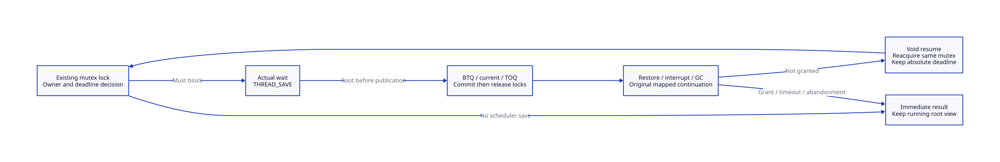

#+TITLE: Published mutex decision-to-suspension REV
#+SETUPFILE: ../../modeling/org/setup.org
#+LANGUAGE: en
#+PROPERTY: header-args :eval never

* PUBLISHED 9bb0e364 :rev:scheduler:roots:
:PROPERTIES:
:CUSTOM_ID: MUTEX-SUSPENSION-PUBLICATION
:REVISION: 9bb0e364b4e494254d74ce36186faa29576b7568
:PARENT: 29f09a81cc4cba2b96c9ee677d7b5074fb88f81f
:SOURCE_TREE: 0686ccfe0d2e6cf8ddc931204f7fadac78838af4
:AUTHORITY: GambitMutexSuspension
:STATUS: five scoped gates closed; whole-SMP acceptance open; local commit only
:END:

[[file:models/sysml/mutex-suspension.sysml][Frozen SysML contract]], [[file:mutex-suspension.org][reviewed audit / benefit matrix]],
[[file:../../../evidence/research/retained/modern-c/mutex-suspension/receipt.json][actual native receipt]], =.cache/tasks/repair-9-12/processes/audit/imported-evidence/modern-c/mutex-suspension-publication.json= (cache-only raw publication; not a clean-checkout prerequisite) and
 form this bounded delivery. Publication is a later observation;
the reviewed pre-commit model/report is not rewritten as a post-commit result.

** Responsibility and actual retirement

The existing mutex lock now owns the immediate owner/deadline decision. Only
the blocked branch calls THREAD_SAVE before publishing wait membership. The old
unconditional save and extra saved-frame root on immediate outcomes are gone.
Actual wait updates, result mutex, retry/deadline, return/abandonment and Scheme
multi-shot continuation semantics remain. No public namespace, workflow,
configure interface, heap setting or wait limit changes.

Exactly three files enter the REV: =lib/_thread.scm=, =tests/makefile.in= and
=tests/mutex-suspension.scm=. The existing unverified prototype changes remain
outside its tree. The selected hunks were merged into their pending index/working
versions without dropping other entries. Generated SMP C stays bound to the
complete producer; only thread C differs from its qualified predecessor, with
unchanged link output. No partial generated distribution cohort is committed.

** Actual evidence and benefit matrix

| Measure | Baseline / requirement | Published cut | Boundary |
|---------+------------------------+---------------+----------|
| Immediate private slow-path probe | Empty / success / nonempty saved frame | Empty / success / empty saved frame | One unnecessary save/root publication removed; not heap-wrapper bytes |
| Real baseline PBT failure |12-action history | Shrinks to1, replayed/deletion-one-minimal; candidate same trace passes | Finite real implementation evidence; not exhaustive schedules |
| Candidate native histories | Same typed three immediate outcomes | Two executions,48 cases/576 actions pass | One Scheme fixture/Make target; no parallel framework |
| Actual blocked request service | Save before wait publication | Two wait histories,24 synchronous callbacks forcing GC, release/join pass | Required blocking save remains |
| Producer | Existing profile and600-second envelope | Two full bootstrap passes171.560s; stock core47.593s | Same SDK; no heap/wait increase |
| Roots / control | Existing consumers |290 layout assertions, frame/map multi-shot and wide roots, RC/exit/test12 pass; existing root replay/shrink54.165s | No W!=R or full census credit |
| Original interpreted inventory |408 cases |408/408,69.651s | Complete local inventory; no inherited repair numerator |
| Whole original Make | Must retain failed evidence | test8 child70/Make2, no timeout | OPEN; no new cause diagnostic or full compiled credit |
| Runtime storage/support | No new ownership table |0 new fields/locks/atomics/allocation operations | Generated stack/code/peak unmeasured |
| Allocation / full-load performance | Valid matched measurements needed | Negative statistics retained and rejected | No speedup/allocation-reduction or repair9 capacity claim |

Five shared ASCENT gates and21 rejection controls admitted the exact tree.
The first attempted submission stopped on a raw Git index-stat refresh despite
unchanged semantic entries and working contents. Its evidence remains; a fresh
transaction passed the original guard. No custody check was relaxed.

** Remaining coupled reconstruction

[[file:repair-driven-gc-smp-design.org][The repair9 plan]] still requires authoritative request ownership through
execution/result/abandonment, actual capture/materialization/retention attribution,
worker/context/root-work separation and safe per-resource retirement. This REV
closes the decision-to-suspension responsibility, not those whole mechanisms.
The current branch has no repair-image drain catcher/wind to remove; any future
request execution boundary must come from this branch's semantics and consumers.
test8, original p11 pressure, complete GSC/Gerbil, release peak/performance and
remote CI remain open. No push was performed.
