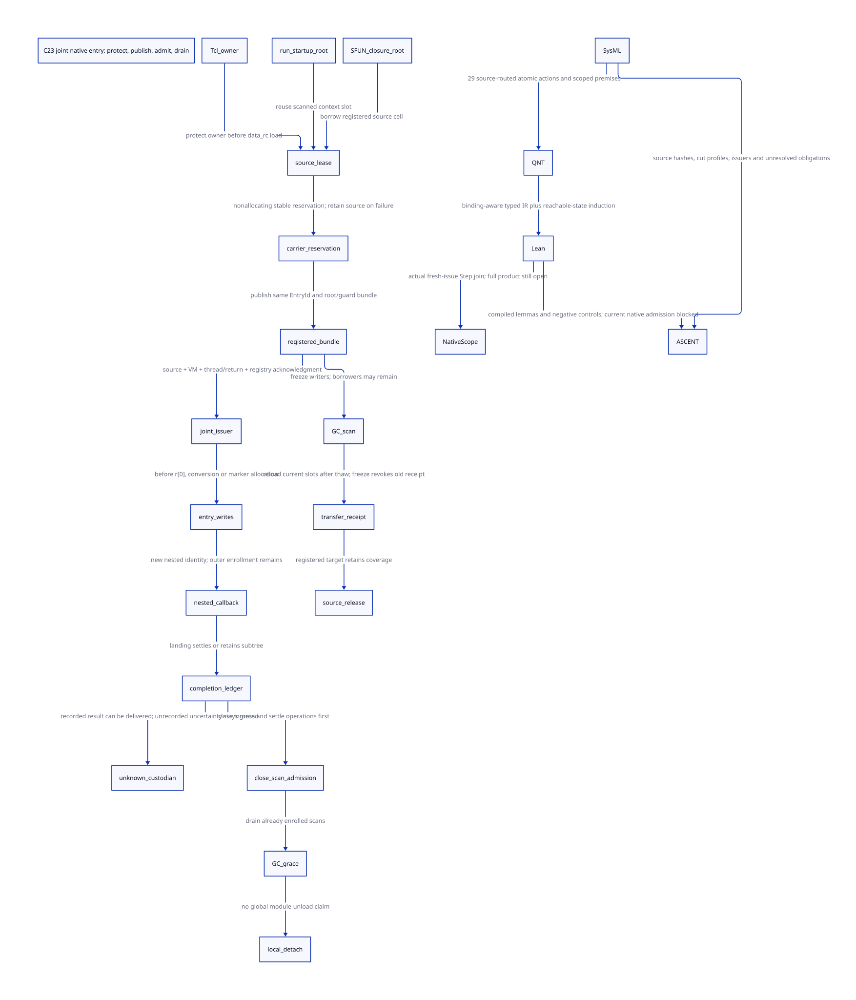

#+TITLE: C23 native entry — joint issuer cuts, pre-registration roots and drain
#+SETUPFILE: ../../modeling/org/setup.org
#+LANGUAGE: en
#+PROPERTY: header-args :eval never
#+STARTUP: overview

* RESEARCH Decision and authority
:PROPERTIES:
:CUSTOM_ID: native-entry-admission
:AUTHORITY: GambitNativeEntryAdmission
:BASELINE: C23
:EVIDENCE_SCOPE: Local source and conditional protocol proof; native admission unresolved
:END:

This refines [[file:native-scope-writers-design.org][NativeScope issuer/writer closure]] at actual ___run, SFUN and
Tcl entry points. It reuses [[file:native-return-domains-design.org][native thread/return domains]], [[file:tcl-source-borrow-design.org][Tcl source ownership]]
and [[file:ingress-carrier-transfer-design.org][ingress carrier transfer]]. No runtime source, native build, preprocessor,
native test or benchmark is changed or run. Modern C remains the implementation
mainline; Zig cannot replace the required ownership/control proofs.

The [[file:models/sysml/native-entry-admission.sysml][native SysML package]] owns five components, eight source cuts, five joint
issuers, two distinct authority levels, shared contracts, obligations,
action/proof routes and return rows.
[[file:../../modeling/tools/native-entry-admission-study.py][Python]] invokes the native SysML evaluator, the actual [[file:../../modeling/ascent/native-entry-admission.rules.scm][ASCENT DSL]],
[[file:models/quint/native_entry_admission.qnt][QNT]] and [[file:models/lean/NativeEntry.lean][Lean]]. It generates the [[file:native-entry-admission-matrix.org][matrix]] and
[[file:diagrams/native-entry-admission.d2][D2]] / ; the [[file:../../../evidence/research/future-frame-commit/native-entry/][research evidence directory]] retains successful checks and failures.

* RESEARCH What the local source actually supplies
:PROPERTIES:
:CUSTOM_ID: native-entry-source-cuts
:END:

** ___run has an earlier cut than ___call

[[file:../../../vendor/gambit/lib/setup.c::___EXP_FUNC(___SCMOBJ,___run)][___run]] rejects a non-running participant before context r[0], catcher,
marker and startup-state writes. It then distinguishes startup_thunk from its
legacy by-value thunk parameter. The startup path passes the actual context slot
to ___make_sfun_stack_marker_from_root. [[file:../../../vendor/gambit/lib/_mem/root-origins.inc][Root enumeration]] already scans
startup_thunk and entry_marker. Startup generation comparison and its startup
CAS are real source identities to retain, not a replacement for the new EntryId.

The real processor path calls ___run from ___run_and_throw_error_on_processor_0; the initial VM
path extracts its thunk from program_descr. Those paths need descriptor lifetime
and current source-slot ownership. The general by-value ABI must not certify an
arbitrary caller's provenance merely from an address of its C local.

[[file:../../../vendor/gambit/lib/c_intf.c::___EXP_FUNC(___SCMOBJ,___make_sfun_stack_marker)][The legacy marker helper]] creates/registers a temporary RC object for a
non-false procedure, stores the procedure, borrows its data slot, and calls the
rooted helper. The rooted helper allocates the marker and then reloads *proc_root.
This is useful existing protection across marker allocation. It does not prove
an arbitrary caller's earlier interval or establish a stable completion guard.
The selected noncollecting prefix is reusable only after its allocation hooks,
nonlocal exits and native reentry capabilities are qualified.

The new joint admission cut must precede ___run's first entry-local effect.
___call's own check, before its argument/frame writes, remains a consumer check;
it cannot undo earlier ___run effects. Direct and exported-table call/run entry
points must converge on the same admission authority. Generated pre-call writes
still require their earlier adapter cut. This is a proposed replacement boundary.

** SFUN already has a valuable root ordering

[[file:../../../vendor/gambit/lib/c_intf.c::___EXP_FUNC(___SCMOBJ,___begin_sfun)][___begin_sfun]] borrows the C-closure self root when proc is false, obtains a
noncollecting RC root bank, reloads the borrowed procedure, and registers/borrows
the bank. It returns the source borrow after the last noncollecting reload.
For an explicit fixed procedure, source/module lifetime must be established by
its generated binding, not guessed from its numeric SCMOBJ representation.

[[file:../../../vendor/gambit/gsc/_ptree2.scm::(define (c-make-function][c-make-function]] orders SCMOBJ parameters before other representations.
[[file:../../../vendor/gambit/include/_gambit/foreign_conversion.h.in][BEGIN_SFUN_ARG_SCMOBJ]] stores those raw inputs through ___sfun_arg before
later collecting representation converters. ___call_sfun creates its marker
from the bank's registered h->data, rechecks the bank and writes arguments under
rc_gate_. These facts support reuse of the existing bank and input prefix.

They do not justify a second root bank or a refcount increment around every
argument. The semantic source pin in the model may be discharged by a verified
same-owner, registered-source, noncollecting interval; it does not prescribe a
new physical RC pin in every fast path. Arbitrary c-type converters, C snippets,
allocation hooks or asynchronous nonlocal abandonment invalidate that profile
unless explicitly admitted. The complete enabled-callout census remains open. Refining the source pin with
only a noncollecting C-local interval requires proving that GC freeze cannot
occur before target publication, or supplying a real registered source slot
through that freeze. The pre-registration-GC histories prove the registered-source
variant; they do not prove that fast interval refinement.

** Tcl admission begins before data_rc, with a qualified fast path

The example's [[file:../../../vendor/gambit/examples/tcltk/tcltk.scm::___HIDDEN int scheme_call_cmd][scheme_call_cmd]] reads ClientData through ___data_rc and passes
its snapshot to tcltk_call. That generated SFUN accepts a scheme-object vector
before a nonnull-char-string-list, so the SCMOBJ-first rule matters directly:
the vector can enter the root bank before list conversion allocates. The example
constructs a still vector containing the procedure and stores it in registered
RC data; its delete callback releases both the Scheme hold and RC storage.

The retained [[file:../../../evidence/research/source-references/tcl/source-bindings.json][Tcl source receipt]] pins commit
cbf86d62348d6b052e1961b4df995960fb21545f. In its
[[file:../../../evidence/research/source-references/tcl/cbf86d62348d6b052e1961b4df995960fb21545f/generic/tclBasic.c::TclInvokeStringCommand(][TclInvokeStringCommand]], argv is allocated on the Tcl stack, the application
callback receives cmdPtr->clientData, and argv is freed after the callback.
Tcl_DeleteCommandFromToken invokes deleteProc before final Command cleanup;
Command refcounts therefore do not constitute an application ClientData lease.
The evaluator also re-resolves a command invalidated by enter traces. Do not
ignore that defense or label all trace/delete interleavings reachable bugs.

No race is demonstrated here in the ordinary same-interpreter-thread,
noncollecting prefix. Same-thread source access followed immediately by bank
publication can be a valid fast profile. A foreign-thread invocation, arbitrary
saved ClientData pointer, unqualified reentrant hook, or migration of a live Tcl
return segment is a different profile. It needs a stable owner lease before RC
header dereference and a root source included in the actual GC roster; otherwise
reject it. Merely acquiring rc_gate_ after the cell was freed would be too late.
This research does not qualify the installed Tcl library or propose a Tcl core
patch from the Command/ClientData distinction alone.

Once Scheme can run, nested events and command deletion can occur. The bank
must already retain the payload and its own storage. All later accesses to the
old ClientData must either cease or retain an explicit source lifetime lease.
argv remains borrowed native storage, not a Scheme root; unknown or escaping
completion must retain its live native return domain or use a qualified result
boundary. It must never park a raw argv pointer after Tcl frees its stack.

* RESEARCH Joint signature and root transfer
:PROPERTIES:
:CUSTOM_ID: native-entry-joint-signature
:END:

The signature combines facts about the same entry and storage, rather than five
independently writable success flags:

| Signer | Required fact | Cannot certify alone |
|---+---+---|
| Source owner | StorageId, canonical root span, source lifetime and owner eligibility | VM execution permission |
| VM domain | Context/participant identity and current execution or parked root manifest | Native C extent |
| Native thread/return domain | Actual binding and live return extent for this activation | GC root registration |
| Stable guard registry | Acknowledged EntryId, owned bank/root storage and descriptor holds | Unknown source provenance |
| Scanner authority | Canonical slot coverage, current root values and retired scan views | Arbitrary C callback quiescence |

The issuer has two authority levels. RootPreparationAdmission authorizes only
bounded source/bank setup under a protected source and native owner; it is not
permission to call Scheme, allocate a collecting marker or mutate entry PSTATE.
Full NativeScope execution admission waits for the target bank/bundle to exist
and be acknowledged. Requiring that final acknowledgment before creating its
bank would be circular. The early adapter reserves stable custody before native
allocation; the later cut accepts execution before the first entry effect.
The model's pinSource/reserveCarrier/qualifyHost/publishCarrier represent these
preparation steps, rather than an already-issued execution scope. Unknown native
allocation during preparation still needs the prior allocation/guard custody
protocol; the new model does not prove that allocator window.

Proposed order: acquire source eligibility; reserve stable metadata without
collecting; qualify host identities; publish the rooted bundle; confirm that
same registration; jointly accept execution; only then permit entry writes and
marker allocation. Signer/storage/generation agreement is checked at the final
acceptance cut, not by concatenating old unrelated receipts. VM/context teardown,
root freeze and thread rebinding must not invalidate an already relied-on fact
between its check and publication. The actual C23 admission adapter is unresolved.

The carrier owns its root-slot storage, or has a separately proved storage
handoff/retain receipt. Copying a pointer into a registry is not ownership of its
RC allocation. Reuse of the existing SFUN bank is preferred: retain the bank and
register its canonical span, rather than allocate a duplicate bank. Copying a
SCMOBJ into an owned slot copies a root word, not the Scheme object graph.

Source release needs acknowledged target registration, target slot/storage
lifetime, enumeration in applicable manifests, descriptor holds, and a current
slot value. A GC freeze invalidates a pending transfer receipt. Both source and
carrier may be scanned during the overlap; reload their updated values after
thaw before transferring. Alias/SlotKey normalization and actual manifest
coverage remain premises to discharge with the existing root-registry work.

Unknown publication retains both sides. Confirm the same EntryId; do not allocate
another registration on a missing response. A private rejected reservation can
roll back while the source remains owned. Published-but-unknown storage cannot
be privately freed or reused. The finite reservation branch models acceptance
or exhaustion; it does not prove a nonallocating pool implementation or ABA safety.

* RESEARCH Three closures with different responsibilities
:PROPERTIES:
:CUSTOM_ID: native-entry-close-freeze-drain
:END:

** Close execution ingress; retain accepted work

The close/accept race needs one linearizable order. An entry reserved before
closure but not accepted cannot start PSTATE writes after closure. An accepted
entry stays enrolled until a stable completion record settles it, including its
nested scopes. Source reservation is not an execution permission. A gate read
followed by an unrelated count increment is insufficient without a verified
combined operation or reserve/recheck/rollback protocol. Counter overflow must
reject enrollment rather than wrap. No concrete atomic encoding is selected here.

** Freeze slot writers for GC; keep borrowers alive

[[file:../../../vendor/gambit/lib/_mem/rc-allocation.inc::Closing writers must never][close_rc_roots]] closes writers under rc_gate_ and explicitly does not wait
for root borrows. [[file:../../../vendor/gambit/lib/_mem/rc-roots.inc][mark_rc]] requires a closed context and updates h->data plus
its registered root span through mark_array. A borrow pins the cell; it does not
keep a C local snapshot current or make its thread a GC participant.

The real [[file:../../../vendor/gambit/lib/_mem/collection-round.inc][collection round]] closes RC roots, records the stopped context and
ROOTS_FROZEN state, and crosses barriers before workers scan. Its thaw validates
the completed root task, restores RUNNING, crosses a barrier excluding retained
worker views, then reopens RC roots. This sequence is reusable evidence for a
new registry adapter; it is not already that adapter.

The model permits freeze/scan/thaw with source pins, an outer in-flight entry,
nested callbacks, or unknown completion retained. Waiting for borrow count zero
before GC could deadlock when the borrower needs GC to resume and return it.
Slot writers stop; registered roots remain; the collector updates them. Execution
ingress closure remains closed after GC writers reopen.

** Retire scanner admission and drain before storage release

[[file:../../../vendor/gambit/lib/_mem/rc-allocation.inc::___HIDDEN void cleanup_rc][cleanup_rc]] rejects outstanding borrows before detaching/freeing the RC
chain and destroying its gate. This is teardown, not the GC freeze predicate.
A new registry must close future snapshot enrollment, drain previously captured
scan users, and retain descriptor storage until grace. A zero callback count is
not this permit. The model represents an enrolled scan round atomically and
requires its return before grace; the actual snapshot/close C23 race and global
descriptor reclamation remain unresolved.

* RESEARCH Unknown completion, exceptions and nested callbacks
:PROPERTIES:
:CUSTOM_ID: native-entry-unknown-custody
:END:

A pre-reserved stable record is owned by a VM lifetime domain, not a vanished
PSTATE/local C activation. Its source and root/descriptor holds remain until
custody transfers or settlement is known. VM destruction must retain that domain
while such entries remain; an unknown native thread exit cannot silently remove
it from the collector's source roster.

A stable result recorded before response loss can be delivered/reconciled using
the same operation identity. Loss before a stable record is a distinct state:
retain roots and custody, do not infer failure, replay the Scheme call, or invoke
the Scheme conversion-error callback as a retry mechanism. No timeout or made-up
reconciliation oracle discharges it. Permanent uncertainty may retain resources
without bound; safety does not prove eventual completion.

Separate AdmissionRejected, ConversionError, KnownCompletion and
UnknownCompletion at the checked boundary. Existing SFUN_ERROR guards use
___check_sfun, but do not implement that typed completion protocol. Each real
conversion-error callback attempt needs its own operation identity even when the
marker is reused. A delayed response retains its original identity; genuine
continuation restoration needs a fresh activation outside restored frames.

BEGIN_TRY uses a local catcher and END_TRY restores it. The return-to-C marker
protocol checks live return extent, but neither is a stable subtree drain service.
An outer landing must reconcile or retain inner guards before its C frames and
old context storage disappear. The model retains the outer enrollment while a
nested callback runs and while unknown completion crosses GC. It does not prove
all Tcl nonlocal exits or authorize cross-thread longjmp. These remain native
return-domain obligations, not Scheme dynamic-wind cleanup assumptions.

* RESEARCH Model/proof closure and its limits
:PROPERTIES:
:CUSTOM_ID: native-entry-model-closure
:END:

Five SysML components share one QNT transition system because source coverage,
registration, accepted execution and scanner retirement share the same invariant.
Component and authority action slices and compiled lemmas are checked by the driver and ASCENT;
files merely existing do not qualify a component. The restricted typed-IR
projector checks actual bindings, exact fields and the complete action roster.
Binding/type/roster/expression poison controls must be rejected.

Lean proves initial safety, all 29 actions and induction over arbitrary model
traces. GC epochs are unbounded mathematical integers, with scan actions loading
the current epoch; they are not a two-round proof or a native wraparound claim.
The nine histories include repeated rounds, GC before registration, GC after
source release, closure with retained borrows, nested unknown completion,
metadata exhaustion and lost registration acknowledgment.

The exact fresh-issue join is stronger than the earlier capability-half lemma:
jointIssueNativeStep constructs a real NativeScopeAst.Step through its actual
issue constructor, and jointIssueNativeSafe uses the existing preservation proof.
The seed fixes the rest of NativeScope.initial, including fresh owner/generation,
closed-writer and no-prior-observation premises. It does not derive those facts
from root registration. It cannot reset a nested/resumed thread's history; full
product refinement and those native premises remain open.

Nine negative admission examples first establish the original prefix, then
reject premature issuance, marker allocation, registration acknowledgment,
source release after freeze, retirement before drain, borrower-drain assumptions,
unknown-as-failure, late callback admission and grace before scan return. ASCENT
also rejects forged cuts, missing bridge/proof, wrong source identity and relaxed
publication claims. Its synthetic-all fixture is not native qualification.

* RESEARCH Return and migration order
:PROPERTIES:
:CUSTOM_ID: native-entry-net-return
:END:

The [[file:native-entry-admission-matrix.org][return matrix]] separates reused mechanisms, additions and refutations.
No person-day estimate or measured speedup is claimed. One stable scope record
per outstanding entry gives O(K) record overhead for K entries, plus O(R) root
slots for the roots actually retained; referenced Scheme graphs may dominate
retained memory. Reusing the existing bank avoids a mandatory second bank.
Overlap temporarily exposes both root spans to scanning. Coherence history is
proof state, not automatically a new runtime table.

Migration sequence: seal the generated noncollecting/input prefix; expose
checked source/entry adapters while retaining the legacy ABI; integrate stable
registration with current RC/root-origin scanning; add close/settle/scan-grace;
then qualify nested landings and arbitrary restoration. Retire the legacy
managed-path snapshot entry, fragmented completion bookkeeping and unchecked
admission-to-conversion-error fallback only after all their real callers move.
Generic public FFI/RC APIs and ordinary marker semantics do not retire wholesale.
Currently zero native paths retire; no performance benefit is established.

Feeley and Miller's PVM compiler/runtime split and lazy materialization motivate
reusing Scheme's semantic assets. Feeley's first-class-continuations/C paper
separates Scheme lifetime from native dynamic extent; its local retained source
anchors the boundary, not our C23 publication protocol. The NativeScope signer,
root carrier and completion record are our proposed derivation. Modern C23
publication and actual reads-from obligations remain those of the preceding
NativeScope study; neither language choice nor model event labels prove them.

* RESEARCH SFUN/Tcl prefix effects and root preparation permissions
:PROPERTIES:
:CUSTOM_ID: native-prefix-permission-link
:END:

[[file:native-prefix-permission-design.org][Prefix effect closure and root preparation]] follows allocator, lock, logging,
custom converter and closure-self paths. Its [[file:native-prefix-permission-matrix.org][SysML-derived matrix]] separates
fast permission, durable source roots and rejection, with actual QNT/Lean and
ASCENT joins. Native closure, physical root handoff and arbitrary abandonment
remain unresolved; no runtime path is retired.
