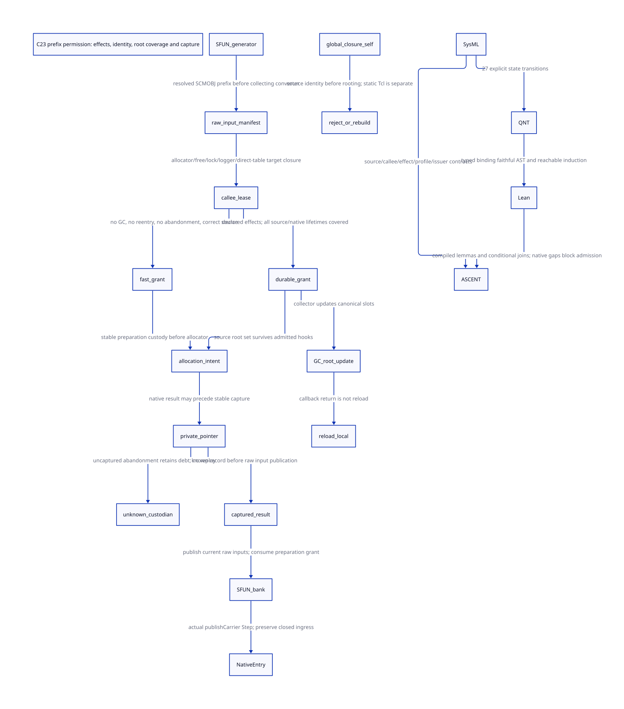

#+TITLE: C23 SFUN and Tcl prefix effects — fast permissions, durable roots and custody
#+SETUPFILE: ../../modeling/org/setup.org
#+LANGUAGE: en
#+PROPERTY: header-args :eval never
#+STARTUP: overview

* RESEARCH Decision and authority
:PROPERTIES:
:CUSTOM_ID: native-prefix-permission
:AUTHORITY: GambitNativePrefixPermission
:BASELINE: C23
:EVIDENCE_SCOPE: Local source census and conditional protocol proof
:END:

This follows [[file:native-entry-admission-design.org][joint native entry admission]]. It resolves the distinction between
root preparation and execution into a proposed effect-qualified preparation
permission. A fast permission requires correct source identity, fixed call
bindings, no GC, no reentry and no abandonment before result capture. A durable
source root relaxes the GC/reentry restriction only after complete source and
native lifetime admission. It does not turn arbitrary C into an admitted caller.

The [[file:models/sysml/native-prefix-permission.sysml][native SysML package]] is the source of component/action slices, the bounded
call census, profile and issuer contracts, obligations, return rows and diagram
edges. The [[file:../../modeling/tools/native-prefix-permission-study.py][Python driver]] asks the native evaluator for those rows and checks
actual [[file:../../modeling/ascent/native-prefix-permission.rules.scm][ASCENT rules]], [[file:models/quint/native_prefix_permission.qnt][QNT]], [[file:models/lean/NativePrefix.lean][Lean]], the [[file:native-prefix-permission-matrix.org][matrix]] and
[[file:diagrams/native-prefix-permission.d2][D2]] / . The [[file:../../../evidence/research/future-frame-commit/native-prefix/][research receipts]] preserve failures and qualified scopes.
No runtime source, native implementation, preprocessor, native build/test or
benchmark is changed or run. No new version naming is introduced.

* RESEARCH Actual SFUN/Tcl prefix and its boundary
:PROPERTIES:
:CUSTOM_ID: prefix-source-chain
:END:

** Generated ordering is useful existing architecture

[[file:../../../vendor/gambit/gsc/_ptree2.scm::(define (scmobj-type?][scmobj-type?]] resolves type aliases before identifying scheme-object types.
c-make-function places those parameters before other representations;
[[file:../../../vendor/gambit/include/_gambit/foreign_conversion.h.in][BEGIN_SFUN_ARG_SCMOBJ]] invokes ___sfun_arg to put them in the bank.
The bank is created by ___begin_sfun before that input prefix. This creates two
separate intervals: native bank preparation while raw inputs still belong to
the source, and representation conversion after the raw input prefix is stored.
Only the former is the proposed noncollecting fast region.

[[file:../../../vendor/gambit/lib/c_intf.c::___EXP_FUNC(___SCMOBJ,___begin_sfun)][___begin_sfun]] calls ___rc_entry_open, optionally obtains closure self and
borrows its RC data root, allocates an RC root bank, reloads the procedure,
returns that source borrow, stores the procedure in the bank and borrows the
bank. That release-before-store is a real small interval. It requires either a
proved noncollecting/nonabandoning source interval or continuing source coverage;
the new architecture must not describe it as an already-proved overlapping
source-to-target root transfer.

The real Tcl example is a static c-define with parameter types
scheme-object and nonnull-char-string-list. Its first vector input can be banked
before list conversion. The C command wrapper's ___data_rc snapshot is earlier
than both operations. Tcl/source ownership must cover that early snapshot and
the entire pre-bank prefix. This source ordering is reusable and is not a
reported ordinary same-owner race.

** RC preparation reaches native allocation and locks

[[file:../../../vendor/gambit/lib/_mem/rc-allocation.inc][The RC path]] is alloc_rc_roots → alloc_rc → alloc_rc_no_register → ALLOC_MEM,
then private header initialization, registration, FAL payload initialization,
flag clearing and root_count publication. These bodies do not directly call
Scheme or Gambit GC on the ordinary path. They do call gates, memory primitives
and allocator/free wrappers. Normal rejected registration leaves the private
allocation caller-owned; alloc_rc frees it on its own rejection path.

borrow_rc_root checks context identity, closure and count limits under rc_gate_.
return_rc_root decrements the borrow and reference counts, and may call FREE_MEM.
An incorrect borrow return calls rc_custody_error; that reaches fatal_error,
which may invoke setup_params.fatal_error before exiting. The fast profile must
prove valid custody and exclude that malformed-state branch. It may not declare
the configurable callback itself harmless. Allocation NULL is an ordinary coded
failure; it is not the same event as fatal custody corruption or unknown return.

The native locking profile matters too. SPINLOCK can select a POSIX mutex or a
ticket lock; debug ticket-lock spinning reaches printf. CPU_RELAX itself is not
a Scheme scheduler call. Nothing here proves wait freedom or bounded malloc,
mutex or stdio latency. A fast profile's root safety alone does not prove
multi-core GC progress while an opaque native call blocks.

** Malloc and logging are different closure leaves

[[file:../../../vendor/gambit/lib/os_base.c::void *___alloc_mem][___alloc_mem]] normally calls malloc. The historical TempNewHandle branch is
separate. With DEBUG_ALLOC_MEM and DEBUG_LOG, it logs after obtaining ptr but
before returning it. [[file:../../../vendor/gambit/lib/os_base.c::int ___printf][___printf]] calls vfprintf and fflush. free_mem likewise
logs before the native free. These captured wrappers contain no direct Scheme
call or Gambit collection. That is a source fact, not an effect certificate for
libc, an interposed allocator or a selected I/O backend. The post-malloc logger
creates a concrete pointer-obtained/before-caller-recorded interval to qualify.

[[file:../../../vendor/gambit/include/_gambit/runtime_protocols.h.in][ALLOC_MEM]] also has ordinary/debug ABI variants. [[file:../../../vendor/gambit/include/_gambit/module_generation.h.in][EXT]] selects either a direct
symbol or a GSTATE function slot depending on binding macros. setup.c installs
alloc_mem/free_mem into that table. An initialization assignment does not close
all later native writers to the exported table. A lease must cover actual
selected targets until the prefix returns; hashing them only after execution
would detect a change too late. The local config.h text undefines debug options,
but neither that text nor the modular header is effective loaded-binary evidence.
No preprocessing or dyld/interposition audit is claimed here.

** The first collecting and reentrant edges remain explicit

For Tcl, NONNULLCHARSTRINGLIST_to_SCMOBJ delegates to
NONNULLSTRINGLIST_to_SCMOBJ, which converts strings and calls make_pair.
[[file:../../../vendor/gambit/lib/_mem/object-allocation.inc][Still-object allocation]] has deferred accounting and an actual garbage_collect
slow path. A particular empty input need not allocate; the general converter is
still potentially collecting. The raw input prefix must already be rooted before
this edge or before collecting marker allocation. A still object is not proof
that allocation never collects.

c-type-converter can emit registered custom C converter names. c-declare and
other native extensions can introduce additional effects. The manual call census
records the boundary and unresolved external leaves; it is not an automatically
verified transitive C call graph. Arbitrary custom declarations/converters require
a complete selected-prefix summary or rejection. A post-prefix converter's GC
must not be incorrectly counted as a fast-prefix violation, nor moved into the
prefix by an unchecked generator/declarator change.

END_SFUN invokes ordinary cleanup and propagate_error; a nonzero status reaches
throw_error and the current catcher. A known prefix failure must settle or retain
its preparation record before nonlocal propagation. Arbitrary longjmp, thread
cancellation, fatal callbacks or hook-induced Scheme control are not covered by
normal brace cleanup. The current default heartbeat/user interrupt routes post
interrupt state; this is not proof that all custom signal routes behave that way.
Neither signal arrival nor a posted interrupt alone demonstrates an immediate
Scheme GC/reentry inside the ordinary prefix.

* RESEARCH Dynamic closure identity is a separate blocker
:PROPERTIES:
:CUSTOM_ID: prefix-closure-identity
:END:

[[file:../../../vendor/gambit/lib/os_dyn.c::c_closure_self needs to be thread local][os_dyn.c]] explicitly declares shared c_closure_self and contains the TODO
that it needs to be thread local. Supported dynamic trampolines write that global
before jumping to the generated converter; ___c_closure_self returns it.
___begin_sfun reads it after entry checks. Concurrent writers or unqualified
reentry before the read can therefore invalidate source identity. Borrowing a
well-formed RC root for the wrong closure would not repair that identity.

SCMOBJ_to_FUNCTION first tries a static c-define function, and uses make_c_closure
only when that path is unavailable. Dynamic code is guarded by the limited
C_CLOSURE_CODE_SIZE architecture branches (x86-32, qualified PPC and SPARC in the
captured source); the unsupported path returns zero. This study does not claim
an arm64 trampoline or demonstrate an arm64 execution race. Tcl's static
c-define entry is not assigned this dynamic-self hazard.

Modern C options include an explicit source/closure handle in an internal
callback ABI, or a proved per-thread/per-invocation trampoline channel. A single
TLS cell does not automatically solve same-thread reentry before capture.
Serializing only the later converter read also cannot protect earlier machine
code stores unless every writer participates. The current unqualified dynamic
channel must be excluded from a parallel managed profile; replacement and ABI
qualification remain unresolved, not implemented here.

* RESEARCH RootPreparationPermission and three supported decisions
:PROPERTIES:
:CUSTOM_ID: prefix-grant
:END:

The proposed receipt binds PrefixId and generated raw-input shape; source/storage
identities; selected macro/ABI and direct/indirect targets; binding generation;
MayCollect/MayReenter/MayAbandon summary; native thread/return ownership; and the
stable allocation-intent recipient. Generator/source-owner, callee-binding owner
and allocation/VM registry jointly sign it. It is not a compiler annotation that
C23 automatically enforces. All target writers must honor the lease or the
managed profile is inadmissible.

| Decision | Required conditions | Roots and custody |
|---+---+---|
| Qualified fast | Complete fixed prefix; correct identity; no GC/reentry/abandonment before capture | No mandatory persistent source-root span; retain source/native lifetime and a stable intent |
| Durable preparation | Declared effects; correct identity; every relevant raw input registered before the hook | Canonical roots, parked GC participation, reload and stable intent; native buffers separately protected |
| Reject | Opaque effects, wrong/unreliable source identity, stale binding lease, unqualified debug I/O | Do not start preparation; return checked admission outcome |

A durable source set is not just the procedure. All raw Scheme inputs that can
move or lose their last live hold must be covered before bank allocation can call
a collecting hook. A generic by-value SCMOBJ ABI cannot supply that proof alone.
For the Tcl case the still vector, the moving procedure reachable from it, the
ClientData owner and the native argv span have distinct lifetimes. Persistent
Scheme roots do not keep TclStackAlloc storage alive after TclStackFree.
An abandoning profile is rejected for borrowed argv unless the return extent is
still live or inputs have been copied into owned native/Scheme storage.

A noncollecting C-local variant must prove that GC freeze cannot occur before
bank publication. A durable variant permits GC but requires actual scanner
coverage and reload. These are alternatives, not interchangeable certificates.
The sourceRoot model field denotes the complete admitted source set; it cannot
be instantiated with only a convenient procedure root. Native qualification of
either source set remains open.

* RESEARCH Hook return, native allocation and unknown completion
:PROPERTIES:
:CUSTOM_ID: prefix-custody
:END:

Root slots may be updated while an admitted hook runs. Returning from that hook
does not update a C local; reload canonical slots before initializing/publishing
raw bank inputs. The stable native allocation record precedes publication of
those inputs. Private metadata contains no uninitialized Scheme root span.

Separate pointer obtained, pointer stably recorded, root inputs published and
handoff accepted. A hook may abandon after native malloc has obtained memory but
before its caller records the pointer; logging in alloc_mem is a real source
location where external effects occur in that interval. A pre-existing intent
retains responsibility, but does not recover an unrecorded pointer by magic.
Without a same-operation allocator receipt/reconciliation mechanism, that state
may retain roots and leak native memory until process termination. Do not replay,
free a guessed pointer or claim progress.

A captured record with a lost delivery can be recovered under the same operation
identity. Recovery here is an owner service completing a recorded root handoff,
not reentry into an abandoned C frame. The native return domain, buffers and
all source lifetimes must still justify any further work. Unknown native-input
lifetime blocks that recovery profile even if Scheme roots remain valid.
The model allows GC to update retained sources/carriers across unbounded
mathematical epochs; actual registry enrollment, native counter limits and
retirement still need the previous NativeEntry contracts.

Rollback is intentionally restricted to the qualified plain private case.
If free/logging can reenter or abandon, use the prior stable cleanup service and
its stronger release protocol; a function named free is not an exactly-once
release receipt. No destructor or arbitrary allocation hook implementation is
introduced in this study.

* RESEARCH Actual models and composition
:PROPERTIES:
:CUSTOM_ID: prefix-formal-scope
:END:

QNT separates seven effect profiles, fast/durable/rejected preparation, a fixed
binding-generation lease, hook entry/return, slot/local epochs, native allocation
capture, unknown custody and bank publication. Profiles are certified-summary
inputs, not properties discovered from a loaded binary. There are no actions
permitting arbitrary rebinding after a grant; proving that native restriction is
an explicit unresolved premise. The first native caller still needs the actual
signers, not a profile number written by itself.

Lean proves initialization, each of the 27 transitions and reachable-state
induction. fastExcludesGc denies collection before a fast prefix has published
roots; wrongSelfCannotBorrowItsWayIn and opaqueCannotObtainGrant deny both grants.
Callback return preserves the old local epoch; publishInputs requires the current
one. Unknown-before-capture has no recovery action. A published bank consumes the
preparation grants and belongs to a qualified profile, including during response
loss; that invariant is retained in the proof.

prefixToEntryStep constructs the actual NativeEntryAst.publishCarrier Step and
prefixToEntrySafe uses its existing preservation proof. The logical source bank
can be handed to the existing entry preparation model without resetting GC
epochs or reopening closed ingress. Host facts, physical storage/slot identity,
source loan and lifetime transfer remain premises. This is a scoped producer /
consumer join, not a full native execution or arbitrary nested-state simulation.

The typed QNT/Lean projector checks the exact state binding and complete action
roster, with poisoned binding/type/roster/expression controls. Ten reachable
negative examples reject collecting/debug/stale/opaque fast admission, wrong
identity, stale local publication after a callback, recovery/rollback of an
uncaptured result, GC within the unrooted fast prefix, and admission after close.
ASCENT checks caller, profile, issuer, component and compiled-proof contracts;
external leaves receive no qualification in the current scenario. Only its
synthetic-all test fixture may satisfy all native conditions.

* RESEARCH Source-sized benefits and costs
:PROPERTIES:
:CUSTOM_ID: prefix-net-return
:END:

The [[file:native-prefix-permission-matrix.org][matrix]] reports theoretical work and required support, not person-days or a
speedup estimate. alloc_rc_roots requests count*(sizeof(SCMOBJ)+1) payload bytes,
where the SFUN passes count=N+2. Thus existing bank payload is (N+2)*(W+1),
excluding the RC header, alignment and native allocator overhead. For Tcl's N=2
this is 4*(W+1); at W=8 it is 36 payload bytes, a symbolic instantiation rather
than a measurement of a loaded Darwin binary. Its scanner also handles h->data
separately. The architecture does not require a second copy of that bank.

A qualified fast prefix avoids an obligatory R-slot persistent source span.
Durable preparation costs up to R canonical source slots/leases plus reloads and
overlap scanning, while keeping the existing target bank. K outstanding native
allocations need O(K) stable intents; referenced graphs and unrecoverable native
memory may dominate retention. Full-source coverage, effect-lease checks and
GC participation are real new support costs. No latency, core utilization or
throughput result follows from these bounds.

Modern C can centralize these contracts in Scheme-generated prefix manifests,
checked native entry and allocator/cleanup services. Managed-path ad hoc
snapshots and duplicate root/bootstrap wrappers retire only after all callers
and external targets satisfy their contracts. Public legacy FFI, all RC APIs,
marker semantics and C portability remain available outside that managed claim.
Current native paths retired: zero. Zig would require the same effect, identity,
root and C-return proofs; it has no proved incremental benefit in this study.

The architectural inference continues Gambit's compiler/runtime separation and
native-extent constraints described in the Feeley papers linked by the preceding
NativeScope and NativeEntry studies. Those papers do not prove a modern libc
closure or this C23 permission protocol. Current source facts, our proposed
contracts, mathematical preservation and native qualification stay distinct.

* RESEARCH Darwin target closure and allocation-origin leases
:PROPERTIES:
:CUSTOM_ID: darwin-target-lease-link
:END:

[[file:darwin-target-lease-design.org][Darwin binding and target leases]] binds two static configuration cohorts and
separates invocation drain from allocation-origin/provider lifetime. Its
[[file:darwin-target-lease-matrix.org][SysML-derived matrix]] links real QNT/Lean prefix-grant joins and ASCENT
checks. Loaded providers, raw writer closure, native outcome capture and full
reclamation remain unresolved. No runtime path is retired.
