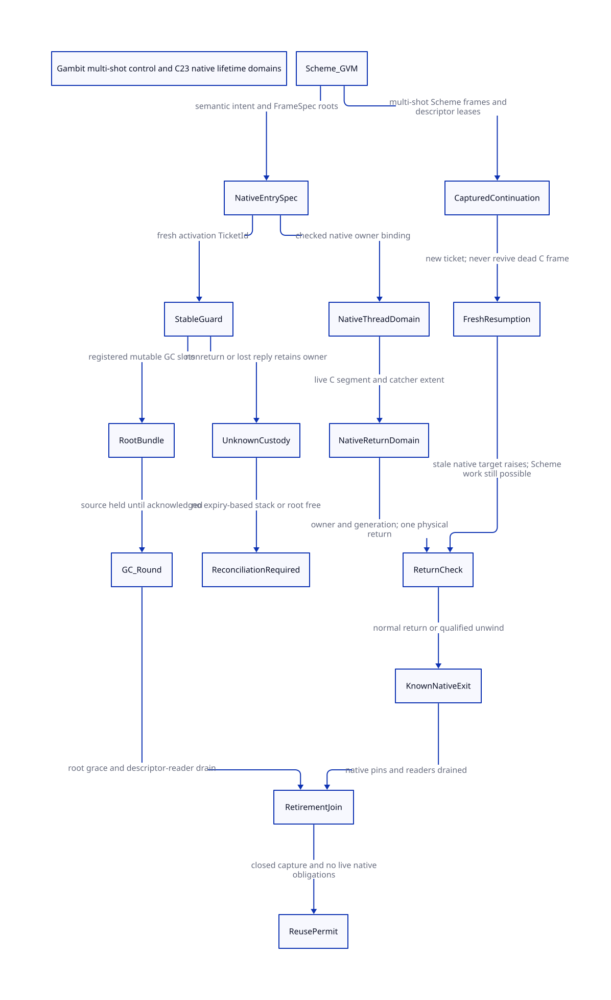

#+TITLE: Gambit native thread, return domains and stable execution guards
#+SETUPFILE: ../../modeling/org/setup.org
#+LANGUAGE: en
#+PROPERTY: header-args :eval never
#+STARTUP: overview

* RESEARCH Decision and scope
:PROPERTIES:
:CUSTOM_ID: native-return-domains
:AUTHORITY: GambitNativeReturnDomains
:BASELINE: C23
:EVIDENCE_SCOPE: Source-bound architecture and finite protocol safety
:END:

Gambit's first-class Scheme control is the semantic asset. Its implementation
choices are revisable. Modernization makes native lifetime, execution identity,
collector participation and ownership explicit compiler/runtime contracts. It
must amplify portable tail calls, reusable Scheme continuations and independent
compilation contexts without pretending that arbitrary C frames become movable
or replayable. Modern C is the required implementation baseline. Zig does not
supply a missing control or GC theorem.

This study succeeds [[file:guard-thread-admission-design.org][guard thread admission]]. It does not implement the
runtime, qualify a Darwin binary, run a native workload or measure speed. The
[[file:models/sysml/native-return-domains.sysml][native SysML package]] owns component obligations, paper grounding, source
anchors, action/proof routes, memory obligations and benefit rows. Python asks
the installed SysML evaluator for these values, runs formal tools, and generates
the [[file:native-return-domains-matrix.org][Org matrix]] and [[file:diagrams/native-return-domains.d2][D2]] /  views. It does not parse SysML semantics.

* RESEARCH Research basis: retain the question, reconsider the mechanism
:PROPERTIES:
:CUSTOM_ID: native-domain-research-basis
:END:

** Gambit primary research

[[https://www.iro.umontreal.ca/~feeley/papers/FeeleyMillerLFP90.pdf][Feeley and Miller, PVM (1990), section 2]] supplies a compiler/runtime division:
backend machine facts participate in compilation. Our architectural inference
is a Scheme-produced NativeEntrySpec, with explicit entry intent, FrameSpec and
root obligations. The historical paper is not a current ABI qualification.

[[https://www.schemeworkshop.org/2000/feeley.ps][Feeley, first-class continuations and C (2000), sections 1–5]] distinguishes
unlimited Scheme extent from dynamic C extent. Section 3 describes lazy native
frame removal: Scheme restoration can succeed even though a later C return must
fail. Copying arbitrary C stacks changes local-store behavior and is not the
selected portable solution. Section 4 proposes independent native-thread stacks
for contiguous C segments, with collector-based reclamation; section 5 says the
proposal was not yet implemented. Its old timing figures are not estimates for
present hardware. We retain independent segment ownership as a research option,
rather than prescribing one OS thread per Scheme resumption.

The preserved [[file:../../../evidence/research/guard-thread-admission/primary-paper.json][primary-paper receipt]] binds the official PostScript and extracted
text. Missing glyphs in extraction preclude reconstructed verbatim quotations.

** Modern mechanisms, with semantic limits

[[https://anil.recoil.org/papers/2021-pldi-retroeff.pdf][Retrofitting Effect Handlers onto OCaml, PLDI 2021, sections 3.1 and 5.3]]
separates system and fiber stacks and describes callback stack transitions. It
chooses one-shot continuations and does not allow effects to capture across C
frames. We learn explicit boundaries, shared callback support and analysis-tool
requirements. Gambit's multi-shot control is not replaced by those restrictions;
no OCaml performance result predicts this design's performance.

[[https://www.open-std.org/jtc1/sc22/wg14/www/docs/n3096.pdf][WG14 N3096, C23 working draft, 5.1.2.4 and 7.13.2.1]] supplies publication
ordering and the same-thread/live-invocation restrictions on longjmp. This is a
public working draft, not the final purchased ISO text. Neither atomics nor a
heap-allocated jmp_buf extends the target C invocation's lifetime. A return
permission must therefore include the actual native owner and live dynamic
extent. C23 does not standardize arbitrary movable native stacks.

JEP 491 and its issue endpoint were not retrievable in this study; no claim about
current JDK pinning is admitted. Modernity is established by explicit contracts,
mechanisms and evidence, not by a reference's date alone.

* RESEARCH Three different owners, five different lifetimes
:PROPERTIES:
:CUSTOM_ID: native-domain-roles
:END:

The Role rows in the [[file:native-return-domains-matrix.org][generated matrix]] define each identity, retirement cut
and authority boundary directly from SysML.

A native thread may host many sequential return domains. Nested callbacks have
distinct guards; nested native segments have a parent/extent relation. An outer
native return can invalidate inner extents on the same C stack. It must settle or
retain every affected guard/lease before old PSTATE/catcher storage becomes
unusable. Independent-stack mode avoids that shared-stack invalidation relation
only after its adapter is qualified. No such adapter is proved here.

A return domain is more precise than an entire thread stack: unwinding one
segment does not imply the OS stack allocation has been freed. Conversely, keeping
the OS thread alive does not keep a returned C function invocation alive.

* RESEARCH Actual source and the required architectural change
:PROPERTIES:
:CUSTOM_ID: native-domain-source
:END:

** Existing return and marker protocol

[[file:../../../vendor/gambit/lib/_kernel.scm][The return-to-C handler]] checks marker processor identity, then marker element
zero, and raises on a subsequent native return. Its first-return branch throws
UNWIND_C_STACK. [[file:../../../vendor/gambit/lib/setup.c][___call]] installs the marker beside the return address in a
Scheme frame, enters the selected host/trampoline route and compares the unwind
destination marker before accepting the return. This is a real live-catcher and
stack-order protocol, not a heap-continuation replay of C locals.

[[file:../../../vendor/gambit/lib/c_intf.c][Marker construction]] may allocate, then reloads *proc_root. Its explicit-root
endpoint depends on a registered source slot; the legacy wrapper's local variable
is not converted into such a root by passing its address. Marker invalidation
sets element zero to false and decrements a still reference. Neither operation
proves native stack reclamation or complete guard settlement.

[[file:../../../vendor/gambit/include/_gambit/foreign_conversion.h.in][BEGIN_TRY]] stores a local jmp buffer and the prior catcher, then restores the
catcher after the protected body. Generated SFUN entry reads PSTATE before marker
construction. In C mode the cleanup braces are not a destructor or an independent
completion service. The replacement needs a generated entry/exit adapter plus a
stable completion recipient; merely putting the same macros inside a C23 function
leaves the lifetime problem intact.

** Scheme restoration and reentrancy

[[file:../../../vendor/gambit/lib/_thread.scm][call/cc reification]] makes a closure over a continuation and dispatches through
continuation-return-aux. The unwind/wind procedure invokes Scheme before/after
thunks and can therefore reenter user control. Direct no-winding/graft paths are
also present. A captured dynamic-wind cleanup closure is not a unique owner of a
native execution: it may execute again, be bypassed by a lower-level path, or
resume after a different activation has begun.

Each genuine restoration requires a fresh activation ticket outside the restored
frames. Retransmitting an already issued operation keeps its ticket. A stale
completion names the old ticket and cannot settle a new execution. Keeping a
captured continuation does not replay native return consumption.

** GC and actual FFI consumers

[[file:../../../vendor/gambit/lib/_mem/root-origins.inc][Root enumeration]] scans saved registers, startup_thunk, entry_marker and context
RC roots. [[file:../../../vendor/gambit/lib/_mem/rc-roots.inc][RC scanning]] follows the supplied context's RC list. Neither is an
existing VM-wide stable-guard root registry. Register new guard bundles explicitly
and define the scanner's admitted context/round; do not infer coverage from a
native pointer or a marker refcount.

[[file:../../../vendor/gambit/examples/tcltk/tcltk.scm][Tcl's command callback]] fetches data_rc before entering the generated Scheme
wrapper. Its delete callback can release that storage. A thread-domain guard
issued inside SFUN is too late to protect this source read. Source admission/pin
must precede it, and deletion must close admission and wait or transfer custody.
[[file:../../../vendor/gambit/lib/os_thread.c][Native binding]] obtains pthread_self, but its pthread_setspecific path ignores
failure. It cannot issue a checked domain-binding receipt as written.

* RESEARCH C23 architecture and policy profiles
:PROPERTIES:
:CUSTOM_ID: native-domain-architecture
:END:

** Shared compiler and runtime boundary

Scheme/GVM owns call intent, Scheme continuation and denv semantics, declaration
meaning, root liveness and FrameSpec coordinates. It emits NativeEntrySpec with
entry category, reentrancy/blocking capabilities, owner constraints, root slot
schema, possible non-local exits and module/descriptor leases. Modern C owns
native thread registration, stable allocation pools, checked TLS adapters,
return-domain records, root registration and completion dispatch. GC owns slot
updates, collection-round acknowledgement and scanner retirement. Neither C nor
Zig reconstructs Scheme semantics from emitted C text.

ModuleSpec exports the native entry schema and ABI fingerprint. Incremental
compilation must invalidate generated callers, wrappers and matching FrameSpec
consumers when that fingerprint changes. A cache key based only on Scheme source
bytes is insufficient. LLVM may later lower an equivalent native-entry contract;
its native stack maps and unwind metadata require separate qualification. MLIR
is not a solution for unspecified FFI roots or dead C return targets.

** Explicit native profiles

1. Leaf native calls: declared no callback, no Scheme allocation and bounded
   native effects. They retain the caller's extent and need no new OS thread.
2. Blocking/reentrant native calls: live native carrier stays pinned to its
   thread domain; separate Scheme work can run on other processors. A callback
   reenters through a fresh guard and checked roots, preserving parent custody.
3. Independent native segments: an optional Feeley-inspired owner/stack adapter
   may isolate return ordering. It must prove thread affinity, nested segment
   allocation, callback dispatch, unwind-tool metadata, root enumeration and safe
   native exit. Stackful coroutines or a native thread pool are implementation
   candidates, not portable-C guarantees. A pooled stack cannot be reassigned
   while its C frames or external pointers remain live.
4. Result/event adapters: only explicitly opted-in APIs may replace a synchronous
   native return with a durable result. That is an API/control transformation,
   not an equivalent implementation of every existing Tcl or arbitrary C call.

These profiles provide a modernization architecture rather than a blanket
one-thread-per-call rule. Suspendability and parallelism are distinct: a blocked
native carrier still consumes resources. A hung foreign function has no generic
safe cancellation/reclamation proof.

** Publication, return claim and retirement

- Initialize an immutable domain descriptor before release publication. Readers
  acquire and obtain a lifetime pin under a closeable admission protocol. Lookup
  plus acquire alone is insufficient for reclamation or ABA avoidance.
- Publish rooted target slots before dropping source coverage; acknowledge the
  relevant GC round. The collector updates actual slots, and borrowers reload
  from them after possible collection.
- Serialize native return on the owning live thread/extent. A generation-checked
  return claim prevents duplicate delivery; a CAS success does not prove that
  the physical return completed. Unknown return outcome retains its owner.
- Commit stable completion custody before a non-local exit or cancellation
  restoration that might not return. Do not leave its only record in C automatic
  storage or a captured Scheme frame. No further old-PSTATE read is allowed after
  the qualified native exit cut.
- Close external entry, then drain native return claims, callbacks, guard roots,
  descriptor readers and GC snapshots before issuing reuse. Segment invalidation,
  guard retirement and OS-thread teardown are different receipts. Counter zero,
  marker false, or an unreachable Scheme handle alone is insufficient.

The exact release/acquire/acq_rel obligations are generated in the matrix. They
are design obligations, not a verified C23 instruction refinement. Cancellation
before initial guard registration remains governed by the parent admission
study's source-owned offer; this model starts after that prerequisite.

* RESEARCH Executable formal scope and counterexamples
:PROPERTIES:
:CUSTOM_ID: native-domain-formal
:END:

[[file:models/quint/native_return_domains.qnt][QNT]] models one pre-admitted native owner, one segment and two Scheme
restorations, with 20 canonical states and 22 actions. Initial root coverage and
owner admission are premises. Native stack/return state 2 means unknown, not
restored validity. A first live restoration and a second restoration after the
native return demonstrate different lifetimes; the latter can execute Scheme
but its eventual native return is rejected. A second live restoration is also
represented. Native-return paths are serialized in this abstraction. closeCapture assumes
a genuine last-holder receipt; scanGrace assumes a genuine completed reader/GC
grace. Their real issuers remain open, rather than being proved by Boolean flags.

[[file:models/lean/NativeReturnAst.lean][Lean AST]] is extracted from typed QNT IR through the restricted scalar projector;
[[file:models/lean/NativeReturn.lean][Lean]] proves all-action preservation and reachable-state safety in that finite
transition system. Additional lemmas cover guard roots, live return extent,
fresh second ticket, unknown custody, stale return rejection, thread exit and
root retirement. Relational step lemmas additionally prove that a consumed
native return never revives and an increased shot gets a strictly newer ticket.
Five explicit histories and bounded random runs are diagnostic
checks; neither proves arbitrary nesting, unbounded resumption or native behavior.

Three altered projected updates must be rejected: resurrect a consumed native
return permission; lose roots after unknown exit; reuse the prior ticket for a
new restoration. These are concrete model countercontrols, not observed native
Gambit failures. Four typed-IR corruption controls check binding, field type,
action roster and unsupported expression rejection.

[[file:../../modeling/ascent/native-return-domains.rules.scm][Actual ASCENT DSL]] joins component ownership, native SysML obligations, exact
source hash/needle, QNT action, compiled Lean theorem, issuer and primary-paper
basis. Only synthetic-all may become a candidate. Wrong owner, stale source,
wrong scope/issuer, missing action/lemma, and substituted Gambit-paper basis must
block it. A matching route is traceability; it is not a proof that native source
implements an abstract action. Paper interpretation is a reviewed research input.

** Open composition obligations

| Obligation | Required argument before closure | Current status |
|------------+----------------------------------+----------------|
| Admission × domain | Same native incarnation, TicketId, RootBundle and GC round in the parent and this model | Open; models linked, product simulation absent |
| Native extent | Real catcher lifetime, nested unwind closure and same-thread physical return | Source grounded; native signer absent |
| GC × roots | Every C alias managed, nonzero processors scanned, updates/reloads and reader grace | Open; one Boolean root in this abstraction |
| Multi-shot | Unbounded captures, winding, no-winding, graft, scheduler and FFI entry all lower through the contract | Two-shot finite witness only |
| Native exit | Normal return, errors, cancellation/nonreturn and unknown outcomes converge without dropped custody | Unknown retention proved in model; recovery/liveness absent |
| Independent stacks | Platform ABI/unwind/root maps and arbitrary foreign pointer lifetime | Research option; no adapter or qualification |
| C23 | Actual instructions refine the protocol without data races/ABA/use-after-free | Memory obligations only |
| Incremental ABI | ModuleSpec/FrameSpec/native-entry schema invalidation and old descriptor pinning compose | Design dependency; no end-to-end proof |

* RESEARCH Net benefit, new work and retirement order
:PROPERTIES:
:CUSTOM_ID: native-domain-net-return
:END:

Use structural work bounds, not guessed speedups. Current Gambit already avoids
arbitrary C stack copying and does not create an OS thread for every Scheme
restoration. Neither is a new saving against the current implementation. Its
precise Scheme root scan also cannot be credited as a removed conservative
whole-C-stack scan. These are constraints on alternative designs, not measured
modernization returns. For N Scheme restorations, K
simultaneously retained native segments, G active guards, S registered root slots
D live descriptor leases and Q retained completion receipts, proposed accounting
is O(K+G+S+D+Q) metadata;
OS-thread demand is profile-dependent, not N by definition. The present model
does not prove a bound on K, native stack bytes, replay receipt history or stalls.
A blocked or outcome-unknown native owner can retain memory indefinitely.

Let Wavoided count repeated wrapper/ownership reconstruction and conservative
native scanning actually removed; let Wadded count guard/root operations, native
pin occupancy, registry contention and extra scan slots. A runtime work benefit
requires Wavoided > Wadded on the relevant workload. Capability benefit separately
requires preserved Scheme observations, independently schedulable contexts and
safe lifetime management. No current measurement establishes either inequality
in time units. The generated matrix reports mechanisms and falsifiers, not an
invented universal speedup.

| Migration cut | Old responsibility eligible for retirement | Required replacement evidence |
|---------------+-------------------------------------------+-------------------------------|
| Entry lowering | SFUN's implicit early PSTATE/source read | Every real entry uses NativeEntrySpec and source admission before allocation |
| Binding | Unchecked TLS used as binding success | Native incarnation registry and checked setter/restore receipts |
| Return | Marker used as the sole native lifetime proxy | ReturnDomain live extent, one-return claim and nested invalidation proof |
| Completion | Captured/local cleanup alone owns settlement | Stable per-activation guard and all non-local exit adapters |
| Root handoff | Local address or still refcount assumed to cover all roots | Complete mutable root enumeration and per-round acknowledgement |
| Retirement | Marker invalidation treated as stack/thread release | Joined native/root/code-reader closure and unknown-outcome custody |

Retain portable native call conventions, live-frame checks and Scheme semantics
until their replacements are qualified. Zero native paths retire in this study.
C23 can implement the entire design. Zig must remove additional necessary support
or enable a separately justified capability while paying its toolchain and ABI
qualification costs. That extra net benefit has not been demonstrated here.

* RESEARCH Receipts and continuation of research

- [[file:../../../evidence/research/native-return-domains/checks.json][Scoped formal checks and native gaps]]
- [[file:../../../evidence/research/native-return-domains/source-witnesses.json][Source anchors with hashes and line locations]]
- [[file:../../../evidence/research/native-return-domains/ascent-results.json][ASCENT candidates and negative controls]]
- [[file:../../../evidence/research/native-return-domains/projection.json][QNT typed-IR to Lean binding receipt]]
- [[file:../../../evidence/research/native-return-domains/input.json][Inputs, parent receipt, composition and raw log hashes]]

The next decisive study is the product of admitted source roots, nested native
return extents and GC retirement, with an unbounded activation identity model.
It must establish who can observe a live catcher, which enclosing unwind
invalidates it, and how code/root leases survive that invalidation. Further local
marker refinements alone do not establish the overall modernization architecture.
