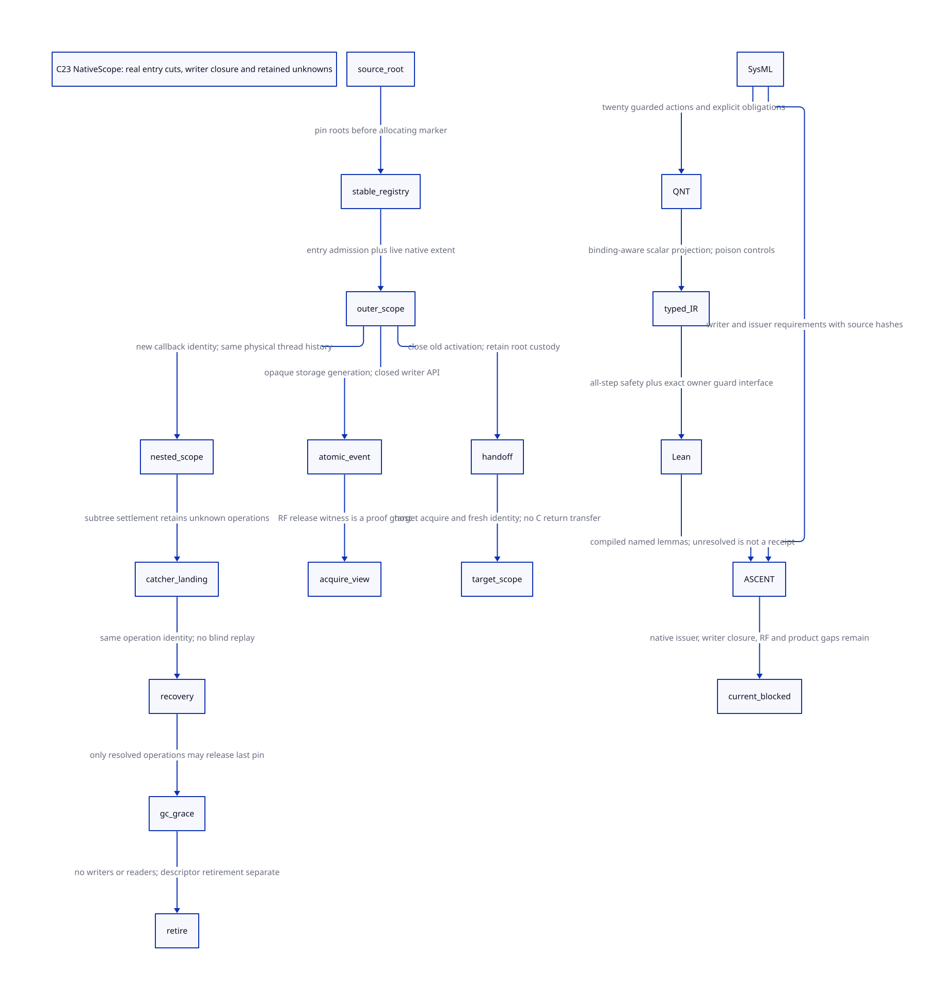

#+TITLE: C23 NativeScope issuance, native writer closure and acquire provenance
#+SETUPFILE: ../../modeling/org/setup.org
#+LANGUAGE: en
#+PROPERTY: header-args :eval never
#+STARTUP: overview

* RESEARCH Decision and relation to the modernization mainline
:PROPERTIES:
:CUSTOM_ID: native-scope-writers
:AUTHORITY: GambitNativeScopeWriters
:BASELINE: C23
:EVIDENCE_SCOPE: Local source; conditional protocol safety; no native admission
:END:

This continues [[file:future-frame-commit-design.org][the lazy-future/AtomicOwner study]] and reuses
[[file:native-return-domains-design.org][NativeThreadDomain, NativeReturnDomain and stable guard boundaries]]. A
NativeScope is a proposed temporary authorization for an admitted native
execution, not a PSTATE pointer, Scheme thread number, movable C stack, or a
credential copied out of a captured frame. Modern C remains mandatory.

The audited chain has real GC admission checks, context-bound RC banks and
catcher/marker handling. It does not yet issue the proposed NativeScope. An
architecture row naming a candidate insertion point is not an implemented
issuer. The [[file:models/sysml/native-scope-writers.sysml][native SysML package]] owns source anchors, issuer rows, writer
classes, action/proof routes, obligations, gains and diagram edges. The
[[file:../../modeling/tools/native-scope-writers-study.py][Python study driver]] evaluates SysML with the native tool, checks actual
[[file:../../modeling/ascent/native-scope-writers.rules.scm][ASCENT rules]], [[file:models/quint/native_scope_writers.qnt][QNT]] and [[file:models/lean/NativeScope.lean][Lean]], and generates the
[[file:native-scope-writers-matrix.org][matrix]] and [[file:diagrams/native-scope-writers.d2][D2]] / . Its evidence is retained in
[[file:../../../evidence/research/future-frame-commit/native-scope/checks.json][the research receipt]]. No runtime implementation, native compiler,
preprocessor, native test or performance experiment is invoked.

* RESEARCH Actual entry cuts and the joint issuer
:PROPERTIES:
:CUSTOM_ID: native-scope-issuer-cuts
:END:

** Entry before mutation, not merely before Scheme dispatch

[[file:../../../vendor/gambit/lib/setup.c::___EXP_FUNC(___SCMOBJ,___run)][___run]] checks the actual participant phase before r[0], marker and
startup ownership writes. [[file:../../../vendor/gambit/lib/setup.c::___EXP_FUNC(___SCMOBJ,___call)][___call]] checks before argument loads, return-frame
writes and catcher activation. These are distinct cuts: a scope issued only at
___call cannot authorize or roll back preceding ___run effects. The exported ___GSTATE call/run slots are assigned to these same functions in
setup.c; admission belongs below every direct/table ABI entry, while generated
pre-call local effects still need their own earlier cut. SFUN entry in
[[file:../../../vendor/gambit/include/_gambit/foreign_conversion.h.in][foreign_conversion.h.in]] obtains PSTATE, calls ___begin_sfun, and routes through
___call_sfun, ___sfun_error and ___end_sfun. Conversion-error retry is another
actual call, not a retransmission of an existing AtomicOutcome.

[[file:../../../vendor/gambit/lib/c_intf.c::___EXP_FUNC(___SCMOBJ,___begin_sfun)][___begin_sfun]] borrows a C-closure root when proc is false, allocates an RC root
bank without collection, reloads the borrowed root, then registers/borrows the
bank. ___call_sfun makes its marker from the bank's registered data slot,
rechecks admission and gates argument writes. This source protection is useful
and must be preserved. It does not cover a caller that already passed a movable
snapshot without a source lease.

The proposed issuer is joint: the source owner proves the ingress slot/storage
lifetime; VM admission proves the context/GC round; NativeThreadDomain proves the
actual thread binding; a live NativeReturnDomain proves any C return extent;
the stable guard registry records the operation identity and root/descriptor
custody. The generated adapter collects those facts before effects. Neither a
helper's name nor the TLS setter may independently sign the combined claim.
Nonallocating reservation and exhaustion handling remain required from the
prior guard work; this model starts with a valid stable root/pin registration.
It does not prove registration-before-marker-allocation. The SysML memory
rows require linearizable close/enrollment and publication of a stable outcome
before decrementing enrollment. A gate load followed by an unrelated counter
increment is not automatically such a cut. Slot reads also need exclusion from
collector relocation, not merely allocation lifetime.

** Nested Tcl callbacks expose the boundary before the bank exists

[[file:../../../vendor/gambit/examples/tcltk/tcltk.scm::___HIDDEN int scheme_call_cmd][scheme_call_cmd]] reads ClientData through ___data_rc and then calls tcltk_call.
___data_rc returns a snapshot; its gate is released before Scheme entry.
The paired scheme_delete_cmd releases the Scheme object and RC storage.
Tcl thread affinity and legal deletion concurrency must be separately
qualified; source adjacency alone is not a demonstrated race. A bank inside the later SFUN cannot establish that the earlier ClientData
storage was alive or that its payload was rooted across a concurrent deletion.
A future managed adapter needs Tcl-side callback lifetime admission plus the
Gambit source lease. This is an unresolved replacement boundary, not proof
that Tcl permits concurrent command deletion in this particular call.

Each nested callback receives a distinct scope/operation identity, parent link
and landing responsibility. The outer call remains enrolled while the inner
callback runs; closing admission does not erase that enrollment. The model
permits an outer pending operation, a nested callback, lost outer response,
subtree landing, closure and recovery in that order. Stable storage retains
roots throughout. This is a conditional landing contract: current BEGIN_TRY's
local jmpbuf and END_TRY's catcher restoration do not implement the subtree
completion service. Multi-shot Scheme restoration cannot restore its signing
right; a genuine new execution is freshly admitted, while delayed delivery
retains the old operation identity.

* RESEARCH Writer closure is per storage kind, not a list of thread names
:PROPERTIES:
:CUSTOM_ID: native-writer-closure
:END:

The SysML writer table enumerates nine required classes in the audited chain.
It is an obligation census, not a complete census of arbitrary native code.

- PSTATE/frame writes: ___run, ___call and SFUN argument/error paths require
  execution admission before their first effect.
- RC payload writes: ___set_data_rc checks the current context domain and
  rc_closed_ under rc_gate_. Root borrows separately pin the RC allocation.
- Collector writes: mark_rc requires a closed context and passes &h->data and
  the registered root span to mark_array. These are relocating slot writes,
  not task control-word updates. A VM registry must enumerate the slots into
  every relevant GC round, not merely keep the RC allocation alive.
- Callback/delete paths must close their own ingress and retain storage until
  in-flight callbacks and GC users are gone. Unknown completion retains custody.
- Task control writes are proposed private operations, including initialization,
  successful reservation/completion/commit/abort, activation/claim, and final
  generation reuse. The existing TASK_PUSH/TASK_POP remain empty.
- Generic CAS, VECTORCAS/STRUCTURECAS, arbitrary c-declare/c-lambda and foreign
  binaries are not automatically members of that managed storage protocol.
  Scheme object-valued CAS additionally needs moving-root discipline.

A closed managed control word requires opaque storage, no writable raw escape,
a generated callout inventory, an explicit initialization-before-publication
cut, and retirement that excludes all old writers/readers before address reuse.
Reset, diagnostic writes, emulated loads implemented as RMW, GC maintenance and
legacy adapter operations must be classified by actual storage and effect.
It is insufficient to count only successful desired-value CAS calls. External
code with an unrestricted alias must be excluded from the managed profile, or
closure remains unresolved. C23 atomics alone cannot enforce this encapsulation.
The rawInterference model action is policy invalidation at a quiescent cut. It
is not a detector or repair mechanism for an arbitrary C data race. An
unmediated conflicting native write invalidates the refinement premise; later
clearing a flag cannot retroactively restore correctness.

Unknown completion is not CAS failure. The proposed stable record distinguishes
not-started, pending, captured outcome and delivered outcome. The finite model
covers a recorded result with lost response and an unknown result before record.
Only the former can recover using that record. The latter remains pinned; no
invented reconciliation oracle or timeout frees it. The protocol proves safety,
not wait-free recovery or bounded memory under permanent failure. Outstanding
same-generation concurrent operations additionally need distinct OperationIds;
the model has one outer pending operation and one nested extent, not an unbounded
operation table.

* RESEARCH Migration, coherence and reads-from
:PROPERTIES:
:CUSTOM_ID: native-scope-rf
:END:

[[file:../../../vendor/gambit/lib/os_thread.c::void ___thread_set_pstate][___thread_set_pstate]] installs TLS/PSTATE and affinity. The
[[file:../../../vendor/gambit/lib/_thread.scm::(macro-thread-pinned stolen-thread)][steal path]] skips pinned threads. Neither transfers a live C invocation.
The proposed migration closes the old activation after its pending operations
and nested extents settle, retains roots/descriptors, publishes a handoff,
and admits a fresh target scope only after target acquire. Scheme work may
move; old C return permission does not. Unknown old execution blocks that
cut. An eventual independent-native-stack design needs its own adapter.

Same physical thread plus same atomic object must retain/join its coherence
history across nested callbacks and scope renewal. Distinct role-local flags
must not reset that history. Another physical thread gets its own history and
must acquire the handoff; copying a source view or floor is not synchronization.
This finite policy revokes the current view at nested entry. That is a
conservative design choice, not a C23 requirement to add an acquire on every
callback; retaining a still-valid outer view would need a separate extent and
writer-interference proof. The model keeps floor0 across renewal/nesting, clears the capability during
handoff, requires targetAcquire, and retains the old recorded response generation
so a delayed old delivery cannot settle a new pending operation.

[[https://www.open-std.org/jtc1/sc22/wg14/www/docs/n3096.pdf][WG14 N3096, 5.1.2.4 paragraphs 7–11, 27 and 31; 7.17.7.4]] is the C23 working-draft
basis, not a copy of final ISO text. Release/acquire synchronization depends on
which write the acquire reads from, on the same atomic object. A numeric result,
a successful CAS Boolean, PSTATE identity, or an added acquire fence does not
supply an event identifier. CAS failure order and expected-after behavior must
match the actual selected adapter; the prior AtomicOutcome study retains these
branch distinctions. The existing native ___WORD_CAS_ACQUIRE requests success
acquire and failure relaxed. It cannot serve unchanged as a release publisher
or as an acquire-on-failure observation.

The proof relation must connect (storage identity, generation, modification
event, release-sequence head, actual thread, acquire event) to the view used by
AtomicOwner. Its rf/observed fields are ghosts. A native proof may use a closed
writer roster and a monotone, nonreset generation to show that every possible
source event for an observed state is covered by the required release head.
It need not read a hardware event ID. That argument fails if an unqualified raw
store, generation reuse, same-value writer outside the release sequence, or
unregistered object alias is possible. A mutex branch needs the same actual
mutex and all-access discipline; an empty legacy fence is insufficient.

Lean's SourceKeyMatches checks event-key agreement only. It does not assert
actual reads-from. The equal-value counterexample uses distinct generations
and events with identical numeric values. Full C23 execution-graph refinement,
including RMW/release-sequence and failed-operation observations, remains open.

* RESEARCH Formal composition and retained counterexamples
:PROPERTIES:
:CUSTOM_ID: native-scope-proof-boundary
:END:

The restricted projector resolves the actual typed QNT binding table, exact
26 state fields and complete twenty-action roster.
It rejects poisoned binding, field type, step roster and expression inputs.
Lean proves initial safety, each action's preservation and induction over all
finite reachable traces. Separate lemmas retain unknown roots, forbid retirement
with pending/nested work, preserve same-thread floors and revoke migration views.
The bounded histories exercise five paths, including unknown-before-record.
Here retire is a local native detachment abstraction with no external scanner
or descriptor reader represented. It is not a VM-wide reclamation permission.
Its root/pin removal requires an additional GC-round grace composition before
it could authorize physical release; that composition stays unresolved.
The negative checks establish each original prefix before deliberately asking
for the forbidden admission conclusion; they do not alter runtime behavior.

The actual AtomicOwnerAst is compiled as a dependency. a0Authority maps CanUse
and an explicit field link to its owner view/generation half;
activationNeedsScopeHalf checks that half against the actual activateA0Guard.
This is an interface lemma. It does not supply the rest of the activation guard,
prove all-owner coverage, or establish a synchronized product Step. SysML keeps
that product obligation unresolved. It also keeps native issuer, writer closure,
actual RF, catcher landing and GC grace unresolved. ASCENT's synthetic-all
scenario checks DSL routing only; current evidence must remain blocked.

The six admissibility counterexamples reject recovery before record, retirement
before drain, target entry before acquire, raw writer escape, reuse of an outer
view after a nested callback, and treating stale delivery as settlement of a new
pending operation. They are finite safety checks, not native executions.

* RESEARCH Paper facts, architectural inference and return
:PROPERTIES:
:CUSTOM_ID: native-scope-return
:END:

Feeley and Miller's [[https://www.iro.umontreal.ca/~feeley/papers/FeeleyMillerLFP90.pdf][PVM paper]], especially lazy parent materialization, supplies
the capability to amplify. [[https://www.schemeworkshop.org/2000/feeley.ps][Feeley's first-class continuations and C paper]]
distinguishes Scheme extent from native dynamic extent; its separate native
segments are a proposal, not an implemented C23 guard protocol. Retained local
paper bytes anchor this distinction. The explicit NativeScope issuer, opaque
writer API and recovery records are our derived architecture and remain subject
to proof. Modern mechanisms do not erase Gambit's multi-shot semantic choices.

The [[file:native-scope-writers-matrix.org][benefit matrix]] counts mechanisms, not person-days or invented speedups.
Migration adds at least one source release publication and one target acquire;
registration/GC costs are additional. Stable pending storage is O(K) for K
outstanding operations; a permanently unknown operation can retain resources
indefinitely. A per-thread/per-object floor is proof/history state, not necessarily
a new runtime table or RMW per read. Writer closure can remove ad-hoc control-word
wrappers only after the private API replaces every writer. It cannot retire the
generic public CAS ABI or all RC support. Currently zero native paths retire.
Zig provides no additional correctness theorem for these mechanisms; its
incremental value must exceed a C23 implementation's existing capabilities.

* RESEARCH Joint native entry cuts and root custody
:PROPERTIES:
:CUSTOM_ID: joint-native-entry-cuts-link
:END:

[[file:native-entry-admission-design.org][Joint native entry admission]] follows ___run, SFUN and Tcl to pre-registration
roots, acknowledged publication, ingress closure and scanner grace. Its
[[file:native-entry-admission-matrix.org][SysML-derived matrix]] includes actual QNT/Lean and ASCENT routes. The fresh
NativeScope Step join is conditional; native integration and full restored-state
composition remain unresolved. No runtime path is retired.
