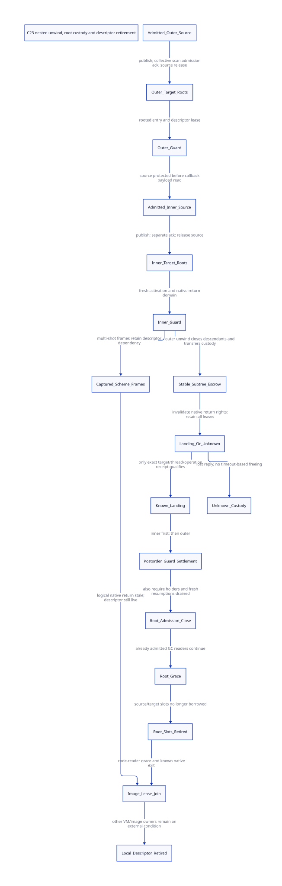

#+TITLE: C23 nested native return domains, ingress roots and GC retirement
#+SETUPFILE: ../../modeling/org/setup.org
#+LANGUAGE: en
#+PROPERTY: header-args :eval never
#+STARTUP: overview

* RESEARCH Decision: unwind changes authority before it changes custody
:PROPERTIES:
:CUSTOM_ID: nested-domain-root-retirement
:AUTHORITY: GambitNestedDomainRootRetirement
:BASELINE: C23
:EVIDENCE_SCOPE: Local vendor source, joint bounded protocol and research interpretation
:END:

An outer native unwind invalidates the return targets of the affected inner
native extents. It does not establish that their cleanup executed, that their
Scheme roots are dead, or that their frame descriptors can be unloaded. Before
the physical transfer, close affected descendant entry and publish a stable
subtree escrow retaining root and code responsibilities. Settle each activation
only after an identified landing, then retire root slots and descriptors through
separate reader/holder closure.

This is an architectural replacement for implicit native-stack ownership. It
preserves Gambit's portable Scheme control, tail calls and multi-shot
continuations while making lifetime coordination usable by independent execution
contexts. C23 is the required implementation baseline. This study implements
formal research models and evidence tooling only; no runtime or native test runs.

The [[file:models/sysml/nested-domain-root-retirement.sysml][native SysML package]] owns components, source anchors, issuers, cross-component
contracts, proof routes, memory obligations and benefit rows. Python orchestrates
the native evaluator and formal tools. The [[file:nested-domain-root-retirement-matrix.org][matrix]] and [[file:diagrams/nested-domain-root-retirement.d2][D2]] /  are derived
views, not independent layout authorities.

* RESEARCH Implementation authority and research basis
:PROPERTIES:
:CUSTOM_ID: nested-domain-basis
:END:

** Fixed local source, with content identity

Implementation claims use the current local vendor/gambit files, including the
modular headers. The repository is dirty; HEAD alone does not identify those
files. The receipt binds each actual file hash, anchor text and line location,
plus the runtime/header composition inherited from the parent study. Local rg
searches locate callers within that source. External literature supplies design
arguments and semantic comparisons, never a substitute vendor implementation.

The parent [[file:native-return-domains-design.org][native-domain study]] deliberately left admission/roots/retirement
composition open. This study puts those responsibilities in one transition state.
It does not establish a refinement simulation from every historical model or from
the C runtime into that joint state.

** Gambit research, then contemporary mechanisms

[[https://www.schemeworkshop.org/2000/feeley.ps][Feeley's continuation/C paper (2000), sections 1–5]] distinguishes Scheme
continuation extent from native C extent. Its lazy-deallocation discussion
permits logical Scheme restoration after a native target becomes stale; the error
occurs on an attempted native return. Its independent-native-stack proposal
addresses ordering between segments and was not implemented then. Our inference
is to retain the semantic distinction while making native extent ownership and
reclamation explicit. The original PostScript is locally preserved and hash
checked; web rendering failed in this study. Historical timings are not reused.

[[https://www.iro.umontreal.ca/~feeley/papers/FeeleyMillerLFP90.pdf][Feeley/Miller PVM (1990), section 2]] motivates front/back-end cooperation.
NativeEntrySpec and FrameSpec should carry semantic intent and root/descriptor
requirements out of Scheme compilation. Current C emitters should not silently
reconstruct that information from local macro ordering.

[[https://anil.recoil.org/papers/2021-pldi-retroeff.pdf][OCaml effect handlers, PLDI 2021, sections 3.1 and 5.3]] gives explicit system/fiber
stack and callback transitions. Its one-shot effects do not cross C frames; those
restrictions are not adopted for Gambit. We learn the value of specifying stack
boundaries and preserving handler state, without transferring benchmark results.

[[https://cisco.github.io/ChezScheme/csug10.3.0/foreign.html][Chez's foreign interface, section 4.4]] documents stale foreign targets after
return to a lower context while Scheme continuation use remains possible. Its
callback example also explicitly retains callback code. These observations
reinforce separate native-target and code-object lifetimes; they do not prove
our Gambit adapters.

[[https://www.open-std.org/jtc1/sc22/wg14/www/docs/n3096.pdf][WG14 N3096, C23 working draft, 7.13.2.1]] restricts longjmp to the appropriate
thread and a still-live setjmp invocation. A transfer to an earlier native frame
can end intervening invocations. Heap guard persistence does not extend their
lifetime. Section 5.1.2.4 provides publication ordering, not automatic memory
reclamation. The draft is public evidence, not the final purchased ISO text.

* RESEARCH Actual unwind and descriptor consumers
:PROPERTIES:
:CUSTOM_ID: nested-domain-source-path
:END:

** Source-grounded nested chain

| Step | Local producer/consumer | Consequence |
|------+-------------------------+-------------|
| Native callback | examples/tcltk/tcltk.scm scheme_call_cmd reads data_rc then calls tcltk_call | Source storage must be admitted before this raw read |
| Generated wrapper | gsc/_ptree2.scm c-function emits BEGIN_SFUN_BODY and SFUN_CALL | BEGIN_SFUN_BODY itself is empty in the current header |
| Scheme entry | foreign_conversion.h.in BEGIN_SFUN allocates a marker and calls ___call | Root protection must precede marker allocation |
| Native destination | _kernel.scm return handler checks processor and marker validity | Return permission is narrower than Scheme resumption |
| Inner propagation | setup.c ___call exits its TRY, compares destination marker, and throws again on mismatch | Its prior catcher is restored before propagation |
| Wrapper cleanup | END_SFUN invalidates the marker after the SFUN_CALL path | Existence of this sequential code is not proof it executes on every outer unwind |
| Intervening native call | _ptree2.scm selects CFUN BODY_CLEANUP according to parameter cleanup requirements | Some intermediate paths install additional catchers; not every call has the same chain |
| Outer landing | ___run has an enclosing TRY and marker cleanup after END_TRY | A real landing exists, but no current stable subtree-completion signer is established |

The trace establishes a source-level bypass possibility for a wrapper tail when
___call rethrows to an outer catcher. It is not a report of a reproduced leak,
corrupted marker or Darwin binary failure. Complete generated/type-specific
catcher paths and conversion-error callbacks still need qualification.

Marker validity and marker storage must also be separated. The current
kill_sfun_stack_marker helper both clears the validity element and decrements a
still-object reference. A managed subtree adapter needs an exact-once MarkerLease
per affected activation: publish stable root coverage, invalidate the native
return target, and discharge the owned storage reference only through its
qualified completion path. Captured Scheme frames may still reference the
invalid marker. The model proves abstract return-right revocation and guard
settlement, not that concrete refcount/slot-update refinement; the helper cannot
yet retire.

** Roots and descriptors outlive native return authority

[[file:../../../vendor/gambit/lib/c_intf.c][Marker-from-root]] reloads *proc_root after allocation. Its local-address legacy
wrapper does not turn a raw Scheme value into a registered root. The current
[[file:../../../vendor/gambit/lib/_mem/root-origins.inc][context root consumer]] scans continuation frames, registers, saved registers,
startup_thunk, entry_marker and context RC lists. A new VM guard/root registry
needs an explicit adapter into those real consumers.

[[file:../../../vendor/gambit/lib/_mem/continuation-roots.inc][Continuation scanning/copying]] reads RETI/RETN label descriptors and holds frame
access. [[file:../../../vendor/gambit/lib/_mem/object-scanning.inc][Captured-frame scanning]] also decodes label metadata after a frame has
moved to the heap. Therefore invalidating a native marker cannot revoke those
metadata readers. Neither a frame-access lock nor marker refcount is a complete
module-image lease.

[[file:../../../vendor/gambit/lib/os_dyn.c][The loader's cleanup]] traverses its dynamic image list and calls platform unload
operations. This is not a per-return-domain unload permit. Other VMs, permanent
raw pointers and maintenance tasks remain part of the global image ownership
problem, outside the bounded local proof.

* RESEARCH Joint protocol and its real signers
:PROPERTIES:
:CUSTOM_ID: nested-domain-protocol
:END:

** Separate handoff for each accepted entry

1. An already protected outer source offer publishes target root slots and code
   leases. A qualifying registry/GC-admission acknowledgement precedes source
   release and outer application entry.
2. The inner callback obtains its own protected source offer from a rooted outer
   context. Publish inner target slots, acknowledge them, release the inner source,
   then allocate/enter the inner marker/guard. Outer root coverage is insufficient
   evidence for a newly created inner root schema.
3. A lost publication reply retains the outer source. The published target can
   still be scanned while its reply is missing. Query the same operation; do not
   register it again under a new identity or free an ambiguous target.

The formal initial source is an admitted premise. reserveInnerOffer represents
a valid protected producer slot; it does not prove safe first access to arbitrary
ClientData. Source-pin issuance, every alias/writer and nonzero-processor adapter
remain native qualification requirements.

The model only acknowledges a new target with no admitted modeled GC reader.
The real implementation must serialize registration with the snapshot boundary
and include it in subsequent rounds. Reading a counter as zero is not such a
receipt. Alternative late-registration delivery during a round needs a separate
refinement and is not silently assumed.

** Outer unwind: fence, escrow, transfer, land, settle

- The owning thread identifies the exact affected descendant set, closes new
  native return/entry for that set, and retains every associated root and image
  lease. Scheme winding callbacks must finish or reenter through qualified fresh
  activations before this final non-local transfer cut.
- Private preparation retains existing native rights and source custody. An
  allocation/metadata failure before publication must roll back privately; no
  live source is freed. This preparation is outside the atomic modeled cut.
- Publish a stable operation record containing native thread incarnation,
  destination catcher/frame incarnation, subtree identities and activation
  tickets. Atomic publication of that record is the abstract escrow cut. Two
  unrelated guard stores are not an implementation of one atomic transaction.
- Issuing the transfer invalidates both modeled return authorities. Inner and
  outer guards become escrow-owned; their rooted values remain scan-visible.
  Never inspect a discarded local C guard/catcher after the transfer.
- A landing receipt must identify the same operation, thread, target frame and
  subtree. Unknown delivery retains both guard responsibilities and leases.
  Timeout, marker false or a missing callback does not establish landing. No
  retry of an arbitrary longjmp is authorized by missing acknowledgement.
- On known landing, settle inner before outer. This conservative postorder
  prevents parent retirement while child cleanup responsibility remains. Native
  resource cleanup may itself produce work or reenter; it must be carried by the
  stable coordinator, not by already-discarded automatic storage.

The current code does not issue these receipts. Their proposed and actual source
roles, plus the outstanding obligations, are native SysML rows in the matrix.

** Captures, GC readers and final retirement

The captured Scheme continuation can execute again under a new activation ticket
after native landing. Its attempted return to the expired inner native extent
still fails. Neither fresh execution nor GC scanning revives the return right.
This bounded scenario schedules resumptions after known landing; it does not
change Gambit's general continuation semantics or forbid independent Scheme work
while a different native operation remains outcome-unknown.

Close future root admission only after all modeled guards settle and all captured
holders/fresh executions drain. This closes this obsolete bundle to new snapshots,
not the VM's GC service. Already admitted scanners continue and retain their
slots and descriptor leases. Those slots must belong to VM-stable storage, not
the discarded C automatic frame or an exited PSTATE. Their completion cannot depend on the guard being
freed: that would create GC→guard→GC waiting.

Root slots retire after source release, admission closure and root-reader grace.
Descriptor retirement additionally requires code-reader grace and native/captured
frame closure. A general runtime can retire some root storage while unrelated
code/frame leases remain; this conservative model waits for captured holders
before closing its aggregate root bundle. No prompt-reclamation optimum is claimed.
Native thread detachment requires the local root/code obligations to be retired.
Global image unloading still joins every other VM and image owner.

* RESEARCH Executable QNT and Lean composition
:PROPERTIES:
:CUSTOM_ID: nested-domain-formal
:END:

[[file:models/quint/nested_domain_root_retirement.qnt][The QNT state]] contains separate outer/inner source delivery, return permissions,
activation guards, captured holders, one GC reader and descriptor/root closure.
Its 25 integer fields and 84 conjuncts describe a bounded product with 33 actions,
not a list of one prescribed history. GC start/finish can interleave with
publication, unknown replies, unwind, landing and admission closure. Nine explicit
histories exercise those orders, including two restorations and code grace before
root-slot retirement. Random bounded traces supplement them.

The [[file:models/lean/NestedDomainAst.lean][Lean AST]] is extracted from QNT typed IR. [[file:models/lean/NestedDomain.lean][Lean]] proves every action preserves
the joint invariant and derives reachable-state safety. Component properties
cover both entry handoffs, descendant invalidation, unknown custody, captured and
scanner descriptor pins, postorder settlement and retirement cuts. Relational
step obligations also track irreversible return invalidation and fresh ticket
increments. They do not prove actual GC pointer relocation or C instructions.

Four countercontrols alter the actual projected protocol: drop inner target
coverage during source release; treat the inner guard as settled before landing;
free the descriptor at native landing; acknowledge root grace with an admitted
scanner. Each supplies a checked prestate and mutated guard/transition, and must
fail the positive safety assertion. Four typed-IR corruption controls remain
separate from these protocol counterexamples.

The [[file:../../modeling/ascent/nested-domain-root-retirement.rules.scm][ASCENT DSL]] joins source hash/needle, component owner, QNT action, compiled Lean
lemma and issuer obligation. Six additional composition joins relate both sides
of a cross-component dependency to a shared proof and contract. A wrong
composition lemma must block candidacy. These joins establish traceability to a
compiled property; the property/source interpretation is reviewed input, not an
automatically verified source-refinement theorem. Only synthetic-all may qualify;
actual native receipts remain absent.

** Failure evidence and proof boundary

The first proof organization left goals unclosed. A later monolithic proof hit
the unchanged 60-second tool limit. Both source/log snapshots are retained.
An additional relational proof hit the default heartbeat budget. The revised
proof exposes invariant conjuncts explicitly and separates ticket arithmetic
from the already-proved step result. Limits are unchanged; bounded random
testing does not substitute for induction.

| Layer | Established by this study | Still open |
|-------+---------------------------+------------|
| Local source | Exact pinned consumer/producer anchors and conditional catcher paths | Every configured/generated native path and raw alias |
| Joint protocol | Bounded all-action preservation in shared state | Arbitrary nesting, many concurrent GC readers and unbounded tickets |
| Entry roots | Conditional outer/inner target acknowledgement before application use | Real producer first-pin, per-round registrar/scanner protocol and moving-slot updates |
| Unwind | Descendant rights revoked while stable custody remains | Exact native landing signer, asynchronous cancellation and partial escrow publication |
| Code/GC retirement | Captured frames/readers prevent local descriptor retirement | Global image group, cross-VM and permanent raw-pointer closure |
| C23 | Explicit release/acquire and ownership obligations | Actual instructions, data-race freedom, ABA and lifetime refinement |
| Parent models | Named shared contracts and six semantic route joins | Formal simulations from both parent protocols into this product |
| Progress | Admitted GC reader can finish independently of guard settlement | Fairness, unknown-result reconciliation and bounded retained memory |

* RESEARCH Net return and replacement sequence
:PROPERTIES:
:CUSTOM_ID: nested-domain-net-return
:END:

Let d be the number of invalidated native descendants, S the protected root slots,
F retained captured frames, I registered image/descriptor leases and Q outstanding
operation receipts. A direct subtree cut requires O(d) ownership/lease handling;
root scanning visits S admitted slots per round. Proposed retained metadata is
O(d+S+F+I+Q), plus actual pinned native-stack memory and Scheme frame/object payload bytes. This is design accounting,
not measured execution time, nor a proven storage bound for unlimited programs.
Unknown native outcomes may retain resources indefinitely.

| Target | Concrete return | Added work | Positive-return condition / falsifier |
|--------+-----------------+------------+---------------------------------------|
| Multi-shot control | Retain Scheme resumability with explicit stale-native-target rejection | Fresh guard/ticket and frame/code leases per resumption | No native stack resurrection; semantics must refine existing Scheme observations |
| Native lifetime | One stable subtree ledger can replace scattered implicit cleanup ownership | O(d) closure/transfer plus acknowledgement traffic | Old ownership paths actually retire; stacking the ledger on them is not a demonstrated saving |
| GC cooperation | Already admitted scans complete while native completion remains unknown | S-slot scans, registry/pin publication and grace handling | Complete roots and no cyclic waiting; no claim of fewer existing scans |
| Independent sessions | Explicit entry/lifetime schema removes one architectural obstacle to safe scheduling | Owner-thread pin occupancy and independent context state | Compiler shared-state and scheduler closure still required; no 12-core throughput claim |
| Descriptor reuse | Captured Scheme code remains reusable after native target expiry | F/I/Q retention until exact closure | No unload while any reader/holder exists; retaining everything forever fails progress goals |
| Zig increment | No necessary semantic support removed by Zig has been proved | Same source, root, unwind and image-lifetime machinery | C23 remains sufficient; language substitution alone establishes no extra net return |

The detailed generated matrix is authoritative for component conditions. Current
Gambit already avoids copying arbitrary C stacks and does not create one OS thread
per continuation restoration. Neither is booked as a new saving.

Retirement order: generated entry/root adapters; stable unwind-subtree coordinator;
landing/exception adapters; GC bundle enumeration and close/grace; descriptor/image
lease join; then old implicit ownership assumptions. Preserve real portable C
calls, Scheme control and safety checks until replacements qualify. This study
retires zero native paths and makes no measured performance claim.

* RESEARCH Evidence and next decisive obligation

- [[file:../../../evidence/research/nested-domain-root-retirement/checks.json][Formal result and explicit native gaps]]
- [[file:../../../evidence/research/nested-domain-root-retirement/source-witnesses.json][Vendor source anchors and hashes]]
- [[file:../../../evidence/research/nested-domain-root-retirement/ascent-results.json][Component and composition joins with negative controls]]
- [[file:../../../evidence/research/nested-domain-root-retirement/input.json][Input, parent and runtime-composition binding]]
- [[file:../../../evidence/research/nested-domain-root-retirement/countercontrols.json][Altered-protocol countercontrols]]

The next proof must refine subtree escrow to actual catcher/guard publication and
combine the root registrar with real moving-GC slot updates. It must explain how
partial preparation is retained without accessing discarded native storage, and
how a last-holder receipt excludes late FFI aliases. Those are architectural
qualification gaps, not configuration-selection tasks.
