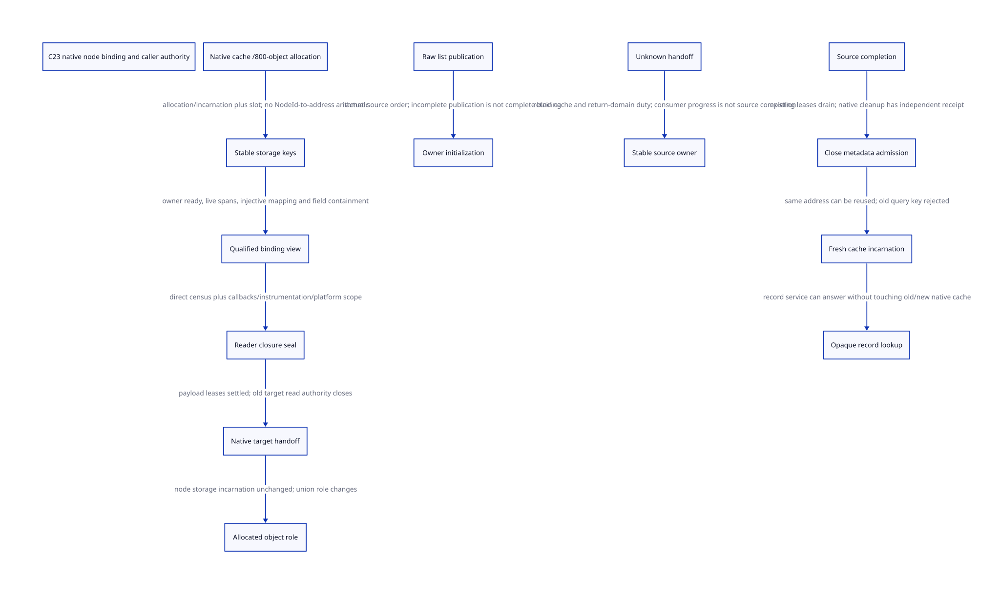

#+TITLE: C23 logical node identity, native storage footprints and reader closure
#+SETUPFILE: ../../modeling/org/setup.org
#+LANGUAGE: en
#+PROPERTY: header-args :eval never
#+STARTUP: overview

* RESEARCH Decision and authority
:PROPERTIES:
:AUTHORITY: GambitNodeStorageAuthority
:STATUS: conditional identity/interval/model proofs; whole native closure unresolved
:CUSTOM_ID: node-storage-authority
:END:

Refine [[file:putobjs-move-graph-design.org][PutObjs / MoveObjs graph]] without equating logical list position with
native pointer arithmetic. Use allocation identity/incarnation plus slot identity;
qualify native field footprints separately from graph edges and role permissions.
Stable metadata lookup is different from dereferencing a cache or transferred
Tcl object. The C23 architecture must make these distinctions explicit.

[[file:models/sysml/node-storage-authority.sysml][Native SysML]] owns sources, writer/consumer/issuer contracts, action/lemma
and refinement routes, obligations, benefits and graph edges. [[file:node-storage-authority-matrix.org][Org matrix]] and
 are native SysML projections. [[file:models/quint/node_storage_authority.qnt][QNT]] describes the proposed registration,
lease, handoff and retirement protocol; its typed IR generates [[file:models/lean/NodeStorageAuthorityAst.lean][Lean AST]].
[[file:models/lean/NodeStorageAuthority.lean][Lean]] imports the source-bound prior graph proof and proves the new interval,
identity and native-edge transport lemmas. [[file:../../modeling/ascent/node-storage-authority.rules.scm][ASCENT DSL]] checks writer/source and
refinement contracts as well as actions/lemmas. [[file:../../../evidence/research/future-frame-commit/node-storage-authority/][Evidence]] retains hashes, controls,
prior-proof reuse receipts and failures. No runtime implementation, native
compiler/preprocessor, native test or performance measurement is performed.

* Native allocation does not encode logical NodeId
The fixed local Tcl sources remain commit cbf86d62348d6b052e1961b4df995960fb21545f.
The public tcl.h capture is independently checked against the retained same-commit
Git tree blob and size; no new network request or loaded-binary qualification.

TclThreadAllocObj refills through TclpSysAlloc(sizeof(Tcl_Obj)*numMove,0), with
NOBJALLOC800. Cache metadata is separately allocated as sizeof(Cache). A free
list of1201 nodes may combine and reorder nodes from multiple800-object batches.
The graph's logical labels1..1202 are list identities, not array indices in one
contiguous native allocation. Even adjacent logical nodes may be in different
chunks, and any later free/transfer can change list order independently of storage.

Proposed binding data:

#+begin_example
StorageKey = (allocatorDomain, AllocationTicket, allocationIncarnation)
NodeBinding = (StorageKey, slotIndex, storageClass)
NodeTable[NodeId] = NodeBinding
CacheKey = independently registered cache allocation/incarnation
RoleLease = (binding, roleEpoch, owner, permittedFields, lifetimeAuthority)
#+end_example

A slot is relative to its actual chunk and must fit its live allocation and
actual object stride. Only that allocator-owned binding can resolve native storage.
Do not compute base+(NodeId-1)*sizeof(Tcl_Obj), merge all chunks into one apparent
span, or derive a new key by reading an old pointer after storage retirement.
NodeTable denotes a semantic relation, not a mandatory per-node hash table.
A live chunk registry plus allocation-key/slot IDs can represent that relation
without duplicating a complete address record for every node. Per-node role/lease
state is needed only where the supported operations require it; deriving a slot
address within its own live qualified chunk is different from arithmetic on
logical traversal order. Reverse pointer lookup still needs source authority and
incarnation checks, so an address-range hit alone is insufficient.

Logical traversal, allocation incarnation, payload role epoch and cache incarnation
are independent. Allocating a cached Tcl object or overlaying an NR callback does
not itself prove native free or a new C allocation lifetime.

Current Tcl code has no installed AllocationTicket/NodeTable issuer. The candidate
actual issuer is the admitted native allocator owner around allocation success,
while the source/storage is still protected, before publication or role handoff.
Metadata failure/unknown registration retains source responsibility; it cannot be
repaired by walking transferred payloads later. Root/guard registration and the
non-abandoning allocation-return window remain inherited unresolved contracts.

* Field separation: what follows and what does not
** Disjoint live allocation regions
Cache.lastPtr is a field of Cache; a node's internalRep.twoPtrValue.ptr1 belongs
to separately allocated Tcl_Obj storage. If both fields lie within their own live
allocation intervals and those intervals are disjoint, subfieldsApart proves the
field intervals are disjoint. This needs no fabricated sizeof/offsetof numbers.
It does require the actual allocator's live-allocation/nonoverlap contract, correct
binding/slot/field bounds and a valid C23 access path. Integer interval arithmetic
is not a proof of C pointer provenance or effective type.

** Deliberate overlap and legacy type views
Tcl_Obj.internalRep is a union. longValue, doubleValue, otherValuePtr and the two
pointer representation intentionally share storage. NRE_callback reuses a
Tcl_Obj-sized allocation and writes procPtr/data/nextPtr. Different field names
or roles therefore cannot establish byte disjointness. Size fit is not exclusive
ownership or a generic effective-type proof. The unit-span negative control is
mathematical and supplies no target ABI size.

The full private Cache includes lastPtr and buckets; AllocCache in tclInt.h is a
separate prefix struct ending at numObjects. The source comment requiring matching
prefixes is not a general C23 strict-aliasing/common-prefix authorization outside
its permitted contexts. Actual loaded flags, layout and valid access assumptions
remain unqualified. The new architecture should use one canonical storage schema
and typed accessors/field-role descriptors; retire duplicate prefix casts only
after all macro/FFI consumers and ABI contracts have migrated. Configuration alone
cannot remove this duplicated layout responsibility.

* Actual direct reader/writer census
The driver records every lexical arrow access to Cache.lastPtr in the captured
allocator file, associates it with the reviewed function and rejects a new function
outside the reviewed set. It separately checks Tcl_GetMemoryInfo contains no such
access. This is a complete textual census for that member spelling in that file,
not a C AST alias analysis, preprocessed macro proof or whole-repository callgraph.
Whole-object memset and bucket.lastPtr have their own classifications.

| Actual source | Direct access/effect | Remaining scope |
|---------------+----------------------+-----------------|
| GetCache | whole Cache memset; list insertion, owner and TLS publication | allocator/init mutex/TLS targets; publication window |
| TclThreadAllocObj | cache lastPtr on refill, native object link initialization/pop | system allocator, panic and selected profile |
| TclThreadFreeObj | lastPtr when previously empty, then possible PutObjs | thread/cache identity and helper effects |
| MoveObjs | destination lastPtr and transferred node link | shared mutex/provider and destination owner |
| PutObjs | old-tail target under lock; final cache field overwrite | no target read after unlock in this function |
| Tcl_GetMemoryInfo | owner/nextPtr and bucket counters, formatting and DString calls | indirect allocation/provider/reentry effects |
| TclNRRunCallbacks | interior data-array alias passed to procPtr, then node free | every actual proc, nested evaluation, continuation/escape |
| TclNewObj / Tcl_ObjType | allocated-object field writes, type callbacks, optional trace hook | custom extension and instrumentation closure |
| TclFreeAllocCache / thread finalizer | bucket and object flush, list unlink, native free/TLS delegation | full keep0/platform cleanup and borrowed aliases |

Tcl_GetMemoryInfo does not directly read Cache.lastPtr or its Tcl_Obj target. Its
listLockPtr covers list traversal, not proof of every bucket field's synchronization
or any DString/provider effect. Do not invent a direct diagnostic old-tail reader;
do not infer a globally effect-free diagnostic from the absence of that expression.
Ptr2Block's panic path concerns bucket Block headers, not a demonstrated read of
the Tcl_Obj free-list tail. Block headers and800-object allocation chunks are
separate storage classes despite both being informally called blocks.

* Callback aliases and instrumentation
TclNRRunCallbacks passes callbackPtr->data to procPtr before TCLNR_FREE. Tcl_NRPostProc
accepts a ClientData array; this is a real interior pointer to storage later reused
by the small allocator. A C callback can copy it, but that fact is not permission
for legal dereference after return/free. Managed admission must prove nonescape,
copy needed data into independently owned/rooted carriers, or refuse that callback
profile. The model's alias/revocation branch retains responsibility and refuses
handoff qualification; it does not detect arbitrary native pointer copies.

Public Tcl_ObjType hooks can manipulate an allocated object's representation.
TclNewObj invokes TCL_DTRACE_OBJ_CREATE; enabled provider implementation and loaded
configuration are not present in this local closure. A macro declaration cannot
prove the hook does not retain, inspect or reenter through the pointer. Unsupported
or unknown hooks keep global reader/writer closure unresolved.

The real Gambit Tcl bridge uses data_rc for its Scheme vector, string argv and
string-result ownership. That body does not directly receive Cache.lastPtr or an
NR data-array pointer. This narrower fact does not close indirect Scheme/Tcl
execution, delete callbacks, custom object types or instrumentation. RC roots and
string ownership keep their existing separate contracts; they are not native node
storage bindings or substitutes for cache lifetime evidence.

* Publication, revocation and address reuse
GetCache zeroes and links Cache under listLockPtr, unlocks, then sets owner and
TclpSetAllocCache. A raw list entry can therefore be visible before owner setup is
complete. Tcl_GetMemoryInfo reads owner under the list lock; the initializer's
later owner write is outside that list lock. This identifies a source ordering
window, not a qualified legal concurrent execution or a proved C23 data race.
Caller/platform admission must settle reachability and synchronization.

The C23 replacement should construct a private typed cache/binding view and publish
a Ready entry after owner/storage initialization, or expose an explicit Initializing
entry that every consumer must reject until Ready. Zero owner is not a readiness
receipt. This construction/publication boundary replaces an implicit list-membership
assumption; it is not a compiler-flag change. Retiring the old ordering requires
all diagnostic/TLS/cache constructors and destructors to use that shared contract.

The proposed binding issuer waits for initialized owner, live allocation/layout
witness, injective NodeTable and reader closure. Raw list publication cannot issue
that receipt. Metadata leases do not grant payload access. All payload leases must
be settled or explicitly transferred before shared handoff; after handoff, even
an object still in a free list is no longer readable through the old owner's role.
New alias evidence revokes the reader seal before handoff; unknown raw aliases
cannot simply be ignored by a cache-hit or synthetic qualified row.

Unknown source completion retains the source cache/return-domain duty. Consumer
allocation changes object role without changing the original native chunk's
allocation incarnation. Known source completion allows closing metadata admission;
existing leases drain before qualified native cleanup and cache retirement. Cache
address reuse obtains a fresh CacheKey; old query incarnation is rejected. The
independent opaque record remains readable without touching either native cache.

The finite model keeps one stable record alive and never reuses it. Record
compaction, ID exhaustion/wrap, arbitrary callbacks, raw aliases, process shutdown
and persistent service capacity remain separate obligations. Exact same-address
reuse is not proved by observing native allocations; the generation witness is a
logical case split. No typed stale pointer comparison is needed to query that key.

* Mathematical bridge and model evidence
StorageKey and NodeBinding distinguish allocation incarnation and slot from list
position. bindingIdentity derives distinct bindings from an injective map;
freshIncarnation proves different incarnations cannot be the same key. subfieldsApart
proves containment transfers whole-region disjointness to the selected fields;
unionRoleNotApart rejects separation of the same nonempty interval.

NativeRel requires an injective NodeId-to-binding function and a native link-read
witness for the selected live graph nodes. walkToNative composes that witness with
the prior canonical graph/MoveObjs cursor lemma: the native binding's observed edge
is the encoding of the QNT successor. This is conditional semantic transport; it
does not construct a real address table, validate actual offsetof values or prove
all native writers preserve the relation. Access authority and stable storage must
also hold; rawNext is not permission to read reinitialized payload bytes.

QNT models raw visibility versus initialized binding, externally attested layout,
reader seal/revocation, independent metadata/payload leases, known/unknown handoff,
object-role changes and cache-generation reuse. The prior initializeTailPayload
Guard/Step is joined under an explicit tail-allocation mirror, not a full product
simulation. The prior graph proof objects are reused only after checking current
source hashes, artifact manifest and the exact Lean binary; this is proof reuse,
not native runtime cache qualification.

The [[file:../../../evidence/research/source-references/feeley-sfp/8bb2fae8ae4b54d3a86206596f90e9cf73da39846af0f39244a476074cf81ed4.txt][Feeley interoperability paper]] supplies the distinction between Scheme control
and native activation lifetime. It does not supply this storage registry, callback
escape checker or C23 layout proof. Those are explicit new design obligations,
with current native issuers and whole-program closure still unresolved.

* Benefit and retirement boundary
See the [[file:node-storage-authority-matrix.org][SysML matrix]] for maintained gain, overhead and blocker rows. The direct
diagnostic census removes a false reason to pin the old tail for those fields.
Stable keys could let late queries avoid transferred payloads and survive source
cache reuse; typed field roles could replace duplicate layouts and raw validation.
The existing2001 selected next-link reads are not reduced by this work.

Added costs include per-allocation/slot/incarnation metadata, role/metadata leases,
reader admission and revocation, native binding/layout evidence and independent
record lifetime. No ABI byte size, memory percentage, speedup or person-day estimate
is fabricated. C23 and Zig would both need these semantic contracts; no Zig-specific
net gain follows from this proof. Old paths retired now0. Retire raw address based
validation/prefix casts only after complete native caller/layout/cleanup evidence;
keep raw compatibility outside managed admission until that migration is qualified.
